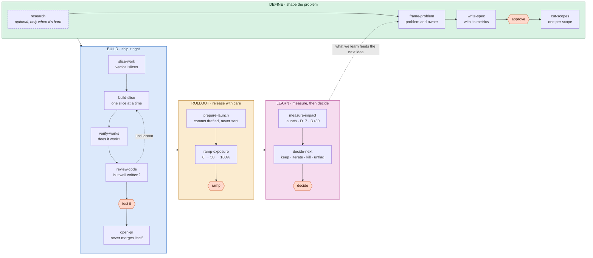

# wholeloop

**An AI development harness that carries one idea all the way through — from the first question to a measured result — on whichever agentic CLI you already use.**

> `Agent = Model + Harness`. Everybody rents the same model. The harness — what context the agent gets, which tools it can reach, in what order things happen, where it stops and who decides, and how you know afterwards that it worked — is the half that is yours. `wholeloop` is that half, made portable.

> [!NOTE]
> **Status: design phase.** This repository currently holds the design, the decisions and the plan. Nothing is installable yet. Follow progress in the [roadmap](./roadmap/README.md).

---

## Why

Follow two engineers through the life of one feature. One looks at the data first, the other opens the editor. One argues with the model's first answer, the other accepts it. Every review asks different questions, every rollout re-decides the same things from scratch, and a month after launch nobody checks whether the numbers moved. **The model is identical in every one of those moments. The process around it is not** — and a faster tool amplifies whatever process you already have, including the absence of one.

`wholeloop` makes that process explicit, executable and the same for everyone, without turning a team into a template: it fixes the *questions* (what to ask before building, what counts as evidence, where a person decides, what *done* means) and leaves the *answers* to you and your repository.

## The flow — four blocks, one line

The orange hexagons are where **a person decides**; the machine does the rest. Merging is always human too: the harness never merges, never sends a message to a user and never touches a feature flag.

**Use all of it, or just one step.** Every step is a complete entry point on its own — `research` a topic, `build-slice` a small fix, `review-code` a pull request — without running anything before it. The full flow is simply what you get when you chain them with `next`.

## Principles

1. **Agent = Model + Harness.** The model is rented; the harness is the edge.
2. **Ask, never guess.** A fact the harness lacks becomes a question, batched, never a plausible invention. Whatever a source cannot reach stays an open question.
3. **Deterministic process, adaptive content.** Steps, order, gates and bookkeeping are code with tests. What each step *writes* adapts to your problem.
4. **Your repository first.** Before acting, each step looks for the skills, agents, rules and conventions your repo already has, and follows them. The harness is the layer above, not a replacement.
5. **Bring your own tools.** Where documents live, where work is tracked, which data answers a question: every integration is a provider you choose, and adding a new one is a manifest, not a fork.
6. **People decide at fixed points.** The machine does the volume; judgement stays with a person at the same few decision points, every time, in every mode.
7. **Always legible.** Every run states its plan first, narrates as it goes, stops when told, and ends with a table of what it produced and how to undo it.
8. **Done means measured, not merged.** Most of the flow sits after the merge, because that is where you find out whether any of it mattered.
9. **Small, correctable, alive.** Skills are short, every hard rule has something that executes it, and a harness that stops changing has stopped describing its team.

The long version, with the reasoning behind each one: [docs/philosophy.md](./docs/philosophy.md).

## Works where you work

One canonical source — open standards first ([Agent Skills](https://agentskills.io), `AGENTS.md`, MCP) — and a generator that writes what each CLI expects.

| Tier | CLIs |
|---|---|
| **A** — supported from the first release | Claude Code · OpenAI Codex CLI · OpenCode · GitHub Copilot CLI |
| **B** — next | Gemini CLI · Google Antigravity CLI · Cursor CLI |

Details, capability matrix and what degrades where: [docs/platforms/README.md](./docs/platforms/README.md).

## Documentation

Everything is documented in [`docs/`](./docs/README.md) — start with [concepts](./docs/concepts.md), then the [flow](./docs/flow/README.md). Decisions and their reasons live in [`docs/decisions/`](./docs/decisions/README.md).

## Contributing

The project is built in small, session-sized tasks described in the [roadmap](./roadmap/README.md). Read [CONTRIBUTING.md](./CONTRIBUTING.md) before your first change.

## License

[MIT](./LICENSE) © Iván González Sáiz
