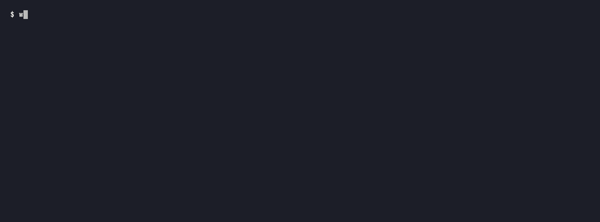
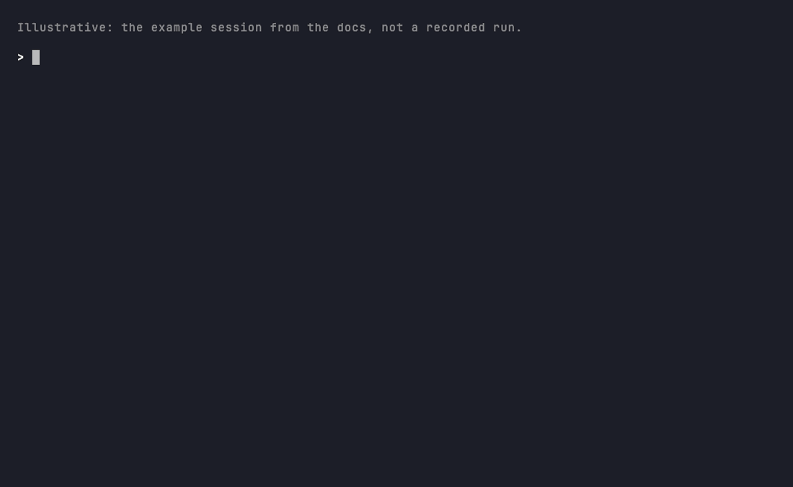

# wholeloop

[](https://www.npmjs.com/package/wholeloop) [](https://github.com/dreamingechoes/wholeloop/actions/workflows/ci.yml) [](./docs/getting-started.md#install-the-cli) [](./LICENSE) [](https://securityscorecards.dev/viewer/?uri=github.com/dreamingechoes/wholeloop)

**A portable development harness for your AI coding client: take an idea from its first question to tested code, a deliberate rollout and a measured result.**

Your coding client already has a capable model. wholeloop adds **the process around it**: which questions to ask before building, what counts as evidence, where you decide and what is remembered between conversations. It installs into the client you already use, Claude Code, Codex, Copilot, Gemini and others, and you can use one step for a small job or the whole loop for a feature.



## Contents

- [Why wholeloop](#why-wholeloop)
- [How it works](#how-it-works)
- [The loop](#the-loop)
- [Quick start](#quick-start)
- [Practical examples](#practical-examples)
- [What every step does](#what-every-step-does)
- [Principles](#principles)
- [Supported clients](#supported-clients)
- [Local first, integrations when needed](#local-first-integrations-when-needed)
- [Autonomous delivery (experimental)](#autonomous-delivery-experimental)
- [Documentation](#documentation)
- [Contributing](#contributing)

## Why wholeloop

Follow two engineers through the life of one feature. One looks at the data first; the other opens the editor. One argues with the model's first answer; the other accepts it. Every review asks different questions, and a month after launch nobody checks whether the numbers moved.

**The model is identical in every one of those moments. The process around it is not.** A faster tool amplifies whatever process you already have, including the absence of one. You do not need a team for this to happen: the same person on a calm Monday and a rushed Friday makes both choices.

With ad hoc prompting, the process lives in people's heads. The prompt that worked last week is in someone's history, the review checklist depends on who remembers it, and a long conversation forgets its own decisions.

wholeloop writes that process down and runs it the same way every time. It fixes **the questions**, such as what to ask before building, what counts as evidence and what *done* means, and leaves **the answers** to you and your repository.

## How it works

wholeloop has two parts that work together:

- **Skills in your coding client.** Short instructions your client loads, like `wl-frame-problem` or `wl-build-slice`. They use your model and your tools to ask questions, draft documents, edit code and coordinate reviewers.
- **The `wl` core.** A plain command-line program, with no model inside. It checks inputs, stores your work and decisions, and enforces the rules: order, gates and approvals. Because the rules are code with tests, they hold on the hundredth run as on the first.


Three things follow from that split:

- **Your work survives the conversation.** Decisions and results are stored outside your repository, so a new conversation, another client or a teammate can continue where the work stopped.
- **Your repository leads.** Each step looks for the skills, agents, rules and conventions your repository already has, and follows them.
- **Project code runs in Docker unless you choose otherwise.** Steps that execute it, such as verification and the builder's tests, use containers that see no host environment, credential or network. Running on your machine is an explicit choice per run or per repository, shown as not isolated, and autonomous runs never allow it.

## The loop

The full process is **thirteen steps in four blocks**: *Define* what to build, *Build* it, *Rollout* it deliberately and *Learn* whether it worked.



The orange hexagons are where **you decide**: approving the specification, testing the change yourself, choosing whether to widen a rollout and deciding what happens next. Framing also asks for your outcome and your approval of its final draft, so the specification is not the first time your judgement counts.

What the harness never does on its own:

- send a message to your users;
- change a feature flag;
- merge a pull request, unless you separately authorize an autonomous run to merge.

**Use all of it, or just one step.** Every step is a complete entry point. You can `research` a question, `build-slice` a small fix or `review-code` a pull request without running anything before it. The full loop is what you get when you chain the steps with `next`.

| Block | Steps | What you get |
| --- | --- | --- |
| Define | [research](./docs/flow/define/research.md) · [frame-problem](./docs/flow/define/frame-problem.md) · [write-spec](./docs/flow/define/write-spec.md) · [cut-scopes](./docs/flow/define/cut-scopes.md) | Evidence, an owned problem, an approved specification and its scopes |
| Build | [slice-work](./docs/flow/build/slice-work.md) · [build-slice](./docs/flow/build/build-slice.md) · [verify-works](./docs/flow/build/verify-works.md) · [review-code](./docs/flow/build/review-code.md) · [open-pr](./docs/flow/build/open-pr.md) | Verified and reviewed code, your own test, a pull request when you decide |
| Rollout | [prepare-launch](./docs/flow/rollout/prepare-launch.md) · [ramp-exposure](./docs/flow/rollout/ramp-exposure.md) | Launch drafts, measurement readiness and exposure decisions |
| Learn | [measure-impact](./docs/flow/learn/measure-impact.md) · [decide-next](./docs/flow/learn/decide-next.md) | Observed results and your decision on what comes next |

Utilities: [next, status, setup and sync](./docs/flow/utilities.md).

### Where to start

| You have | Ask for | You get |
| --- | --- | --- |
| An idea nobody has validated | `frame-problem` | An owned problem statement, explicit unknowns and your go, on-hold or drop decision |
| A question that needs evidence | `research` | A brief with linked sources, challenged claims and open questions |
| A confirmed problem | `write-spec`, then `cut-scopes` | Acceptance criteria, a measurement plan and approved pieces of work |
| A small fix | `build-slice` | The change in an isolated Git worktree, verified and reviewed |
| Code to inspect | `review-code` | Findings with evidence, against your repository's rubric |
| Something already shipped | `measure-impact`, then `decide-next` | What actually changed, and your decision |

A step used on its own still asks for what it needs: a missing fact becomes a question, never an invention.

## Quick start

### 1. Check the requirements

| You need | Why |
| --- | --- |
| **Node.js 20** or newer | Runs the `wl` core |
| **Git 2.36** or newer | Isolated worktrees for each change |
| A **coding client** that already works with a model | Runs the skills; see [supported clients](#supported-clients) |
| **Docker 28** or newer, local daemon | Only for steps that run your project's code, such as verification, unless you choose to run them on your machine |

### 2. Install the CLI

```console
$ npm install --global wholeloop
added 1 package in 597ms
$ wl --version
1.1.0
```

The package has no runtime dependencies and installs two equivalent commands, `wl` and `wholeloop`.

### 3. Install into your coding client

This example uses Claude Code. For another client, change `claude` to its [install target](#supported-clients).

First, **preview**. `--dry-run` writes nothing and tells you what would change:

```console
$ wl install --target claude --scope user --dry-run
Dry run for claude at user scope: nothing was written.
  203 files to write
Run the same command without --dry-run to apply it.
…
```

Then **install**. The *scope* decides where the skills are available:

| Scope | Run it from | Skills available in |
| --- | --- | --- |
| `user` | anywhere | every repository you open |
| `project` | inside one repository | that repository only |

```console
$ wl install --target claude --scope user
Installed claude at user scope.
Installation record:
~/.local/state/wholeloop/installations/22d5c1ca…/receipt.json
Restart the client and check that the skills appear.
…
```

The **installation record** lists exactly what was written, so updating or uninstalling later touches only those files. Install also prints a command to add wholeloop's Git guards to a repository; [getting started](./docs/getting-started.md#install-for-one-client) explains it.

Finally, **check**:

```console
$ wl doctor --target claude
Doctor: no failed checks.
Observed: 6 passing checks.
Optional checks: 1 observed, 2 unknown, 0 skipped.

Doctor cannot see whether the client loads the skills, is signed in or grants
permissions.
Add --json for the full report.
```

> [!TIP]
> `unknown` is not a failure. It marks something doctor cannot see from outside, such as a project-scope install you have not made. Only `fail` needs action.

Installation **does not** install or sign in to your client, choose a model, change the client's MCP settings or call any service.

### 4. Run your first skill

Restart your client in an application repository and ask for `wl-frame-problem` with a real idea. This is a request to the client, not a shell command:

```text
Use wl-frame-problem for this idea:
"People with long task lists may need to find tasks by title."
I am the owner. This is an unvalidated hypothesis, not a confirmed problem.
Frame it only: ask for missing facts, preserve unknowns and stop for my
outcome and final-draft approval before specification or code.
```

What happens next, in order:

1. A **preflight**: what the run will do, and what it will never do, before it drafts anything.
2. **Eight framing questions**, plus who owns the problem.
3. Gaps written as `TBD: ...; who: ...` instead of invented answers.
4. Feedback from a **challenger**, a reviewer role that questions the draft.
5. Your outcome, then the final draft for your approval.

*On hold* is a valid result: nothing needs to be invented to keep the flow moving. No application at hand? [Your first framing](./docs/tutorials/first-framing.md) has a fictional one.

### 5. Check that the work was kept

Save the initiative ID the run returns. Restart the client and ask for `wl-status` with it, or look from a terminal:

```console
$ wl status
In progress
init-3cf1140a Find tasks by title in … · frame

0 unread messages. Add --json for the full status.
```

No client or model account yet? The [local core tour](./docs/tutorials/local-core.md) shows the core on its own:


Something failed or a skill is missing? Start with [troubleshooting](./docs/troubleshooting.md).

## Practical examples

These are **requests to your coding client**, not shell commands. The wording is an example; say it your way.

**Fix a small, agreed bug.** The [small-change walkthrough](./docs/tutorials/small-change.md) shows how to inspect the worktree, read the gate results and decide when to publish.

```text
Use wl-build-slice to reject an empty task title.
Agree on acceptance criteria and the relevant existing tests first.
Follow this repository's conventions and use the allocated worktree.
Run verification and review, then stop for my local testing before any PR.
```

**Review without asking for a repair.**

```text
Use wl-review-code on this branch against its agreed base; ask if unclear.
Follow the repository's review rubric. Report findings with evidence;
do not edit the implementation or publish comments.
```

**Pick up where the work stopped.** Reading the status and moving the work forward are separate requests: after this one, ask for `wl-next` with the same ID to continue.

```text
Use wl-status for the initiative ID I saved.
Show its current state and pending decisions. Do not advance the flow yet.
```

## What every step does

Every step, in every client, follows the same exchange with the core. You always see the plan before any work, and you decide at the same points.

Here is a framing step as it might look in your client:



*Illustrative: an example session, animated. Its wording depends on your client and model. Every step page has one.*


From a terminal you can see everything the client sees. `wl --help` lists everyday commands first and `--help --all` includes repository and maintainer tools, `wl <command> --help` explains one, and a typo gets a suggestion:


| Command | What it does |
| --- | --- |
| `wl status [<id>]` | Shows your work and pending decisions. Only reads |
| `wl resume <id>` | Prints the context a new conversation needs to continue. Only reads |
| `wl next [<id>]` | Begins the next step. This one can change state |

Your work lives **outside your repositories**, in `~/.local/state/wholeloop` (or `$XDG_STATE_HOME/wholeloop`), and your settings in `~/.config/wholeloop`. [Core command reference](./docs/architecture/core-cli.md#implemented-commands) · [State and recovery](./docs/architecture/state-and-messaging.md).

## Principles

1. **Agent = model + harness.** The model is rented and changes every few months. The harness is yours, and it is what keeps your results consistent.
2. **Ask, never guess.** A fact the harness lacks becomes a question, never a plausible invention. What a source cannot answer stays an open question.
3. **Deterministic process, adaptive content.** Order, gates and bookkeeping are code with tests. What each step *writes* adapts to your problem.
4. **Your repository first.** Each step follows the skills, rules and conventions your repository already has. The harness is the layer above them, not a replacement.
5. **Bring your own tools.** Where documents live, where work is tracked and which data answers a question are providers you choose. Adding one is a manifest, not a fork.
6. **People own every decision, at the moment or in advance.** By default the flow stops for you at the same few points, every time. Autonomous delivery lets you decide in advance instead, through an explicit authorization, never a style setting.
7. **Always legible.** Every run states its plan first, reports as it goes, stops when told and ends with what it produced and how to undo it.
8. **Done means measured, not merged.** The loop continues after the merge, because that is where you find out whether the change mattered.
9. **Small, correctable, alive.** Skills are short, every hard rule has something that enforces it, and the harness keeps changing as the way you work does.

The reasoning behind each one is in the [philosophy](./docs/philosophy.md).

## Supported clients

| Client | Install target | How to ask for a skill |
| --- | --- | --- |
| Claude Code | `claude` | `/wl-frame-problem`, or `/wholeloop:frame-problem` with the plugin |
| OpenAI Codex CLI | `codex` | `$wl-frame-problem` |
| OpenCode | `opencode` | Ask for `wl-frame-problem` |
| GitHub Copilot CLI | `copilot` | Ask for `wl-frame-problem` |
| Gemini CLI | `gemini` | Ask for `wl-frame-problem` |
| Google Antigravity CLI | `antigravity` | Ask for `wl-agy-frame-problem` |
| Cursor CLI | `cursor` | Ask for `wl-frame-problem` |

[Client setup](./docs/platforms/local-onboarding.md) explains how each client loads the skills, and [platforms](./docs/platforms/README.md) records what was checked on each one and with which version.

## Local first, integrations when needed

You can start **without any Jira, Notion, analytics or feature-flag account**. The local providers keep documents and tasks on your machine:

```console
$ wl setup --profile pair --docs local-docs --tracker local-tracker --scope user
{
  "schema": "wholeloop/setup@1",
  "scope": "user",
  "applied": true,
  …
```

Add a remote provider when your workflow needs one. wholeloop never talks to a service itself:

- operations go through **your client's existing MCP connection**, using the tools it discovers;
- or through command-line clients you already installed, such as `gh` and `glab`;
- setup never signs in to a service or rewrites your client's MCP settings.

Remote integrations are **experimental**: tested against fixtures, not certified against every service. [Provider configuration](./docs/configuration/providers.md).

## Autonomous delivery (experimental)

Once a scope is approved, you can hand it to an **autonomous run** (`wl delivery`). It builds, verifies and reviews the work in isolated worktrees and containers, up to a pull request, within limits you authorize in advance: what it may do, which rubrics judge the result and how many attempts it gets.

- It is **experimental**: tested end to end with fixtures and real Git and Docker, but its commands may still change in a minor release.
- Its workers are headless sessions of your coding client, launched with a credential the controller supplies. Antigravity has no such path yet, so it cannot be a delivery worker; using it in your own session is unaffected.

Start with the [autonomous delivery overview](./docs/architecture/autonomous-delivery.md).

## Documentation

| I want to… | Start here | Then read |
| --- | --- | --- |
| Install and run my first skill | [Getting started](./docs/getting-started.md) | [Client setup](./docs/platforms/local-onboarding.md) · [First framing](./docs/tutorials/first-framing.md) |
| Try the core without a model | [Local core tour](./docs/tutorials/local-core.md) | [Core reference](./docs/architecture/core-cli.md) |
| Work through a practical change | [Small-change walkthrough](./docs/tutorials/small-change.md) | [All thirteen steps](./docs/flow/README.md) |
| Solve a setup or workflow problem | [Troubleshooting](./docs/troubleshooting.md) | [FAQ](./docs/faq.md) · [Glossary](./docs/glossary.md) |
| Understand the design | [Concepts](./docs/concepts.md) | [Philosophy](./docs/philosophy.md) · [Architecture](./docs/architecture/README.md) |
| Configure my project and tools | [Configuration](./docs/configuration/README.md) | [Profiles](./docs/configuration/profile.md) · [Providers](./docs/configuration/providers.md) · [Repository guidance](./docs/configuration/repo-skills.md) |
| Hand work to an autonomous run | [Autonomous delivery](./docs/architecture/autonomous-delivery.md) | [Delivery intake](./docs/tutorials/delivery-intake.md) · [Delivery planning](./docs/tutorials/delivery-plan.md) |
| Extend the harness | [Extensions](./docs/extending/README.md) | [Providers](./docs/extending/providers.md) · [Compatibility](./docs/extending/compatibility.md) |

The [documentation index](./docs/README.md) has the complete map.

## Contributing

Questions and ideas go to [Discussions](https://github.com/dreamingechoes/wholeloop/discussions); bugs and provider requests go to [issues](https://github.com/dreamingechoes/wholeloop/issues/new/choose).

Contributions are welcome. The [contributing guide](./CONTRIBUTING.md) covers how work is planned, committed and reviewed, and the [development guide](./docs/contributing/development.md) covers building from source, the gates, Docker and the commit hook.

## License

[MIT](./LICENSE) © Iván González Sáiz
