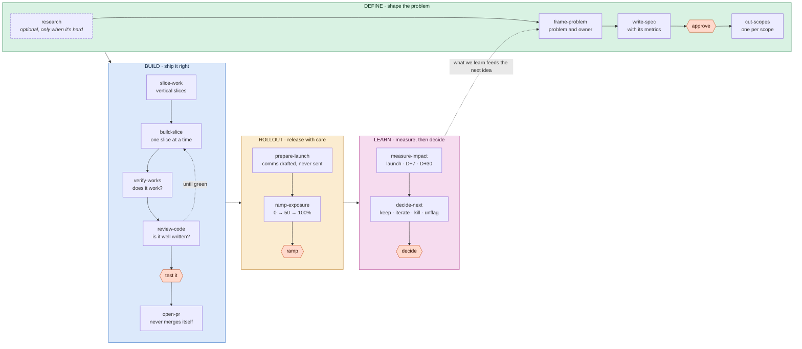

# wholeloop

**A portable development harness for your AI coding CLI: take an idea from its first question to tested code, a deliberate rollout and a measured result.**

wholeloop supplies the process around the model: what context to load, which questions and checks to run, where a person decides and what to remember between sessions. Use one step for a small job, or the complete flow with your existing coding client.

> [!NOTE]
> **Status: source-installable, before 1.0.** The local core, all thirteen steps and artifact generation for seven clients are implemented. Native compatibility still has open acceptance checks. The repository/package is currently private at version 0.0.0; public npm/marketplace installation is not available. [Current evidence and remaining acceptance](./docs/v1-acceptance.md).

## Contents

**Expanded 1.0:** [recoverable autonomous delivery and unattended research](./roadmap/specifications/autonomous-delivery/README.md), with [thirty-two completed tasks, four implemented tasks awaiting native or hosted acceptance and two tasks in progress or awaiting implementation](./roadmap/phase-6-autonomous-delivery.md). The scope is accepted and implementation is authorized; current installation and usage below retain their existing supervised behavior.

- [What you can do](#what-you-can-do)
- [Install from source](#install-from-source)
- [Run your first skill](#run-your-first-skill)
- [Practical examples](#practical-examples)
- [The client and the core](#the-client-and-the-core)
- [Why](#why)
- [The flow — four blocks, one line](#the-flow--four-blocks-one-line)
- [Principles](#principles)
- [Clients and entrypoints](#clients-and-entrypoints)
- [Local first, integrations when needed](#local-first-integrations-when-needed)
- [Documentation map](#documentation-map)
- [Development and contributing](#development-and-contributing)
- [License](#license)

The [expanded acceptance map](./docs/reference/delivery-acceptance.md) connects every delivery specification case to executable controls and keeps native, backend, hosted and release evidence separate.

## What you can do

| Start with | Use | Result |
| --- | --- | --- |
| An unvalidated hypothesis | `frame-problem` | An owned problem statement, explicit unknowns and an approved go, on-hold or dropped outcome |
| A question needing evidence | `research` | A source-linked brief, examined claims and open questions |
| A confirmed problem | `write-spec` and `cut-scopes` | Acceptance criteria, measurement plans and approved deliverables |
| A small fix or a ready slice | `build-slice` | Work in an isolated Git worktree, with verification and review evidence |
| Existing code to inspect | `review-code` | Findings against the actual change and repository rubric |
| Something already delivered | `measure-impact` and `decide-next` | Observed outcomes or explicit unknowns, followed by a human decision |

You do not have to frame an initiative before reviewing code. Standalone steps retain their own prerequisites and approvals; missing information becomes a question. [Small-change walkthrough](./docs/tutorials/small-change.md).

## Install from source

You need **Node.js 22 or newer and npm to build**, Git 2.36 or newer, and an installed coding client for model-backed use. Steps that execute your project's code (verification, integration and acceptance) also need **Docker**: a local Linux daemon, version 28 or newer, reached through a Unix socket. This is a deliberate requirement, not an optional speed-up: project code never runs on your machine, and no host environment or credential reaches it; see [Execution isolation](docs/architecture/execution-isolation.md). The checked development versions are Node 22.23.1 and 24.22.0; prefer one of those over an early minor release of a supported major. The bundled core supports Node 20 or newer; native clients have their own requirements. Access is required while this repository is private. The Git minimum preserves unambiguous worktree ownership, including paths containing newlines; see [ADR-0138](docs/decisions/0138-unambiguous-git-worktree-runtime.md).

### 1. Build

```bash
git clone https://github.com/dreamingechoes/wholeloop.git
cd wholeloop
npm ci
npm run build
node ./dist/wl.mjs --version
export WHOLELOOP_CLI="$PWD/dist/wl.mjs"
```

Already have the checkout? Start with `npm ci` inside it. Keep the absolute `WHOLELOOP_CLI` path when you change into another project. In a new terminal, export it again from this checkout. Native file installation does not create a global `wl` command.

### 2. Install for one client

This example selects Claude Code. Replace `claude` with your [target](#clients-and-entrypoints).

```bash
node "$WHOLELOOP_CLI" install --target claude --scope user --dry-run --json
node "$WHOLELOOP_CLI" install --target claude --scope user --json
node "$WHOLELOOP_CLI" doctor --target claude --json
```

The dry run shows intended files. User scope installs owned skills, roles and guard components outside your projects. Installation does not install the coding client, authenticate it, configure MCP or start a model. Doctor checks observed versions, store access and managed files; it does not prove native activation or read-only isolation.

Restart the selected client in the repository you want to work on. For project scope, other clients, updates and removal, follow [getting started](./docs/getting-started.md) and [local client setup](./docs/platforms/local-onboarding.md). If a check fails or a skill is missing, start with [troubleshooting](./docs/troubleshooting.md).

No client or model account yet? The [local core tour](./docs/tutorials/local-core.md) exercises configuration, preflight questions and recoverable state without either.

## Run your first skill

In your coding client's conversation, select/request the installed `wl-frame-problem` skill. Antigravity uses `wl-agy-frame-problem`. Supply your actual owner name and application context:

```text
Use wl-frame-problem for this idea:
"People with long task lists may need to find tasks by title."
I am the owner. This is an unvalidated hypothesis, not a confirmed problem.
Frame it only: ask for missing facts, preserve unknowns and stop for my
outcome and final-draft approval before specification or code.
```

Use a real application with a task list, or the explicitly fictional scenario in [your first framing](./docs/tutorials/first-framing.md). The harness should not infer a task application from its own implementation repository.

Expect a preflight, the eight framing questions, explicit `TBD: ...; who: ...` gaps, challenger feedback and a request for your outcome. The exact final draft needs review and your approval. On-hold is a valid completed framing; no evidence needs to be invented to keep the flow moving.

Save the returned initiative ID. Request `wl-status` with it, restart the client and ask again. [The tutorial](./docs/tutorials/first-framing.md) covers answers, final review, receipts and recovery in detail.

## Practical examples

These are **requests to the coding client**, not shell commands. They describe intended work; actual model/permission behavior remains scoped to your client's recorded acceptance.

### Fix a small, agreed bug

```text
Use wl-build-slice to reject an empty task title.
Agree on acceptance criteria and the relevant existing tests first.
Follow this repository's conventions and use the allocated worktree.
Run verification and review, then stop for my local testing before any PR.
```

[Follow the small-change walkthrough](./docs/tutorials/small-change.md) to inspect the worktree, interpret gate results and decide when to publish.

### Review without requesting a repair

```text
Use wl-review-code on this branch against its agreed base; ask if unclear.
Follow the repository's review rubric. Report findings with evidence;
do not edit the implementation or publish comments.
```

### Recover before continuing

```text
Use wl-status for the initiative ID I saved.
Show its current state and pending decisions. Do not advance the flow yet.
```

After inspecting the state, request `wl-next` with that ID to continue. Reading status and authorizing continuation are separate actions.

## The client and the core

**Your coding client runs the skills:** it uses the model and tools you configured to ask questions, draft artifacts, edit code and coordinate reviewers. **The `wl` core manages deterministic rules:** it validates input, stores work and decisions, plans gates and returns the next available contract.

Running `node dist/wl.mjs next ...` in a terminal does not start an AI conversation or independently implement a feature. Request `wl-next` in the client for orchestration. For direct inspection, keep the absolute executable path exported and set `INITIATIVE_ID` to an actual receipt ID:

```bash
node "$WHOLELOOP_CLI" --help
node "$WHOLELOOP_CLI" status --json
node "$WHOLELOOP_CLI" status "$INITIATIVE_ID" --json
node "$WHOLELOOP_CLI" resume "$INITIATIVE_ID" --json
```

Status and resume inspect local state; `next` can begin the next available contract. Journals, artifacts and ownership/backups live outside repositories, normally under `$XDG_STATE_HOME/wholeloop` or `$HOME/.local/state/wholeloop`. User settings normally live under `$XDG_CONFIG_HOME/wholeloop` or `$HOME/.config/wholeloop`. [Core command reference](./docs/architecture/core-cli.md#implemented-commands) · [State and recovery](./docs/architecture/state-and-messaging.md).

## Why

Follow two engineers through the life of one feature. One looks at the data first, the other opens the editor. One argues with the model's first answer, the other accepts it. Every review asks different questions, every rollout re-decides the same things from scratch, and a month after launch nobody checks whether the numbers moved. **The model is identical in every one of those moments. The process around it is not** — and a faster tool amplifies whatever process you already have, including the absence of one.

`wholeloop` makes that process explicit, executable and the same for everyone, without turning a team into a template: it fixes the *questions* (what to ask before building, what counts as evidence, where a person decides, what *done* means) and leaves the *answers* to you and your repository.

## The flow — four blocks, one line



The orange hexagons mark the main human decision points. Framing also requires an explicit owner outcome and approval of its final reviewed revision; the spec is not the first time your judgment matters. Merging is always human too: the harness never merges, never sends a message to a user and never touches a feature flag.

**Use all of it, or just one step.** Every step is a complete entry point on its own — `research` a topic, `build-slice` a small fix, `review-code` a pull request — without running anything before it. The full flow is simply what you get when you chain them with `next`.

### Step references

| Block | Step references | Main handoff |
| --- | --- | --- |
| Define | [research](./docs/flow/define/research.md) · [frame-problem](./docs/flow/define/frame-problem.md) · [write-spec](./docs/flow/define/write-spec.md) · [cut-scopes](./docs/flow/define/cut-scopes.md) | Evidence, owner outcome, approved spec/scopes |
| Build | [slice-work](./docs/flow/build/slice-work.md) · [build-slice](./docs/flow/build/build-slice.md) · [verify-works](./docs/flow/build/verify-works.md) · [review-code](./docs/flow/build/review-code.md) · [open-pr](./docs/flow/build/open-pr.md) | Checked work, human testing, deliberate draft publication |
| Rollout | [prepare-launch](./docs/flow/rollout/prepare-launch.md) · [ramp-exposure](./docs/flow/rollout/ramp-exposure.md) | Drafts, measurement readiness and exposure decisions |
| Learn | [measure-impact](./docs/flow/learn/measure-impact.md) · [decide-next](./docs/flow/learn/decide-next.md) | Observed results and an explicit human decision |

Utilities: [next, status, setup and sync](./docs/flow/utilities.md).

## Principles

1. **Agent = Model + Harness.** The model is rented; the harness is the edge.
2. **Ask, never guess.** A fact the harness lacks becomes a question, batched, never a plausible invention. Whatever a source cannot reach stays an open question.
3. **Deterministic process, adaptive content.** Steps, order, gates and bookkeeping are code with tests. What each step *writes* adapts to your problem.
4. **Your repository first.** Before acting, each step looks for the skills, agents, rules and conventions your repo already has, and follows them. The harness is the layer above, not a replacement.
5. **Bring your own tools.** Where documents live, where work is tracked, which data answers a question: every integration is a provider you choose, and adding a new one is a manifest, not a fork.
6. **People decide at fixed points.** The machine does the volume; judgement stays with a person at the same few decision points, every time, in every mode.
7. **Always legible.** Every run states its plan first, narrates as it goes, stops when told, and ends with a table of what it produced and how to undo it.
8. **Done means measured, not merged.** The flow continues after the merge, because that is where you find out whether any of it mattered.
9. **Small, correctable, alive.** Skills are short, every hard rule has something that executes it, and a harness that stops changing has stopped describing its team.

The long version, with the reasoning behind each one: [docs/philosophy.md](./docs/philosophy.md).

## Clients and entrypoints

All seven targets have implemented artifact/installation paths. This table identifies the target and installed framing skill; it does not claim complete live certification for every client.

| Client | Install target | Skill to select/request |
| --- | --- | --- |
| Claude Code | `claude` | `wl-frame-problem` |
| OpenAI Codex CLI | `codex` | `wl-frame-problem` |
| OpenCode | `opencode` | `wl-frame-problem` |
| GitHub Copilot CLI | `copilot` | `wl-frame-problem` |
| Gemini CLI | `gemini` | `wl-frame-problem` |
| Google Antigravity CLI | `antigravity` | `wl-agy-frame-problem` |
| Cursor CLI | `cursor` | `wl-frame-problem` |

Managed Claude loose skills use `/wl-frame-problem`; a separately installed generated Claude plugin uses `/wholeloop:frame-problem`. Codex's skill picker uses `$wl-frame-problem`. Other clients can be asked to use the exact installed name. [Client setup](./docs/platforms/local-onboarding.md) explains delivery routes; [platforms](./docs/platforms/README.md) records boundaries and evidence.

Claude framing and session recovery have been exercised by hand. Actual Codex framing and one six-lens headless review have passing observations. These results are scoped to their recorded versions/builds; other trials have recorded permission, access or availability failures. See [acceptance](./docs/v1-acceptance.md) before treating copied files or simulations as native passes.

## Local first, integrations when needed

No Jira, Notion, analytics or flag account is required for local framing. The default local document/tracker providers reference stored artifacts. To select them explicitly:

```bash
node "$WHOLELOOP_CLI" setup --profile pair --docs local-docs --tracker local-tracker --scope user --json
```

Add remote providers when your workflow needs them. Operations prefer the coding client's existing MCP connection and must match its exact discovered tools. Existing HTTP bridges are explicit experimental alternatives, with no automatic fallback. Setup does not authenticate services or rewrite client MCP settings.

Remote integrations are **experimental · fixture-tested · service-unverified**. Certification is deferred; accounts with every listed vendor are not required for 1.0. Missing observations stay unknown and unknown contracts stay pending handoffs. [Provider configuration](./docs/configuration/providers.md) · [MCP transport](./docs/extending/providers.md#client-owned-mcp-transport).

## Documentation map

| I want to… | Start here | Then read |
| --- | --- | --- |
| Install and run my first skill | [Getting started](./docs/getting-started.md) | [Client setup](./docs/platforms/local-onboarding.md) · [First framing](./docs/tutorials/first-framing.md) |
| Try the core without a model | [Local core tour](./docs/tutorials/local-core.md) | [Core reference](./docs/architecture/core-cli.md) |
| Inspect exact integrated milestone candidates | [Integration candidate guide](./docs/tutorials/delivery-integration-candidates.md) | [Delivery planning](./docs/tutorials/delivery-plan.md) |
| Assemble and test the complete milestone | [Owned assembly guide](./docs/tutorials/delivery-assembly.md) | [Behavioral acceptance](./docs/tutorials/delivery-acceptance.md) |
| Exercise original delivery controls | [Evaluation fixture guide](./docs/tutorials/delivery-evaluation-fixtures.md) | [Acceptance evidence](./docs/v1-acceptance.md) |
| Keep acceptance inputs private and observe red/green | [Private evaluator guide](./docs/tutorials/delivery-private-acceptance.md) | [Pinned acceptance](./docs/tutorials/delivery-acceptance.md) |
| Exercise actual UI and persistence | [Browser acceptance](./docs/tutorials/delivery-browsers.md) | [Pinned acceptance](./docs/tutorials/delivery-acceptance.md) |
| Execute objective API or CLI acceptance | [Behavior host guide](./docs/tutorials/delivery-behaviors.md) | [Pinned acceptance](./docs/tutorials/delivery-acceptance.md) |
| Work through a practical change | [Small-change walkthrough](./docs/tutorials/small-change.md) | [All thirteen steps](./docs/flow/README.md) |
| Pin behavioral coverage and evidence | [Acceptance tutorial](./docs/tutorials/delivery-acceptance.md) | [Docker environments](./docs/tutorials/delivery-docker.md) · [Lifecycle](./docs/tutorials/delivery-lifecycle.md) |
| Resolve a setup/session problem | [Troubleshooting](./docs/troubleshooting.md) | [FAQ](./docs/faq.md) |
| Understand the design | [Concepts](./docs/concepts.md) | [Philosophy](./docs/philosophy.md) · [Architecture](./docs/architecture/README.md) |
| Configure my team and tools | [Configuration](./docs/configuration/README.md) | [Profiles](./docs/configuration/profile.md) · [Providers](./docs/configuration/providers.md) · [Repository guidance](./docs/configuration/repo-skills.md) |
| Extend the harness | [Extensions](./docs/extending/README.md) | [Providers](./docs/extending/providers.md) · [Lenses/templates/profiles](./docs/extending/lenses-templates-profiles.md) · [Compatibility](./docs/extending/compatibility.md) |
| Assess readiness for 1.0 | [Acceptance](./docs/v1-acceptance.md) | [Roadmap](./roadmap/README.md) · [Detailed verification](./roadmap/manual-verification.md) |
| Contribute or prepare a release | [Contributing](./CONTRIBUTING.md) | [Authoring](./docs/contributing/authoring.md) · [Release preparation](./docs/contributing/releasing.md) · [Decisions](./docs/decisions/README.md) |

The [documentation index](./docs/README.md) contains the complete topic map and reading paths.

## Development and contributing

```bash
npm run check
npm run build
npm run smoke
```

The complete check includes lint, types, unit/workflow tests, offline package installation, generated references, harness rules, Markdown and Mermaid. Markdown prose uses one paragraph per source line: check with `npm run lint:md`, or apply fixes with `npm run lint:md:fix`.

Read the [working agreement](./AGENTS.md), [contribution guide](./CONTRIBUTING.md) and [roadmap journal](./roadmap/journal.md). The bootstrap currently commits directly to `main`; the future branch/PR switch will be recorded explicitly. Public visibility, npm publication and the 1.0 release remain maintainer decisions.

## License

[MIT](./LICENSE) © Iván González Sáiz
