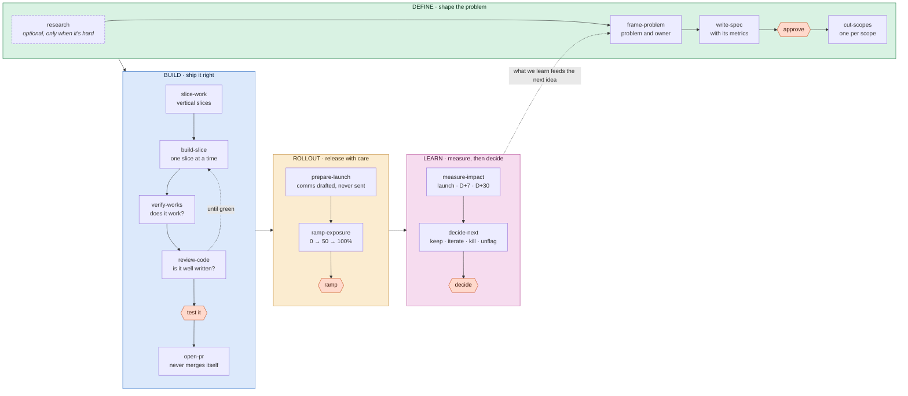

# wholeloop

**A portable development harness for your AI coding client: take an idea from its first question to tested code, a deliberate rollout and a measured result.**

wholeloop supplies the process around the model: what context to load, which questions and checks to run, where a person decides and what to remember between conversations. It installs into the coding client you already use, and you can take one step for a small job or the whole loop for a feature.

> [!NOTE]
> **Status: preparing 1.0.0.** The first release is not on npm yet. Until it is, build the CLI from source as the [development guide](./docs/contributing/development.md) describes and use `node dist/wl.mjs` wherever this page says `wl`. Native client behaviour is checked per client version; [platforms](./docs/platforms/README.md) records what each client has been checked against.

## Contents

- [Why wholeloop](#why-wholeloop)
- [The loop](#the-loop)
- [What you can do](#what-you-can-do)
- [Install](#install)
- [Run your first skill](#run-your-first-skill)
- [Practical examples](#practical-examples)
- [The client and the core](#the-client-and-the-core)
- [Principles](#principles)
- [Supported clients](#supported-clients)
- [Local first, integrations when needed](#local-first-integrations-when-needed)
- [Documentation](#documentation)
- [Contributing](#contributing)
- [License](#license)

## Why wholeloop

Follow two engineers through the life of one feature. One looks at the data first, the other opens the editor. One argues with the model's first answer, the other accepts it. Every review asks different questions, every rollout re-decides the same things from scratch, and a month after launch nobody checks whether the numbers moved. **The model is identical in every one of those moments. The process around it is not**, and a faster tool amplifies whatever process you already have, including the absence of one.

Ad hoc prompting leaves that process in each person's head. The prompt that worked last week is in someone's history, the review checklist depends on who remembers it, and a long conversation forgets its own decisions. wholeloop makes the process explicit, executable and the same for everyone, without turning a team into a template: it fixes the *questions* (what to ask before building, what counts as evidence, where a person decides, what *done* means) and leaves the *answers* to you and your repository.

What changes in practice:

- **Missing facts become questions.** A step that lacks an owner, a metric or an acceptance criterion asks for it instead of inventing a plausible one, and unknowns stay visible.
- **Rules are code, not reminders.** Order, gates, approvals and bookkeeping live in a tested core (`wl`), so they hold on the hundredth run as on the first.
- **Work survives the conversation.** Decisions, artifacts and receipts are stored outside your repository, so a new conversation, a different client or a teammate can resume exactly where the work stopped.
- **Your repository leads.** Each step looks for the skills, agents, rules and conventions your repository already has and follows them.
- **Done means measured.** The loop continues after the merge, to the rollout and to whether the change moved the numbers it promised.

## The loop

Four blocks, thirteen steps, one line.



The orange hexagons are the main human decision points. Framing also needs the owner's explicit outcome and approval of its final revision, so the specification is not the first time your judgement matters. Merging is always a person's decision: the harness never merges, never sends a message to a user and never changes a feature flag.

**Use all of it, or just one step.** Every step is a complete entry point: `research` a topic, `build-slice` a small fix or `review-code` a pull request without running anything before it. The full loop is what you get when you chain them with `next`, and an approved scope can also be handed to an autonomous run that builds, verifies and reviews it in isolated worktrees and containers up to a pull request ([autonomous delivery](./docs/architecture/autonomous-delivery.md)). That part is **experimental** in 1.0.0: its commands may still change in a minor release, and unattended runs are still being certified with native clients.

| Block | Steps | Main handoff |
| --- | --- | --- |
| Define | [research](./docs/flow/define/research.md) · [frame-problem](./docs/flow/define/frame-problem.md) · [write-spec](./docs/flow/define/write-spec.md) · [cut-scopes](./docs/flow/define/cut-scopes.md) | Evidence, owner outcome, approved spec and scopes |
| Build | [slice-work](./docs/flow/build/slice-work.md) · [build-slice](./docs/flow/build/build-slice.md) · [verify-works](./docs/flow/build/verify-works.md) · [review-code](./docs/flow/build/review-code.md) · [open-pr](./docs/flow/build/open-pr.md) | Checked work, human testing, deliberate draft publication |
| Rollout | [prepare-launch](./docs/flow/rollout/prepare-launch.md) · [ramp-exposure](./docs/flow/rollout/ramp-exposure.md) | Drafts, measurement readiness and exposure decisions |
| Learn | [measure-impact](./docs/flow/learn/measure-impact.md) · [decide-next](./docs/flow/learn/decide-next.md) | Observed results and an explicit human decision |

Utilities: [next, status, setup and sync](./docs/flow/utilities.md).

## What you can do

| Start with | Use | Result |
| --- | --- | --- |
| An unvalidated hypothesis | `frame-problem` | An owned problem statement, explicit unknowns and an approved go, on-hold or dropped outcome |
| A question needing evidence | `research` | A source-linked brief, examined claims and open questions |
| A confirmed problem | `write-spec` and `cut-scopes` | Acceptance criteria, measurement plans and approved deliverables |
| A small fix or a ready slice | `build-slice` | Work in an isolated Git worktree, with verification and review evidence |
| Existing code to inspect | `review-code` | Findings against the actual change and the repository's rubric |
| Something already delivered | `measure-impact` and `decide-next` | Observed outcomes or explicit unknowns, followed by a human decision |

You do not have to frame an initiative before reviewing code. Standalone steps keep their own prerequisites and approvals; missing information becomes a question. [Small-change walkthrough](./docs/tutorials/small-change.md).

## Install

You need **Node.js 20 or newer**, **Git 2.36 or newer** and a coding client you can already use with a model. Steps that execute your project's code (verification, integration and acceptance) also need **Docker**: a local daemon, version 28 or newer, reached through a Unix socket. That is deliberate: project code never runs on your machine, and no host environment or credential reaches it ([execution isolation](./docs/architecture/execution-isolation.md)).

```bash
npm install --global wholeloop
wl --version
```

The package installs two equivalent commands, `wl` and `wholeloop`, and has no runtime dependencies.

### Install into your coding client

This example selects Claude Code; replace `claude` with your [client's target](#supported-clients).

```bash
wl install --target claude --scope user --dry-run --json
wl install --target claude --scope user --json
wl doctor --target claude --json
```

The dry run lists the files it would write. User scope installs the skills, roles and guards outside your projects; project scope, run from an application repository, installs them for that repository only. Installation does not install or sign in to the client, choose a model, change MCP settings or call any service. `doctor` checks versions, store access and the managed files; it does not prove that the client has activated them.

Restart the client in the repository you want to work on. For project scope, updates and removal, follow [getting started](./docs/getting-started.md) and [local client setup](./docs/platforms/local-onboarding.md); if a check fails or a skill is missing, start with [troubleshooting](./docs/troubleshooting.md). No client or model account yet? The [local core tour](./docs/tutorials/local-core.md) exercises configuration, questions and recoverable state without either.

## Run your first skill

In your coding client's conversation, ask for the installed `wl-frame-problem` skill (Antigravity names it `wl-agy-frame-problem`) and give it a real idea from an application you work on:

```text
Use wl-frame-problem for this idea:
"People with long task lists may need to find tasks by title."
I am the owner. This is an unvalidated hypothesis, not a confirmed problem.
Frame it only: ask for missing facts, preserve unknowns and stop for my
outcome and final-draft approval before specification or code.
```

Expect a preflight, eight framing questions, explicit `TBD: ...; who: ...` gaps, challenger feedback and a request for your outcome; then the final draft for your review and approval. On hold is a valid result: no evidence needs to be invented to keep the flow moving. Without an application at hand, use the fictional scenario in [your first framing](./docs/tutorials/first-framing.md).

Save the returned initiative ID. Ask for `wl-status` with it, restart the client and ask again: the work is still there.

## Practical examples

These are **requests to the coding client**, not shell commands.

### Fix a small, agreed bug

```text
Use wl-build-slice to reject an empty task title.
Agree on acceptance criteria and the relevant existing tests first.
Follow this repository's conventions and use the allocated worktree.
Run verification and review, then stop for my local testing before any PR.
```

The [small-change walkthrough](./docs/tutorials/small-change.md) shows how to inspect the worktree, read gate results and decide when to publish.

### Review without requesting a repair

```text
Use wl-review-code on this branch against its agreed base; ask if unclear.
Follow the repository's review rubric. Report findings with evidence;
do not edit the implementation or publish comments.
```

### Pick up where the work stopped

```text
Use wl-status for the initiative ID I saved.
Show its current state and pending decisions. Do not advance the flow yet.
```

Then ask for `wl-next` with that ID to continue. Reading status and authorizing the next step are separate actions.

## The client and the core

**Your coding client runs the skills:** it uses the model and tools you configured to ask questions, draft artifacts, edit code and coordinate reviewers. **The `wl` core enforces the deterministic rules:** it validates input, stores work and decisions, plans gates and returns the next available contract. Running `wl next` in a terminal does not start an AI conversation; ask for `wl-next` in the client for that.

From a terminal you can inspect everything the client sees:

```bash
wl --help
wl status --json
wl status "$INITIATIVE_ID" --json
wl resume "$INITIATIVE_ID" --json
```

`status` and `resume` only read; `next` can begin the next contract. Work and decisions live outside your repositories, normally under `$XDG_STATE_HOME/wholeloop` or `$HOME/.local/state/wholeloop`, and settings under `$XDG_CONFIG_HOME/wholeloop` or `$HOME/.config/wholeloop`. [Core command reference](./docs/architecture/core-cli.md#implemented-commands) · [State and recovery](./docs/architecture/state-and-messaging.md).

## Principles

1. **Agent = Model + Harness.** The model is rented; the harness is the edge.
2. **Ask, never guess.** A fact the harness lacks becomes a question, batched, never a plausible invention. Whatever a source cannot reach stays an open question.
3. **Deterministic process, adaptive content.** Steps, order, gates and bookkeeping are code with tests. What each step *writes* adapts to your problem.
4. **Your repository first.** Before acting, each step looks for the skills, agents, rules and conventions your repository already has, and follows them. The harness is the layer above, not a replacement.
5. **Bring your own tools.** Where documents live, where work is tracked, which data answers a question: every integration is a provider you choose, and adding one is a manifest, not a fork.
6. **People decide at fixed points.** The machine does the volume; judgement stays with a person at the same few decision points, every time, in every mode.
7. **Always legible.** Every run states its plan first, narrates as it goes, stops when told, and ends with a table of what it produced and how to undo it.
8. **Done means measured, not merged.** The flow continues after the merge, because that is where you find out whether any of it mattered.
9. **Small, correctable, alive.** Skills are short, every hard rule has something that executes it, and a harness that stops changing has stopped describing its team.

The reasoning behind each one: [philosophy](./docs/philosophy.md).

## Supported clients

| Client | Install target | Skill to ask for |
| --- | --- | --- |
| Claude Code | `claude` | `wl-frame-problem` |
| OpenAI Codex CLI | `codex` | `wl-frame-problem` |
| OpenCode | `opencode` | `wl-frame-problem` |
| GitHub Copilot CLI | `copilot` | `wl-frame-problem` |
| Gemini CLI | `gemini` | `wl-frame-problem` |
| Google Antigravity CLI | `antigravity` | `wl-agy-frame-problem` |
| Cursor CLI | `cursor` | `wl-frame-problem` |

Claude Code loose skills answer to `/wl-frame-problem`, and the generated Claude plugin to `/wholeloop:frame-problem`; Codex's skill picker uses `$wl-frame-problem`. Other clients can be asked for the exact installed name. [Client setup](./docs/platforms/local-onboarding.md) explains each delivery route, and [platforms](./docs/platforms/README.md) records what has been checked on each client.

## Local first, integrations when needed

No Jira, Notion, analytics or feature-flag account is needed to start: local document and tracker providers store everything on your machine.

```bash
wl setup --profile pair --docs local-docs --tracker local-tracker --scope user --json
```

Add remote providers when your workflow needs them. wholeloop never talks to a service itself: operations run through your coding client's existing MCP connection, using the exact tools it discovers, or through command-line clients you installed such as `gh` and `glab`. Setup does not authenticate services or rewrite client MCP settings. Remote integrations are **experimental**: tested against fixtures, not certified against every service. [Provider configuration](./docs/configuration/providers.md).

## Documentation

| I want to… | Start here | Then read |
| --- | --- | --- |
| Install and run my first skill | [Getting started](./docs/getting-started.md) | [Client setup](./docs/platforms/local-onboarding.md) · [First framing](./docs/tutorials/first-framing.md) |
| Try the core without a model | [Local core tour](./docs/tutorials/local-core.md) | [Core reference](./docs/architecture/core-cli.md) |
| Work through a practical change | [Small-change walkthrough](./docs/tutorials/small-change.md) | [All thirteen steps](./docs/flow/README.md) |
| Solve a setup or workflow problem | [Troubleshooting](./docs/troubleshooting.md) | [FAQ](./docs/faq.md) · [Glossary](./docs/glossary.md) |
| Understand the design | [Concepts](./docs/concepts.md) | [Philosophy](./docs/philosophy.md) · [Architecture](./docs/architecture/README.md) |
| Configure my team and tools | [Configuration](./docs/configuration/README.md) | [Profiles](./docs/configuration/profile.md) · [Providers](./docs/configuration/providers.md) · [Repository guidance](./docs/configuration/repo-skills.md) |
| Hand work to an autonomous run | [Autonomous delivery](./docs/architecture/autonomous-delivery.md) | [Delivery intake](./docs/tutorials/delivery-intake.md) · [Delivery planning](./docs/tutorials/delivery-plan.md) |
| Extend the harness | [Extensions](./docs/extending/README.md) | [Providers](./docs/extending/providers.md) · [Compatibility](./docs/extending/compatibility.md) |

The [documentation index](./docs/README.md) has the complete map.

## Contributing

Contributions are welcome. The [contributing guide](./CONTRIBUTING.md) covers how work is planned, committed and reviewed, and the [development guide](./docs/contributing/development.md) covers building from source, the gates, Docker and the commit hook.

## License

[MIT](./LICENSE) © Iván González Sáiz
