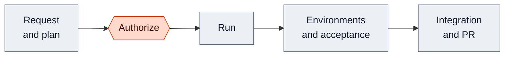

# wholeloop documentation

> **TL;DR** — Start with a tutorial, then use the step and configuration references when you need them. You can try the core without a model, frame one idea in your coding client or work through a small change. Autonomous delivery, extending wholeloop and contributing each have their own section below.

Remote integrations and autonomous delivery are experimental. [What 1.0 covers](./v1-acceptance.md).

## Contents

- [Start with your goal](#start-with-your-goal)
- [First steps](#first-steps)
- [Understand the ideas](#understand-the-ideas)
- [All thirteen steps](#all-thirteen-steps)
- [Configuration and integrations](#configuration-and-integrations)
- [Autonomous delivery (experimental)](#autonomous-delivery-experimental)
- [Architecture and extensions](#architecture-and-extensions)
- [Contributing, acceptance and release](#contributing-acceptance-and-release)
- [Reading paths](#reading-paths)
- [Getting help](#getting-help)

## Start with your goal

| Goal | First page | You are done when |
| --- | --- | --- |
| Install it in my coding client | [Getting started](./getting-started.md) | Doctor passes and the client shows the skills |
| Try it without a model account | [Local core tour](./tutorials/local-core.md) | You have an item, its questions and its context recovered in a new terminal |
| Know what to answer during framing | [First framing](./tutorials/first-framing.md) | Your final draft is approved, or your no-go is recorded, and a new session finds it |
| Build one small change | [Small-change walkthrough](./tutorials/small-change.md) | The change is verified and reviewed, and waiting for you to test it |
| Fix a setup or workflow problem | [Troubleshooting](./troubleshooting.md) | You know which part failed and what to do next |
| Hand an approved scope to an autonomous run | [Autonomous delivery](#autonomous-delivery-experimental) | You know which guides apply; the feature is experimental |
| See what 1.0 covers | [V1 acceptance](./v1-acceptance.md) | You can tell what was tested from what is still open |

## First steps

| Page | What it answers |
| --- | --- |
| [Getting started](./getting-started.md) | Requirements, installing from npm and into a client, the first skill, updates and removal |
| [Local core tour](./tutorials/local-core.md) | What the `wl` core does on its own, without a model |
| [First framing](./tutorials/first-framing.md) | Your first conversation: context, answers, your decision, final review and recovery |
| [Small change](./tutorials/small-change.md) | Criteria, worktrees, gates and your own test before publishing |
| [Local client setup](./platforms/local-onboarding.md) | Where each of the seven clients keeps the skills, how to call them and what to check |
| [Troubleshooting](./troubleshooting.md) | Executable paths, discovery, permissions, stored work and exit codes |
| [FAQ](./faq.md) | Short answers to the first questions people ask |

## Understand the ideas

| Page | What it answers |
| --- | --- |
| [Philosophy](./philosophy.md) | Why the process around the model matters, and the principles behind wholeloop |
| [Concepts](./concepts.md) | Initiatives, scopes and slices, the step contract, decision points, slots, providers and gates |
| [Glossary](./glossary.md) | Every term in one line, and how it maps to your team's vocabulary |

## All thirteen steps

Every step can be used on its own. The [flow overview](./flow/README.md) explains the order and the decision points; each step page covers its inputs, outputs and limits. Conversations on those pages are examples of requests to your coding client.

| Block | Step | Result |
| --- | --- | --- |
| Define | [research](./flow/define/research.md) | Evidence with sources, and open questions |
| Define | [frame-problem](./flow/define/frame-problem.md) | An owned problem and an explicit go or no-go |
| Define | [write-spec](./flow/define/write-spec.md) | Stories, acceptance criteria and a measurement plan |
| Define | [cut-scopes](./flow/define/cut-scopes.md) | Approved deliverables, each owning its metrics |
| Build | [slice-work](./flow/build/slice-work.md) | Vertical slices, and contract-first parts across repositories |
| Build | [build-slice](./flow/build/build-slice.md) | The change, built in its own worktree |
| Build | [verify-works](./flow/build/verify-works.md) | Evidence that the agreed behaviour works |
| Build | [review-code](./flow/build/review-code.md) | Findings against the change and your repository's rubric |
| Build | [open-pr](./flow/build/open-pr.md) | A draft pull request, after you tested it |
| Rollout | [prepare-launch](./flow/rollout/prepare-launch.md) | Launch drafts and dashboard hand-offs; nothing sent |
| Rollout | [ramp-exposure](./flow/rollout/ramp-exposure.md) | Evidence-based decisions for each stage; flag changes stay yours |
| Learn | [measure-impact](./flow/learn/measure-impact.md) | Measurements at each checkpoint, with unknowns kept visible |
| Learn | [decide-next](./flow/learn/decide-next.md) | Your keep, iterate, kill or unflag decision |

[Utilities](./flow/utilities.md) covers `next`, `status`, `setup` and `sync`.

## Configuration and integrations

| Page | Use it for |
| --- | --- |
| [Configuration](./configuration/README.md) | User, project and run settings, and which one wins |
| [Interaction profile](./configuration/profile.md) | How much it explains, how hard it pushes back, how much runs at once, which language |
| [Providers](./configuration/providers.md) | Choosing tools for documents, tracking and data, and the full catalogue |
| [Repository guidance](./configuration/repo-skills.md) | How steps find and follow your repository's own skills and conventions |
| [Client-owned MCP transport](./extending/providers.md#client-owned-mcp-transport) | How a provider uses your client's existing MCP connection |

Start locally. Remote providers are optional until your work needs them, and you never need an account with every vendor. wholeloop reaches a service only through your client's MCP connection or a command-line client you installed, never by itself.

## Autonomous delivery (experimental)

An approved scope can be handed to an **autonomous run** that builds, verifies and reviews it in isolated worktrees and containers, up to a pull request, within limits you authorize in advance. It is **experimental**: its commands and schemas may change in a minor release. Start with the [overview](./architecture/autonomous-delivery.md); the guides below follow the life of a run.

### 1. Request and plan

| Page | What it answers |
| --- | --- |
| [Delivery intake](./tutorials/delivery-intake.md) | Capturing the request once, from a file, a sentence, an item or a remote document |
| [Delivery planning](./tutorials/delivery-plan.md) | Criteria, repositories, limits and plan revisions, before anything runs |
| [Maintenance proposals](./tutorials/maintenance-proposals.md) | Turning an inspection finding into a request you can review |

### 2. Authorize and run

| Page | What it answers |
| --- | --- |
| [Delivery authorization](./tutorials/delivery-authorization.md) | Granting a run what it may do, until when, and revoking it |
| [Delegated machine decisions](./tutorials/delivery-decisions.md) | Letting a machine apply your decision under a pinned rubric, with an independent challenge |
| [Delivery runner controls](./tutorials/delivery-runner.md) | Preparing, running, pausing, resuming and stopping a run |
| [Delivery queue](./tutorials/delivery-queue.md) | How work waits for its dependencies |
| [Delivery workers](./tutorials/delivery-workers.md) | What each worker receives, and why its answer is only a claim |
| [Native delivery hosts](./tutorials/delivery-native.md) | Which coding clients can be workers, and what they need |

### 3. Environments and acceptance

| Page | What it answers |
| --- | --- |
| [Environment planning](./tutorials/delivery-environments.md) | Choosing exactly how the application starts, without running anything |
| [Docker application environments](./tutorials/delivery-docker.md) | Starting the application in Docker and checking it is ready |
| [Environment stop and retirement](./tutorials/delivery-lifecycle.md) | Stopping and removing exactly what a run started, and recovering an interruption |
| [Behavioral acceptance and evidence](./tutorials/delivery-acceptance.md) | Pinning acceptance cases before code is written, and keeping the evidence |
| [Execute API and CLI acceptance](./tutorials/delivery-behaviors.md) | Checking real API responses and command output |
| [Execute isolated browser acceptance](./tutorials/delivery-browsers.md) | Running a UI journey in an isolated browser, with backend checks beyond screenshots |
| [Private acceptance and regression sensitivity](./tutorials/delivery-private-acceptance.md) | Hidden cases the builder never sees, run before and after the change |

### 4. Integration and publication

| Page | What it answers |
| --- | --- |
| [Integrated milestone candidates](./tutorials/delivery-integration-candidates.md) | Recording exactly which commits make up a milestone |
| [Owned assembly and combined verification](./tutorials/delivery-assembly.md) | Combining the parts, testing the whole product, publishing a PR and following CI |

### 5. Limits, recovery and evaluation

| Page | What it answers |
| --- | --- |
| [Delivery budgets](./tutorials/delivery-budgets.md) | Time, attempts and evidence limits that never refill |
| [Delivery checkpoints](./tutorials/delivery-checkpoints.md) | Detecting changed inputs and resuming the same run safely |
| [Delivery recovery](./tutorials/delivery-recovery.md) | Reading a run's history from another process and rebuilding caches |
| [Original delivery evaluation fixtures](./tutorials/delivery-evaluation-fixtures.md) | The reference applications used to evaluate delivery |
| [Acceptance case map](./reference/delivery-acceptance.md) | Each delivery acceptance case, with its tests and the limits of its evidence |

## Architecture and extensions

| Page | Use it for |
| --- | --- |
| [Platforms](./platforms/README.md) | What each client supports, its boundaries and the conformance evidence |
| [Architecture](./architecture/README.md) | The core, the canonical sources, adapters and the lifecycle |
| [Core CLI](./architecture/core-cli.md) | Every command, its output schema and exit codes |
| [State and messaging](./architecture/state-and-messaging.md) | The journal, projections, mailbox and recovery |
| [Orchestration and gates](./architecture/orchestration-and-gates.md) | How agents run, lenses, independent refutation and budgets |
| [Execution isolation](./architecture/execution-isolation.md) | Why project code runs only in Docker |
| [Determinism and testing](./architecture/determinism-and-testing.md) | Unit and workflow tests, simulations, evaluations and live evidence |
| [Extension overview](./extending/README.md) | Choosing an extension point |
| [Writing a provider](./extending/providers.md) | Manifests and the transport contract |
| [Lenses, templates and profiles](./extending/lenses-templates-profiles.md) | Custom guidance, review coverage and interaction presets |
| [Compatibility](./extending/compatibility.md) | Versioned contracts, experimental surfaces and deprecation |
| [Architecture decisions](./decisions/README.md) | Every decision, the alternatives and why they lost |

## Contributing, acceptance and release

| Page | Audience |
| --- | --- |
| [Contributing](../CONTRIBUTING.md) | Anyone changing this repository |
| [Working agreement](../AGENTS.md) | People and coding agents implementing wholeloop |
| [Development](./contributing/development.md) | Building from source, the gates, Docker and the commit hook |
| [Authoring](./contributing/authoring.md) | Skills, agents, protocols and enforcers |
| [Documentation style](./contributing/docs-style.md) | How pages are written, real examples, diagrams and recordings |
| [Roadmap](../roadmap/README.md) and [journal](../roadmap/journal.md) | What is done, what is next and the evidence |
| [V1 acceptance](./v1-acceptance.md) | What was verified on which client, and what is still open |
| [Detailed verification](../roadmap/manual-verification.md) | Scoped checks, environments and their limits |
| [Nightly conformance](./contributing/conformance.md) | Maintainers running client checks on a schedule |
| [Release preparation](./contributing/releasing.md) | Maintainers reviewing bundles and publishing |

## Reading paths

- **First use:** getting started → client setup → first framing → recovering the status.
- **No account yet:** local core tour → concepts → command reference. Add a client when you want model-backed work.
- **Everyday development:** small change → the step you need → configuration or troubleshooting as needed.
- **Team adoption:** concepts → repository guidance → profiles → providers → checking permissions in your real client.
- **Autonomous delivery:** concepts → delivery overview → intake → planning → authorization → runner controls.
- **Contributing:** contribution guide → working agreement → roadmap and journal → architecture → authoring and checks.

## Getting help

Ask questions and share ideas in [Discussions](https://github.com/dreamingechoes/wholeloop/discussions). Report a bug or request a provider through [issues](https://github.com/dreamingechoes/wholeloop/issues/new/choose), and a security problem privately, as [SECURITY.md](../SECURITY.md) describes.

<!-- docnav -->
[🧭 Concepts](concepts.md)  ·  [Getting started ▶](getting-started.md)
