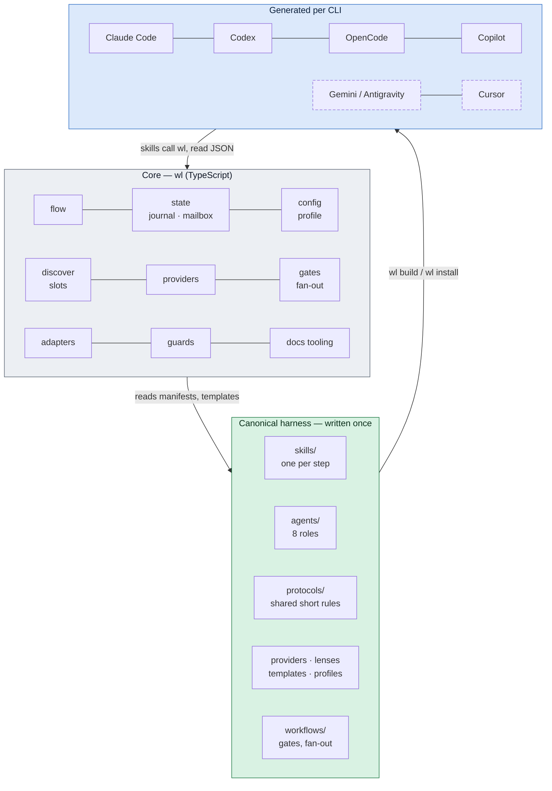
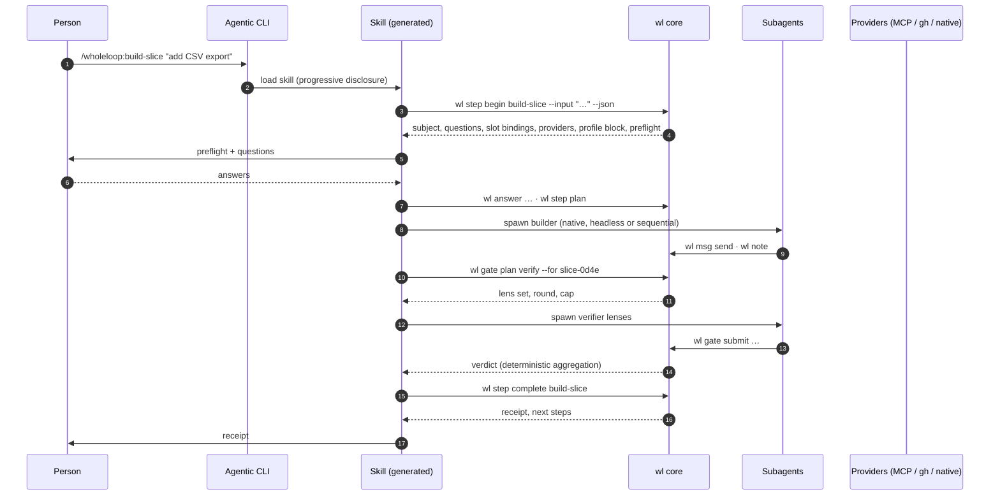

# Architecture — one core, thin skills, generated adapters

> **TL;DR** — `wholeloop` is three layers. A **canonical harness** of short skills, agents and manifests written once in open formats. A **deterministic core** (`wl`, TypeScript) that owns state, flow, configuration, discovery, providers and gates. And **generated adapters** that translate the canonical harness into whatever each agentic CLI expects. Every CLI can run a shell command and read JSON, so the core is portable by construction.

> [!NOTE]
> **Status: 🚧 partial.** The core now includes configuration, extension catalogs, external state, messaging, repository discovery, provider resolution, local framing, structured research, validated specs/scopes/slices, isolated worktrees, bounded gates, builder/verification hosts, incremental review, launch kits, evidence-bound exposure stages and source-linked impact checkpoints and explicit learning decisions and merge-backed synchronization; self-contained local generation for all four tier-A targets plus Gemini/Antigravity is implemented, while hook registration and actual client conformance and authenticated provider execution remain pending. Decisions behind this page: [ADR-0002](../decisions/0002-open-standards-canonical-source.md), [ADR-0003](../decisions/0003-deterministic-core-cli.md), [ADR-0006](../decisions/0006-orchestration-tiers.md).

---

## The three layers



| Layer | Responsibility | Never does |
| --- | --- | --- |
| **Canonical harness** | Says *what* each step and role is for, in as few lines as possible | Hold rules nothing executes; hold state |
| **Core (`wl`)** | Everything with one right answer: order, preconditions, questions, bindings, shape checks, gate arithmetic, persistence | Call a model; make a product judgement |
| **Adapters** | Translate formats, paths, tool names and hook payloads per CLI | Add behaviour that other CLIs would not get |

## Repository layout (target)

```text
wholeloop/
├─ src/                      core — the `wl` CLI
│  ├─ cli/                   command definitions (generate the command reference)
│  ├─ flow/                  step registry, step contract, decision points
│  ├─ state/                 journal, projections, mailbox, ids, locking
│  ├─ config/                schema, layered loading, profile rendering
│  ├─ discover/              repo scan, slot resolution
│  ├─ providers/             registry, manifest schema, detection, MCP recipes
│  ├─ gates/                 lenses, rounds, refutation threshold, aggregation
│  ├─ fanout/                native · headless · sequential engines
│  ├─ adapters/              one module per CLI
│  ├─ guards/                normalised hook entry point (`wl guard`)
│  └─ docs/                  docnav, link and diagram checks
├─ harness/                  canonical, CLI-neutral content
│  ├─ skills/<step>/SKILL.md
│  ├─ agents/<role>.md
│  ├─ protocols/*.md
│  ├─ workflows/*.ts
│  ├─ providers/<id>/provider.yml
│  ├─ lenses/*.yml · templates/*.md · profiles/*.yml
├─ test/                     unit · snapshot · workflow · conformance · evals
├─ docs/                     this documentation
└─ roadmap/                  phases and session-sized tasks
```

## How a step actually runs



The skill never computes a verdict, a precedence or a next step. It asks the core.

## Where to go next

| Page | Covers |
| --- | --- |
| [Core CLI](./core-cli.md) | The `wl` command surface and the step contract JSON |
| [State and messaging](./state-and-messaging.md) | Journal, projections, mailbox, resume, sync adapters |
| [Orchestration and gates](./orchestration-and-gates.md) | Engines, agents, lenses, verdicts, caps |
| [Determinism and testing](./determinism-and-testing.md) | What is tested how, and why evals are the last layer |

---

<!-- docnav -->
[◀ Platforms](../platforms/README.md)  ·  [📖 Docs index](../README.md)  ·  [🧭 Concepts](../concepts.md)  ·  [Core CLI ▶](core-cli.md)
