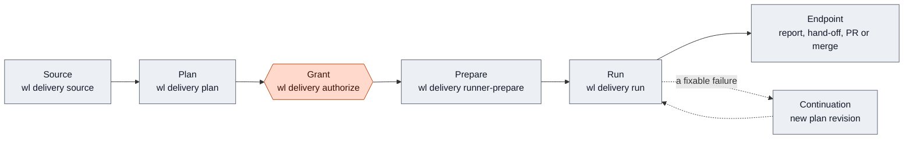
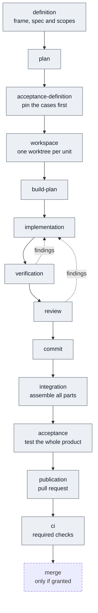

# Autonomous delivery — hand an approved piece of work to a run

> **TL;DR** — **Autonomous delivery** (`wl delivery`) takes a request, a plan and your authorization, and runs the existing wholeloop steps without asking you again: it defines acceptance, builds, verifies, reviews, tests the integrated product and, if you allowed it, opens a pull request, follows CI and merges. Every action is limited by a **grant** you record in advance, every limit is finite, and every machine decision follows a rubric you pinned.

> [!IMPORTANT]
> **Experimental.** Autonomous delivery's commands and schemas may change in a minor release ([compatibility](../extending/compatibility.md#experimental-surfaces)). Every stage on this page is implemented and tested with fixtures and real Git and Docker, and live trials passed with Codex; certification across signed-in clients continues.

## Contents

- [When to use it](#when-to-use-it)
- [The life of a run](#the-life-of-a-run)
- [What a run does, stage by stage](#what-a-run-does-stage-by-stage)
- [Endpoint and intervention](#endpoint-and-intervention)
- [Who decides what](#who-decides-what)
- [What keeps a run safe](#what-keeps-a-run-safe)
- [When something fails](#when-something-fails)
- [What you need](#what-you-need)
- [Guides](#guides)
- [Design references](#design-references)

## When to use it

**Use it when** the work is agreed and you would rather decide once than at every step: a well-specified change, a research question you want answered in a brief, or a maintenance finding you have already reviewed.

**Stay with the supervised flow when** the problem or the solution is still open, or when you want to test each change yourself before it moves on. The [supervised steps](../flow/README.md) keep their own approvals; autonomous delivery never fills them in.

## The life of a run

1. **Source.** The request is captured once and never changes: a local file, a sentence, an existing item or a complete observation of a remote document. Intake starts nothing and authorizes nothing.
2. **Plan.** What to deliver: acceptance criteria, the repositories and their bases, the endpoint, the intervention level and finite budgets. A plan can also start as an **envelope**, the outer bounds within which the run plans the details itself. Every change makes a new numbered revision.
3. **Grant.** Your authorization for that exact plan or envelope: which **effects** are allowed (such as writing code, committing, pushing), which decisions the machine may take, which repositories it may touch and until when. You can revoke it at any time.
4. **Prepare and run.** `runner-prepare` fixes the route and its owner without starting anything; `wl delivery run` executes it in a controller you keep in the foreground. You can pause, resume and stop it.
5. **Endpoint.** The run ends where the plan said: a research report, a local hand-off, a pull request, or a merge.

## What a run does, stage by stage

An implementation run goes through these stages. Each stage is a separate, recorded step with its own evidence; a stage that fails stops the run or loops back within its budget.

| Stage | What happens |
| --- | --- |
| **definition** | When the plan is not ready, the run frames the problem, writes the specification and cuts scopes, and adopts a new plan revision |
| **plan** | The plan, or the plan made inside an envelope, is accepted |
| **acceptance-definition** | The acceptance cases are pinned **before** any code is written, so the builder cannot shape the test to its code |
| **workspace** | Each unit of work gets its own Git worktree on a branch the run owns |
| **build-plan** | The builder writes its plan from the repository's pinned guidance |
| **implementation** | The builder writes the code in its worktree |
| **verification** | The repository's own suite runs once per round in Docker, and verifiers check each criterion |
| **review** | Reviewers inspect the change through fixed lenses; findings go back to the builder |
| **commit** | The verified and reviewed state is committed and pinned |
| **integration** | All committed parts are assembled in a separate worktree and checked together, including their contracts |
| **acceptance** | The pinned cases run against the whole product in Docker: API, CLI and browser journeys, plus private cases the builder never saw |
| **publication** | A pull request is opened, or updated, for the exact accepted state |
| **ci** | The run follows the required checks on that exact commit |
| **merge** | Only with a separate merge grant, after every required check and review passed on the tested commit |

**Research runs** are shorter: plan → research → hand-off of a stored brief. **Learning observations** read one measurement checkpoint and hand off a recommendation that changes nothing.

## Endpoint and intervention

Two independent settings in the plan decide how far a run goes and how much it asks you:

| Endpoint | The run stops after |
| --- | --- |
| `research-report` | Storing a research brief |
| `learning-observation` | Settling one measurement checkpoint and recommending, without changing anything |
| `local-handoff` | Accepted work, left in local worktrees for you |
| `to-pr` | A pull request for the accepted work, followed through CI |
| `to-merge` | A merge, under a separate merge grant |

| Intervention | Means |
| --- | --- |
| `supervised` | The run waits for a person at each decision |
| `on-exception` | The run decides what it was delegated and comes back to you when something falls outside that |
| `none` | The run never waits for a person. A decision it cannot take ends the run with a stated limitation instead of a prompt |

They are independent on purpose: a research-only grant does not allow code changes, and a run allowed to open a pull request is not allowed to merge it.

## Who decides what

With intervention `none`, each decision the supervised flow would ask you becomes a **delegated decision**:

| Stage | Decision |
| --- | --- |
| definition | Framing outcome (go), specification and scopes approved |
| build-plan | Build plan approved |
| acceptance | Acceptance of the whole product |
| research plan and sources | Research plan and its sources accepted |
| observation | Learning outcome recommended |

For each one, the grant pins a **rubric**: the written criteria the decision must apply. A machine judge applies it to the exact evidence, an independent challenger tries to refute the judgement, and both are recorded. Three things are never delegated: widening the machine's own authority, changing what counts as accepted, and supplying a fact only a person knows. [Delegated machine decisions](../tutorials/delivery-decisions.md) shows the whole mechanism.

## What keeps a run safe

- **Nothing outside the grant.** Every effect is checked against the grant before it happens; anything not listed is refused. Branches the run may push are limited to the ones it owns, under the topic prefix in the grant.
- **Finite budgets that never refill.** Deadlines, attempts, repairs, pushes and evidence bytes are counted across restarts and plan revisions. Usage that cannot be measured stays unknown; a hard limit that cannot be metered is refused.
- **Project code runs only in Docker**, in environments the run starts from an explicit recipe and owns. No host environment variable or credential reaches it ([execution isolation](./execution-isolation.md)).
- **Workers get only what their role needs.** Each worker is a fresh headless session of a coding client, with the role's tools, the pinned repository guidance and the exact context for its stage. Its client's own skill and instruction loading is switched off.
- **A worker's answer is a claim.** The controller observes the real result, such as the files, the commit or the test output, before anything counts.
- **Acceptance is defined before the code.** Cases are pinned first, private cases are hidden from the builder, and a regression check counts only when it was seen failing on the base and passing on the change.
- **Every write is recorded first.** Each external effect is journalled before it runs and observed afterwards. An effect with an unknown result is never repeated blindly.
- **Merge needs its own grant**, the exact tested commit, every required check and review passing, and a code host that enforces branch protection.

## When something fails

A run does not give up at the first failure, and it does not loop forever:

- **Verification and review findings** go back to the builder within the round budget.
- **A failed integration or acceptance case**, or **a failed required CI check**, can become a **continuation**: a new plan revision that records the failure, corrects the owning unit and carries the run on. A run with intervention `none` can continue under its own envelope grant, within its repair and push budgets, without a person.
- **Anything else** ends with a report: what happened, what was kept, which effects ran and the exact next permitted actions (`wl delivery report`).

Stopped or interrupted runs keep their worktrees, environments and evidence. [Checkpoints](../tutorials/delivery-checkpoints.md) and [recovery](../tutorials/delivery-recovery.md) explain how a run resumes without repeating an effect.

## What you need

| You need | For |
| --- | --- |
| The `wl` CLI and Git | Every stage |
| A local Docker daemon, version 28 or newer | Verification, integration and acceptance |
| A coding client that can run headless, with a worker credential in your OS secret store | Model-backed stages. Antigravity cannot be a worker yet |
| A Git remote, with `gh` or `glab` signed in | Publication, CI and merge |

Store a worker credential with `wl delivery credential-store`, which reads it from standard input and never writes it to a file, and check it with `wl delivery credential-check`. [Native delivery hosts](../tutorials/delivery-native.md) lists which clients can be workers.

## Guides

The [documentation index](../README.md#autonomous-delivery-experimental) groups the guides in the order of a run. Good starting points:

- [Delivery intake](../tutorials/delivery-intake.md) and [planning](../tutorials/delivery-plan.md): from a request to a plan, with nothing running.
- [Authorization](../tutorials/delivery-authorization.md): recording and revoking a grant.
- [Runner controls](../tutorials/delivery-runner.md): preparing, running and controlling a run.
- [Owned assembly and combined verification](../tutorials/delivery-assembly.md): integration, acceptance, publication and CI.

## Design references

For contributors and anyone checking why a boundary is where it is:

| Topic | Decision |
| --- | --- |
| Why autonomous delivery was planned this way | [ADR-0092](../decisions/0092-expanded-v1-autonomous-delivery-planning.md) |
| Immutable source intake | [ADR-0093](../decisions/0093-immutable-delivery-source-intake.md) |
| Plan revisions and envelopes | [ADR-0094](../decisions/0094-revision-bound-delivery-plans-and-envelopes.md) |
| Grants and worker claims | [ADR-0095](../decisions/0095-operator-grants-and-scoped-worker-claims.md) |
| Repository guidance in workers | [ADR-0207](../decisions/0207-public-implementation-route-composition.md#repository-guidance-in-workers-p6-40) |
| Continuing under the envelope grant | [ADR-0198](../decisions/0198-envelope-grant-continuation.md) |
| CI correction under the envelope grant | [ADR-0248](../decisions/0248-ci-correction-continuation-under-the-envelope-grant.md) |

The full proposal is in ten chapters, from the [specification index](../../roadmap/specifications/autonomous-delivery/README.md):

| Concern | Chapter |
| --- | --- |
| Inputs, source revisions and operator authority | [Contract and authorization](../../roadmap/specifications/autonomous-delivery/01-contract-and-authorization.md) |
| Durable scheduling, worker claims and recovery | [Runner](../../roadmap/specifications/autonomous-delivery/02-durable-runner.md) |
| Application, services and data isolation | [Environments](../../roadmap/specifications/autonomous-delivery/03-execution-environments.md) |
| Executable criteria and independent evidence | [Behavioral QA](../../roadmap/specifications/autonomous-delivery/04-behavioral-qa.md) |
| Combined work and requirement changes | [Integration](../../roadmap/specifications/autonomous-delivery/05-integration-and-change-impact.md) |
| PR publication, CI repair and conditional merge | [Publication](../../roadmap/specifications/autonomous-delivery/06-publication-ci-and-merge.md) |
| Limits, timeline and diagnosis | [Controls](../../roadmap/specifications/autonomous-delivery/07-controls-and-observability.md) |
| Scheduled observation and follow-up proposals | [Learning](../../roadmap/specifications/autonomous-delivery/08-learning-and-maintenance.md) |
| Full-flow evaluation and acceptance | [Validation](../../roadmap/specifications/autonomous-delivery/09-validation-and-acceptance.md) |
| Complete no-intervention research and implementation | [Delegated decisions](../../roadmap/specifications/autonomous-delivery/10-unattended-decisions-and-research.md) |

<!-- docnav -->
[◀ Repo skills](../configuration/repo-skills.md)  ·  [📖 Docs index](../README.md)  ·  [🧭 Concepts](../concepts.md)  ·  [Delivery request intake ▶](../tutorials/delivery-intake.md)
