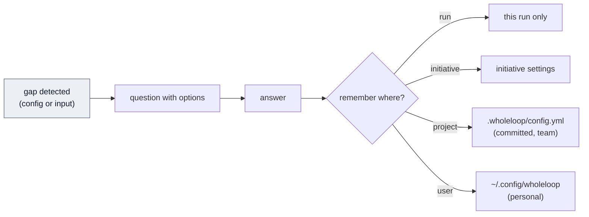

# The core CLI — `wl`

> **TL;DR** — `wl` is the single place where `wholeloop` makes decisions that have one right answer. Skills call it through the shell, pass `--json`, and get structured answers back. Humans can use it too: every command has a readable default output.

> [!NOTE]
> **Status: 🚧 partial.** The command router, versioned JSON outputs, documented exit codes and generated implemented-command reference are available. Later flow behavior below remains planned.

---

## Design rules

1. **Every command has `--json`**, with a versioned schema. Skills only ever consume JSON.
2. **Deterministic.** Same inputs, same store, same config → same output. No model calls, no network unless the command is explicitly about a provider.
3. **Single writer.** Only `wl` writes the store. Writes are validated, atomic (write-then-rename) and serialised with a lock.
4. **Exit codes mean something.** `0` ok · `2` needs input (questions in the payload) · `3` precondition failed · `4` shape check failed · `1` unexpected error.
5. **Small surface.** A new command needs a reason a skill cannot express with the existing ones.

## Implemented commands

Every command accepts `--json`. Output contracts live in `src/cli/schemas/`. Errors use `wholeloop/error@1`; exit codes are 0 (success), 1 (unexpected), 2 (needs input), 3 (precondition), and 4 (invalid shape).

<!-- commands:start -->
| Command | Output schema | Purpose |
| --- | --- | --- |
| `wl docs nav` | `wholeloop/docs-nav@1` | Rewrite docnav footers from docs/nav.yml |
| `wl docs check` | `wholeloop/docs-check@1` | Check documentation navigation, status, links and anchors |
| `wl harness check` | `wholeloop/harness-check@1` | Check size budgets, front matter and enforcement |
| `wl guard commit-msg <file>` | `wholeloop/commit-check@1` | Validate a commit message without changing it |
<!-- commands:end -->

Regenerate with `npm run docs:commands`; CI checks drift.

## Planned command surface

| Group | Commands | Used by |
| --- | --- | --- |
| **Steps** | `wl step begin <step>` · `wl step plan` · `wl step complete <step>` · `wl step skip <step> --reason` | every skill |
| **Questions** | `wl answer <qid>=<value> --remember run\|initiative\|project\|user` | every skill |
| **State** | `wl state show\|list\|get <id>` · `wl open <id>` · `wl note <id> "…"` · `wl link <id> <url>` · `wl state rebuild` | skills, people |
| **Messaging** | `wl msg send --thread <id> --to <role> --kind <kind>` · `wl msg read --for <role>` · `wl handoff <id> --to <role>` | agents |
| **Sessions** | `wl resume [<id>]` · `wl status` | `next`, `status`, people |
| **Repo** | `wl discover` · `wl resolve <slot>` | step begin, `setup` |
| **Providers** | `wl provider list\|show\|test\|scaffold` · `wl mcp add <provider> --target <cli>` | `setup`, authors |
| **Profile** | `wl profile show\|set <dial>=<value>\|preset <name>` | `setup`, people |
| **Gates** | `wl gate plan <gate> --for <id>` · `wl gate submit` · `wl gate verdict` | gate workflows |
| **Fan-out** | `wl fanout run <workflow> --engine native\|headless\|sequential` | gates, `research` |
| **Guards** | `wl guard <event>` (reads a hook payload on stdin) | generated hooks, git hooks |
| **Worktrees** | `wl worktree create\|open\|stop\|list\|prune <slice>` — isolated workspace and branch per slice, with port allocation | builder, `open-pr`, `sync` |
| **Environment** | `wl env declare <what> --undo "<command>"` · `wl env report` | builder, `open-pr` |
| **Install** | `wl install --target <cli,…> --scope user\|project` · `wl uninstall` · `wl doctor` | people |
| **Docs (dev)** | `wl docs nav` · `wl docs check [--json]` — ✅ implemented | CI, contributors |
| **Harness (dev)** | `wl harness check [--json]` — budgets, front matter, enforcement map — ✅ implemented | CI, contributors |

## The step contract

`wl step begin` is the heart of the design. It turns *"which step, with what input"* into everything the skill needs to act, and nothing it should decide on its own.

```json
{
  "schema": "wholeloop/step-begin@1",
  "step": "write-spec",
  "mode": "flow",
  "subject": { "kind": "initiative", "id": "init-41c2" },
  "have": { "frame": "init-41c2/frame.md", "brief": "brief-7f3a" },
  "missing": ["docs.destination"],
  "questions": [
    {
      "id": "docs.destination",
      "prompt": "Where should the spec live?",
      "multi": false,
      "options": [
        { "value": "local", "label": "Local Markdown", "note": "default" },
        { "value": "notion", "label": "Notion", "note": "MCP detected" },
        { "value": "confluence", "label": "Confluence", "note": "not connected — wl mcp add confluence" }
      ],
      "remember": ["run", "initiative", "project", "user"]
    }
  ],
  "bindings": {
    "spec.template": { "source": "repo", "ref": ".agents/skills/product-spec" }
  },
  "profile": "Be brief. Product-level vocabulary. Challenge assumptions firmly but kindly. …",
  "template": "harness/templates/spec.md",
  "decision": { "id": "approve-spec", "after": "complete" },
  "preflight": ["Plan — …", "Where — …", "Never — …", "Stop — …"]
}
```

- **`have` / `missing`** — the step uses whatever already exists and asks only for the gap. This is what makes standalone use work.
- **`questions`** are generated from configuration gaps and step inputs, never improvised by the model. The skill renders them with the CLI's structured question tool when there is one, otherwise as plain text and waits.
- **`bindings`** say whose rules to follow ([repo-first slots](../configuration/repo-skills.md)).
- **`profile`** is a pre-rendered style block, ≤ 10 lines ([profile](../configuration/profile.md)).
- **`preflight`** lines are generated, so a stated cap or destination is always the one actually enforced.

`wl step complete` validates the produced artifact against the step's **shape rules** (for example: every metric in a spec names a source and a window), records it in the journal, publishes through providers if configured, and returns the receipt plus the suggested next steps.

## Questions and remembering



A remembered answer is never asked again at that scope. A step that re-asks a settled question is a bug.

## Hooks and guards

All generated hooks, for every CLI, call one entry point: `wl guard <event>`. It normalises the payload (`tool_name` vs `toolName`, PascalCase vs camelCase events) and applies the same policies everywhere. Where a CLI has no usable hooks, **git hooks** installed by `wl install` carry the critical ones (no commit to the default branch, no push from a gated step). Details: [ADR-0006](../decisions/0006-orchestration-tiers.md).

---

<!-- docnav -->
[◀ Architecture](README.md)  ·  [📖 Docs index](../README.md)  ·  [🧭 Concepts](../concepts.md)  ·  [State and messaging ▶](state-and-messaging.md)
