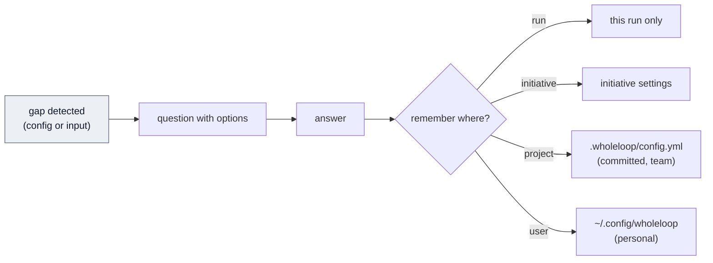

# The core CLI — `wl`

> **TL;DR** — `wl` is the single place where `wholeloop` makes decisions that have one right answer. Skills call it through the shell, pass `--json`, and get structured answers back. Humans can use it too: every command has a readable default output.

> [!NOTE]
> **Status: 🚧 partial.** The router, layered configuration, profile, external state, mailbox, step engine, repository discovery, extension catalogs and local next/status/setup utilities are implemented. The registry contains all thirteen steps; local framing, structured research briefs and validated specs, scope plans and vertical slice plans can complete; build-slice completes through current host-supplied verify/review evidence. The worktree manager provisions isolated environments and conservative cleanup; journaled gates enforce coverage, budgets, refutations and snapshot-bound verdicts. Once-per-round suites, incremental review with loaded/pinned rubrics and tested draft publication with gh/glab hosts and a declarative external-effect/undo ledger are implemented. Launch preparation pins measurement revisions and produces local kits with explicit draft/create handoffs; real adapter isolation remains pending. Canonical URL adoption and recoverable shared Define publication are available through explicit host contracts and CLI handoffs. A bounded headless gate process host provides local seven-client recipes, with AGY conditional on read-only initialization before assignment; self-contained artifact generation for all four tier-A targets plus Gemini/Antigravity/Cursor is implemented. All three have owned overlays, native formats, MCP snippets/detection and the shared framing scenario. Gemini extensions bind hook roots through native environment values; loose overlays retain an explicit Git fallback. Common guard policies, generated native bindings and explicit owned Git fallback management are implemented; observed doctor diagnostics cover versions, provider declarations, actual external-store probes and explicit generated-artifact drift. Disposable standalone framing conformance separates installed-core simulations from explicit live process evidence. Generated command/config/provider/adapter tables share the built-core renderer with docs check and explicit reference regeneration. Managed native user/project installation and uninstall with retained external ownership/backups are implemented; actual client activation/hook conformance and authenticated provider execution remain pending.

---

## Design rules

1. **Every command has `--json`**, with a versioned schema. Skills only ever consume JSON.
2. **Deterministic.** Same inputs, same store, same config → same output. No model calls, no network unless the command is explicitly about a provider.
3. **Single writer.** Only `wl` writes the store. Writes are validated, atomic (write-then-rename) and serialised with a lock.
4. **Exit codes mean something.** `0` ok · `2` needs input (questions in the payload) · `3` precondition failed · `4` shape check failed · `1` unexpected error.
5. **Small surface.** A new command needs a reason a skill cannot express with the existing ones.

## Implemented commands

Every command accepts `--json`. Machine-readable output contracts live in `src/cli/schemas/`. Errors use `wholeloop/error@1`; exit codes are 0 (success), 1 (unexpected), 2 (needs input), 3 (precondition), and 4 (invalid shape). Unknown options fail rather than silently changing behavior.

The normal test suite compares source and compiled-help commands with the general
output schema, rejecting missing/duplicate/unversioned branches. It also inventories
all source schema locations, including event maps, for unique version-one
identities. Gate/suite event-map wrappers retain the prior payload rules and
journal format; no event migration follows. Registration does not establish the
complete v1 compatibility freeze or native execution. See
[ADR-0065](../decisions/0065-public-output-schema-registration.md).

The v1 candidate now adds per-declaration compatibility fingerprints, retained
command/exit contracts and explicit delivery-manifest validation. This freezes
declarations for review without publishing 1.0 or proving runtime semantics. New
identities and optional command flags remain additive; read the
[compatibility and deprecation policy](../extending/compatibility.md).

<!-- commands:start -->
| Command | Output schema | Purpose |
| --- | --- | --- |
| `wl conformance acquisition <downloads.json>` | `wholeloop/conformance-acquisition@1` | Validate exact native vendor downloads without installing or running clients |
| `wl release verify <directory>` | `wholeloop/release-verified@1` | Verify prepared release bytes and source context without publishing |
| `wl release preflight` | `wholeloop/release-preflight@1` | Check exact local release source and supplied CI metadata without publishing |
| `wl release notes` | `wholeloop/release-notes@1` | Draft bounded Conventional Commit release notes from explicit local history |
| `wl release artifacts` | `wholeloop/distribution-build@1` | Export owned seven-client delivery previews and a local Claude marketplace |
| `wl conformance issues <results.json>` | `wholeloop/conformance-issues@1` | Draft structural regression issues from explicit fresh comparable observations |
| `wl conformance collect <plan.json>` | `wholeloop/conformance-results@1` | Collect fresh pinned/latest observations with explicit execution mode and native paths |
| `wl conformance prepare` | `wholeloop/conformance-prepared@1` | Prepare a disposable native framing fixture without launching a client |
| `wl conformance run <id>` | `wholeloop/conformance-report@1` | Run one explicitly simulated or live pinned-client framing scenario |
| `wl conformance report <id>` | `wholeloop/conformance-report@1` | Rejudge process and journal evidence with named missing events |
| `wl conformance matrix <results.json>` | `wholeloop/conformance-matrix@1` | Render bounded observations and identify comparable regression candidates |
| `wl eval grounding <corpus.json>` | `wholeloop/grounding-eval@1` | Score traceable numeric assertions and deliberately absent sandbox metrics |
| `wl sync` | `wholeloop/sync@1` | Reconcile exact PR merges, delivery readiness and conservative cleanup |
| `wl learn begin [<description>]` | `wholeloop/learning-begin@1` | Pin outcome evidence and the leaning to challenge |
| `wl learn challenge` | `wholeloop/learning-report@1` | Record a counterargument against the exact current leaning |
| `wl learn decide <keep\|iterate\|kill\|unflag>` | `wholeloop/learning-decision@1` | Record a human outcome and close only fully decided scopes |
| `wl learn complete` | `wholeloop/learning-complete@1` | Recover canonical decision completion and conditional closure |
| `wl learn report` | `wholeloop/learning-report@1` | Show evidence, the counterargument and proposed follow-up |
| `wl learn schema` | `wholeloop/learning-schema@1` | Print counterargument, reported-evidence and iteration contracts |
| `wl measure begin [<description>]` | `wholeloop/impact-begin@1` | Pin a due checkpoint and its exact measurement plan |
| `wl measure requests` | `wholeloop/impact-read-requests@1` | Plan exact source reads without querying services |
| `wl measure observe` | `wholeloop/impact-report@1` | Record normalized observations and preserve missing datapoints as unknown |
| `wl measure format` | `wholeloop/impact-report@1` | Apply a repository-guided layout without rewriting measured values |
| `wl measure complete` | `wholeloop/impact-complete@1` | Store the canonical checkpoint report with traceable values |
| `wl measure report` | `wholeloop/impact-report@1` | Show query-linked measurements, verdicts and qualitative signals |
| `wl measure schedule` | `wholeloop/impact-schedule@1` | List checkpoint due dates, missing offsets and measured status |
| `wl measure digest` | `wholeloop/impact-digest@1` | Prepare an unsent impact digest and per-scope comment bodies |
| `wl measure schema` | `wholeloop/impact-schema@1` | Print measurement, qualitative query and report layout contracts |
| `wl ramp begin [<description>]` | `wholeloop/ramp-begin@1` | Pin a confirmed audience plan and evidence checks before ramping |
| `wl ramp requests` | `wholeloop/ramp-read-requests@1` | Plan exact read-only evidence calls without querying services |
| `wl ramp observe` | `wholeloop/ramp-report@1` | Import exact normalized read results and retain missing evidence as unknown |
| `wl ramp decide <go\|hold\|rollback>` | `wholeloop/ramp-report@1` | Record one stage decision against the evidence shown to the person |
| `wl ramp proposal` | `wholeloop/ramp-proposal@1` | Produce an unapplied flag or manual exposure change proposal |
| `wl ramp confirm` | `wholeloop/ramp-report@1` | Confirm an externally performed change before advancing one stage |
| `wl ramp report` | `wholeloop/ramp-report@1` | Resume the current stage, evidence and explicit decision |
| `wl ramp schema` | `wholeloop/ramp-schema@1` | Print the versioned ramp plan input contract |
| `wl launch begin [<description>]` | `wholeloop/launch-begin@1` | Pin launch measurements and repository voice before drafting |
| `wl launch complete` | `wholeloop/launch-complete@1` | Store a validated launch kit with metric-linked dashboard specs |
| `wl launch report` | `wholeloop/launch-report@1` | Show local artifacts and explicit provider draft/create handoffs |
| `wl launch schema` | `wholeloop/launch-schema@1` | Print measurement and launch draft input contracts |
| `wl env declare` | `wholeloop/env-declare@1` | Record a non-secret external write and its explicit undo recipe |
| `wl env report` | `wholeloop/env-report@1` | Report external effects and undo recipes without executing them |
| `wl pr prepare [<branch>]` | `wholeloop/pr-prepare@1` | Prepare a repository-shaped draft without pushing or opening it |
| `wl pr tested` | `wholeloop/pr-tested@1` | Record human testing and approval of the exact publication plan |
| `wl pr open` | `wholeloop/pr-open@1` | Push the tested pinned commit and open its draft PR once |
| `wl pr reconcile` | `wholeloop/pr-open@1` | Read a pending remote PR instead of repeating an ambiguous write |
| `wl review begin [<branch\|pr>]` | `wholeloop/review-begin@1` | Begin an isolated review with pinned rubric and incremental input |
| `wl review input` | `wholeloop/review-context@1` | Load the exact round patch and repository rubric for reviewers |
| `wl review comment-plan` | `wholeloop/review-comment-plan@1` | Draft a codehost comment without publishing it |
| `wl review complete` | `wholeloop/review-complete@1` | Complete a review from its input and current gate PASS |
| `wl verify begin [<branch\|pr>]` | `wholeloop/verify-begin@1` | Begin verification from agreed criteria or ask before mutation |
| `wl verify suite` | `wholeloop/verify-suite@1` | Execute declared checks once in the pinned verify round |
| `wl verify complete` | `wholeloop/verify-complete@1` | Complete verification from its suite receipt and current gate PASS |
| `wl build route [<input>]` | `wholeloop/build-route@1` | Route a scope slice issue URL or sentence to ready build work |
| `wl build agree <input>` | `wholeloop/build-agree@1` | Create an ad-hoc slice from explicitly agreed testable criteria |
| `wl build preflight <id>` | `wholeloop/build-preflight@1` | Resolve and load repository build guidance before code |
| `wl build prepare <id>` | `wholeloop/build-prepare@1` | Begin the build and provision its isolated workspace |
| `wl build plan <id>` | `wholeloop/build-plan@1` | Record the builder plan before changing the prepared code |
| `wl build complete <id>` | `wholeloop/build-complete@1` | Record a receipt only after current verify and review passes |
| `wl build schema` | `wholeloop/build-schema@1` | Print the versioned builder plan schema |
| `wl gate plan <verify\|review>` | `wholeloop/gate-plan@1` | Pin coverage and start or resume a bounded read-only gate round |
| `wl gate submit` | `wholeloop/gate-submit@1` | Journal a planned unit result or independent finding refutation |
| `wl gate verdict` | `wholeloop/gate-verdict@1` | Seal a round with deterministic fail-safe aggregation |
| `wl gate schema` | `wholeloop/gate-schema@1` | Print public gate plan result and refutation schemas |
| `wl worktree create <id>` | `wholeloop/worktree-create@1` | Allocate an isolated worktree from a recorded named base |
| `wl worktree open <id>` | `wholeloop/worktree-open@1` | Show environment path ports and commands without starting them |
| `wl worktree stop <id>` | `wholeloop/worktree-stop@1` | Stop the workspace lease while retaining files and branches |
| `wl worktree list` | `wholeloop/worktree-list@1` | List recorded workspace allocations and lifecycle status |
| `wl worktree prune [<id>]` | `wholeloop/worktree-prune@1` | Remove only stopped clean merged or explicitly abandoned work |
| `wl slices plan` | `wholeloop/slices-plan@1` | Suggest vertical work and expose inherited acceptance criteria |
| `wl slices check <file>` | `wholeloop/slices-check@1` | Validate slice outcomes tests repositories and dependencies |
| `wl slices schema` | `wholeloop/slices-schema@1` | Print the versioned slice plan schema |
| `wl eval gates <corpus>` | `wholeloop/gate-eval@1` | Measure each review lens before and after active refutations |
| `wl eval definitions <corpus>` | `wholeloop/definition-eval@1` | Measure labelled definition defects and false alarms |
| `wl challenge plan <problem\|spec\|criteria\|scopes\|slicing>` | `wholeloop/challenge-plan@1` | Lint a definition and render fixed challenger coverage |
| `wl challenge schema` | `wholeloop/challenge-schema@1` | Print the standalone criteria metadata schema |
| `wl scopes plan` | `wholeloop/scopes-plan@1` | Suggest one scope and expose the metric ownership contract |
| `wl scopes schema` | `wholeloop/scopes-schema@1` | Print the versioned scope plan schema |
| `wl spec check <file>` | `wholeloop/spec-check@1` | Check stories criteria metrics and rollout structure |
| `wl spec schema` | `wholeloop/spec-schema@1` | Print the versioned spec metadata schema |
| `wl research plan` | `wholeloop/research-plan@1` | Plan source angles and independent examination jobs |
| `wl research submit` | `wholeloop/research-submit@1` | Record a validated source result in the journal |
| `wl research examine` | `wholeloop/research-examine@1` | Record one independent claim examination |
| `wl research complete` | `wholeloop/research-complete@1` | Aggregate evidence into a replayable research brief |
| `wl adapter root` | `wholeloop/adapter-root@1` | Resolve a packaged core root from its matching ownership manifest |
| `wl build` | `wholeloop/adapter-build@1` | Render a self-contained client artifact tree without installing it |
| `wl fanout run <verify\|review>` | `wholeloop/fanout@1` | Collect bounded isolated headless gate workers without changing coverage |
| `wl adopt <URL>` | `wholeloop/adopt@1` | Adopt a revision-bound shared source without inventing approvals |
| `wl share mode` | `wholeloop/share-report@1` | Select explicit shared destinations and queue completed Define artifacts |
| `wl share report` | `wholeloop/share-report@1` | Inspect shared publication receipts and ambiguity |
| `wl share requests` | `wholeloop/share-report@1` | Inspect queued Define publication chunks without authorizing writes |
| `wl share request` | `wholeloop/share-request@1` | Journal one publication intent before the conductor writes |
| `wl share reconcile` | `wholeloop/share-report@1` | Verify an exact published chunk from a labelled complete read |
| `wl next [<idea\|id\|URL>]` | `wholeloop/next@1` | Continue stored work or begin evidence-based framing |
| `wl status [<id>]` | `wholeloop/status@1` | Inspect work and pending decisions without mutation |
| `wl setup` | `wholeloop/setup@1` | Ask for or explicitly save scoped profile and provider choices |
| `wl template list` | `wholeloop/template-list@1` | List validated manifests and their origins |
| `wl template test <id>` | `wholeloop/template-test@1` | Validate a manifest and its required resources |
| `wl template scaffold <id>` | `wholeloop/template-scaffold@1` | Print or explicitly create a manifest kit |
| `wl profile list` | `wholeloop/profile-list@1` | List validated manifests and their origins |
| `wl profile test <id>` | `wholeloop/profile-test@1` | Validate a manifest and its required resources |
| `wl profile scaffold <id>` | `wholeloop/profile-scaffold@1` | Print or explicitly create a manifest kit |
| `wl lens list` | `wholeloop/lens-list@1` | List validated manifests and their origins |
| `wl lens test <id>` | `wholeloop/lens-test@1` | Validate a manifest and its required resources |
| `wl lens scaffold <id>` | `wholeloop/lens-scaffold@1` | Print or explicitly create a manifest kit |
| `wl provider list` | `wholeloop/provider-list@1` | List providers with their origins and detection evidence |
| `wl provider show <id>` | `wholeloop/provider-show@1` | Show one validated provider manifest |
| `wl provider test <id>` | `wholeloop/provider-test@1` | Validate declared access or execute explicit offline binding fixtures |
| `wl provider resolve <operation>` | `wholeloop/provider-resolve@1` | Resolve an operation to an explicit or built-in provider |
| `wl provider scaffold <id>` | `wholeloop/provider-scaffold@1` | Print or explicitly create a provider manifest |
| `wl mcp add <id>` | `wholeloop/mcp-add@1` | Print a credential-free MCP configuration snippet |
| `wl discover` | `wholeloop/discover@1` | Discover repository guidance and declared commands without executing them |
| `wl resolve <slot>` | `wholeloop/resolve@1` | Explain slot precedence or ask about ambiguous matches |
| `wl profile show` | `wholeloop/profile-show@1` | Show the active profile and rendered instructions |
| `wl profile set <dial=value>` | `wholeloop/profile-set@1` | Set a profile dial at user, project or run scope |
| `wl profile preset <name>` | `wholeloop/profile-preset@1` | Select a built-in interaction preset |
| `wl step begin <step>` | `wholeloop/step-begin@1` | Compute inputs and begin an available step |
| `wl step plan` | `wholeloop/step-plan@1` | Plan the next step and required decisions |
| `wl step complete <step>` | `wholeloop/step-complete@1` | Validate and record a step artifact |
| `wl step skip <step>` | `wholeloop/step-skip@1` | Skip a step with a durable reason |
| `wl answer <qid=value>` | `wholeloop/answer@1` | Remember an answer or record an explicit human decision |
| `wl msg send` | `wholeloop/msg-send@1` | Send a durable message in an item thread |
| `wl msg read` | `wholeloop/msg-read@1` | Read unread messages with a persistent per-reader cursor |
| `wl handoff <id>` | `wholeloop/handoff@1` | Hand an item to another role with durable context |
| `wl resume [<id>]` | `wholeloop/resume@1` | Print a context pack bounded to 6144 UTF-8 bytes |
| `wl state create <kind>` | `wholeloop/state-create@1` | Create a typed item in the external store |
| `wl state update <id>` | `wholeloop/state-update@1` | Update a stored item through the journal |
| `wl state show [<id>]` | `wholeloop/state-show@1` | Show an item or the whole store |
| `wl state list` | `wholeloop/state-list@1` | List stored item summaries |
| `wl state get <id>` | `wholeloop/state-get@1` | Get a complete stored item |
| `wl state rebuild` | `wholeloop/state-rebuild@1` | Rebuild projections from the journal |
| `wl note <id> <text>` | `wholeloop/note@1` | Append a durable note |
| `wl link <id> <url>` | `wholeloop/link@1` | Record an external reference |
| `wl open <id>` | `wholeloop/open@1` | Print the item as Markdown |
| `wl config show` | `wholeloop/config-show@1` | Resolve layered configuration and optionally explain every value |
| `wl config schema` | `wholeloop/config-schema@1` | Print the configuration JSON Schema |
| `wl docs nav` | `wholeloop/docs-nav@1` | Rewrite docnav footers from docs/nav.yml |
| `wl docs reference` | `wholeloop/docs-reference@1` | Check generated reference sections or explicitly regenerate their tables |
| `wl docs check` | `wholeloop/docs-check@1` | Check navigation, status, links, anchors and generated references |
| `wl harness check` | `wholeloop/harness-check@1` | Check size budgets, front matter and enforcement |
| `wl install` | `wholeloop/install@1` | Install owned native components without rewriting shared client settings |
| `wl uninstall` | `wholeloop/uninstall@1` | Remove unchanged owned native components and retain external backups |
| `wl doctor` | `wholeloop/doctor@1` | Observe versions, external-store writes, provider declarations and optional artifact drift |
| `wl guard hooks <install\|uninstall\|status>` | `wholeloop/git-guards@1` | Explicitly manage owned external Git hooks and preserve originals |
| `wl guard before-tool` | `wholeloop/guard@1` | Check transient native before-tool input without granting permissions |
| `wl guard git-commit` | `wholeloop/guard@1` | Check staged runtime paths and the assigned Build topic workspace |
| `wl guard git-push` | `wholeloop/guard@1` | Check an exact tested open-pr push from transient JSON stdin |
| `wl guard state-write` | `wholeloop/guard@1` | Reject runtime state destinations inside any Git repository |
| `wl guard commit-msg <file>` | `wholeloop/commit-check@1` | Validate a commit message without changing it |
<!-- commands:end -->

Regenerate with `npm run docs:commands`; CI checks for drift.

## Planned command surface

| Group | Commands | Used by |
| --- | --- | --- |
| **Steps** | `wl step begin <step>` · `wl step plan` · `wl step complete <step>` · `wl step skip <step> --reason` | every skill |
| **Questions** | `wl answer <qid>=<value> --remember run\|initiative\|project\|user` | every skill |
| **State** | `wl state show\|list\|get <id>` · `wl open <id>` · `wl note <id> "…"` · `wl link <id> <url>` · `wl state rebuild` | skills, people |
| **Messaging** | `wl msg send --thread <id> --to <role> --kind <kind>` · `wl msg read --for <role>` · `wl handoff <id> --to <role>` | agents |
| **Sessions** | `wl resume [<id>]` · `wl status` | `next`, `status`, people |
| **Repo** | `wl discover` · `wl resolve <slot>` | step begin, `setup` |
| **Providers** | `wl provider list\|show\|test\|scaffold` · `wl mcp add <provider> --target <cli>` | `setup`, authors |
| **Profile** | `wl profile show\|set <dial>=<value>\|preset <name>` | `setup`, people |
| **Gates** | `wl gate plan <gate> --for <id>` · `wl gate submit` · `wl gate verdict` | gate workflows |
| **Fan-out** | `wl fanout run <workflow> --engine native\|headless\|sequential` | gates, `research` |
| **Guards** | `wl guard <event>` (reads a hook payload on stdin) | generated hooks, git hooks |
| **Worktrees** | `wl worktree create\|open\|stop\|list\|prune <slice>` — isolated workspace and branch per slice, with port allocation | builder, `open-pr`, `sync` |
| **Environment** | `wl env declare <what> --undo "<command>"` · `wl env report` | builder, `open-pr` |
| **Install** | `wl install --target <cli,…> --scope user\|project` · `wl uninstall` · `wl doctor` | people |
| **Docs (dev)** | `wl docs nav` · `wl docs check [--json]` · `wl docs reference [--write]` — ✅ implemented | CI, contributors |
| **Harness (dev)** | `wl harness check [--json]` — budgets, front matter, enforcement map — ✅ implemented | CI, contributors |

## Running the core step contract

```text
wl step begin frame-problem --input "Find past orders faster" --owner "Alex" --json
wl step complete frame-problem --for init-0123abcd --artifact /path/to/frame.md --json
wl step plan --for init-0123abcd --json
wl step skip research --for init-0123abcd --reason "Existing support evidence" --json
wl answer owner=Alex --remember user --json
```

A framing artifact requires the eight framing headings plus `Owner`; the begin contract lists their exact names. Headings inside code fences do not count. Unknowns require `TBD: <missing>; who: <answerer>`. Completed research briefs can seed framing with `--from`; equivalent titles reuse initiatives. `--no-go dropped|on-hold` requires a reason, and on-hold also requires `--reopen`. Completion copies the artifact into the external store and includes its contents in the journal so rebuild restores it. Repeated begin calls reuse an unfinished run; completion without a start fails. Unimplemented steps return their contract with `available: false` and exit 3, without recording a fabricated run.

`--mode standalone` (default) allows direct entry; `--mode flow` checks the next planned step. Missing input/owner returns batched questions and exit 2 without creating an item. Skipping requires a reason, retains it in subsequent preflights and preserves that step's required decisions.

`answer` recognizes `owner`, `input`, `impact`, `docs.destination` and `tracker.destination`. Run/initiative answers require `--for`; a run answer uses `--run` or the latest started run. User/project answers explicitly update configuration (`answers.owner` or `providers.*`); `input` and `impact` cannot be remembered beyond their initiative. A spec started without framing accepts `--impact`; its completion stops at a revision-bound approval.

A pending decision is answered with `wl answer decision.approve-spec=approved --for <id> --by "Alex" --remember run`. Only `approved`/`rejected` are accepted; decisions cannot become reusable defaults. They bind to the completed/skipped revision, so changing that revision requires another decision. Merging remains outside the CLI.

## The step contract

`wl step begin` is the heart of the design. It turns *"which step, with what input"* into everything the skill needs to act, and nothing it should decide on its own.

```json
{
  "schema": "wholeloop/step-begin@1",
  "step": "write-spec",
  "mode": "flow",
  "subject": { "kind": "initiative", "id": "init-41c2" },
  "have": { "frame": "init-41c2/frame.md", "brief": "brief-7f3a" },
  "missing": ["docs.destination"],
  "questions": [
    {
      "id": "docs.destination",
      "prompt": "Where should the spec live?",
      "multi": false,
      "options": [
        { "value": "local", "label": "Local Markdown", "note": "default" },
        { "value": "notion", "label": "Notion", "note": "MCP detected" },
        { "value": "confluence", "label": "Confluence", "note": "not connected — wl mcp add confluence" }
      ],
      "remember": ["run", "initiative", "project", "user"]
    }
  ],
  "bindings": {
    "spec.template": { "source": "repo", "ref": ".agents/skills/product-spec" }
  },
  "profile": "Be brief. Product-level vocabulary. Challenge assumptions firmly but kindly. …",
  "template": "harness/templates/spec.md",
  "decision": { "id": "approve-spec", "after": "complete" },
  "preflight": ["Plan — …", "Where — …", "Never — …", "Stop — …"]
}
```

- **`have` / `missing`** — the step uses whatever already exists and asks only for the gap. This is what makes standalone use work.
- **`questions`** are generated from configuration gaps and step inputs, never improvised by the model. The skill renders them with the CLI's structured question tool when there is one, otherwise as plain text and waits.
- **`bindings`** say whose rules to follow ([repo-first slots](../configuration/repo-skills.md)).
- **`profile`** is a pre-rendered style block, ≤ 10 lines ([profile](../configuration/profile.md)).
- **`preflight`** lines are generated, so a stated cap or destination is always the one actually enforced.

`wl step complete` validates the produced artifact against the step's **shape rules** (for example: every metric in a spec names a source and a window), records it in the journal, publishes through providers if configured, and returns the receipt plus the suggested next steps.

## Questions and remembering



A remembered answer is never asked again at that scope. A step that re-asks a settled question is a bug.

## Hooks and guards

Generated Claude/Copilot command hooks and the thin OpenCode JS plugin delegate to
`wl guard before-tool --stdin`. The core normalizes native names/JSON arguments;
reports contain only wholeloop/guard@1 decisions and fixed policy reasons, never raw
tool bodies, commands or remote URLs. Empty native success preserves the client's
normal permission checks. Missing/invalid/timed-out core results deny. Codex CLI
uses the Git fallback; desktop plugin support is not proof of a CLI hook surface.

Build commits require their active assigned workspace/topic. Pass the environment
returned by build prepare/worktree open, including WL_SUBJECT, to the builder; it
identifies attempts from the original checkout without guessing a default branch.
Unmanaged owner commits remain allowed. Pushes require one non-delete update bound
to a clean pending, human-tested open-pr request with exact SHA, branch, remote and
snapshot, current gated evidence and no unresolved ancestor decisions. Object-pinned
producer pushes are supported; extra refs and known non-fast-forward history fail.

Use guard state-write --path for the authoritative external destination check.
StoreFiles also enforces that boundary on every real runtime mutation, including
Git ancestors and symlinks. Known native writes and staged Git paths reject reserved
.wholeloop runtime directories; explicit project settings/distribution output are
separate writes. A generic shell cannot be classified as arbitrary file I/O.

Install Git fallbacks explicitly, using the compiled core:

```text
wl guard hooks install --repo /path/to/project --json
wl guard hooks status --repo /path/to/project --json
wl guard hooks uninstall --repo /path/to/project --json
```

An optional --store pins the same external workspace store used by Build/open-pr.
The installation places a hashed core and wrappers outside repositories, then sets
one local core.hooksPath override. Existing executable hooks run at their original
paths; guarded pre-commit/pre-push events are checked before and after them. Other
existing hooks pass through. Uninstall restores only prior local values, preserving
effective global settings, and retains the owned installation as a returned backup.
Changed files/config, partial installs, relative/multiple effective hook paths or
worktree-specific overrides require inspection/manual chaining. Original hooks are
not copied; inspect new original hook names before reinstalling wrappers.

These are cooperative hooks, not an adversarial sandbox or complete shell parser.
Known simple bypass flags are denied natively; disabled hooks, aliases and compound
programs retain native limits. Copilot outer timeouts can fail open, so keep the Git
fallback. Authored payload/transport fixtures are synthetic; actual native captures,
timeouts and cross-platform behavior remain owner checks. Native install/uninstall returns these per-repository activation/removal commands;
Git configuration remains an explicit separate action. Doctor inspects owned scopes
without activation. See [ADR-0049](../decisions/0049-shared-guards-and-owned-git-fallbacks.md).

---

<!-- docnav -->
[◀ Architecture](README.md)  ·  [📖 Docs index](../README.md)  ·  [🧭 Concepts](../concepts.md)  ·  [State and messaging ▶](state-and-messaging.md)
