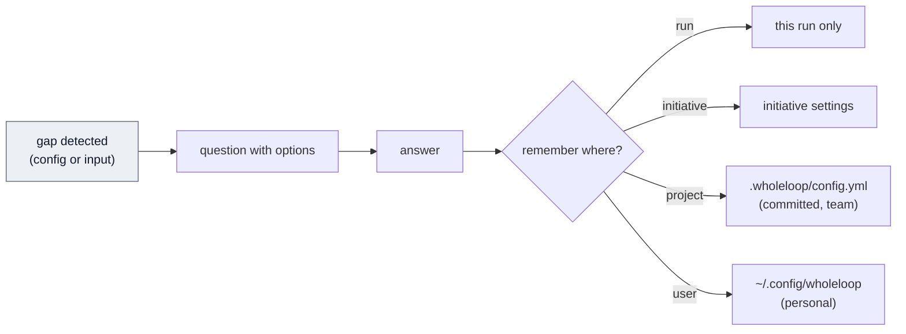

# The core CLI — `wl`

> **TL;DR** — `wl` is the single place where `wholeloop` makes decisions that have one right answer. Skills call it through the shell, pass `--json`, and get structured answers back. Humans can use it too: every command has a readable default output.

Provider operations through a client's MCP connection are experimental.

---

## Operator overview

`wl overview [--json]` returns the bounded `wholeloop/overview@1` read model: health, a deterministic headline, ordered attention with exact commands, item flow, deliveries, agents, worktrees, checkpoints and outcomes. `wl overview schema` prints the consumer contract kit without opening a store. A held writer lock or unreadable input returns an unavailable view with unknown totals and exit 3.

Reads make no store writes and establish no native acceptance. See the [overview architecture and fixtures](./operator-overview.md).

`wl watch [--since <cursor>] [--poll]` follows complete overviews and bounded redacted activity as NDJSON. File events are hints with a one-second poll fallback; `--poll` forces polling. Persist only `resumeCursor` from complete frames, and keep liveness separate from progress. SIGINT/SIGTERM stop the reader; a partial final line acknowledges nothing. The feed acquires no writer lease and opens no network listener.

Displayed item approval commands include optional `answer --basis <event-id>`. The writer transaction checks that it still matches the pending decision before appending an approval. Person and outcome inputs remain explicit.

## Small step inputs and temporary artifacts

**Small non-secret JSON** can go through --stdin instead of a scratch file: framing decisions and final reviews, gate results/votes, research results/examinations/conclusions, builder plans/criteria, learning challenges, environment declarations and normalized ramp, measurement, sharing and synchronization observations. Existing file flags and schemas stay compatible, including a file literally named `-`. Use exactly one input mode. Invalid input is refused without echoing its contents; normal ownership, source, workspace and approval checks still run.

Standard input is at most **1 MiB**, except framing decisions/reviews and shared target lists (**64 KiB**) and shared observations (**2 MiB**). A decision payload and --rationale-stdin cannot share one stream; keep the existing separate file or answer mode when a rationale is required.

**Preparation needs one observation.** `step begin research --with-plan` returns the first research plan alongside the usual contract; missing owner/guidance questions still stop before planning and source choices still precede workers. Framing begin returns inputSchemas for its decision and final review. Review begin already includes its review and assignments; read review input again only for a changed round or missing resumption context.

Ready begin/prepare results return **scratch**, one stable directory per store/run under the operating system's temporary root, outside repositories and the private state store. It is not created until a large artifact is needed. Keep all remaining temporary artifacts there and write them quietly; stream small payloads without echoing them. Only the core writes private runtime state. The seven generated clients share these instructions; their live experience and call budgets remain in manual verification.

## Person-facing display

Every step command carries a **display** (`wholeloop/display@1`): one header, aligned label/value rows, optional observed progress, produced artifacts, open questions and the available next step. Its `text` is the same plain text the terminal prints without `--json`, at 80 terminal cells. Skills forward that text verbatim; profile style instructions and internal state identifiers stay in machine fields. The shared emitter renders the operation's structured result before its single serialization, with no extra store query or command execution. Decisions still block continuation, unavailable checks stay visible, and formatting changes no approval or evidence.

Terminal exceptions retain their conventional error stream and message; JSON errors also carry display data.

Native hosts format actual completion events with the stateless progress command. The values below are a synthetic observation; formatting it does not start a worker or establish that one ran:

```console
$ wl display progress --step research --worker Web --elapsed-ms 65123
Web — finished · 1:05
```

Headless fan-out uses the same formatter. Human output includes progress on stderr; JSON stays silent unless `--progress` is requested. Only observed completions are emitted, with elapsed time; a cached round emits none. A native host must use its actual completion event and original start time, never a fixed sleep or inferred result. Actual native forwarding and timing remain in [manual verification](../../roadmap/manual-verification.md); fixtures establish the layout and local process route only. See the [display decision](../decisions/0256-person-facing-display-rendered-by-the-core.md).

## Private decision attribution

Person decisions support `--channel <name>` plus one optional `--rationale-stdin` or `--rationale-file <path>`. These flags apply to `answer decision.<id>=<outcome>`, `frame finalize`, `build agree`, `pr tested`, `learn decide`, `ramp decide`, and delivery `human-decide`, `pause`, `resume` and `stop`. A rationale must be nonblank UTF-8 of at most 4096 bytes.

A declared agent cannot supply person metadata. No option accepts the optional private rationale text in argv; default reads omit it. See [state and messaging](./state-and-messaging.md#optional-event-attribution) for provenance, privacy and retry semantics.

## Design rules

1. **Every command has `--json`**, with a versioned schema. Skills only ever consume JSON. Step commands attach a versioned `display` and print its exact text without `--json`. `install`, `uninstall`, `doctor` and `status` also have human forms; remaining non-step commands keep their existing format until the human-output work is complete.
2. **Deterministic.** Same inputs, same store, same config → same output. No model calls, no network unless the command is explicitly about a provider.
3. **Single writer.** Only `wl` writes the store. Writes are validated, atomic (write-then-rename) and serialised with a lock.
4. **Exit codes mean something.** `0` ok · `2` needs input (questions in the payload) · `3` precondition failed · `4` shape check failed · `1` unexpected error.
5. **Small surface.** A new command needs a reason a skill cannot express with the existing ones.

## Delivery source intake

delivery source --file request.json captures one bounded request into an immutable external snapshot; delivery source-schema exposes its closed input shape. Explicit inline/file/item inputs use their content digest as revision. Tracker/document observations require exact provider, canonical URL, repository/tenant scope, complete content and a nonempty observed revision.

An imported receipt remains distinct from a current host read. Extraction maps select verbatim line ranges without inventing criteria. Intake creates no item, decision, grant or worker; unsafe/missing sources return a structured missing-input result with exit 3. See the [executable tutorial](../tutorials/delivery-intake.md) and [source identity decision](../decisions/0093-immutable-delivery-source-intake.md).

## Implemented commands

Delivery authority-schema exposes the operator/broker contracts. authorize records a bounded explicit plan/envelope grant; grant inspects it; revoke retains a durable revocation. Repeating the same action preserves its deadline and cannot renew expired/revoked authority. These metadata commands start no process and perform no remote effect. Broker requests are scoped worker claims, independently gated by current controller/runtime context.

See [authorization and revocation](../tutorials/delivery-authorization.md) and [ADR-0095](../decisions/0095-operator-grants-and-scoped-worker-claims.md). Owned backend/behavior hosts and [private delegated decisions](../tutorials/delivery-decisions.md) are implemented separately; complete native orchestration remains pending and existing supervised human gates are unchanged.

Delivery recovery-schema exposes checkpoint and effect-intent contracts. checkpoint captures exact input manifests; checkpoints inspects current/stale inputs; effects reports retained local intent/observation records. recover optionally resumes metadata after current inputs, authority and ownership are known; it supplies no backend automatically. lock-status/repair-lock retain a verified stopped writer record without signalling processes or recreating authority. See the [checkpoint/recovery tutorial](../tutorials/delivery-checkpoints.md) and [ADR-0098](../decisions/0098-checkpoint-recovery-and-observed-effect-reconciliation.md). Actual worker/backend dispatch and operation-specific publication eligibility remain later work.

Delivery enqueue persists an authorized exact work slot; queue inspects retained entries, reasons and reservations. Both commands start no worker. Atomic claims, current generations and repository/global capacity live in the trusted controller API, with unavailable host admission by default. See the [queue tutorial](../tutorials/delivery-queue.md) and [ADR-0097](../decisions/0097-durable-queue-reservations-and-current-attempt-fences.md); actual dispatch/environment/QA evidence remains later work.

Delivery state-schema exposes event and projection envelopes plus every registered closed payload/facet family. track observes a stored plan/envelope and optional private grant without starting execution. status replays authoritative delivery history; events pages it by exclusive global sequence; rebuild repairs disposable caches without reconstructing authority or changing legacy human/PR history.

See the [recovery tutorial](../tutorials/delivery-recovery.md) and [ADR-0096](../decisions/0096-replayable-delivery-journal-without-authority-recovery.md). Runner preparation/status and pause/resume/stop controls are available in the [runner guide](../tutorials/delivery-runner.md). They preserve original authority and do not launch workers; complete foreground domain-host and endpoint wiring remains in progress.

Delivery planning adds plan-schema, envelope, plan and inspect-plan. These commands retain version one by default; explicit --schema-version 2 selects the CI correction plan/record contracts. The separate delivery continue-ci previews or records that proposal and reports its installed-SDK execution requirement, without granting authority or suggesting unsupported public execution.

These validate and preserve proposals with explicit ownership, dependency waves, local target SHAs and immutable policy/guidance bindings, without creating items, approvals, grants or workers. Inspecting a historic revision does not require today's target to match its old base. An initial envelope bounds a derived plan structurally; independent semantic acceptance and execution authority remain separate. The [planning tutorial](../tutorials/delivery-plan.md) exercises both proposal types and fresh-process recovery; [ADR-0094](../decisions/0094-revision-bound-delivery-plans-and-envelopes.md) explains the boundary.

Every command accepts `--json`. Machine-readable output contracts live in `src/cli/schemas/`. Errors use `wholeloop/error@1`; exit codes are 0 (success), 1 (unexpected), 2 (needs input), 3 (precondition), and 4 (invalid shape). Unknown options fail rather than silently changing behavior.

`wl --help` lists the everyday commands and names every other command group by area; `wl <group> --help` lists a group, `wl <command> --help` prints one command's usage and options, and `wl --help --all` prints the whole table. With `--json`, help always returns the complete `wholeloop/help@1` table. A mistyped command fails as before, with exit 1, and names the closest known command when one is near enough.

The normal test suite compares source and compiled-help commands with the general output schema, rejecting missing/duplicate/unversioned branches. It also inventories all source schema locations, including event maps, for unique version-one identities. Gate/suite event-map wrappers retain the prior payload rules and journal format; no event migration follows. Registration does not establish the complete v1 compatibility freeze or native execution. See [ADR-0065](../decisions/0065-public-output-schema-registration.md).

The v1 candidate now adds per-declaration compatibility fingerprints, retained command/exit contracts and explicit delivery-manifest validation. This freezes declarations for review without publishing 1.0 or proving runtime semantics. New identities and optional command flags remain additive; read the [compatibility and deprecation policy](../extending/compatibility.md).

<!-- commands:start -->
| Command | Output schema | Purpose |
| --- | --- | --- |
| `wl display progress` | `wholeloop/display-progress@1` | Show one observed worker completion and the elapsed time |
| `wl overview schema` | `wholeloop/overview-schema@1` | Print the overview and local feed contract kit without opening a store |
| `wl overview` | `wholeloop/overview@1` | Read bounded operator attention, progress and exact next commands without writes |
| `wl watch` | `wholeloop/watch-frame@1` | Follow bounded local activity and overviews without writes or listeners |
| `wl delivery runner-schema` | `wholeloop/delivery-runner-schema@1` | Show owned runner contracts and current execution limitations |
| `wl delivery credential-store` | `wholeloop/delivery-credential@1` | Store a worker credential read from stdin in the secret store, never in a file |
| `wl delivery credential-check` | `wholeloop/delivery-credential@1` | Check that a worker credential resolves, without printing it |
| `wl delivery runner-host` | `wholeloop/delivery-runner-host@1` | Print the public host identity a runner request must name for these documents |
| `wl delivery runner-prepare` | `wholeloop/delivery-runner-status@1` | Prepare a private authorized route without starting execution |
| `wl delivery runner-status` | `wholeloop/delivery-runner-status@1` | Inspect retained controller ownership and exact stage observations |
| `wl delivery pause` | `wholeloop/delivery-runner-status@1` | Pause dispatch without deleting owned work or renewing budgets |
| `wl delivery resume` | `wholeloop/delivery-runner-status@1` | Resume the same run after original ownership is resolved |
| `wl delivery stop` | `wholeloop/delivery-runner-status@1` | Request owned cancellation without asserting process termination |
| `wl delivery run` | `wholeloop/delivery-runner-run@1` | Run a prepared route in an owned foreground controller under the public fixed host |
| `wl delivery reconcile` | `wholeloop/delivery-runner-reconcile@1` | Observe or cancel owned controller and stage work without replaying it |
| `wl delivery human-decide` | `wholeloop/delivery-human-decision@1` | Record a person's decision on the exact subject a waiting stage published |
| `wl delivery decision-schema` | `wholeloop/delegated-decision-schema@1` | Show delegated decision contracts without executing a host |
| `wl delivery decision-pin` | `wholeloop/delegated-decision-pins@1` | Pin decision-specific rubrics from an active original private grant |
| `wl delivery decision-preflight` | `wholeloop/delegated-decision-preflight@1` | Inspect delegation scope without certifying runtime capability |
| `wl delivery decision-inspect` | `wholeloop/delegated-decision-status@1` | Inspect historical machine decisions and current eligibility |
| `wl eval delivery-schema` | `wholeloop/evaluation-schema@1` | Show original evaluation catalog, oracle and seed contracts |
| `wl eval delivery-catalog <catalog>` | `wholeloop/evaluation-catalog@1` | Inspect reviewed scenario identities without revealing expected outcomes |
| `wl eval delivery-seed <catalog>` | `wholeloop/evaluation-seed@1` | Pin private standards and create disposable original Git applications |
| `wl eval delivery-inspect <digest>` | `wholeloop/evaluation-seed@1` | Verify immutable expected outcomes without overwriting implementation files |
| `wl delivery integration-assembly-reconcile` | `wholeloop/integration-assembly-status@1` | Observe already-issued owned Git steps without dispatching or restoring authority |
| `wl delivery integration-assembly-schema` | `wholeloop/integration-assembly-schema@1` | Show owned assembly and whole-milestone verification contracts |
| `wl delivery integration-assemble` | `wholeloop/integration-assembly-status@1` | Assemble required committed parts in owned worktrees under original grants |
| `wl delivery integration-assembly-status` | `wholeloop/integration-assembly-status@1` | Inspect retained assembly steps, conflicts and partial outcomes |
| `wl delivery integration-verify` | `wholeloop/integration-verification@1` | Execute pinned whole-milestone cases against the complete owned assembly |
| `wl delivery integration-report` | `wholeloop/integration-verification@1` | Reobserve whole-milestone evidence without executing acceptance cases |
| `wl delivery integration-schema` | `wholeloop/integration-schema@1` | Show committed milestone candidate and input contracts |
| `wl delivery integration-candidate` | `wholeloop/integration-prepared@1` | Observe and pin an exact committed milestone candidate without assembly execution |
| `wl delivery integration-inspect` | `wholeloop/integration-inspection@1` | Compare a retained candidate with current commits, bases and protected inputs |
| `wl delivery integration-compare` | `wholeloop/integration-comparison@1` | Explain exact candidate input equality without authorizing evidence reuse |
| `wl delivery private-schema` | `wholeloop/private-acceptance-schema@1` | Show private evaluator inputs and observed sensitivity contracts |
| `wl delivery private-plan` | `wholeloop/private-acceptance-prepared@1` | Pin private evaluator inputs outside builder workspaces |
| `wl delivery private-inspect` | `wholeloop/private-acceptance-inspection@1` | Inspect private definition identity without exposing hidden input values |
| `wl delivery private-sensitivity` | `wholeloop/acceptance-sensitivity@1` | Compare actual unchanged baseline and current candidate observations |
| `wl delivery browser-schema` | `wholeloop/browser-schema@1` | Show grounded browser cases and the reviewed immutable MCP reference |
| `wl delivery acceptance-run` | `wholeloop/acceptance-case-result@1` | Execute pinned API or CLI assertions against an exact owned application |
| `wl delivery behavior-schema` | `wholeloop/behavior-schema@1` | Show the closed input contract for the fixed API and CLI behavior host |
| `wl delivery acceptance-seal` | `wholeloop/acceptance-sealed@1` | Retain a current typed acceptance report as an immutable private artifact |
| `wl delivery acceptance-schema` | `wholeloop/acceptance-schema@1` | Show closed behavioral acceptance and artifact contracts |
| `wl delivery acceptance-plan` | `wholeloop/acceptance-plan-prepared@1` | Pin complete behavioral cases without executing tests |
| `wl delivery acceptance-inspect` | `wholeloop/acceptance-plan-inspection@1` | Read pinned acceptance definitions without executing tests |
| `wl delivery acceptance-report` | `wholeloop/acceptance-report@1` | Assess observed coverage against the current owned application |
| `wl delivery acceptance-artifact` | `wholeloop/acceptance-artifact-capture@1` | Retain bounded sanitized artifacts within the current run budget |
| `wl delivery acceptance-human-note` | `wholeloop/acceptance-human-note@1` | Record an explicit operator note for an exact human-only case |
| `wl delivery environment-lifecycle-schema` | `wholeloop/environment-lifecycle-schema@1` | Show owned stop, reconciliation and explicit retirement contracts |
| `wl delivery environment-stop` | `wholeloop/environment-lifecycle-receipt@1` | Stop exact owned resources and retain data and evidence |
| `wl delivery environment-reconcile` | `wholeloop/environment-lifecycle-receipt@1` | Recover an interrupted owned stop or retirement without replaying startup |
| `wl delivery environment-retire` | `wholeloop/environment-lifecycle-receipt@1` | Explicitly retire exact owned resources after observed shutdown |
| `wl delivery environment-runtime-schema` | `wholeloop/environment-runtime-schema@1` | Show owned Docker runtime contracts without starting resources |
| `wl delivery environment-backend` | `wholeloop/environment-backend-preflight@1` | Observe local Docker capacity and cached images without provisioning |
| `wl delivery environment-start` | `wholeloop/environment-provision-result@1` | Provision an explicitly authorized owned application environment |
| `wl delivery environment-status` | `wholeloop/environment-status@1` | Reinspect exact owned resources and current candidate readiness |
| `wl delivery environment-schema` | `wholeloop/environment-schema@1` | Show inert environment recipe and immutable selection contracts |
| `wl delivery environment-discover` | `wholeloop/environment-discovery@1` | Discover bounded setup candidates without executing scripts |
| `wl delivery environment-plan` | `wholeloop/environment-recipe-prepared@1` | Pin explicit isolated environment setup without granting execution |
| `wl delivery environment-inspect` | `wholeloop/environment-recipe-inspection@1` | Compare recipe inputs without asserting environment readiness |
| `wl delivery native-schema` | `wholeloop/delivery-native-schema@1` | Show native role capabilities, reference pins and non-accepting execution records |
| `wl delivery worker-schema` | `wholeloop/delivery-worker-schema@1` | Show role-bound worker assignment, claim and controller execution contracts |
| `wl delivery budget-schema` | `wholeloop/delivery-budget-schema@1` | Show finite usage constraint contracts without granting authority |
| `wl delivery budget-configure` | `wholeloop/delivery-budget-status@1` | Bind optional immutable usage constraints before execution starts |
| `wl delivery budget` | `wholeloop/delivery-budget-status@1` | Inspect retained deadlines, unknown usage and no-progress findings |
| `wl delivery artifact` | `wholeloop/delivery-artifact-capture@1` | Reserve unique artifact bytes before copying bounded local evidence |
| `wl delivery recovery-schema` | `wholeloop/delivery-recovery-schema@1` | Show checkpoint request, input manifest and effect intent contracts |
| `wl delivery checkpoint` | `wholeloop/delivery-checkpoints-status@1` | Retain an exact checkpoint input manifest without granting acceptance |
| `wl delivery checkpoints` | `wholeloop/delivery-checkpoints-status@1` | Inspect current and stale checkpoint inputs without rewriting history |
| `wl delivery effects` | `wholeloop/delivery-effects-status@1` | Inspect retained effect intents and observations without invoking a host |
| `wl delivery lock-status` | `wholeloop/delivery-lock-status@1` | Inspect writer ownership without signalling or removing a process |
| `wl delivery repair-lock` | `wholeloop/delivery-lock-status@1` | Retain an exactly observed absent writer lock without restoring authority |
| `wl delivery recover` | `wholeloop/delivery-recovery-result@1` | Validate recovery inputs and ownership without starting replacement workers |
| `wl delivery enqueue` | `wholeloop/delivery-queue-status@1` | Persist an authorized work slot without starting a worker |
| `wl delivery queue` | `wholeloop/delivery-queue-status@1` | Inspect persisted queue reasons and reservations without dispatching work |
| `wl delivery state-schema` | `wholeloop/delivery-state-schema@1` | Show delivery event, registered payload and projection contracts |
| `wl delivery track` | `wholeloop/delivery-status@1` | Track a stored plan or envelope without granting authority or starting work |
| `wl delivery status` | `wholeloop/delivery-status@1` | Replay authoritative delivery state independently of cached projections |
| `wl delivery report` | `wholeloop/delivery-report@1` | Explain the outcome, waits, effects and exact next permitted actions read-only |
| `wl delivery revise` | `wholeloop/delivery-revise@1` | Preview a revision impact; record it only with explicit acceptance |
| `wl delivery continue` | `wholeloop/delivery-continue@1` | Preview a correction revision for a retained failure; record it only when accepted |
| `wl delivery continue-ci` | `wholeloop/delivery-ci-continue@1` | Preview an exact CI correction proposal without granting execution |
| `wl delivery diagnostics` | `wholeloop/delivery-diagnostics@1` | Export redacted event categories and digests without private payloads |
| `wl delivery recovery-export` | `wholeloop/delivery-recovery-export@1` | Write an explicit private recovery bundle with per-file checksums |
| `wl delivery recovery-import` | `wholeloop/delivery-recovery-import@1` | Verify a recovery bundle and archive it without restoring claims or grants |
| `wl delivery events` | `wholeloop/delivery-events@1` | Read bounded delivery event pages without changing legacy item history |
| `wl delivery rebuild` | `wholeloop/delivery-rebuild@1` | Rebuild disposable delivery projections without restoring grants or effects |
| `wl delivery authority-schema` | `wholeloop/delivery-authority-schema@1` | Show explicit operator authorization, revocation and worker request contracts |
| `wl delivery authorize` | `wholeloop/delivery-authorization@1` | Record a bounded operator grant without starting workers or external effects |
| `wl delivery revoke` | `wholeloop/delivery-authorization@1` | Revoke a grant for later assignments and effects while retaining history |
| `wl delivery grant` | `wholeloop/delivery-authorization@1` | Inspect a grant, its finite deadline and any retained revocation |
| `wl delivery plan-schema` | `wholeloop/delivery-planning-schema@1` | Show the closed delivery plan and initial request-envelope contracts |
| `wl delivery plan` | `wholeloop/delivery-plan-prepared@1` | Validate and preserve an exact delivery proposal without granting execution |
| `wl delivery guidance` | `wholeloop/delivery-guidance@1` | Propose repository guidance pins from each pinned base before authorization |
| `wl delivery envelope` | `wholeloop/delivery-envelope-prepared@1` | Pin initial request bounds for later independent planning and authorization |
| `wl delivery inspect-plan` | `wholeloop/delivery-plan-prepared@1` | Read a stored plan revision, proposed route and dependency waves |
| `wl delivery source-schema` | `wholeloop/delivery-source-schema@1` | Show the bounded delivery request and imported observation contract |
| `wl delivery source` | `wholeloop/delivery-source-intake@1` | Capture an immutable external request snapshot without starting work |
| `wl adapter build-native` | `wholeloop/adapter-build@1` | Render an explicit native-version dialect without changing legacy build output |
| `wl conformance diagnose <run>` | `wholeloop/conformance-diagnostics@1` | Inspect redacted native error categories without exposing private output |
| `wl frame schema` | `wholeloop/frame-schema@1` | Show final framing decision and semantic review contracts |
| `wl frame draft` | `wholeloop/frame-draft@1` | Render exact owner-approved stop conditions before final review |
| `wl frame finalize` | `wholeloop/frame-finalized@1` | Complete framing with matching final approval and semantic review |
| `wl provider plan <id> <operation>` | `wholeloop/provider-transport@1` | Plan client-owned MCP or native transport without service access |
| `wl provider read-flags <id>` | `wholeloop/flag-read@2` | Plan a flag-state read through client MCP, a local file or an open question |
| `wl conformance acquisition <downloads.json>` | `wholeloop/conformance-acquisition@1` | Validate exact native vendor downloads without installing or running clients |
| `wl release verify <directory>` | `wholeloop/release-verified@1` | Verify prepared release bytes and source context without publishing |
| `wl release preflight` | `wholeloop/release-preflight@1` | Check exact local release source and supplied CI metadata without publishing |
| `wl release notes` | `wholeloop/release-notes@1` | Draft bounded Conventional Commit release notes from explicit local history |
| `wl release artifacts` | `wholeloop/distribution-build@1` | Export owned seven-client delivery previews and a local Claude marketplace |
| `wl conformance issues <results.json>` | `wholeloop/conformance-issues@1` | Draft structural regression issues from explicit fresh comparable observations |
| `wl conformance collect <plan.json>` | `wholeloop/conformance-results@1` | Collect fresh pinned/latest observations with explicit execution mode and native paths |
| `wl conformance prepare` | `wholeloop/conformance-prepared@1` | Prepare a disposable native framing fixture without launching a client |
| `wl conformance run <id>` | `wholeloop/conformance-report@1` | Run one explicitly simulated or live pinned-client framing scenario |
| `wl conformance report <id>` | `wholeloop/conformance-report@1` | Rejudge process and journal evidence with named missing events |
| `wl conformance matrix <results.json>` | `wholeloop/conformance-matrix@1` | Render bounded observations and identify comparable regression candidates |
| `wl eval grounding <corpus.json>` | `wholeloop/grounding-eval@1` | Score traceable numeric assertions and deliberately absent sandbox metrics |
| `wl sync` | `wholeloop/sync@1` | Reconcile exact PR merges, delivery readiness and conservative cleanup |
| `wl learn begin [<description>]` | `wholeloop/learning-begin@1` | Pin outcome evidence and the leaning to challenge |
| `wl learn challenge` | `wholeloop/learning-report@1` | Record a counterargument against the exact current leaning |
| `wl learn decide <keep\|iterate\|kill\|unflag>` | `wholeloop/learning-decision@1` | Record a human outcome and close only fully decided scopes |
| `wl learn complete` | `wholeloop/learning-complete@1` | Recover canonical decision completion and conditional closure |
| `wl learn report` | `wholeloop/learning-report@1` | Show evidence, the counterargument and proposed follow-up |
| `wl learn schema` | `wholeloop/learning-schema@1` | Print counterargument, reported-evidence and iteration contracts |
| `wl maintenance inspect` | `wholeloop/maintenance-inspection@1` | Run one pinned local inspection read-only and show its finding |
| `wl maintenance propose` | `wholeloop/maintenance-propose@1` | Record a proposal for a freshly inspected finding without changing code |
| `wl maintenance proposals` | `wholeloop/maintenance-proposals@1` | List recorded maintenance proposals and retained dismissals |
| `wl maintenance dismiss` | `wholeloop/maintenance-dismissal@1` | Dismiss a proposal with an operator and reason so it does not return |
| `wl maintenance admit` | `wholeloop/maintenance-admit@1` | Admit current proposals within an operator envelope as separate delivery sources |
| `wl measure begin [<description>]` | `wholeloop/impact-begin@1` | Pin a due checkpoint and its exact measurement plan |
| `wl measure requests` | `wholeloop/impact-read-requests@1` | Plan exact source reads without querying services |
| `wl measure observe` | `wholeloop/impact-report@1` | Record normalized observations and preserve missing datapoints as unknown |
| `wl measure format` | `wholeloop/impact-report@1` | Apply a repository-guided layout without rewriting measured values |
| `wl measure complete` | `wholeloop/impact-complete@1` | Store the canonical checkpoint report with traceable values |
| `wl measure report` | `wholeloop/impact-report@1` | Show query-linked measurements, verdicts and qualitative signals |
| `wl measure tick` | `wholeloop/impact-tick@1` | Schedule each due checkpoint observation once in the external store |
| `wl measure schedule` | `wholeloop/impact-schedule@1` | List checkpoint due dates, missing offsets and measured status |
| `wl measure digest` | `wholeloop/impact-digest@1` | Prepare an unsent impact digest and per-scope comment bodies |
| `wl measure schema` | `wholeloop/impact-schema@1` | Print measurement, qualitative query and report layout contracts |
| `wl ramp begin [<description>]` | `wholeloop/ramp-begin@1` | Pin a confirmed audience plan and evidence checks before ramping |
| `wl ramp requests` | `wholeloop/ramp-read-requests@1` | Plan exact read-only evidence calls without querying services |
| `wl ramp observe` | `wholeloop/ramp-report@1` | Import exact normalized read results and retain missing evidence as unknown |
| `wl ramp decide <go\|hold\|rollback>` | `wholeloop/ramp-report@1` | Record one stage decision against the evidence shown to the person |
| `wl ramp proposal` | `wholeloop/ramp-proposal@1` | Produce an unapplied flag or manual exposure change proposal |
| `wl ramp confirm` | `wholeloop/ramp-report@1` | Confirm an externally performed change before advancing one stage |
| `wl ramp report` | `wholeloop/ramp-report@1` | Resume the current stage, evidence and explicit decision |
| `wl ramp schema` | `wholeloop/ramp-schema@1` | Print the versioned ramp plan input contract |
| `wl launch dispatch` | `wholeloop/dashboard-dispatch@2` | Plan one metric-pinned dashboard through client MCP or the local handoff |
| `wl launch begin [<description>]` | `wholeloop/launch-begin@1` | Pin launch measurements and repository voice before drafting |
| `wl launch draft` | `wholeloop/launch-complete@1` | Draft a planned launch kit in one isolated read-only headless worker |
| `wl launch complete` | `wholeloop/launch-complete@1` | Store a validated launch kit with metric-linked dashboard specs |
| `wl launch report` | `wholeloop/launch-report@1` | Show local artifacts and explicit provider draft/create handoffs |
| `wl launch schema` | `wholeloop/launch-schema@1` | Print measurement and launch draft input contracts |
| `wl env declare` | `wholeloop/env-declare@1` | Record a non-secret external write and its explicit undo recipe |
| `wl env report` | `wholeloop/env-report@1` | Report external effects and undo recipes without executing them |
| `wl pr prepare [<branch>]` | `wholeloop/pr-prepare@1` | Prepare a repository-shaped draft without pushing or opening it |
| `wl pr tested` | `wholeloop/pr-tested@1` | Record human testing and approval of the exact publication plan |
| `wl pr open` | `wholeloop/pr-open@1` | Push the tested pinned commit and open its draft PR once |
| `wl pr reconcile` | `wholeloop/pr-open@1` | Read a pending remote PR instead of repeating an ambiguous write |
| `wl review begin [<branch\|pr>]` | `wholeloop/review-begin@1` | Begin an isolated review with pinned rubric and incremental input |
| `wl review input` | `wholeloop/review-context@1` | Load the exact round patch and repository rubric for reviewers |
| `wl review comment-plan` | `wholeloop/review-comment-plan@1` | Draft a codehost comment without publishing it |
| `wl review complete` | `wholeloop/review-complete@1` | Complete a review from its input and current gate PASS |
| `wl verify begin [<branch\|pr>]` | `wholeloop/verify-begin@1` | Begin verification from agreed criteria or ask before mutation |
| `wl verify suite` | `wholeloop/verify-suite@1` | Execute declared checks once in the pinned verify round |
| `wl verify complete` | `wholeloop/verify-complete@1` | Complete verification from its suite receipt and current gate PASS |
| `wl build route [<input>]` | `wholeloop/build-route@1` | Route a scope slice issue URL or sentence to ready build work |
| `wl build agree <input>` | `wholeloop/build-agree@1` | Create an ad-hoc slice from explicitly agreed testable criteria |
| `wl build preflight <id>` | `wholeloop/build-preflight@1` | Resolve and load repository build guidance before code |
| `wl build prepare <id>` | `wholeloop/build-prepare@1` | Begin the build and provision its isolated workspace |
| `wl build plan <id>` | `wholeloop/build-plan@1` | Record the builder plan before changing the prepared code |
| `wl build complete <id>` | `wholeloop/build-complete@1` | Record a receipt only after current verify and review passes |
| `wl build schema` | `wholeloop/build-schema@1` | Print the versioned builder plan schema |
| `wl gate plan <verify\|review>` | `wholeloop/gate-plan@1` | Pin coverage and start or resume a bounded read-only gate round |
| `wl gate submit` | `wholeloop/gate-submit@1` | Journal a planned unit result or independent finding refutation |
| `wl gate verdict` | `wholeloop/gate-verdict@1` | Seal a round with deterministic fail-safe aggregation |
| `wl gate schema` | `wholeloop/gate-schema@1` | Print public gate plan result and refutation schemas |
| `wl worktree create <id>` | `wholeloop/worktree-create@1` | Allocate an isolated worktree from a recorded named base |
| `wl worktree open <id>` | `wholeloop/worktree-open@1` | Show environment path ports and commands without starting them |
| `wl worktree stop <id>` | `wholeloop/worktree-stop@1` | Stop the workspace lease while retaining files and branches |
| `wl worktree list` | `wholeloop/worktree-list@1` | List recorded workspace allocations and lifecycle status |
| `wl worktree prune [<id>]` | `wholeloop/worktree-prune@1` | Remove only stopped clean merged or explicitly abandoned work |
| `wl slices plan` | `wholeloop/slices-plan@1` | Suggest vertical work and expose inherited acceptance criteria |
| `wl slices check <file>` | `wholeloop/slices-check@1` | Validate slice outcomes tests repositories and dependencies |
| `wl slices schema` | `wholeloop/slices-schema@1` | Print the versioned slice plan schema |
| `wl eval gates <corpus>` | `wholeloop/gate-eval@1` | Measure each review lens before and after active refutations |
| `wl eval definitions <corpus>` | `wholeloop/definition-eval@1` | Measure labelled definition defects and false alarms |
| `wl challenge plan <problem\|spec\|criteria\|scopes\|slicing>` | `wholeloop/challenge-plan@1` | Lint a definition and render fixed challenger coverage |
| `wl challenge schema` | `wholeloop/challenge-schema@1` | Print the standalone criteria metadata schema |
| `wl scopes plan` | `wholeloop/scopes-plan@1` | Suggest one scope and expose the metric ownership contract |
| `wl scopes schema` | `wholeloop/scopes-schema@1` | Print the versioned scope plan schema |
| `wl spec check <file>` | `wholeloop/spec-check@1` | Check stories criteria metrics and rollout structure |
| `wl spec schema` | `wholeloop/spec-schema@1` | Print the versioned spec metadata schema |
| `wl research plan` | `wholeloop/research-plan@1` | Plan source angles and independent examination jobs |
| `wl research submit` | `wholeloop/research-submit@1` | Record a validated source result in the journal |
| `wl research examine` | `wholeloop/research-examine@1` | Record one independent claim examination |
| `wl research complete` | `wholeloop/research-complete@1` | Aggregate evidence into a replayable research brief |
| `wl adapter root` | `wholeloop/adapter-root@1` | Resolve a packaged core root from its matching ownership manifest |
| `wl build` | `wholeloop/adapter-build@1` | Render a self-contained client artifact tree without installing it |
| `wl fanout run <verify\|review>` | `wholeloop/fanout@1` | Collect bounded isolated headless gate workers without changing coverage |
| `wl adopt <URL>` | `wholeloop/adopt@1` | Adopt a revision-bound shared source without inventing approvals |
| `wl share mode` | `wholeloop/share-report@1` | Select explicit shared destinations and queue completed Define artifacts |
| `wl share report` | `wholeloop/share-report@1` | Inspect shared publication receipts and ambiguity |
| `wl share requests` | `wholeloop/share-report@1` | Inspect queued Define publication chunks without authorizing writes |
| `wl share request` | `wholeloop/share-request@1` | Journal one publication intent before the conductor writes |
| `wl share reconcile` | `wholeloop/share-report@1` | Verify an exact published chunk from a labelled complete read |
| `wl next [<idea\|id\|URL>]` | `wholeloop/next@1` | Continue stored work or begin evidence-based framing |
| `wl status [<id>]` | `wholeloop/status@1` | Inspect work and pending decisions without mutation |
| `wl setup` | `wholeloop/setup@1` | Ask for or explicitly save scoped profile, provider and model choices |
| `wl template list` | `wholeloop/template-list@1` | List validated manifests and their origins |
| `wl template test <id>` | `wholeloop/template-test@1` | Validate a manifest and its required resources |
| `wl template scaffold <id>` | `wholeloop/template-scaffold@1` | Print or explicitly create a manifest kit |
| `wl profile list` | `wholeloop/profile-list@1` | List validated manifests and their origins |
| `wl profile test <id>` | `wholeloop/profile-test@1` | Validate a manifest and its required resources |
| `wl profile scaffold <id>` | `wholeloop/profile-scaffold@1` | Print or explicitly create a manifest kit |
| `wl lens list` | `wholeloop/lens-list@1` | List validated manifests and their origins |
| `wl lens test <id>` | `wholeloop/lens-test@1` | Validate a manifest and its required resources |
| `wl lens scaffold <id>` | `wholeloop/lens-scaffold@1` | Print or explicitly create a manifest kit |
| `wl provider list` | `wholeloop/provider-list@1` | List providers with their origins and detection evidence |
| `wl provider show <id>` | `wholeloop/provider-show@1` | Show one validated provider manifest |
| `wl provider test <id>` | `wholeloop/provider-test@1` | Validate declared access or execute explicit offline binding fixtures |
| `wl provider resolve <operation>` | `wholeloop/provider-resolve@1` | Resolve an operation to an explicit or built-in provider |
| `wl provider scaffold <id>` | `wholeloop/provider-scaffold@1` | Print or explicitly create a provider manifest |
| `wl mcp add <id>` | `wholeloop/mcp-add@1` | Print a credential-free MCP configuration snippet |
| `wl discover` | `wholeloop/discover@1` | Discover repository guidance and declared commands without executing them |
| `wl resolve <slot>` | `wholeloop/resolve@1` | Explain slot precedence or ask about ambiguous matches |
| `wl profile show` | `wholeloop/profile-show@1` | Show the active profile and rendered instructions |
| `wl profile set <dial=value>` | `wholeloop/profile-set@1` | Set a profile dial at user, project or run scope |
| `wl profile preset <name>` | `wholeloop/profile-preset@1` | Select a built-in interaction preset |
| `wl step begin <step>` | `wholeloop/step-begin@1` | Compute inputs and begin an available step |
| `wl step plan` | `wholeloop/step-plan@1` | Plan the next step and required decisions |
| `wl step complete <step>` | `wholeloop/step-complete@1` | Validate and record a step artifact |
| `wl step skip <step>` | `wholeloop/step-skip@1` | Skip a step with a durable reason |
| `wl answer <qid=value>` | `wholeloop/answer@1` | Remember an answer or record an explicit human decision |
| `wl msg send` | `wholeloop/msg-send@1` | Send a durable message in an item thread |
| `wl msg read` | `wholeloop/msg-read@1` | Read unread messages with a persistent per-reader cursor |
| `wl handoff <id>` | `wholeloop/handoff@1` | Hand an item to another role with durable context |
| `wl resume [<id>]` | `wholeloop/resume@1` | Print a context pack bounded to 6144 UTF-8 bytes |
| `wl state create <kind>` | `wholeloop/state-create@1` | Create a typed item in the external store |
| `wl state update <id>` | `wholeloop/state-update@1` | Update a stored item through the journal |
| `wl state show [<id>]` | `wholeloop/state-show@1` | Show an item or the whole store |
| `wl state list` | `wholeloop/state-list@1` | List stored item summaries |
| `wl state get <id>` | `wholeloop/state-get@1` | Get a complete stored item |
| `wl state rebuild` | `wholeloop/state-rebuild@1` | Rebuild projections from the journal |
| `wl note <id> <text>` | `wholeloop/note@1` | Append a durable note |
| `wl link <id> <url>` | `wholeloop/link@1` | Record an external reference |
| `wl open <id>` | `wholeloop/open@1` | Read an item; add --raw for its complete Markdown and metadata |
| `wl config show` | `wholeloop/config-show@1` | Resolve layered configuration and optionally explain every value |
| `wl config schema` | `wholeloop/config-schema@1` | Print the configuration JSON Schema |
| `wl docs nav` | `wholeloop/docs-nav@1` | Rewrite docnav footers from docs/nav.yml |
| `wl docs reference` | `wholeloop/docs-reference@1` | Check generated reference sections or explicitly regenerate their tables |
| `wl docs check` | `wholeloop/docs-check@1` | Check navigation, status, links, anchors and generated references |
| `wl harness check` | `wholeloop/harness-check@1` | Check size budgets, front matter and enforcement |
| `wl install` | `wholeloop/install@1` | Install owned native components without rewriting shared client settings |
| `wl uninstall` | `wholeloop/uninstall@1` | Remove unchanged owned native components and retain external backups |
| `wl doctor` | `wholeloop/doctor@1` | Observe versions, external-store writes, provider declarations and optional artifact drift |
| `wl guard hooks <install\|uninstall\|status>` | `wholeloop/git-guards@1` | Explicitly manage owned external Git hooks and preserve originals |
| `wl guard before-tool` | `wholeloop/guard@1` | Check transient native before-tool input without granting permissions |
| `wl guard git-commit` | `wholeloop/guard@1` | Check staged runtime paths and the assigned Build topic workspace |
| `wl guard git-push` | `wholeloop/guard@1` | Check an exact tested open-pr push from transient JSON stdin |
| `wl guard state-write` | `wholeloop/guard@1` | Reject runtime state destinations inside any Git repository |
| `wl guard commit-msg <file>` | `wholeloop/commit-check@1` | Validate a commit message without changing it |
<!-- commands:end -->

Regenerate with `npm run docs:commands`; CI checks for drift.

## Command surface by group

| Group | Commands | Used by |
| --- | --- | --- |
| **Steps** | `wl step begin <step>` · `wl step plan` · `wl step complete <step>` · `wl step skip <step> --reason` | every skill |
| **Questions** | `wl answer <qid>=<value> --remember run\|initiative\|project\|user` | every skill |
| **State** | `wl state show\|list\|get <id>` · `wl open <id>` · `wl note <id> "…"` · `wl link <id> <url>` · `wl state rebuild` | skills, people |
| **Messaging** | `wl msg send --thread <id> --to <role> --kind <kind>` · `wl msg read --for <role>` · `wl handoff <id> --to <role>` | agents |
| **Sessions** | `wl resume [<id>]` · `wl status` | `next`, `status`, people |
| **Repo** | `wl discover` · `wl resolve <slot>` | step begin, `setup` |
| **Providers** | `wl provider list\|show\|test\|scaffold` · `wl mcp add <provider> --target <cli>` | `setup`, authors |
| **Profile** | `wl profile show\|set <dial>=<value>\|preset <name>` | `setup`, people |
| **Gates** | `wl gate plan <gate> --for <id>` · `wl gate submit` · `wl gate verdict` | gate workflows |
| **Fan-out** | `wl fanout run <workflow> --engine native\|headless\|sequential` | gates, `research` |
| **Guards** | `wl guard <event>` (reads a hook payload on stdin) | generated hooks, git hooks |
| **Worktrees** | `wl worktree create\|open\|stop\|list\|prune <slice>` — isolated workspace and branch per slice, with port allocation | builder, `open-pr`, `sync` |
| **Environment** | `wl env declare <what> --undo "<command>"` · `wl env report` | builder, `open-pr` |
| **Install** | `wl install --target <cli,…> --scope user\|project` · `wl uninstall` · `wl doctor` | people |
| **Docs (dev)** | `wl docs nav` · `wl docs check [--json]` · `wl docs reference [--write]` — ✅ implemented | CI, contributors |
| **Harness (dev)** | `wl harness check [--json]` — budgets, front matter, enforcement map — ✅ implemented | CI, contributors |

## Running the core step contract

```text
wl step begin frame-problem --input "Find past orders faster" --owner "Alex" --json
wl step complete frame-problem --for init-0123abcd --artifact /path/to/frame.md --json
wl step plan --for init-0123abcd --json
wl step skip research --for init-0123abcd --reason "Existing support evidence" --json
wl answer owner=Alex --remember user --json
```

A framing artifact requires the eight framing headings plus `Owner`; the begin contract lists their exact names. Headings inside code fences do not count. Unknowns require `TBD: <missing>; who: <answerer>`. Completed research briefs can seed framing with `--from`; equivalent titles reuse initiatives. `--no-go dropped|on-hold` requires a reason, and on-hold also requires `--reopen`.

Completion copies the artifact into the external store and includes its contents in the journal so rebuild restores it. Repeated begin calls reuse an unfinished run; completion without a start fails. Unimplemented steps return their contract with `available: false` and exit 3, without recording a fabricated run.

`--mode standalone` (default) allows direct entry; `--mode flow` checks the next planned step. Missing input/owner returns batched questions and exit 2 without creating an item. Skipping requires a reason, retains it in subsequent preflights and preserves that step's required decisions.

`answer` recognizes `owner`, `input`, `impact`, `docs.destination` and `tracker.destination`. Run/initiative answers require `--for`; a run answer uses `--run` or the latest started run. User/project answers explicitly update configuration (`answers.owner` or `providers.*`); `input` and `impact` cannot be remembered beyond their initiative. A spec started without framing accepts `--impact`; its completion stops at a revision-bound approval.

A pending decision is answered with `wl answer decision.approve-spec=approved --for <id> --by "Alex" --remember run`. Only `approved`/`rejected` are accepted; decisions cannot become reusable defaults. They bind to the completed/skipped revision, so changing that revision requires another decision. Merging remains outside the CLI.

## The step contract

`wl step begin` is the heart of the design. It turns *"which step, with what input"* into everything the skill needs to act, and nothing it should decide on its own.

```json
{
  "schema": "wholeloop/step-begin@1",
  "step": "write-spec",
  "mode": "flow",
  "subject": { "kind": "initiative", "id": "init-41c2" },
  "have": { "frame": "init-41c2/frame.md", "brief": "brief-7f3a" },
  "missing": ["docs.destination"],
  "questions": [
    {
      "id": "docs.destination",
      "prompt": "Where should the spec live?",
      "multi": false,
      "options": [
        { "value": "local", "label": "Local Markdown", "note": "default" },
        { "value": "notion", "label": "Notion", "note": "MCP detected" },
        { "value": "confluence", "label": "Confluence", "note": "not connected — wl mcp add confluence" }
      ],
      "remember": ["run", "initiative", "project", "user"]
    }
  ],
  "bindings": {
    "spec.template": { "source": "repo", "ref": ".agents/skills/product-spec" }
  },
  "profile": "Be brief. Product-level vocabulary. Challenge assumptions firmly but kindly. …",
  "template": "harness/templates/spec.md",
  "decision": { "id": "approve-spec", "after": "complete" },
  "preflight": ["Plan — …", "Where — …", "Never — …", "Stop — …"]
}
```

- **`have` / `missing`** — the step uses whatever already exists and asks only for the gap. This is what makes standalone use work.
- **`questions`** are generated from configuration gaps and step inputs, never improvised by the model. The skill renders them with the CLI's structured question tool when there is one, otherwise as plain text and waits.
- **`bindings`** say whose rules to follow ([repo-first slots](../configuration/repo-skills.md)).
- **`profile`** is a pre-rendered style block, ≤ 10 lines ([profile](../configuration/profile.md)).
- **`preflight`** lines are generated, so a stated cap or destination is always the one actually enforced.

`wl step complete` validates the produced artifact against the step's **shape rules** (for example: every metric in a spec names a source and a window), records it in the journal, publishes through providers if configured, and returns the receipt plus the suggested next steps.

## Questions and remembering



A remembered answer is never asked again at that scope. A step that re-asks a settled question is a bug.

## Hooks and guards

Generated Claude/Copilot command hooks and the thin OpenCode JS plugin delegate to `wl guard before-tool --stdin`. The core normalizes native names/JSON arguments; reports contain only wholeloop/guard@1 decisions and fixed policy reasons, never raw tool bodies, commands or remote URLs. Empty native success preserves the client's normal permission checks. Missing/invalid/timed-out core results deny. Codex CLI uses the Git fallback; desktop plugin support is not proof of a CLI hook surface.

Build commits require their active assigned workspace/topic. Pass the environment returned by build prepare/worktree open, including WL_SUBJECT, to the builder; it identifies attempts from the original checkout without guessing a default branch. Unmanaged user commits remain allowed. Pushes require one non-delete update bound to a clean pending, human-tested open-pr request with exact SHA, branch, remote and snapshot, current gated evidence and no unresolved ancestor decisions. Object-pinned producer pushes are supported; extra refs and known non-fast-forward history fail.

Use guard state-write --path for the authoritative external destination check. StoreFiles also enforces that boundary on every real runtime mutation, including Git ancestors and symlinks. Known native writes and staged Git paths reject reserved .wholeloop runtime directories; explicit project settings/distribution output are separate writes. A generic shell cannot be classified as arbitrary file I/O.

Install Git fallbacks explicitly, using the compiled core:

```text
wl guard hooks install --repo /path/to/project --json
wl guard hooks status --repo /path/to/project --json
wl guard hooks uninstall --repo /path/to/project --json
```

An optional --store pins the same external workspace store used by Build/open-pr. The installation places a hashed core and wrappers outside repositories, then sets one local core.hooksPath override. Existing executable hooks run at their original paths; guarded pre-commit/pre-push events are checked before and after them.

Other existing hooks pass through. Uninstall restores only prior local values, preserving effective global settings, and retains the owned installation as a returned backup. Changed files/config, partial installs, relative/multiple effective hook paths or worktree-specific overrides require inspection/manual chaining. Original hooks are not copied; inspect new original hook names before reinstalling wrappers.

These are cooperative hooks, not an adversarial sandbox or complete shell parser. Known simple bypass flags are denied natively; disabled hooks, aliases and compound programs retain native limits. Copilot outer timeouts can fail open, so keep the Git fallback. Authored payload/transport fixtures are synthetic; actual native captures, timeouts and cross-platform behavior remain manual checks.

Native install/uninstall returns these per-repository activation/removal commands; Git configuration remains an explicit separate action. Doctor inspects owned scopes without activation. See [ADR-0049](../decisions/0049-shared-guards-and-owned-git-fallbacks.md).

---

<!-- docnav -->
[◀ Architecture](README.md)  ·  [📖 Docs index](../README.md)  ·  [🧭 Concepts](../concepts.md)  ·  [State and messaging ▶](state-and-messaging.md)
