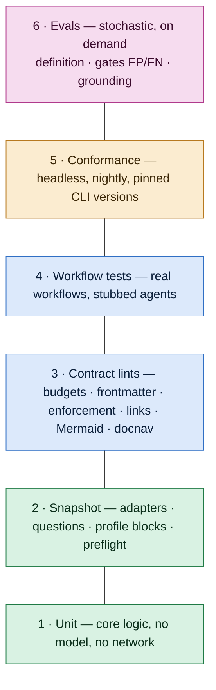

# Determinism and testing — push everything possible below the model

> **TL;DR** — A model's output cannot be unit-tested; almost everything around it can. `wholeloop` moves every decision with one right answer into the core, tests it without a model in seconds, snapshot-tests what it generates, runs real workflows against stubbed agents, smoke-tests each CLI headlessly, and keeps stochastic evals for the thin layer that is genuinely stochastic.

> [!NOTE]
> **Status: 🚧 partial.** Unit, snapshot, contract and stubbed-workflow checks run locally, alongside a reproducible definition corpus and deterministic baseline. A labelled gate corpus reports per-lens matrices before/after runtime refutation from explicit observations. A grounding corpus exercises real ramp/impact collectors with synthetic missing-data traps and exact numeric provenance. A disposable tier-A/Gemini framing runner separates explicit simulation from owner-run pinned live processes and names missing journal events. Live model measurements, narrative grounding and nightly client conformance remain pending. Decisions: [ADR-0003](../decisions/0003-deterministic-core-cli.md), [ADR-0011](../decisions/0011-size-budgets-and-enforcement.md). Implementation began in [P0-02](../../roadmap/phase-0-foundations.md#p0-02--typescript-toolchain).

---

## Where determinism comes from

| Concern | Lives in | Therefore |
| --- | --- | --- |
| Step order, preconditions, skips with reasons | `src/flow` | unit-tested state machine |
| Which questions to ask, with which options | `src/flow` + `src/config` | generated, snapshot-tested |
| Config and profile precedence | `src/config` | table-driven tests |
| Which repo skill fills which slot | `src/discover` | fixture repositories |
| Which provider fulfils a capability | `src/providers` | fixture CLI configs |
| Artifact shape (spec, slices, brief…) | `src/flow/shapes` | corpus of good and bad artifacts |
| Lens sets, refutation threshold, caps, verdict | `src/gates` | pure functions |
| Adapter output per CLI | `src/adapters` | golden files |
| Projections from the journal | `src/state` | replay must be byte-identical |
| Docnav, links, diagrams | `src/docs` | CI check on every change |

What is left to the model: understanding, writing, investigating, building, judging a lens. That is the only part evals measure.

## The test pyramid



| Layer | Runs | Speed | Fails when |
| --- | --- | --- | --- |
| 1 · Unit | every commit | seconds | a decision changed |
| 2 · Snapshot | every commit | seconds | generated output changed — review the diff, update on purpose |
| 3 · Contract lints | every commit | seconds | a file breaks a budget, a rule has no enforcer, a link or diagram breaks |
| 4 · Workflow | every commit | seconds | the orchestration logic misroutes, mis-aggregates or never calls a guard |
| 5 · Conformance | nightly + before release | minutes | a real CLI no longer loads, calls `wl`, or reaches the expected journal state |
| 6 · Evals | when a prompt or check changes | minutes–hours | a check got noisier, blinder or started inventing |

## Workflow tests with stubbed agents

Gate and fan-out workflows are tested by running the **real workflow code** with a fake `agent()` that returns scripted results. This catches the failure an extracted unit test cannot: a guard that exists but is never called.

## Conformance across CLIs

A fixture repository, a scripted scenario (for example: standalone `build-slice "add a --version flag"`) and, per tier-A CLI, a headless run with pinned versions. Assertions are **structural** — journal events, item states, files on the branch — never on the model's wording. The result feeds the generated [compatibility matrix](../platforms/README.md).

## Disposable standalone conformance

Build the core, then prepare a fixture with an exact installed client version:

```bash
wl conformance prepare --target codex --pin 0.163.0 --json
wl conformance report cf-<returned-id> --json
wl conformance run cf-<returned-id> --fixture --json
```

Preparation returns an external disposable repository, prompt and shell-free native
recipe; it starts no client/model. Use the returned complete ID. Simulation calls
that target's installed launcher/core and reports FIXTURE_PASS with simulation
evidence. It cannot populate the actual client conformance matrix. The synthetic
facts and framing artifact live in harness/conformance/standalone-frame.json.

Gemini is supported as an additional explicit target; tier-A acceptance remains
a separate four-client requirement.

For an actual model run, prepare a **new** fixture, review its project customization
and arrange native trust, auth and permissions first. Then use conformance run with
--live instead of --fixture. Live execution can use authenticated models and incur
cost. The runner probes the selected binary version before sending the scenario;
missing/mismatched versions fail. A process has a 180-second default deadline,
overridable with --timeout in milliseconds (100–600000), and a 1 MiB combined output
limit. Cancellation terminates the worker group. No resume or permission bypass is
emitted. A failed/interrupted fixture is consumed; inspect it and prepare another.

Control, ownership and state stay outside Git. Per-run XDG roots isolate wholeloop
user configuration/state, while native authentication remains in its existing
store. These are fresh processes, not hermetic client environments: ambient client
settings, compatible skills/plugins and native logs may remain. No credentials are
copied and native stdout/stderr is discarded rather than saved in reports.

The structural judge requires one initiative with the fixture owner/repository,
one standalone frame-problem start and same-run completion, the full artifact shape
and projection, a go outcome and no continuation/skip/approval. A random note marker
is present only in the installed skill and must appear between start and completion.
The observed repository snapshot must stay unchanged. Missing fields name their
journal event, alongside the CLI and step. Reports include source/scenario/core
hashes and process status; report rechecks retained evidence without launching work.
UNRUN exits 3, failed reports exit 4, and fixture/live structural passes exit 0.

A live PASS covers only this scenario's process/journal contract. It does not prove
native JSON protocol, the actual loader, hook activation, permission isolation,
semantic challenge quality or truthful narrative evidence. Ignored files, Git
configuration, external writes and remote effects need separate inspection. Native
startup files can trigger workspace-change failures; investigate them rather than
silently weakening the baseline. See [ADR-0051](../decisions/0051-disposable-conformance-and-explicit-evidence.md)
and the [manual checklist](../../roadmap/manual-verification.md).

## Evals — measuring the checks themselves

| Corpus | Measures |
| --- | --- |
| **Definition** | Do the challengers catch defective criteria and slice sets, without crying wolf on look-alikes? |
| **Gates** | False positives and false negatives per lens, before and after adversarial verification |
| **Grounding** | Do data steps invent numbers, or turn unreachable sources into open questions? |

Every real failure that reaches a person becomes a new fixture. A change to a check ships with its eval result.

### Reproducible definition report

Run `npm run eval:definitions -- --json` against the fixed thirty-case seed, or
`wl eval definitions <corpus.json> --json` after building. It covers all four Define
challenger modes, defective definitions and look-alike negatives. The report
includes per-class TP/FP/TN/FN, recall, precision and false-alarm rate; no
denominator produces null rather than a misleading perfect score.

The initial **core-definition-lint@1** baseline has 18 true positives, 0 false
positives and 2 false negatives: 90% micro recall and 0% false-alarm rate across
this seed's case/class pairs. Supported structural classes have full recall in
this small fixture set; prose semantic-conflict and independent-delivery each
have zero recall. These are local deterministic measurements, not model quality
or population estimates. The committed baseline retains both misses.

For actual challenger evaluation, collect predictions in
wholeloop/definition-predictions@1 JSON with evaluator, corpusSha256 and one
case/defects result per case, then pass `--predictions <file>`. The digest binds
labels and exact artifact bytes. Missing/duplicate responses, unknown labels and
changed seeds fail. An evaluator name does not prove the host ran; preserve raw
findings and actual execution evidence separately, with expected labels hidden
from the challenger. The runner makes no model/network calls or state writes.

See the [corpus instructions](../../test/evals/definition/README.md),
[baseline](../../test/evals/definition/baseline.json) and
[ADR-0028](../decisions/0028-definition-eval-seeds-and-external-predictions.md).
Scoring exits zero even when it reports misses; callers choose regression
thresholds independently. Baseline reproduction and confusion arithmetic run in
the unit suite.

### Per-lens gate report

Run `npm run eval:gates -- --json`, or `wl eval gates <corpus> --predictions <file>
--json`. Twenty-four original snippets cover labelled defects and look-alikes for
all six built-in lenses. The committed baseline is explicitly synthetic: before
TP 6 / FP 6 / TN 6 / FN 6; after TP 6 / FP 2 / TN 10 / FN 6. Recall stays 0.5 and
the false-alarm rate changes from 0.5 to 1/6. Correctness/security preserve their
cautious false positives when one verifier disagrees. This is arithmetic evidence,
not a model-quality measurement or a claim about production defect rates.

The runner uses the real gateReport aggregation, including fail-safe unanimity.
It reports unavailable responses as unknown with coverage, never invented negatives,
and leaves undefined ratios null. Incorrect refutations can also lose true defects.
Predictions bind the exact corpus digest, provenance and every assigned case/slot.
No snippets, models or network operations execute during scoring.

For real collection export `--inputs` (opaque IDs, questions and source only), hide
the gold labels/reasons and collect independent reviewer/refuter observations.
Case-level finding presence does not establish the semantic correctness of every
finding; validate reasoning, locations and labels separately. See the
[gate seed guide](../../test/evals/gates/README.md),
[baseline](../../test/evals/gates/baseline.json) and
[ADR-0037](../decisions/0037-gate-evaluation-observations-and-refutation-matrices.md).

### Seeded structured grounding

Run `npm run eval:grounding -- --json`, or `wl eval grounding <corpus> --json`.
Twenty original sandbox cases exercise actual ramp/impact collectors: six present
finite values (including actual zero and signed deltas) and fourteen absent,
incomplete, wrong-unit, nonnumeric, empty, non-finite or unsupported-operation traps.
The fixed synthetic baseline grounds all six values and keeps every trap unknown.
It is a deterministic normalization regression, not a live model measurement.

The judge requires exact metric/unit/query/source/body provenance, complete case
coverage, explicit unknown reasons and an exact corpus digest. Right-looking values
from unrelated sources and omitted genuine observations fail. Failed grounding
returns exit 4. External predictions carry evaluator/provenance, but metadata alone
proves no real execution. Export --inputs for opaque shuffled source observations
without labels/reasons, hide the corpus/guide/baseline and preserve actual host
records separately. --inputs and --predictions cannot be combined.

The report explicitly lists frame-problem, research, prepare-launch and decide-next
as unevaluated: narrative numbers, qualitative statistics, production query truth
and causal interpretations remain separate semantic checks. See the
[grounding seed guide](../../test/evals/grounding/README.md),
[baseline](../../test/evals/grounding/baseline.json) and
[ADR-0044](../decisions/0044-grounding-fixtures-and-exact-numeric-provenance.md).

## Enforcement — every hard rule executes somewhere

A rule written only in prose is a suggestion the agent can reason around. `enforcement.yml` maps each hard rule to the code, test or lint that enforces it; the enforcement lint fails on a rule with no enforcer, an enforcer that is only a restatement, or a skill that contradicts a rule. Details: [ADR-0011](../decisions/0011-size-budgets-and-enforcement.md).

---

<!-- docnav -->
[◀ Orchestration and gates](orchestration-and-gates.md)  ·  [📖 Docs index](../README.md)  ·  [🧭 Concepts](../concepts.md)  ·  [Decisions ▶](../decisions/README.md)
