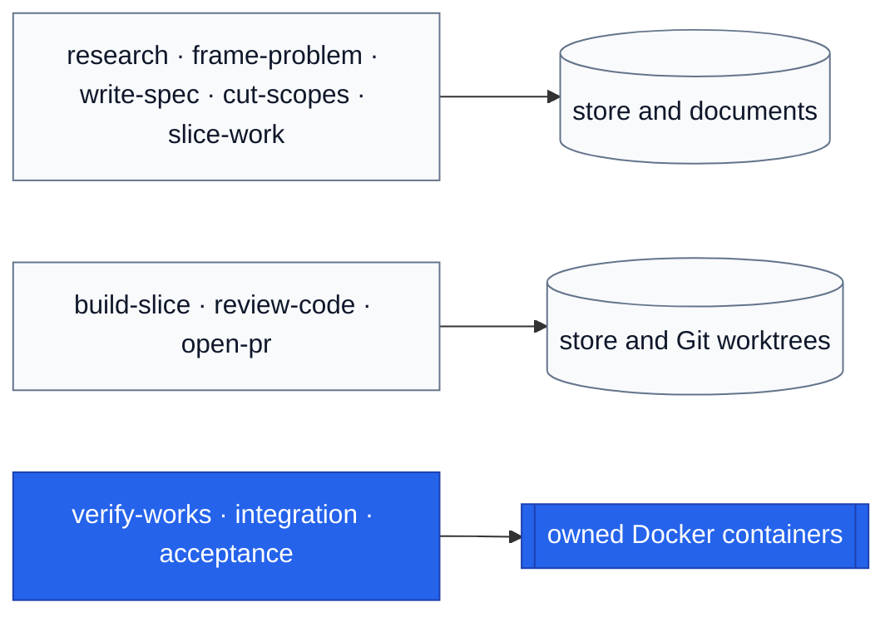

# Execution isolation — why project code runs in Docker

> **TL;DR** — Whenever `wholeloop` must run your project's code — its test suite, the builder's tests and scripts, its services, its acceptance checks — it runs them in Docker containers by default, supervised or autonomous. Docker is what lets a verdict rest on observed results without exposing your home directory, credentials or network. You can choose to run a supervised step on your machine, per run or per repository, and it is then shown as not isolated; autonomous runs never allow it. Steps that only read never touch Docker.

> [!NOTE]
> **Partial.** Owned containers, volumes and networks, the refusals below and recovery are tested on macOS and Linux. Standalone headless gate workers still inherit the caller's environment, and whether a native client's builder obeys its instruction to use `wl exec` is not yet observed; see [Known gaps](#known-gaps). Decision: [ADR-0245](../decisions/0245-require-docker-for-project-code-execution.md).

---

## Why Docker is required

The point of the runner is that you can trust its verdicts. A verdict such as "the suite passes" or "the endpoint returns 200" is only worth something if the runner observed it itself, so it has to execute code a model has just written.

Running that code directly on your machine would give it your home directory, your shell environment, your SSH and cloud credentials and your network. Docker gives the runner what it needs instead:

| Need | What the container provides |
| --- | --- |
| Containment | No host mounts, no host environment, no Docker socket, no network unless the recipe declares an internal one |
| Repeatability | An image pinned by digest, inputs pinned by content hash, explicit commands with fixed working directories |
| Ownership | Every container, volume and network is labelled, re-inspected before each effect, cancellable and retired by the run that created it, even after the controller crashes |
| Bounded cost | Memory, CPU, output, time and capacity limits that refuse before starting |

This is a conscious trade-off: Docker is an external dependency you must install, in exchange for strict, observable checks. There is no fallback that runs project code on the host when Docker is missing; such a fallback would silently remove the guarantees above, so the step refuses and says why.

## Which steps need it

Steps that execute project code need Docker whether you call them one at a time or let the runner chain them. The others never contact it.

## Supervised steps

When you run `verify-works` or `build-slice` yourself, project code runs in one **warm container per slice**: the suite through `wl verify suite`, and the builder's tests, builds and scripts through `wl exec --for <slice> -- <command>`. The container is created on first use, reused while the slice lives and removed when its worktree stops.

| Property | Supervised container |
| --- | --- |
| Image | Chosen by you, from your local cache only; nothing is pulled |
| Files | The slice's worktree at `/workspace`, read and written as your user ID |
| Network | None |
| Environment | `HOME=/tmp` on a private temporary file system; no host variable |
| Privileges | No capabilities, no privilege escalation, bounded processes, memory and CPU |

- **Docker is checked only when code is about to run**, before anything is planned. Without it the step refuses (exit 3) and names both remedies: start Docker, or choose host execution for this run.
- **Host execution is a person's choice**: `--execution host` on `wl verify suite` for one run, or `wl setup --execution host --scope project` for the repository. It is shown before the suite starts, recorded with the round and displayed as "This machine, not isolated". Builders cannot select it; `wl exec` follows only the repository's choice. The autonomous runner refuses it.
- **Dependencies** are installed by one declared setup command (`wl setup --project-setup "npm ci" --scope project`), run once per container with network; the container is detached from that network and checked offline before any other command, and the dependency folder lives in the store, not the worktree. Without a declared setup the container never joins a network ([ADR-0260](../decisions/0260-network-for-supervised-project-setup.md)).

## Requirements

- A Docker Engine reachable through a **local Unix socket**, with permission to create containers, local volumes and bridge networks. Remote, TCP and SSH contexts are refused.
- A **Linux** daemon, version 28 or newer; the reference engine is 29.9.2. The preflight observes the actual daemon; a version string alone is not trusted.
- The pinned helper image already in the local cache; nothing is pulled silently. See the [Docker environments tutorial](../tutorials/delivery-docker.md).
- For supervised steps, the image you chose for the repository, also from the local cache.

## Secrets and environment variables

`wl` is built so that running your project in Docker does not read or forward your secrets:

- **No host environment reaches a container.** Containers receive only `HOME` and `TMPDIR` plus the variables baked into the pinned image.
- **The Docker CLI gets a minimal environment**: `PATH`, `HOME` and the `DOCKER_*` connection variables. Docker authenticates through its own credential store; `wl` never reads Docker's configuration files, and credentials never enter argv, generated files or container environments. Read-only queries are answered over the local socket that the CLI itself resolves, without starting a process ([ADR-0244](../decisions/0244-environment-and-docker-read-amplification.md)).
- **Credential files refuse the whole environment.** A candidate containing `.env`, `.env.*`, `.npmrc`, `.pypirc`, `auth.json` or `credentials*` is refused rather than silently skipped, so you notice.
- **Every copied file is scanned** for private keys, GitHub, OpenAI-style and AWS tokens and URLs with embedded passwords; a match refuses.
- **Ignored files are never copied.** Only tracked and non-ignored files of the owned candidate enter a volume; symbolic links refuse.
- **Recipes cannot request secrets.** A service that declares secret delivery is refused before any Docker command.
- **Delivery workers get an allowlisted environment** built by `deliveryWorkerEnvironment`, with a private home per attempt.

Workspace snapshots hash the bytes of every tracked and non-ignored file to prove that nothing changed; the bytes are hashed in memory and never stored or logged.

## Known gaps

- **Standalone headless gate workers** (`src/fanout/host.ts`) start the native client with the caller's complete environment. Delivery workers do not. Restricting gate workers needs each client's authentication variables declared and verified against signed-in clients, so it remains open in [manual verification](../../roadmap/manual-verification.md).
- **Builders in native clients** are instructed to run project commands through `wl exec`, and their tool policies still include a shell. Whether each client's builder follows the instruction is a native observation in [manual verification](../../roadmap/manual-verification.md); the core cannot stop a client's own shell.
- **No network for supervised setup.** A supervised container cannot install dependencies; repositories whose packages need a Linux install must prepare them another way or choose host execution.

## Decisions

[ADR-0102](../decisions/0102-inert-environment-recipes-and-pinned-setup-origins.md) (inert recipes and pinned origins), [ADR-0104](../decisions/0104-owned-environment-lifecycle-and-private-cancellation.md) (owned lifecycle and cancellation), [ADR-0243](../decisions/0243-single-writer-store-trust-model.md) (what the runner trusts and what it re-observes) [ADR-0245](../decisions/0245-require-docker-for-project-code-execution.md) and [ADR-0257](../decisions/0257-where-project-code-runs.md) (where project code runs, by default and by choice).

---

<!-- docnav -->
[◀ Orchestration and gates](orchestration-and-gates.md)  ·  [📖 Docs index](../README.md)  ·  [🧭 Concepts](../concepts.md)  ·  [Determinism and testing ▶](determinism-and-testing.md)
