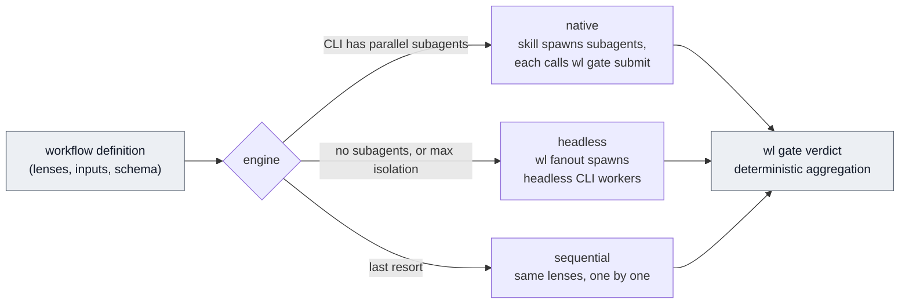
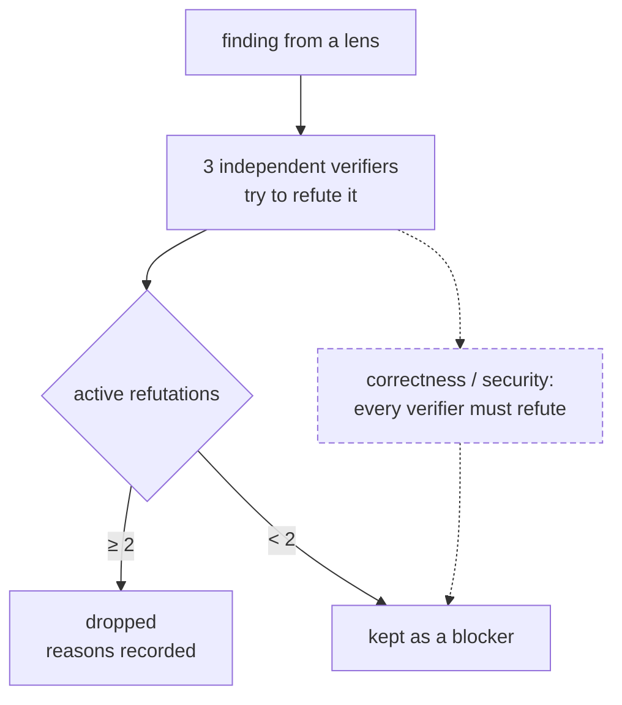

# Orchestration and gates — agents, engines and "until green"

> **TL;DR** — Eight short agent roles do the work. They run on whichever **engine** the CLI supports best — native subagents, headless worker processes, or one after another — and the result is the same, because everything that decides (lens sets, thresholds, round caps, aggregation) lives in the core, not in the engine.

A compiled six-lens review passed live on Codex. Decisions: [ADR-0006](../decisions/0006-orchestration-tiers.md), [ADR-0010](../decisions/0010-interaction-profile-never-changes-coverage.md).

---

## Persistent delivery limits

Expanded delivery uses independent [run budgets](../tutorials/delivery-budgets.md), bound to its immutable plan and private grant. Original deadlines and counters survive recovery and stricter plan revisions; unknown usage remains unknown and unavailable hard metering refuses admission. Interaction profiles cannot expand these allowances or turn fixture evidence into actual execution. Existing gate rounds remain unchanged. The complete native unattended runner is subsequent Phase 6 work.

## Fresh delivery workers

Expanded [worker assignments](../tutorials/delivery-workers.md) pin role tools, exact attempt/fence, bounded resume bytes and private context audiences. The controller assembles current queue contexts from immutable sources/plans and live grants. Worker output remains a claim; separate execution observations require current ownership and actual artifact bytes, and still establish no acceptance. Workers return blocked/unknowns to the controller and never ask directly. Dedicated [native delivery hosts](../tutorials/delivery-native.md) now negotiate pinned reference recipes and exact trusted runtime proof, with actual process registration, bounded execution and retained non-accepting receipts. Other expanded targets remain unverified. Actual backend/tool conformance still needs signed-in native clients, rather than following from prompt text or these schemas. [ADR-0100](../decisions/0100-role-bound-worker-contexts-and-execution-observations.md) preserves the standalone gate-host boundary.

## The agents

| Role | Job | Can write code? | Used by |
| --- | --- | --- | --- |
| `conductor` | Locates state, states the plan, routes steps, relays verdicts | No | `next`, multi-slice builds |
| `researcher` | Investigates one angle against one source; evidence first | No | `research`, `measure-impact` |
| `challenger` | Attacks a definition artifact: a problem, a spec, a scope cut, a slice set, a criteria set | No | Define steps, `slice-work` |
| `builder` | Implements one slice or part, following the repo's resolved skills | **Yes** | `build-slice` |
| `verifier` | Checks one acceptance criterion or test group against real behaviour | No | `verify-works` |
| `reviewer` | Reviews through one lens; in `refute` mode cross-examines another finding | No | `review-code`, both gates' verify pass |
| `launcher` | Drafts comms, builds dashboards, writes enablement | Docs only, never sends | `prepare-launch`, `ramp-exposure` |
| `analyst` | Pulls real numbers against the pinned plan; verdict per metric | No | `measure-impact`, `decide-next` |

**What a role must not do is removed from its tools, not only written in its prompt.** Where a CLI cannot enforce a read-only agent, the core verifies it afterwards (the working tree must be unchanged after a review).

## Definition challenger modes

`wl challenge plan problem|spec|criteria|scopes|slicing --file <artifact> --json` renders fixed coverage, an input digest, structural findings and host instructions. Problem/spec/scopes/slicing read their Markdown artifacts; standalone criteria use `wholeloop/criteria@1` JSON from `wl challenge schema --json`. Scope plans pinned to a spec also need `--for <initiative>`; slicing uses `--for <scope>`. Exit 4 reports structural defects. The command is read-only and does not invoke a model.

The resolved challenge dial controls tone and **additional** counter-questions: supportive 1, balanced 2, adversarial 3. `--challenge` is a transient override. Every finding and coverage item remains present at every level. The host challenger reports location, defect, evidence and a falsifying example, without repairing the author's artifact or inventing missing evidence.

Optional criterion `assertion` metadata contains `subject`, `context`, `unit`, `operator` (`lt`, `lte`, `eq`, `ne`, `gte`, `gt`) and numeric `value`. Lint detects contradictory pairs only with identical subject/context/unit, including open and closed bounds. It does not infer assertions from prose or convert units. Broader logical consistency, independence and factual truth still need semantic critique. [ADR-0025](../decisions/0025-explicit-criteria-constraints-and-challenge-modes.md) records the deliberate boundary. Spec completion runs this same lint before writing state. Definition plans and instruction snapshots are tested locally; live host critique and read-only tools remain manual verification.

## Three engines, one result



| Engine | When | Trade-off |
| --- | --- | --- |
| **native** | Claude Code, Codex, OpenCode, Copilot (`/fleet`), Cursor, Antigravity | Best UX; enforcement of read-only varies per CLI |
| **headless** | Gemini CLI if parallel subagents are unavailable; anyone who wants each lens in a clean process | Real isolation and parallelism; separate processes cost more start-up and need non-interactive permissions |
| **sequential** | Anything else | Slowest; identical coverage |

The engine is chosen by the adapter's declared capabilities and can be overridden per run. **Coverage never depends on it.**

## Local headless process transport

Plan a gate through its normal workflow before selecting the process transport:

```text
wl gate plan review --for review-01234567 --repo . --base main --json
wl fanout run review --for review-01234567 --engine headless --adapter codex --concurrency 4 --timeout 120 --json
```

Current local recipes cover all seven clients, with an explicit AGY readiness condition. They were checked against installed help and primary documentation, then executed with synthetic PATH clients. Actual Codex 0.163.0/core 9ea3a298 passes the compiled-CLI six-lens review gate-35be1f516f42cb8c, with all workers accepted and no repository edits. This does not certify every client, semantic truth or adversarial isolation. AGY additionally requires a reported read-only init before any assignment is sent. Native/sequential SDK hosts are available independently.

Each assignment gets a separate process, session and external-store directory. Prompts travel through stdin, with the exact pinned patch/rubric and suite metadata when present. The response must match its assignment digest/run/round and unit or finding/verifier; only validated responses enter the same gate submit/verdict path. Verification requires the actual once-per-round suite first; the process host does not convert a semantic answer into a machine execution result.

Concurrency is 1–16 (default 4), timeout is 0.1–600 seconds (default 120), input is bounded to 2 MiB and combined output to 1 MiB. Timeout/cancellation terminates then kills the owned POSIX process group. Missing/failed/invalid inspections become unavailable; failed refuters contribute no vote. Observed workspace changes stop the run and preserve edits. A failed round retains its ordinary budget and needs explicit gate planning rather than an automatic repair or reset.

The transport stores worker status/exit metadata under `fanout/<run>/<round>/`; it retains no assignment bodies or raw stdout/stderr. Client-owned internal logs and managed policy still need live review. Decided rounds return cached verdicts; undecided rounds skip recorded units/votes. A round ownership lock prevents two conductors from spawning the same round concurrently. Inspect its owner.json and confirm the process stopped before recovering a lock left by a physical crash.

Claude uses read-only built-in tools, non-interactive denials and disabled ordinary customizations/MCP. Codex uses an ephemeral read-only sandbox, no approval prompts, ignored user config and a working directory outside the project; its prompt names the repository to inspect. Its per-assignment --output-schema binds the complete envelope and exact unit or finding/verifier, using a staged non-secret schema. The core still enforces all public gate and evidence rules; it never reconstructs missing identity from bare output. See [ADR-0091](../decisions/0091-native-exact-headless-response-schemas.md). Neither recipe uses a permission bypass or resume flag.

OpenCode selects V1/V2 from the observed native version, with a unique inspector outside the repository. V1 retains its deny-default global/agent permissions, read/glob/grep and completed final stop event. V2 stages an isolated global config with only the path-checked reader, explicit assigned external-directory access and native integration denials. Search, shell, editing and delegation stay denied. V2 accepts ended final-step text after clean process exit, unwrapping at most one exact JSON fence before unchanged assignment validation. Reject repository paths with wildcard characters, mixed sessions, failures and truncated turns. Native managed configuration/startup effects and full OpenCode gate acceptance remain separate checks; see [ADR-0088](../decisions/0088-version-specific-opencode-native-transports.md).

Copilot starts outside the repository with view/glob/grep only, explicit read permission, shell/write/url/memory denial, built-in MCP disabled and no automatic update, custom instructions or remote export. Override inherited allow-all and prompt-extension opt-in variables; retain native authentication in place. Silent text must be exactly one valid response envelope; do not mine JSON out of progress or tool events. Custom MCP startup, trusted-folder hooks and native client logs remain manual checks. [ADR-0058](../decisions/0058-additional-read-only-headless-recipes.md) records the native contracts and rejected broad grants.

Cursor uses Ask mode and an enabled sandbox, with the repository added to a fresh external workspace. Stage only .cursor/cli.json and hooks.json in that worker: read allowances, shell/write/web/MCP denials and a fail-closed positive read/search hook. Bad context, unknown tools, malformed/oversized payloads and missing Node are denied; a read response is empty and preserves other native permissions. Require the exact successful native final JSON object. No force, trust, resume, auto-review or MCP auto-approval flag is emitted. Only these two non-secret Cursor policy files may be staged, at most 64 KiB each, with private modes and whole-batch preflight; existing output and symlinks are refused. Setup failure launches no client. This is not crash-atomic multi-file writing or hermetic native startup. Actual hook activation, policy merging, ignored/external effects and model behavior remain manual checks. See [ADR-0060](../decisions/0060-cursor-observer-workers-and-private-native-policy.md).

Gemini uses explicit default approval and JSON output, with a positive native core read/list/glob/search registry. Its allowed-tools option alone is confirmation handling, not isolation. Stage only .gemini/worker-settings.json and apply it through a worker-local system override that remains effective when project settings are untrusted. Disable MCP, extensions, skills, ordinary hooks/discovery commands, experimental plan/agents and both built-in delegators. Preserve model/authentication and native trust; do not auto-trust the external worker or replace HOME.

Existing managed settings or an explicit system-settings override block setup. Keep the original system-defaults path rather than let native path derivation redirect it. The host's effective environment participates in this refusal. No personal/shared policy is read and re-emitted. Commas/newlines in include paths are refused. Actual Gemini 0.27.0 settings/argument/config/registry APIs accepted the production policy in a credential-free explicitly untrusted fixture, exposing only four read/search tools; no model or authentication initialized. Actual native activation, inherited include roots, logs/updaters and external effects remain manual checks. See [ADR-0071](../decisions/0071-gemini-observer-registry-and-private-policy.md).

Antigravity uses a uniquely named private primary observer with only view_file and grep_search, shell execution off, no subagent/MCP/skill/plugin attachment, inherited model and native sandbox. A private non-granting read/search hook denies mutations, unknown tools, invalid workspace context and external linked reads. Existing native settings, HOME, trust and authentication are not replaced.

Its native workspace writes are allowed by default, so the process transport holds the assignment until a bounded first-line init reports the exact worker cwd, unique read-only tool names and request-review/strict permission mode. No prompt is sent before that check. Missing/refused/malformed initialization, cancellation or timeout produces an unavailable worker. If a client waits for a prompt before emitting init, this recipe deliberately remains unavailable; do not send a probe prompt or permission bypass. Actual AGY 1.4.2 pre-input init remains unverified. Native startup hooks and service-side effects are not fully isolated by this check.

After readiness, send one documented JSONL user event and require one fresh matching SUCCESS result with one turn and consistent conversation IDs. Reject mixed/failed streams rather than use an earlier response. Bound both logical and encoded input and keep existing process/output/cancellation limits. Named private agent/hook files share whole-batch ancestor preflight and private modes with the other recipes. Actual agent/hook loading, reported tools, inherited policy, native logs/updaters and models remain manual checks. See [ADR-0072](../decisions/0072-antigravity-startup-gated-observer-workers.md).

These settings and snapshot checks do not prove the absence of ignored/transient writes, managed-hook effects or external side effects. See [ADR-0046](../decisions/0046-bounded-headless-workers-and-shared-gate-aggregation.md) and the [manual checklist](../../roadmap/manual-verification.md).

## Gates

The decision layer is executable independently of a model:

```bash
wl gate plan review --for review-01234567 --repo . --base main --json
wl gate plan verify --for slice-01234567 --criteria agreed-criteria.json --json
wl gate submit --for review-01234567 --file result.json --json
wl gate verdict --for review-01234567 --gate review --json
wl gate plan review --for review-01234567 --extend 5 --reason 'Owner requests two more attempts' --json
wl gate schema --json
```

Use an open slice/part with an active recorded worktree, or create a standalone `review` item and supply a named base. Planning pins repository, base SHA, prompts, policy digest, quorum and criteria. Verify reads criteria from the slice or an explicit `wholeloop/criteria@1` file; absent criteria cause a question/precondition failure. It includes one suite unit and one unit per verbatim criterion. Planning does not execute a suite or invoke a model.

A result envelope contains `run`, `round`, `result`; a refutation envelope contains `run`, `round`, `vote`. The schema command prints their public shapes. For example:

```json
{
  "run": "gate-0123456789abcdef",
  "round": 1,
  "result": {
    "unit": "correctness",
    "status": "ok",
    "evidence": ["Observed request test exits 0; empty input returns 400"],
    "findings": []
  }
}
```

Findings carry a local ID, location, text and evidence. A vote names `<unit>:<finding>`, a verifier slot, `refute|confirm|uncertain`, reason and evidence. Active refutations require counterevidence; duplicate slots and late submissions are rejected. The host must provide genuinely independent sessions.

Verdict seals the round, including missing/unavailable workers as blockers. Ordinary findings drop at the strict majority; correctness/security require every verifier to refute, so uncertainty cannot establish safety. A failed round records a compact mailbox pointer for the builder. Round projections rebuild from the external journal. PASS exits 0; FAIL/EXHAUSTED/STALE exit 4; exhausted planning exits 3.

HEAD, branch, semantic index, tracked/untracked non-ignored file bytes, modes and symlink targets must match the plan at submissions and sealing. The core preserves changed files and fails the round. Later changes expose a historical PASS as STALE. Ignored files, external symlink destinations and services need separate checks; submodules currently block snapshotting for explicit inspection. Changes restored between checks are not observable. See [ADR-0031](../decisions/0031-pinned-gate-rounds-and-fail-safe-verdicts.md).

### Verify — does it work, and does it solve the problem?

- Runs the repository's own suite **once** per round (tests, type checks, linters — detected by `wl discover`).
- One `verifier` per acceptance criterion or test group, reading the criterion verbatim.
- Asks of every changed test: *could this ever fail?* A test that cannot fail proves nothing.

### Review — is it well written?

Six fixed lenses, each a separate `reviewer`:

| Lens | Asks |
| --- | --- |
| `correctness` | Bugs the tests missed |
| `design-fit` | Does it follow this repo's existing patterns and boundaries? |
| `performance` | N+1s, unbounded work, wasteful I/O |
| `security` | Untrusted input, authz, secrets, injection |
| `simplicity` | Could it be smaller, clearer, more direct? |
| `change-shape` | Is the change scoped, reviewable, free of unrelated edits? |

Teams can **add** lenses through manifests ([extending](../extending/lenses-templates-profiles.md)). Removing a built-in requires a recorded reason in project config and shows up in every preflight.

### Adversarial verification



The rule counts **refutations**, not confirmations. Written the other way round, a verifier that crashes silently would delete a real blocker.

### Rounds — "until green", with a budget you control

| Gate | Default rounds | Round ≥ 2 looks at |
| --- | --- | --- |
| verify | 4 | the full suite again, plus the criteria still failing |
| review | 3 | only the diff since the previous round |

The round budget is a **parameter, not a constant**:

| Where | How | Example |
| --- | --- | --- |
| Project default | `.wholeloop/config.yml` | `gates: { verify: { rounds: 5 }, review: { rounds: 2 } }` |
| This run | flag | `--rounds verify=6,review=4` |
| This run | your words | "give it five rounds of review" |
| Mid-run, at the limit | an offer, never automatic | "Review is still red after 3 rounds — 2 more, or stop here?" |

- `wl gate plan ... --rounds verify=6,review=4` overrides the selected gate for its first round. `--extend <total> --reason <why>` records a larger explicit budget; `--new-run` requires a previous PASS. A failed run cannot reset its counter.
- The budget is counted by the core from the journal, never by the agent, and the preflight prints the number actually enforced.
- Reaching the budget **never passes the slice**. It stops and hands the open findings to a person, who can extend the budget or take over.
- Valid range is 1–10 per gate; the minimum of one round means a gate can be made shorter, but never skipped.
- The verification quorum (three verifiers, two refutations to drop a finding) is configurable too (`gates.verifiers`, odd numbers only, majority to drop).

### Gates observe, builders repair

Gates **never fix**. They route findings back to the builder through the mailbox. A checker that could edit what it checks would end up approving its own work.

## Pace — concurrency, nothing else

| Pace | Builders | Gates |
| --- | --- | --- |
| `guided` | One at a time, plan shown before code | Lenses one after another |
| `staged` | In parallel | One slice's gates at a time, cost reported between slices |
| `parallel` | In parallel | Fully fanned out |

Parallel builders never collide because each one works in its **own git worktree** on its own branch; dependencies between slices (`blocked-by`) still decide what may start, and chained slices can stack their branches.

Every pace runs the same lenses, the same verification, the same round budget and stops at the same decision points.

---

## Incremental review context

Build and standalone review share the same read-only scheduler. Each reviewer and refuter receives the actual pinned repository rubric, exact private patch and prior kept findings. New rounds compare changed-file manifests, including edits without commits; they do not replay the full branch diff. The core guards index bytes and current snapshot receipts. Semantic rechecking of earlier blockers and actual tool isolation remain host responsibilities. Private objects must accompany the journal on recovery. See [ADR-0034](../decisions/0034-private-incremental-review-inputs-and-pinned-rubrics.md).

<!-- docnav -->
[◀ Operator overview](operator-overview.md)  ·  [📖 Docs index](../README.md)  ·  [🧭 Concepts](../concepts.md)  ·  [Execution isolation ▶](execution-isolation.md)
