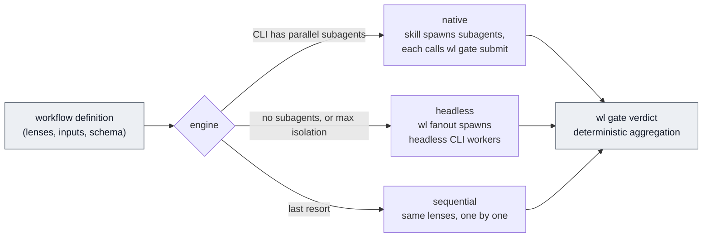
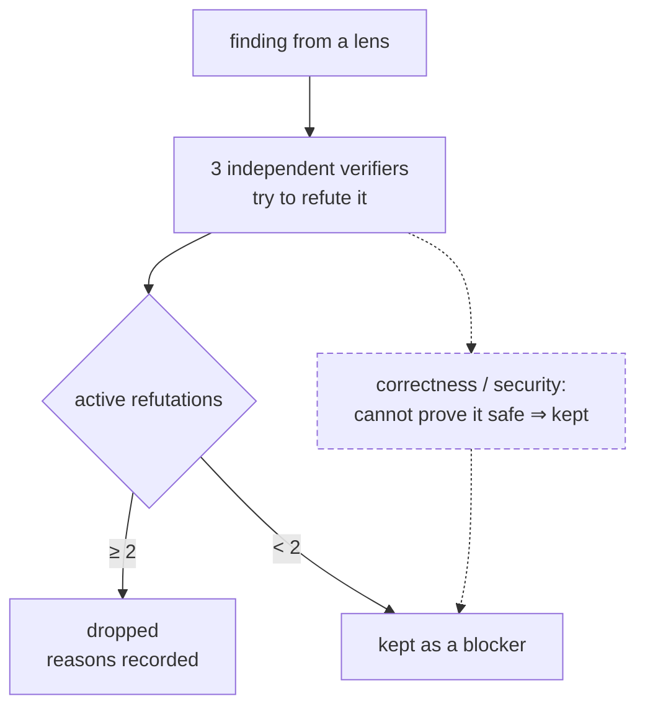

# Orchestration and gates — agents, engines and "until green"

> **TL;DR** — Eight short agent roles do the work. They run on whichever **engine** the CLI supports best — native subagents, headless worker processes, or one after another — and the result is the same, because everything that decides (lens sets, thresholds, round caps, aggregation) lives in the core, not in the engine.

> [!NOTE]
> **Status: 🚧 partial.** The conductor and research roles, shared research scheduling, pinned source plans and active-refutation aggregation and fixed definition challenger modes are implemented with fixture/snapshot tests. Live client engines, gate rounds and the remaining roles are pending. Decisions: [ADR-0006](../decisions/0006-orchestration-tiers.md), [ADR-0010](../decisions/0010-interaction-profile-never-changes-coverage.md). Implementation: [P3-03](../../roadmap/phase-3-build.md#p3-03--gate-engine), [P5-03](../../roadmap/phase-5-reach-release.md#p5-03--headless-fan-out-engine).

---

## The agents

| Role | Job | Can write code? | Used by |
| --- | --- | --- | --- |
| `conductor` | Locates state, states the plan, routes steps, relays verdicts | No | `next`, multi-slice builds |
| `researcher` | Investigates one angle against one source; evidence first | No | `research`, `measure-impact` |
| `challenger` | Attacks a definition artifact: a problem, a spec, a scope cut, a slice set, a criteria set | No | Define steps, `slice-work` |
| `builder` | Implements one slice or part, following the repo's resolved skills | **Yes** | `build-slice` |
| `verifier` | Checks one acceptance criterion or test group against real behaviour | No | `verify-works` |
| `reviewer` | Reviews through one lens; in `refute` mode cross-examines another finding | No | `review-code`, both gates' verify pass |
| `launcher` | Drafts comms, builds dashboards, writes enablement | Docs only, never sends | `prepare-launch`, `ramp-exposure` |
| `analyst` | Pulls real numbers against the pinned plan; verdict per metric | No | `measure-impact`, `decide-next` |

**What a role must not do is removed from its tools, not only written in its prompt.** Where a CLI cannot enforce a read-only agent, the core verifies it afterwards (the working tree must be unchanged after a review).

## Definition challenger modes

`wl challenge plan problem|spec|criteria|scopes --file <artifact> --json` renders
fixed coverage, an input digest, structural findings and host instructions.
Problem/spec/scopes read their Markdown artifacts; standalone criteria use
`wholeloop/criteria@1` JSON from `wl challenge schema --json`. Scope plans pinned
to a spec also need `--for <initiative>`. Exit 4 reports structural defects.
The command is read-only and does not invoke a model.

The resolved challenge dial controls tone and **additional** counter-questions:
supportive 1, balanced 2, adversarial 3. `--challenge` is a transient override.
Every finding and coverage item remains present at every level. The host
challenger reports location, defect, evidence and a falsifying example, without
repairing the author's artifact or inventing missing evidence.

Optional criterion `assertion` metadata contains `subject`, `context`, `unit`,
`operator` (`lt`, `lte`, `eq`, `ne`, `gte`, `gt`) and numeric `value`. Lint detects
contradictory pairs only with identical subject/context/unit, including open and
closed bounds. It does not infer assertions from prose or convert units. Broader
logical consistency, independence and factual truth still need semantic critique.
[ADR-0025](../decisions/0025-explicit-criteria-constraints-and-challenge-modes.md)
records the deliberate boundary. Spec completion runs this same lint before
writing state. Definition plans and instruction snapshots are tested locally;
live host critique and read-only tools remain manual verification.

## Three engines, one result

| Engine | When | Trade-off |
| --- | --- | --- |
| **native** | Claude Code, Codex, OpenCode, Copilot (`/fleet`), Cursor, Antigravity | Best UX; enforcement of read-only varies per CLI |
| **headless** | Gemini CLI if parallel subagents are unavailable; anyone who wants each lens in a clean process | Real isolation and parallelism; separate processes cost more start-up and need non-interactive permissions |
| **sequential** | Anything else | Slowest; identical coverage |

The engine is chosen by the adapter's declared capabilities and can be overridden per run. **Coverage never depends on it.**

## Gates

### Verify — does it work, and does it solve the problem?

- Runs the repository's own suite **once** per round (tests, type checks, linters — detected by `wl discover`).
- One `verifier` per acceptance criterion or test group, reading the criterion verbatim.
- Asks of every changed test: *could this ever fail?* A test that cannot fail proves nothing.

### Review — is it well written?

Six fixed lenses, each a separate `reviewer`:

| Lens | Asks |
| --- | --- |
| `correctness` | Bugs the tests missed |
| `design-fit` | Does it follow this repo's existing patterns and boundaries? |
| `performance` | N+1s, unbounded work, wasteful I/O |
| `security` | Untrusted input, authz, secrets, injection |
| `simplicity` | Could it be smaller, clearer, more direct? |
| `change-shape` | Is the change scoped, reviewable, free of unrelated edits? |

Teams can **add** lenses through manifests ([extending](../extending/lenses-templates-profiles.md)). Removing a built-in requires a recorded reason in project config and shows up in every preflight.

### Adversarial verification

The rule counts **refutations**, not confirmations. Written the other way round, a verifier that crashes silently would delete a real blocker.

### Rounds — "until green", with a budget you control

| Gate | Default rounds | Round ≥ 2 looks at |
| --- | --- | --- |
| verify | 4 | the full suite again, plus the criteria still failing |
| review | 3 | only the diff since the previous round |

The round budget is a **parameter, not a constant**:

| Where | How | Example |
| --- | --- | --- |
| Project default | `.wholeloop/config.yml` | `gates: { verify: { rounds: 5 }, review: { rounds: 2 } }` |
| This run | flag | `--rounds verify=6,review=4` |
| This run | your words | "give it five rounds of review" |
| Mid-run, at the limit | an offer, never automatic | "Review is still red after 3 rounds — 2 more, or stop here?" |

- The budget is counted by the core from the journal, never by the agent, and the preflight prints the number actually enforced.
- Reaching the budget **never passes the slice**. It stops and hands the open findings to a person, who can extend the budget or take over.
- Valid range is 1–10 per gate; the minimum of one round means a gate can be made shorter, but never skipped.
- The verification quorum (three verifiers, two refutations to drop a finding) is configurable too (`gates.verifiers`, odd numbers only, majority to drop).

### Gates observe, builders repair

Gates **never fix**. They route findings back to the builder through the mailbox. A checker that could edit what it checks would end up approving its own work.

## Pace — concurrency, nothing else

| Pace | Builders | Gates |
| --- | --- | --- |
| `guided` | One at a time, plan shown before code | Lenses one after another |
| `staged` | In parallel | One slice's gates at a time, cost reported between slices |
| `parallel` | In parallel | Fully fanned out |

Parallel builders never collide because each one works in its **own git worktree** on its own branch; dependencies between slices (`blocked-by`) still decide what may start, and chained slices can stack their branches.

Every pace runs the same lenses, the same verification, the same round budget and stops at the same decision points.

---

<!-- docnav -->
[◀ State and messaging](state-and-messaging.md)  ·  [📖 Docs index](../README.md)  ·  [🧭 Concepts](../concepts.md)  ·  [Determinism and testing ▶](determinism-and-testing.md)
