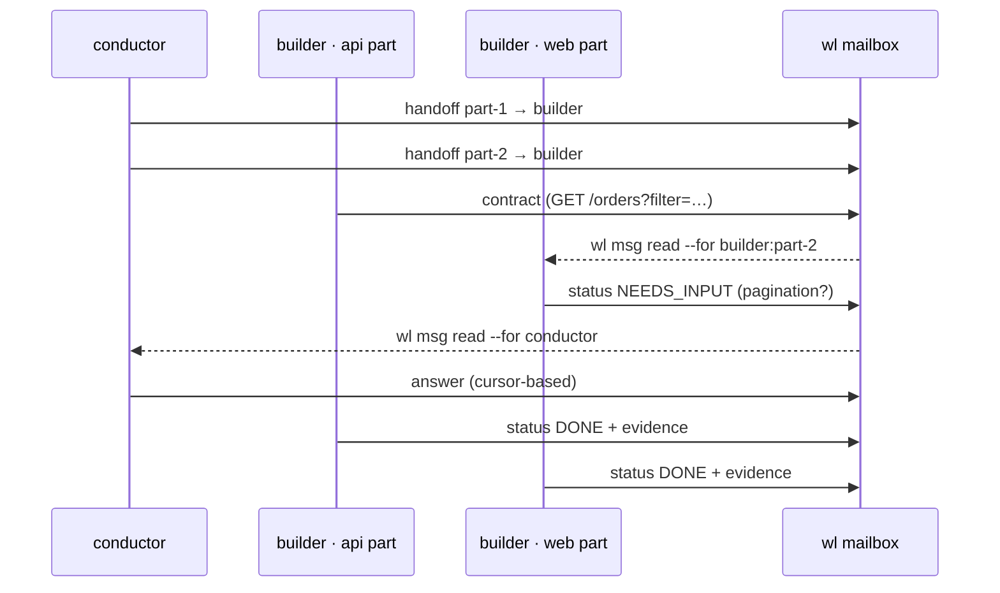

# State and messaging — memory that outlives every session

> **TL;DR** — One store per person, outside every repository. An append-only **journal** of events is the source of truth; readable **projections** are regenerated from it; a **mailbox** carries messages between agents and steps. Only `wl` writes to it. Any session, in any CLI, can resume from it.

> [!NOTE]
> **Status: 🚧 partial.** The external journal, typed items, atomic projections, state commands, mailbox and bounded context packs are implemented. The step engine now records minimal framing runs and required decisions; full step workflows and provider adoption remain planned. Decision: [ADR-0004](../decisions/0004-state-outside-the-repo.md). Implementation: [P1-03, P1-04](../../roadmap/phase-1-walking-skeleton.md#p1-03--state-store--journal-ids-projections).

---

## Why not keep state in the session, or in the repo?

| Option | Problem |
| --- | --- |
| In the agent session | Lost on compaction, on a crash, on switching CLI; invisible to other agents |
| Inside the repository | Pollutes diffs and history; leaks between branches; one initiative may span several repositories |
| An external tracker as the store | Couples the harness to one vendor; slow; needs network for every write |
| **A local store owned by `wl`** | Survives everything above; vendor-neutral; mirrors outward through providers when you want it shared |

## Layout

```text
$XDG_STATE_HOME/wholeloop/            default: ~/.local/state/wholeloop
├─ journal/2026-10.ndjson               append-only events, one file per month
├─ items/
│  ├─ init-41c2/
│  │  ├─ initiative.md                  projection: front matter + body
│  │  ├─ frame.md · spec.md · decisions.md
│  │  └─ scopes/scope-a9e0/…
│  ├─ brief-7f3a.md
│  └─ slice-0d4e/
│     ├─ slice.md
│     └─ gates/verify-r1.json …
├─ mailbox/<thread-id>.ndjson           messages, one file per thread
├─ cursors.json                         per-reader read positions
├─ links.json                           id ↔ external refs (issue key, doc URL, PR)
├─ repos.json                           known repositories and their paths
└─ worktrees/<repo>/<slice-id>/         one git worktree per slice or part being built
```

`WL_WORKSPACE` selects `$XDG_STATE_HOME/wholeloop/workspaces/<name>` (for example `work` and `personal`); unset uses the root store. Names contain lowercase letters, numbers, underscores and hyphens. Relative XDG paths are ignored.

## Available commands

```text
wl state create initiative --title "Faster order search" --owner "Alex" --json
wl state list --json
wl state get init-0123abcd --json
wl state update init-0123abcd --status closed --json
wl note init-0123abcd "Support evidence collected" --json
wl link init-0123abcd https://example.com/spec --json
wl open init-0123abcd
wl state rebuild --json
```

`state show` prints all items, or one optional ID. `state list` returns summaries; `state get` returns the full item. `open` prints Markdown without launching another application. Creation accepts `--body-file` and an existing `--parent`; updates accept title, owner, body and status. IDs have a kind prefix and eight random hexadecimal characters, checked for collisions under the store lock. The examples in the design diagrams abbreviate them.

## The journal

Implemented event types are `item.created`, `item.updated`, `item.closed`, `note.added`, `link.added`, `msg.sent`, `msg.read`, `step.started`, `step.completed`, `step.skipped`, `answer.remembered` `decision.recorded`, `research.planned`, `research.submitted` and `research.examined`; later families in the table below remain planned. Their versioned schema lives in `src/state/schemas/event-v1.json`. Every change is an event. Projections are a pure function of the journal, which makes them reproducible and testable (`wl state rebuild` must produce byte-identical files).

```json
{"v":1,"id":"ev-01JA…","ts":"2026-10-14T16:02:11Z","actor":{"kind":"agent","name":"builder"},
 "type":"gate.verdict","subject":"slice-0d4e","data":{"gate":"verify","round":1,"result":"fail","findings":2}}
```

| Event family | Examples |
| --- | --- |
| `item.*` | `item.created` · `item.updated` · `item.closed` |
| `step.*` | `step.started` · `step.completed` · `step.skipped` (with reason) |
| `question.*` / `answer.*` | asked, answered, remembered scope |
| `gate.*` | `gate.planned` · `gate.submitted` · `gate.verdict` |
| `decision.*` | a person decided at a decision point — who, what, why |
| `msg.*` | `msg.sent` · `msg.read` |
| `link.*` · `env.*` | external refs · writes outside a repo with their undo command |

## The mailbox

Agents running in parallel need to talk without sharing a context window. The mailbox gives them threads, addressed by role, with a small set of message kinds:

| Kind | Meaning | Typical sender → receiver |
| --- | --- | --- |
| `contract` | A published interface others can build against | builder (producer part) → builder (consumer part) |
| `handoff` | "This is yours now", with what is done and what is not | conductor → builder · builder → verifier |
| `status` | `DONE` · `BLOCKED` · `NEEDS_INPUT`, with evidence | any agent → conductor |
| `question` | Something only another role or a person can answer | builder → conductor |
| `note` | Durable context worth keeping | anyone |



```text
wl msg send --thread slice-0123abcd --to builder --kind contract --body "GET /orders uses cursors" --json
wl msg read --for builder --reader session-a --json
wl msg read --for builder --reader session-b --peek --json
wl handoff slice-0123abcd --to verifier --body "Ready for verification" --json
```

Threads are existing item IDs. `--from` defaults to `conductor`; bodies can come from `--body-file`. Reading advances a cursor per reader and destination role; the reader defaults to the role. `--peek` leaves it untouched. Mailbox files and `cursors.json` are journal-derived projections, so rebuild preserves read positions. These commands only write the local store.

Messages live in the store, so they survive a crashed subagent and can be read by an agent spawned tomorrow in another CLI.

## Resuming anywhere

`wl resume [<id>] [--for <role>] [--reader <id>]` prints a **context pack**. Without an ID it selects the most recently active item. The implemented pack includes item/descendant summaries, unread message references, recent notes, links and an available next command; compact JSON is capped at 6144 UTF-8 bytes, with explicit totals and truncation. It never consumes messages or includes artifact bodies. The pack includes planned next-step availability, pending decisions and artifact references. The target pack also includes: where the item is in the flow, what each step produced (links, not bodies), open questions, unread messages, pending decision points and the suggested next command. It is short on purpose, sized to start a fresh session without flooding it. The `next` skill calls it first.

## Sharing with other people

The local store is personal. Sharing happens through **providers**: in synced mode each step also writes its artifact to the configured `docs` / `tracker` destinations and records the link. Someone else can then **adopt** the work into their own store from those artifacts (`next <URL>`), adopting existing items instead of duplicating them. Optional **sync adapters** (GitHub Issues, Linear, Jira…) mirror items outward; they are adapters, never the source of truth.

## Guarantees

- **Your checkout is never touched** — builds happen in dedicated git worktrees under the store, one per slice or part, each on its own branch. Your working copy can stay dirty, on any branch, while several slices build in parallel.
- **No harness writes inside repositories** — a guard refuses them. Project *configuration* (`.wholeloop/config.yml`) is the only harness file a repo holds, and it is written by people, on purpose.
- **Crash-safe** — a validated batch atomically replaces its monthly journal file, preserving all previous events. Files and directories are fsynced. Reads replay the journal, so a crash before projection updates does not hide committed changes; `state rebuild` repairs them. See [ADR-0020](../decisions/0020-journal-atomicity-and-lock-recovery.md).
- **Locks** — directory creation serializes writers. After five seconds, contention fails with the lock path and owner metadata. A crashed writer's lock is deliberately not stolen: inspect `.lock/owner.json`, confirm the writer has stopped, then remove only that lock directory.
- **Corruption** — invalid or incomplete journal lines stop reads and writes with file/line evidence. Preserve the original before manual recovery; the CLI never truncates it automatically.
- **Path guard** — repository roots, worktrees, bare repositories and symlinked ancestors are rejected before store writes. Store subpaths cannot escape through symlinks or traversal.
- **Replayable** — any projection can be deleted and rebuilt.
- **Inspectable** — everything is plain text; `wl open <id>` shows it.

---

<!-- docnav -->
[◀ Core CLI](core-cli.md)  ·  [📖 Docs index](../README.md)  ·  [🧭 Concepts](../concepts.md)  ·  [Orchestration and gates ▶](orchestration-and-gates.md)
