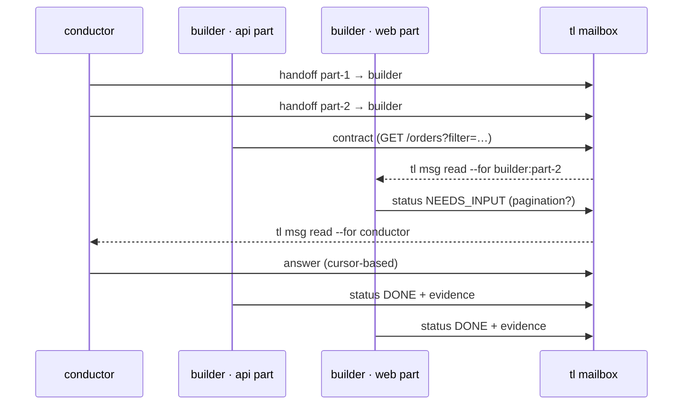

# State and messaging — memory that outlives every session

> **TL;DR** — One store per person, outside every repository. An append-only **journal** of events is the source of truth; readable **projections** are regenerated from it; a **mailbox** carries messages between agents and steps. Only `tl` writes to it. Any session, in any CLI, can resume from it.

> [!NOTE]
> **Status: 📐 design.** Decision: [ADR-0004](../decisions/0004-state-outside-the-repo.md). Implementation: [P1-03, P1-04](../../roadmap/phase-1-walking-skeleton.md#p1-03--state-store--journal-ids-projections).

---

## Why not keep state in the session, or in the repo?

| Option | Problem |
|---|---|
| In the agent session | Lost on compaction, on a crash, on switching CLI; invisible to other agents |
| Inside the repository | Pollutes diffs and history; leaks between branches; one initiative may span several repositories |
| An external tracker as the store | Couples the harness to one vendor; slow; needs network for every write |
| **A local store owned by `tl`** | Survives everything above; vendor-neutral; mirrors outward through providers when you want it shared |

## Layout

```text
$XDG_STATE_HOME/throughline/            default: ~/.local/state/throughline
├─ journal/2026-10.ndjson               append-only events, one file per month
├─ items/
│  ├─ init-41c2/
│  │  ├─ initiative.md                  projection: front matter + body
│  │  ├─ frame.md · spec.md · decisions.md
│  │  └─ scopes/scope-a9e0/…
│  ├─ brief-7f3a.md
│  └─ slice-0d4e/
│     ├─ slice.md
│     └─ gates/verify-r1.json …
├─ mailbox/<thread-id>.ndjson           messages, one file per thread
├─ cursors.json                         per-reader read positions
├─ links.json                           id ↔ external refs (issue key, doc URL, PR)
├─ repos.json                           known repositories and their paths
└─ worktrees/<repo>/<slice-id>/         one git worktree per slice or part being built
```

`TL_WORKSPACE` selects an isolated store (for example `work` and `personal`) without changing anything else.

## The journal

Every change is an event. Projections are a pure function of the journal, which makes them reproducible and testable (`tl state rebuild` must produce byte-identical files).

```json
{"v":1,"id":"ev-01JA…","ts":"2026-10-14T16:02:11Z","actor":{"kind":"agent","name":"builder"},
 "type":"gate.verdict","subject":"slice-0d4e","data":{"gate":"verify","round":1,"result":"fail","findings":2}}
```

| Event family | Examples |
|---|---|
| `item.*` | `item.created` · `item.updated` · `item.closed` |
| `step.*` | `step.started` · `step.completed` · `step.skipped` (with reason) |
| `question.*` / `answer.*` | asked, answered, remembered scope |
| `gate.*` | `gate.planned` · `gate.submitted` · `gate.verdict` |
| `decision.*` | a person decided at a decision point — who, what, why |
| `msg.*` | `msg.sent` · `msg.read` |
| `link.*` · `env.*` | external refs · writes outside a repo with their undo command |

## The mailbox

Agents running in parallel need to talk without sharing a context window. The mailbox gives them threads, addressed by role, with a small set of message kinds:

| Kind | Meaning | Typical sender → receiver |
|---|---|---|
| `contract` | A published interface others can build against | builder (producer part) → builder (consumer part) |
| `handoff` | "This is yours now", with what is done and what is not | conductor → builder · builder → verifier |
| `status` | `DONE` · `BLOCKED` · `NEEDS_INPUT`, with evidence | any agent → conductor |
| `question` | Something only another role or a person can answer | builder → conductor |
| `note` | Durable context worth keeping | anyone |



Messages live in the store, so they survive a crashed subagent and can be read by an agent spawned tomorrow in another CLI.

## Resuming anywhere

`tl resume <id>` prints a **context pack**: where the item is in the flow, what each step produced (links, not bodies), open questions, unread messages, pending decision points and the suggested next command. It is short on purpose, sized to start a fresh session without flooding it. The `next` skill calls it first.

## Sharing with other people

The local store is personal. Sharing happens through **providers**: in synced mode each step also writes its artifact to the configured `docs` / `tracker` destinations and records the link. Someone else can then **adopt** the work into their own store from those artifacts (`next <URL>`), adopting existing items instead of duplicating them. Optional **sync adapters** (GitHub Issues, Linear, Jira…) mirror items outward; they are adapters, never the source of truth.

## Guarantees

- **Your checkout is never touched** — builds happen in dedicated git worktrees under the store, one per slice or part, each on its own branch. Your working copy can stay dirty, on any branch, while several slices build in parallel.
- **No harness writes inside repositories** — a guard refuses them. Project *configuration* (`.throughline/config.yml`) is the only harness file a repo holds, and it is written by people, on purpose.
- **Crash-safe** — write-then-rename for every file, lock for every append.
- **Replayable** — any projection can be deleted and rebuilt.
- **Inspectable** — everything is plain text; `tl open <id>` shows it.

---

<!-- docnav -->
[◀ Core CLI](core-cli.md)  ·  [📖 Docs index](../README.md)  ·  [🧭 Concepts](../concepts.md)  ·  [Orchestration and gates ▶](orchestration-and-gates.md)
