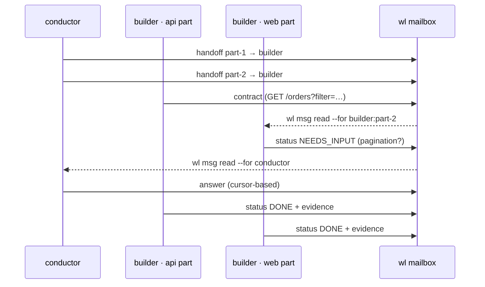

# State and messaging — memory that outlives every session

> **TL;DR** — One store per person, outside every repository. An append-only **journal** of events is the source of truth; readable **projections** are regenerated from it; a **mailbox** carries messages between agents and steps. Only `wl` writes to it. Any session, in any CLI, can resume from it.

> [!NOTE]
> **Status: 🚧 partial.** The external journal, typed items, atomic projections, state commands, mailbox and bounded context packs are implemented. The step engine records framing outcomes, research evidence, spec plans, stable child scope definitions, slice/part contracts, worktree allocation/lifecycle events and inherited required decisions; later Build/Rollout/Learn workflows and canonical URL adoption/shared outboxes are implemented locally. Optional journal attribution includes packaged client declarations and private person-decision metadata. Live adapter execution remains an manual conformance check. Decision: [ADR-0004](../decisions/0004-state-outside-the-repo.md). Implementation: [P1-03, P1-04](../../roadmap/phase-1-walking-skeleton.md#p1-03--state-store--journal-ids-projections).

---

## Why not keep state in the session, or in the repo?

| Option | Problem |
| --- | --- |
| In the agent session | Lost on compaction, on a crash, on switching CLI; invisible to other agents |
| Inside the repository | Pollutes diffs and history; leaks between branches; one initiative may span several repositories |
| An external tracker as the store | Couples the harness to one vendor; slow; needs network for every write |
| **A local store owned by `wl`** | Survives everything above; vendor-neutral; mirrors outward through providers when you want it shared |

## Layout

```text
$XDG_STATE_HOME/wholeloop/            default: ~/.local/state/wholeloop
├─ journal/2026-10.ndjson               append-only events, one file per month
├─ items/
│  ├─ init-41c2/
│  │  ├─ initiative.md                  projection: front matter + body
│  │  ├─ frame.md · spec.md · decisions.md
│  │  └─ scopes/scope-a9e0/…
│  ├─ brief-7f3a.md
│  └─ slice-0d4e/
│     ├─ slice.md
│     └─ gates/verify-r1.json …
├─ mailbox/<thread-id>.ndjson           messages, one file per thread
├─ cursors.json                         per-reader read positions
├─ links.json                           id ↔ external refs (issue key, doc URL, PR)
├─ repos.json                           known repositories and their paths
└─ worktrees/<repo-key>/<slice-or-part-id>/         one git worktree per slice or part being built
```

`WL_WORKSPACE` selects `$XDG_STATE_HOME/wholeloop/workspaces/<name>` (for example `work` and `personal`); unset uses the root store. Names contain lowercase letters, numbers, underscores and hyphens. Relative XDG paths are ignored.

Workspace allocations are journaled before Git provisioning, then marked ready or failed. Their projections live at `items/<id>/worktree.json` and in the readable item's Workspace section; status includes them and resume links the projection. The separate worktree-control lock coordinates Git lifecycle operations without holding the journal lock across external mutations. The manager must be called outside a journal transaction. Worktree output lives under the store, while journal/lock metadata stays outside those Git checkouts. Retry and cleanup rules are recorded in [ADR-0030](../decisions/0030-worktree-intents-leases-and-conservative-pruning.md).

## Delivery journal and cache recovery

Delivery metadata uses separate immutable segments at `delivery/journal/<first-sequence>.ndjson` and disposable `delivery/state/<run>.json` projections. Track stored plans/envelopes and private grant observations with delivery track; status always replays the authoritative segments, and delivery events provides bounded per-run pages. Every read re-reads each segment; a process reuses its last validated replay only for identical current bytes ([ADR-0174](../decisions/0174-exact-byte-delivery-replay-reuse.md)). delivery rebuild repairs only projections, never grants/revocations, legacy history or external effects. These commands start no worker and imply no execution authority.

Each transaction commits one atomic segment before its caches. Core validation requires known versioned payload/facet schemas, contiguous global sequence and predecessor digests, exact revisions/attempt identities and valid lifecycle transitions. Unknown/incomplete history refuses writes; recognizable future caches and aliases into another store namespace refuse repair. The [recovery tutorial](../tutorials/delivery-recovery.md) exercises independent-process inspection and byte-identical cache reconstruction. [ADR-0096](../decisions/0096-replayable-delivery-journal-without-authority-recovery.md) preserves legacy human/PR semantics and separates recovery from live admission. Checkpoint/worker/effect recovery is now available at the local controller-contract boundary described below; actual native/backend hosts remain later increments.

Delivery queue events/facets additionally retain exact work slots, enqueue order, dependency/capacity reasons, controller/attempt/generation and repository identity reservations. A claim and attempt commit together under the writer lock. Shared Git identity and explicitly named remote identity coordinate differently labelled runs and clones. Terminal observed evidence plus fencing is required before retry; no timeout steals a reservation. CLI enqueue/queue expose metadata only, while actual host admission/dispatch remains separate. See the [queue guide](../tutorials/delivery-queue.md) and [ADR-0097](../decisions/0097-durable-queue-reservations-and-current-attempt-fences.md).

Checkpoint manifests pin exact allowed external input paths, sizes and hashes, including binary evidence without copying its content. Immutable manifests precede their journal event; orphan manifests convey no state or authority. Delivery recovery validates current inputs and retains legacy gates/budgets. Effect intents persist a finite single invocation and its scoped observations separately; ambiguity cannot be blindly retried or closed successfully. Unknown worker identity retains reservations, pauses supervised recovery or returns blocked in none. Actual backend observations remain explicit host prerequisites.

Ordinary locking still never steals ownership. Explicit delivery lock-status/repair-lock accepts only an exact unchanged writer record whose PID is observed absent, retaining the original directory and a versioned receipt. It never signals a PID or restores a grant. Unknown/live/reused/malformed ownership refuses. See the [checkpoint tutorial](../tutorials/delivery-checkpoints.md) and [ADR-0098](../decisions/0098-checkpoint-recovery-and-observed-effect-reconciliation.md); native/backend group ownership and full runner acceptance remain separate.

## Optional event attribution

The pre-freeze journal contract accepts optional attribution ([ADR-0210](../decisions/0210-operator-overview-and-change-feed.md)). Validation, store APIs, packaged adapter declarations and person-command producers share this contract. No client or model is inferred from a name, message, environment variable or worker response.

| Field | Who may supply it | Meaning |
| --- | --- | --- |
| `actor.client` | State agent actor | Explicit `client`, optional `version`/`model`, and required `source` (`declared` or `host-observed`) |
| `actor.channel` | State person or delivery operator actor | A lowercase channel token, at most 64 ASCII characters |
| `rationale` | Person decision; operator lifecycle decision; controller observation of a delegated plan/build-plan/acceptance decision | A private reason, at most 4096 UTF-8 bytes, retaining line breaks |

Identity source is a provenance label, not authentication or evidence of native execution. An adapter declaration must remain `declared`; a trusted host may only describe observations it already owns. Existing native worker bindings and receipts keep their independently observed identity. Controller actors remain controllers: a session client never becomes the controller's identity. Missing fields mean unknown and are not backfilled on replay.

The state store's transaction append accepts optional metadata as its third argument; `event` accepts it as its fourth. The delivery append accepts an optional `{ rationale }` third argument; `deliveryEvent` accepts it as its sixth. Actor input is copied before retention. Validation rejects agent channels, worker-supplied person reasons, unknown provenance, malformed/oversized identity and non-decision reasons before journal mutation. Client versions are bounded to 128 UTF-8 bytes and models to 256, both single-line. None of these fields changes a grant, approval, transition or capability.

Legacy events retain their original bytes and replay behavior. Attribution participates in delivery event digests, so adding or changing it creates different integrity bytes; it never rewrites earlier records. Projections, bounded resume context, delivery reports and default diagnostics omit the new private reason. Raw journals remain private; exporting a recovery bundle still requires explicit `--include-private`. The optional rationale has no argv ingestion path.

Generated adapters declare only their client ID through the existing owned package manifest. The executing core verifies that manifest against its actual bytes; package version is not a native-client version. Missing or invalid declarations remain unknown. Invocation-scoped attribution keeps concurrent clients separate and prevents a declared agent from replacing its actor or reading person rationale inputs. This descriptive boundary supplements the existing worker containment; it is not authentication.

Person decision commands accept `--channel`, and one of `--rationale-stdin` or `--rationale-file`. Inputs are bounded before decoding, must be valid UTF-8, and retain their original text. Files must be regular, with no symlink leaf. Errors omit contents and paths. `answer` permits these flags only for a decision question. Existing semantic reason/note options retain their original contract; they never populate the new private rationale. Incidental non-decision events in a transaction carry no rationale.

A supervised delivery human decision keeps its existing immutable record unchanged. Optional attribution is a separate `wholeloop/delivery-person-attribution@1` journal payload referring to its record digest and invocation. The reducer validates the operator, basis and intervention policy without creating approval or lifecycle state. The decision publishes first; while the original request remains pending, a retry can repair a missing description. Identical retries append nothing, and conflicting descriptions cannot rewrite history. Controls attach optional person metadata to their original control event.

The controller copies an existing plan/build-plan/acceptance judgment rationale only from a retained decision on the exact run, plan and required decision ID. It never generates one, uses a challenge as a substitute, or changes execution on an attribution failure. An original reason exceeding the journal's byte bound stays in its original private decision record; its journal rationale remains absent. Fixture and observed native stage provenance remain distinct.

## Shared work and the publication outbox

URL adoption matches canonical stored links before importing a complete provider read. An imported initiative retains its source revision/digest and host/import origin; reading a document never fabricates Define completion or approval.

share.mode pins an initiative's explicit local/shared choice and destinations. share.queued binds a completed Define event to one target. Completion atomically queues work without remote I/O; switching to shared queues earlier artifacts too. Research inherits destinations only after unambiguous initiative adoption.

The conductor journals share.requested before external I/O. Existing resources require a fresh full read and conditional revision update; unrelated content is preserved. A fresh same-reference read must contain the exact marker-bound chunk before share.published and links can be recorded. Requested entries with no receipt stay ambiguous and cannot be automatically retried. Pausing local does not revoke an intent already handed to a client, and destinations remain pinned on resumption.

Rebuild emits `items/<initiative>/sharing.json` and `outbox/<key>.json` entirely from the journal; resume points to sharing.json without loading document bodies into its bounded context. CLI normalized read imports remain labelled separately from actual host reads. See [ADR-0045](../decisions/0045-canonical-url-adoption-and-recoverable-shared-publication.md) and the [utility commands](../flow/utilities.md#adopt-a-url-and-publish-define-artifacts).

## Available commands

```text
wl state create initiative --title "Faster order search" --owner "Alex" --json
wl state list --json
wl state get init-0123abcd --json
wl state update init-0123abcd --status closed --json
wl note init-0123abcd "Support evidence collected" --json
wl link init-0123abcd https://example.com/spec --json
wl open init-0123abcd
wl state rebuild --json
```

`state show` prints all items, or one optional ID. `state list` returns summaries; `state get` returns the full item. `open` prints Markdown without launching another application. Creation accepts `--body-file` and an existing `--parent`; updates accept title, owner, body and status. IDs have a kind prefix and eight random hexadecimal characters, checked for collisions under the store lock. The examples in the design diagrams abbreviate them.

## The journal

Implemented event types are `item.created`, `item.updated`, `item.closed`, `note.added`, `link.added`, `msg.sent`, `msg.read`, `step.started`, `step.completed`, `step.skipped`, `answer.remembered` `decision.recorded`, `research.planned`, `research.submitted`, `research.examined`, `frame.sourced` and `frame.decided`; later families in the table below remain planned. Their versioned schema lives in `src/state/schemas/event-v1.json`. Every change is an event. Projections are a pure function of the journal, which makes them reproducible and testable (`wl state rebuild` must produce byte-identical files).

```json
{"v":1,"id":"ev-01JA…","ts":"2026-10-14T16:02:11Z","actor":{"kind":"agent","name":"builder"},
 "type":"gate.verdict","subject":"slice-0d4e","data":{"gate":"verify","round":1,"result":"fail","findings":2}}
```

| Event family | Examples |
| --- | --- |
| `item.*` | `item.created` · `item.updated` · `item.closed` |
| `step.*` | `step.started` · `step.completed` · `step.skipped` (with reason) |
| `question.*` / `answer.*` | asked, answered, remembered scope |
| `gate.*` | `gate.planned` · `gate.submitted` · `gate.verdict` |
| `decision.*` | a person decided at a decision point — who, what, why |
| `msg.*` | `msg.sent` · `msg.read` |
| `link.*` · `env.*` | external refs · writes outside a repo with their undo command |

## The mailbox

Agents running in parallel need to talk without sharing a context window. The mailbox gives them threads, addressed by role, with a small set of message kinds:

| Kind | Meaning | Typical sender → receiver |
| --- | --- | --- |
| `contract` | A published interface others can build against | builder (producer part) → builder (consumer part) |
| `handoff` | "This is yours now", with what is done and what is not | conductor → builder · builder → verifier |
| `status` | `DONE` · `BLOCKED` · `NEEDS_INPUT`, with evidence | any agent → conductor |
| `question` | Something only another role or a person can answer | builder → conductor |
| `note` | Durable context worth keeping | anyone |



```text
wl msg send --thread slice-0123abcd --to builder --kind contract --body "GET /orders uses cursors" --json
wl msg read --for builder --reader session-a --json
wl msg read --for builder --reader session-b --peek --json
wl handoff slice-0123abcd --to verifier --body "Ready for verification" --json
```

Threads are existing item IDs. `--from` defaults to `conductor`; bodies can come from `--body-file`. Reading advances a cursor per reader and destination role; the reader defaults to the role. `--peek` leaves it untouched. Mailbox files and `cursors.json` are journal-derived projections, so rebuild preserves read positions. These commands only write the local store.

Messages live in the store, so they survive a crashed subagent and can be read by an agent spawned tomorrow in another CLI.

## Resuming anywhere

`wl resume [<id>] [--for <role>] [--reader <id>]` prints a **context pack**. Without an ID it selects the most recently active item. The implemented pack includes item/descendant summaries, unread message references, recent notes, links and an available next command; compact JSON is capped at 6144 UTF-8 bytes, with explicit totals and truncation. It never consumes messages or includes artifact bodies. The pack includes planned next-step availability, pending decisions and artifact references. The target pack also includes: where the item is in the flow, what each step produced (links, not bodies), open questions, unread messages, pending decision points and the suggested next command. It is short on purpose, sized to start a fresh session without flooding it. The `next` skill calls it first.

## Sharing with other people

The local store is personal. Sharing happens through **providers**: in synced mode each step also writes its artifact to the configured `docs` / `tracker` destinations and records the link. Someone else can then **adopt** the work into their own store from those artifacts (`next <URL>`), adopting existing items instead of duplicating them. Optional **sync adapters** (GitHub Issues, Linear, Jira…) mirror items outward; they are adapters, never the source of truth.

## Guarantees

- **Your checkout is never touched** — builds happen in dedicated git worktrees under the store, one per slice or part, each on its own branch. Your working copy can stay dirty, on any branch, while several slices build in parallel.
- **No harness writes inside repositories** — a guard refuses them. Project *configuration* (`.wholeloop/config.yml`) is the only harness file a repo holds, and it is written by people, on purpose.
- **Crash-safe** — a validated batch atomically replaces its monthly journal file, preserving all previous events. Files and directories are fsynced. Reads replay the journal, so a crash before projection updates does not hide committed changes; `state rebuild` repairs them. See [ADR-0020](../decisions/0020-journal-atomicity-and-lock-recovery.md).
- **Locks** — directory creation serializes writers. After five seconds, contention fails with the lock path and owner metadata. A crashed writer's lock is deliberately not stolen: inspect `.lock/owner.json`, confirm the writer has stopped, then remove only that lock directory.
- **Corruption** — invalid or incomplete journal lines stop reads and writes with file/line evidence. Preserve the original before manual recovery; the CLI never truncates it automatically.
- **Path guard** — repository roots, worktrees, bare repositories and symlinked ancestors are rejected before store writes. Store subpaths cannot escape through symlinks or traversal.
- **Replayable** — any projection can be deleted and rebuilt.
- **Inspectable** — everything is plain text; `wl open <id>` shows it.

---

## Immutable delivery inputs and proposals

Delivery source snapshots live under delivery/sources in the external store. Planning adds content-addressed delivery/envelopes and numbered delivery/plans/RUN/REVISION.json records with canonical value digests. Repeated preparation reuses the exact record; a conflicting replacement or damaged digest is refused. New plan revisions pin their predecessor. Inspection reads stored structure and source identities without demanding that today's local target or remote still match the original observation.

These are immutable artifacts, not new legacy item events or an alternative item hierarchy. Existing projection rebuilds leave them intact and do not reconstruct missing immutable artifacts. Delivery lifecycle journaling/recovery is P6-04 work. No plan proposal is a grant or actual human decision. See [ADR-0094](../decisions/0094-revision-bound-delivery-plans-and-envelopes.md) and the [planning tutorial](../tutorials/delivery-plan.md).

Operator grants/revocations add private immutable delivery/authority records, while delivery/broker retains scoped worker requests as claims with effects not-performed. Stable action IDs prevent implicit renewal, reads verify record digests and revoked/expired authority refuses later admission/requests. These artifacts do not append legacy human approval/testing events. A grant ID is not a bearer credential; only controller-owned session context and the separately observed runtime boundary can make a broker session available. Full lifecycle journaling and actual native/backend ownership follow in later increments. See [ADR-0095](../decisions/0095-operator-grants-and-scoped-worker-claims.md).

<!-- docnav -->
[◀ Core CLI](core-cli.md)  ·  [📖 Docs index](../README.md)  ·  [🧭 Concepts](../concepts.md)  ·  [Orchestration and gates ▶](orchestration-and-gates.md)
