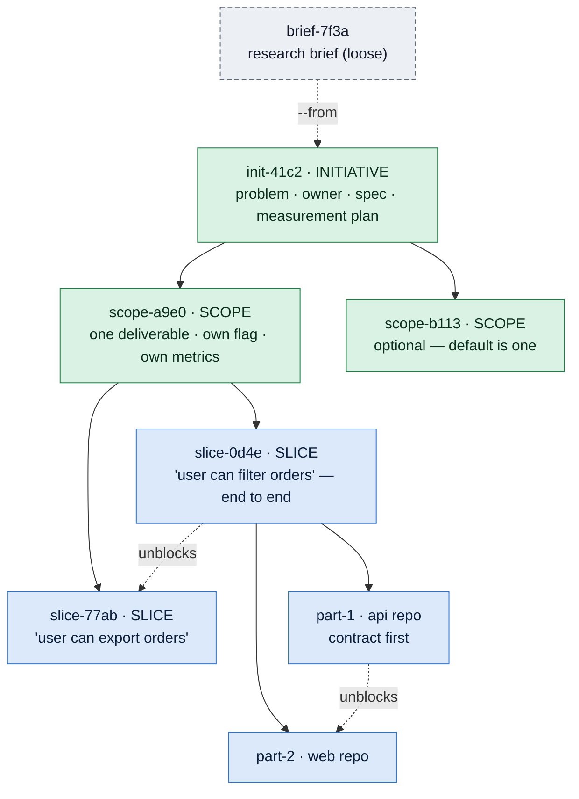
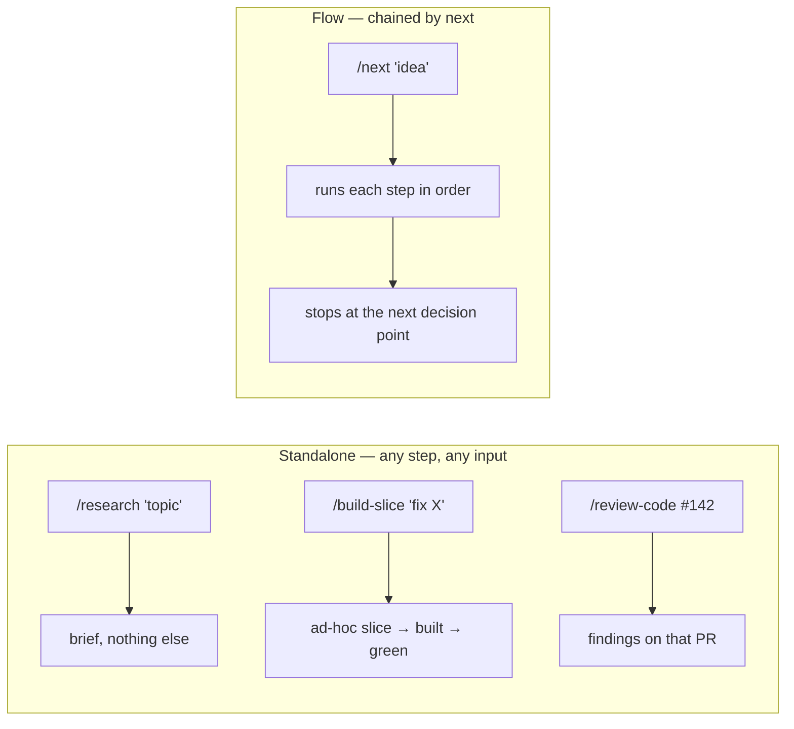
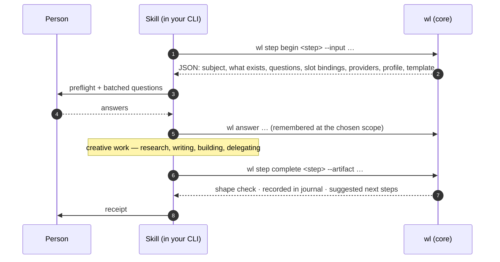

# Core concepts — the model everything hangs on

> **TL;DR** — Ten ideas carry the whole design. Once they click, the rest of the docs are reference material: the **work tree**, **steps and blocks**, **standalone vs flow**, **decision points**, the **step contract**, **state and mailbox**, **repo-first slots**, **providers**, the **interaction profile**, and the **gates**.

> [!NOTE]
> **Status: 🚧 partial.** The local work hierarchy, thirteen step contracts, decision gates, external journal/mailbox, slots, providers and profiles are implemented. Canonical skill interaction describes the client contract; actual native execution, permission isolation and authenticated transports remain separate verification. See the [roadmap](../roadmap/README.md) and [manual checklist](../roadmap/manual-verification.md).

---

## At a glance

| Concept | One line | Deep dive |
| --- | --- | --- |
| **Work tree** | initiative → scope → slice → part, plus loose artifacts like a research brief | [below](#the-work-tree) |
| **Steps & blocks** | 13 steps in 4 blocks (Define · Build · Rollout · Learn) + 4 utilities | [flow](./flow/README.md) |
| **Standalone vs flow** | Every step is a full entry point; `next` chains them | [below](#standalone-or-flow--both-are-first-class) |
| **Decision points** | The six fixed moments where a person decides | [below](#decision-points) |
| **Step contract** | `wl step begin` → the skill works → `wl step complete` | [architecture/core-cli](./architecture/core-cli.md) |
| **State & mailbox** | Event journal + readable projections + agent messages, outside the repo | [architecture/state-and-messaging](./architecture/state-and-messaging.md) |
| **Repo-first slots** | Each step binds named slots to your repo's own skills first | [configuration/repo-skills](./configuration/repo-skills.md) |
| **Providers** | Pluggable sources and destinations behind a capability taxonomy | [configuration/providers](./configuration/providers.md) |
| **Interaction profile** | Dials for verbosity, depth, challenge, pace… that never change coverage | [configuration/profile](./configuration/profile.md) |
| **Gates** | Fixed lens fan-outs with adversarial verification, run until green | [architecture/orchestration-and-gates](./architecture/orchestration-and-gates.md) |

---

## The coding client and the core

Skills run inside your coding client and use its model/tools. The `wl` executable computes deterministic preflights, validates artifacts and records state. A direct `wl next` call returns one action/contract; the `wl-next` skill carries out the model-backed work and continues until a required decision. For a runnable distinction, take the [local core tour](./tutorials/local-core.md).

## The work tree

Whatever the flow produces has an address in one small tree.

- **Initiative** — the umbrella opened by [`frame-problem`](./flow/define/frame-problem.md). Carries the problem, the named **owner**, the spec and its **measurement plan**. It is done when it is **measured**, never at merge.
- **Scope** — a deliverable you decide to ship, cut by [`cut-scopes`](./flow/define/cut-scopes.md). Default: one. Each scope has its own flag, its share of the metrics and its own timeline.
- **Slice** — a **vertical** user story delivered end to end, cut by [`slice-work`](./flow/build/slice-work.md). Never a stack layer: there is no "backend task", there is "user can filter their orders".
- **Part** — when a slice spans repositories it splits into one part per repository, **contract first**: the shared contract closes early so producer and consumer build in parallel.
- **Worktree** — every slice or part is built in its own git worktree on its own branch, so independent work runs in parallel — even in the same repository — and your own checkout is never switched or touched.
- **Loose artifacts** — a research brief, an ad-hoc slice for a small fix, a standalone review. They live in the same store, can be attached to an initiative later (`--from brief-7f3a`), or never.

IDs are short, typed and stable (`init-41c2`, `scope-a9e0`, `slice-0d4e`, `brief-7f3a`), so a human can say them out loud and an agent can pass them between sessions.

Diagrams use abbreviated IDs for readability. Copy the full actual ID from a receipt when running commands; the illustrative diagram labels are not existing store records.

## Steps, blocks and utilities

| Block | Intent | Steps |
| --- | --- | --- |
| **Define** | shape the problem | `research` (optional) · `frame-problem` · `write-spec` · `cut-scopes` |
| **Build** | ship it right | `slice-work` · `build-slice` · `verify-works` · `review-code` · `open-pr` |
| **Rollout** | release with care | `prepare-launch` · `ramp-exposure` |
| **Learn** | measure, then decide | `measure-impact` · `decide-next` |
| *Utilities* | move around | `next` · `status` · `setup` · `sync` |

Names are **verb + object**, so the name alone says what you get. Full per-step guides: [the flow](./flow/README.md).

## Standalone or flow — both are first-class

Every step accepts free text, a file, a URL (issue, document, PR) or an ID from the store. It computes what it needs, **uses what already exists** (a previous brief, an approved spec) and **asks only for what is missing**. It never requires earlier steps to have run. The full flow is just `next` chaining steps for you ([ADR-0007](./decisions/0007-standalone-steps-opt-in-flow.md)).

One rule survives standalone use: **what a step promises, it keeps**. `build-slice` always ends with its own checks green; `open-pr` always asks you to test locally first. Those are part of the step, not of the flow.

## Decision points

The machine runs a lot on its own, but it **stops for a person at six fixed points** — in every mode, every profile, every CLI.

These shared decision points are joined by step-specific approvals. In particular, framing requires your go/on-hold/dropped outcome, approved stop/reopen conditions and approval of the exact final reviewed draft. The later spec approval does not substitute for that framing decision. [First-framing walkthrough](./tutorials/first-framing.md#5-choose-the-outcome-and-approve-exact-wording).

| # | Decision | Where | Why a person |
| --- | --- | --- | --- |
| 1 | **Approve the spec** | end of `write-spec` | Commits the team to a problem, a solution shape and a definition of success |
| 2 | **Approve the scopes** | end of `cut-scopes` | Decides what ships separately and in what order |
| 3 | **Test it** | before `open-pr` | Nothing is published before a human ran it |
| 4 | **Merge** | outside the harness | The harness never merges |
| 5 | **Ramp** | each `ramp-exposure` stage | The machine never touches a feature flag |
| 6 | **Decide** | `decide-next` | Keep, iterate, kill or unflag — closes the scope |

A step may be **skipped with a recorded reason** ("no flag: internal tool"), never silently. Decision points cannot be disabled by configuration; a team can add its own.

## The step contract

Every step, in every CLI, follows the same three-beat contract with the core:

The **core decides** (preconditions, missing inputs, which questions, which skills and providers apply, whether an artifact has the right shape, what comes next). The **skill creates**. That split is what makes the process testable without a model ([ADR-0003](./decisions/0003-deterministic-core-cli.md)).

The sequence is a general lifecycle, not a shortcut around workflow-specific evidence. New framing uses `frame draft` and `frame finalize` to bind the exact owner decision and semantic review; legacy `step complete` cannot establish that guarantee. Build, verification, review and publication also retain their own receipt/gate preconditions.

## State and mailbox

All state lives **outside your repositories**, in one store per user (`$XDG_STATE_HOME/wholeloop`, by default `~/.local/state/wholeloop`):

- an append-only **journal** of events — the source of truth;
- readable **projections** (Markdown + front matter) regenerated from it;
- a **mailbox** of messages between agents and steps (hand-offs, published contracts, blockers);
- **links** to external copies (an issue key, a document URL).

Agents never edit state files directly: every write goes through `wl`, which validates it. `wl resume` prints a compact context pack so any session — **in any CLI** — can pick up where another stopped. Details: [state and messaging](./architecture/state-and-messaging.md).

## Repo-first slots

Each step declares named **slots** — `build.frontend`, `verify.suite`, `review.rubric`, `open-pr.convention`… Before acting, `wl discover` scans your repository (skills and agents for every CLI, `AGENTS.md`/`CLAUDE.md`/`GEMINI.md`, lint configs, scripts, design-system packages) and binds each slot:

> explicit config → repo skill tagged for the slot → repo skill matched by rule → user-installed skill → harness default

The binding is shown in the preflight ("frontend → `design-system-guide` (repo)"), so you always know whose rules are being followed. Details: [repo skills](./configuration/repo-skills.md).

## Providers and capabilities

Steps never talk to "Confluence" or "Mixpanel". They ask for a **capability** — `docs.create`, `tracker.create-item`, `source.product-analytics.query` — and the configured **provider** fulfils it via MCP, a CLI (`gh`, `glab`) or the host's native tools. The capability vocabulary deliberately has **no verb** for sending a message, toggling a flag or merging: what must never happen is not expressible. Providers are manifests, so adding one is cheap. Details: [providers](./configuration/providers.md) · [writing a provider](./extending/providers.md).

## Interaction profile

Personal dials — `verbosity`, `depth`, `challenge`, `pace`, `stops`, `teaching`, `language` — with presets (`mentor`, `pair`, `sparring`, `autopilot`). They change **how it talks and how much happens at once**, never **what is checked** or **where a person decides**. Details: [profile](./configuration/profile.md).

## Gates — "until green"

Every slice passes two gates before it can ship: **verify** (*does it work, and does it solve the problem?*) and **review** (*is it well written?*). Each is a fan-out of **fixed lenses**; every finding is cross-examined by independent verifiers and falls only when **at least two actively refute it**. Gates **observe and report — they never repair**: findings go back to the builder, within a round budget you control (by default 4 for verify, 3 for review). Details: [orchestration and gates](./architecture/orchestration-and-gates.md).

## The output contract

Always legible, in any profile:

1. **Preflight** — plan · where · bindings · gates · what it will never do · how to stop.
2. **Narration** — one line per event while it runs.
3. **Stop** — skills stop on request and hosts cancel owned workers. Inspect retained receipts for an in-flight external operation; stopping is not an automatic rollback of a remote write.
4. **Receipt** — what was produced, actionable rows first, each with the command that opens or undoes it.

---

## Gotchas & FAQ

**"Initiative, scope, slice — do I need all three?"** No. Standalone steps create only what they need: a small fix is a single ad-hoc slice; research is a single brief.

**"Where is my work if I switch from Claude Code to Codex mid-way?"** In the store, not in a session. Run `wl resume <id>` (or the `next` skill) in the new CLI.

**"Can I turn off a decision point?"** No. You can skip a *step* with a recorded reason, and you can add decision points; you cannot remove the six.

**"Does the harness replace my repo's skills?"** The opposite: it looks for them first and follows them.

---

<!-- docnav -->
[◀ V1 acceptance](v1-acceptance.md)  ·  [📖 Docs index](README.md)  ·  [The flow ▶](flow/README.md)
