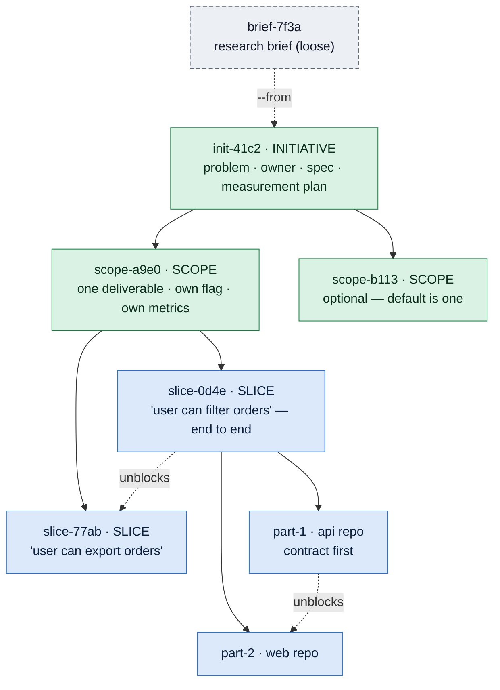
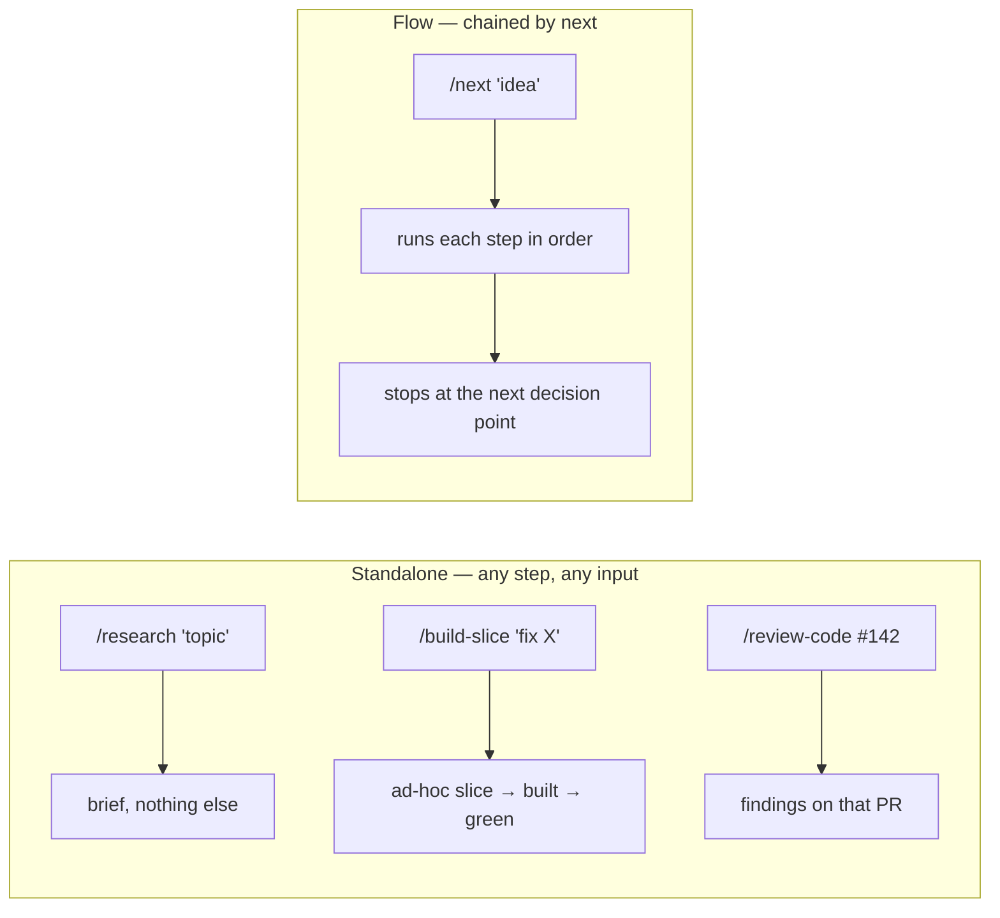
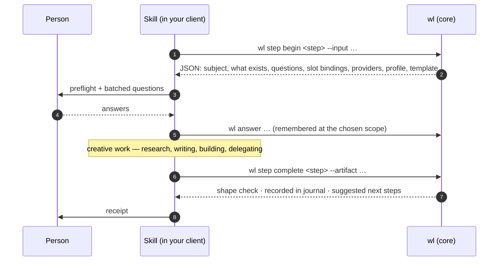
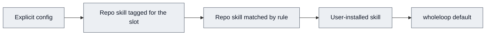
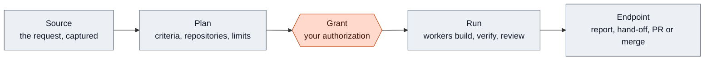

# Core concepts — the model everything hangs on

> **TL;DR** — A handful of ideas carry the whole design. Once they click, the rest of the docs are detail: where your work lives (the **work tree** and the **store**), how a step runs (the **step contract**), where you decide (**decision points**), how your repository and tools take part (**slots** and **providers**), how quality is checked (**gates**) and how work can run without you (**autonomous delivery**).

## Contents

- [At a glance](#at-a-glance)
- [The coding client and the core](#the-coding-client-and-the-core)
- [The work tree](#the-work-tree)
- [Steps, blocks and utilities](#steps-blocks-and-utilities)
- [Standalone or flow — both are first-class](#standalone-or-flow--both-are-first-class)
- [Decision points](#decision-points)
- [The step contract](#the-step-contract)
- [State and mailbox](#state-and-mailbox)
- [Repo-first slots](#repo-first-slots)
- [Providers and capabilities](#providers-and-capabilities)
- [Interaction profile](#interaction-profile)
- [Gates — "until green"](#gates--until-green)
- [The output contract](#the-output-contract)
- [Autonomous delivery](#autonomous-delivery)
- [Gotchas & FAQ](#gotchas--faq)

## At a glance

| Concept | In one line | Read more |
| --- | --- | --- |
| **Work tree** | Initiative → scope → slice → part, plus loose artifacts such as a research brief | [below](#the-work-tree) |
| **Steps and blocks** | 13 steps in 4 blocks (Define, Build, Rollout, Learn), plus 4 utilities | [the flow](./flow/README.md) |
| **Standalone or flow** | Every step is a complete entry point; `next` chains them | [below](#standalone-or-flow--both-are-first-class) |
| **Decision points** | The moments where a person decides, at the time or in advance | [below](#decision-points) |
| **Step contract** | `wl step begin` → the skill works → `wl step complete` | [below](#the-step-contract) |
| **State and mailbox** | Your work and the messages between steps, kept outside every repository | [state and messaging](./architecture/state-and-messaging.md) |
| **Slots** | Named places where your repository's own skills and rules take over | [repository guidance](./configuration/repo-skills.md) |
| **Providers** | Your choice of tools for documents, tracking and data | [providers](./configuration/providers.md) |
| **Interaction profile** | How the harness talks to you; never what it checks | [profile](./configuration/profile.md) |
| **Gates** | Verification and review, repeated until green within a budget | [orchestration and gates](./architecture/orchestration-and-gates.md) |
| **Autonomous delivery** | An approved piece of work, run by the machine within limits you set | [below](#autonomous-delivery) |

## The coding client and the core

wholeloop has two halves, and most confusion comes from mixing them up:

- **Skills run inside your coding client.** They use the client's model and tools to ask, draft, build and review.
- **The `wl` core is a plain program.** It computes preflights, checks artifacts and records state. It never calls a model.

So `wl next` in a terminal returns **one action**, the contract for the next step, and stops. Asking your client for the `wl-next` skill does the model-backed work and continues until a decision is due. The [local core tour](./tutorials/local-core.md) shows the difference in a few commands.

## The work tree

Everything the flow produces has an address in one small tree.

| Level | What it is | Created by |
| --- | --- | --- |
| **Initiative** | The umbrella for one idea: the problem, its named **owner**, the specification and its **measurement plan**. It is done when it is *measured*, never at merge | [`frame-problem`](./flow/define/frame-problem.md) |
| **Scope** | A deliverable you decide to ship on its own, with its own flag, metrics and timeline. One by default | [`cut-scopes`](./flow/define/cut-scopes.md) |
| **Slice** | A **vertical** user story, delivered end to end. Never a layer: there is no "backend task", there is "user can filter their orders" | [`slice-work`](./flow/build/slice-work.md) |
| **Part** | One repository's share of a slice that spans several. The shared **contract** is agreed first, so both sides can build in parallel | [`slice-work`](./flow/build/slice-work.md) |
| **Loose artifact** | A research brief, a one-off slice for a small fix, a standalone review. It can be attached to an initiative later (`--from brief-7f3a`), or never | any step used on its own |

Every slice or part is built in its own **Git worktree**, on its own branch. Independent work runs in parallel, even in the same repository, and your own checkout is never switched or touched.

IDs are short, typed and stable (`init-41c2`, `slice-0d4e`), so you can say them out loud and an agent can pass them between sessions. The IDs in these diagrams are shortened examples; copy real ones from a receipt.

## Steps, blocks and utilities

| Block | Intent | Steps |
| --- | --- | --- |
| **Define** | Shape the problem | `research` (optional) · `frame-problem` · `write-spec` · `cut-scopes` |
| **Build** | Ship it right | `slice-work` · `build-slice` · `verify-works` · `review-code` · `open-pr` |
| **Rollout** | Release with care | `prepare-launch` · `ramp-exposure` |
| **Learn** | Measure, then decide | `measure-impact` · `decide-next` |
| *Utilities* | Move around | `next` · `status` · `setup` · `sync` |

Names are **verb + object**, so the name alone says what you get. Each step has its own page in [the flow](./flow/README.md).

## Standalone or flow — both are first-class

Every step accepts **free text, a file, a URL** (an issue, a document, a pull request) **or an ID** from the store. It then:

1. works out what it needs;
2. **uses what already exists**, such as an earlier brief or an approved specification;
3. **asks only for what is missing**.

It never requires earlier steps to have run. The full flow is simply `next` chaining the steps for you.

One rule survives standalone use: **what a step promises, it keeps**. `build-slice` always ends with its own checks green, and `open-pr` always asks you to test locally first. Those promises belong to the step, not to the flow.

## Decision points

The machine does a lot on its own, but in the supervised flow it **stops for a person at six fixed points**, on every profile and in every client:

| # | Decision | Where | Why a person |
| --- | --- | --- | --- |
| 1 | **Approve the spec** | end of `write-spec` | It commits you to a problem, a solution shape and a definition of success |
| 2 | **Approve the scopes** | end of `cut-scopes` | It decides what ships separately and in what order |
| 3 | **Test it** | before `open-pr` | Nothing is published before a person has run it |
| 4 | **Merge** | outside the harness | The supervised flow never merges; only a separately authorized autonomous run can |
| 5 | **Ramp** | each `ramp-exposure` stage | The machine never touches a feature flag |
| 6 | **Decide** | `decide-next` | Keep, iterate, kill or unflag; this closes the scope |

Some steps add their own approvals. Framing, for example, asks for your **outcome** (go, on hold or dropped), your stop and reopen conditions and your approval of the exact final draft. Approving the specification later does not replace that decision. The [first framing walkthrough](./tutorials/first-framing.md#5-choose-the-outcome-and-approve-exact-wording) shows it.

What you can and cannot change:

- A step can be **skipped with a recorded reason** ("no flag: internal tool"), never silently.
- No configuration or interaction profile switches a decision point off. You can **add** your own.
- [Autonomous delivery](#autonomous-delivery) lets you take these decisions **in advance**, through an explicit authorization. The [philosophy](./philosophy.md#5-people-own-every-decision-at-the-moment-or-in-advance) explains why both ways exist.

## The step contract

Every step, in every client, follows the same exchange with the core:

**The core decides; the skill creates.** The core works out preconditions, missing inputs, which questions to ask, which skills and providers apply, whether an artifact has the right shape and what comes next. That split is what lets the process be tested without a model.

This is the general shape. Some steps add their own checks on top: framing, for instance, uses `frame draft` and `frame finalize` so that your decision is bound to the exact reviewed text, and building, verification, review and publication each keep their own receipts and gates.

## State and mailbox

All your work lives in one **store** per user, **outside your repositories**: `~/.local/state/wholeloop`, or `$XDG_STATE_HOME/wholeloop` when that is set. It holds:

- a **journal**: an append-only log of events, and the source of truth;
- readable **projections**: Markdown files regenerated from the journal;
- a **mailbox**: messages between agents and steps, such as hand-offs and blockers;
- **links** to external copies, such as an issue key or a document URL.

Agents never edit these files directly; every write goes through `wl`, which checks it. `wl resume` prints a compact summary of a piece of work, so any session, **in any client**, can continue where another stopped. [State and messaging](./architecture/state-and-messaging.md) has the details.

## Repo-first slots

Each step declares named **slots**, places where your repository's own guidance should take over: `build.frontend`, `verify.suite`, `review.rubric`, `open-pr.convention` and so on.

Before acting, `wl discover` scans your repository: skills and agents for every client, `AGENTS.md`, `CLAUDE.md` and `GEMINI.md`, lint configurations, scripts and design-system packages. It then fills each slot from the first source that matches:

The preflight shows each binding, such as "frontend → `design-system-guide` (repo)", so you always know whose rules are being followed. [Repository guidance](./configuration/repo-skills.md) has the details.

## Providers and capabilities

Steps never talk to "Confluence" or "Mixpanel" directly. They ask for a **capability**, such as `docs.create`, `tracker.create-item` or `source.product-analytics.query`, and the **provider** you configured fulfils it through your client's MCP connection, a command-line client such as `gh`, or the client's own tools.

The capability vocabulary deliberately has **no verb** for sending a message, toggling a flag or merging. What must never happen cannot even be expressed. Providers are small manifest files, so adding one is cheap. See [providers](./configuration/providers.md) and [writing a provider](./extending/providers.md).

## Interaction profile

Your **profile** is a set of personal dials: `verbosity`, `depth`, `challenge`, `pace`, `stops`, `teaching` and `language`, with four presets (`mentor`, `pair`, `sparring`, `autopilot`). It changes **how the harness talks and how much happens at once**, never **what is checked** or **where a person decides**. [Profile](./configuration/profile.md) lists every dial.

## Gates — "until green"

Every slice passes two **gates** before it can ship:

- **verify**: *does it work, and does it solve the problem?*
- **review**: *is it well written?*

Each gate sends the change to several reviewers at once, one per fixed **lens** such as correctness or security. Every finding is then cross-examined by independent verifiers, and it is dropped only when **at least two of them actively refute it**.

Gates **observe and report; they never repair**. Findings go back to the builder, and the loop repeats within a round budget you control: by default 4 rounds for verify and 3 for review. [Orchestration and gates](./architecture/orchestration-and-gates.md) has the details.

## The output contract

Every run is legible, in every profile:

1. **Preflight**: the plan, where it runs, the slot bindings, the gates, what it will never do and how to stop it.
2. **Narration**: one line per event while it runs.
3. **Stop**: skills stop when asked, and wholeloop cancels the workers it started. Stopping is not a rollback: if an external write was in flight, check its receipt.
4. **Receipt**: what was produced, actionable rows first, each with the command that opens or undoes it.

## Autonomous delivery

> [!IMPORTANT]
> **Experimental.** Autonomous delivery may change in a minor release.

In the supervised flow you decide at each step. **Autonomous delivery** (`wl delivery`) lets you decide **once, in advance**, and hand an approved piece of work to a run that builds, checks and publishes it without asking you again.

Five terms carry it:

| Term | What it is |
| --- | --- |
| **Source** | The request, captured once and never changed: an issue, a document, a file or a sentence |
| **Plan** | What to deliver: the acceptance criteria, the repositories, the policy and finite budgets. Each change makes a new **revision**; an earlier one is never edited |
| **Grant** | Your authorization for one exact plan: which effects are allowed (write code, commit, push…), which decisions the machine may take, and until when. It can be revoked |
| **Run** | The controller executing the plan, stage by stage, with **workers**: headless sessions of your coding client, each limited to one role |
| **Endpoint** | Where the run stops: a research report, a local hand-off, a pull request, or a merge when you grant that separately |

How much the run asks you is the **intervention** setting: `supervised`, `on-exception` or `none`. It is independent of the endpoint: a run allowed to open a pull request is not allowed to merge it.

Start with the [autonomous delivery overview](./architecture/autonomous-delivery.md), then the [intake](./tutorials/delivery-intake.md) and [planning](./tutorials/delivery-plan.md) tutorials.

## Gotchas & FAQ

**"Initiative, scope, slice — do I need all three?"** No. A step used on its own creates only what it needs: a small fix is a single one-off slice, and research is a single brief.

**"Where is my work if I switch from Claude Code to Codex halfway?"** In the store, not in a conversation. Ask the new client for `wl-next` with the ID, or run `wl resume <id>`.

**"Can I turn off a decision point?"** Not through configuration or a profile. You can skip a *step* with a recorded reason, and add decision points of your own. Autonomous delivery lets you take the decisions in advance, through an explicit authorization with rubrics and limits.

**"Does the harness replace my repository's skills?"** The opposite: it looks for them first and follows them.

<!-- docnav -->
[◀ Philosophy](philosophy.md)  ·  [📖 Docs index](README.md)  ·  [Glossary ▶](glossary.md)
