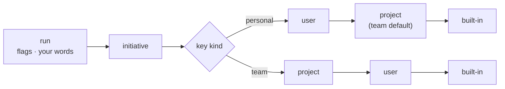

# Configuration — what you can set, where it lives, who wins

> **TL;DR** — There is nothing to configure before your first run: anything missing becomes a question, and the answer is remembered at the scope you choose. Settings come in two kinds. **Personal** settings (your interaction profile) follow you. **Team** settings (providers, slot bindings, lenses, templates) follow the repository.

> [!NOTE]
> **Status: 📐 design.** Schema and loader: [P1-02](../../roadmap/phase-1-walking-skeleton.md#p1-02--configuration-schema-and-layered-loading). The full key reference will be generated from the JSON Schema.

---

## Files

| Scope | Path | Committed? | Typical content |
|---|---|---|---|
| **User** | `$XDG_CONFIG_HOME/throughline/config.yml` (default `~/.config/throughline/`) | No | Your profile, your default providers, CLIs you use |
| **Project** | `<repo>/.throughline/config.yml` | **Yes** | Team providers and destinations, slot bindings, extra lenses, decision-point additions |
| **Project extensions** | `<repo>/.throughline/{providers,lenses,templates,profiles}/` | Yes | Manifests the team adds ([extending](../extending/README.md)) |
| **Initiative** | in the store, on the initiative | — | Work mode and destinations chosen for that initiative |
| **Run** | flags and your words in the session | — | `--pace guided`, "be more technical" |

The project file is the **only** harness file a repository holds, and people write it on purpose. Runtime state never goes there ([ADR-0004](../decisions/0004-state-outside-the-repo.md)).

## Who wins



- **Personal keys** (`profile.*`) — your user file beats the project's default. A team can suggest a profile; it cannot impose one.
- **Team keys** (`providers.*`, `slots.*`, `lenses.*`, `templates.*`, `gates.*`, `build.*`, `learn.*`, `flow.*`) — the project beats your user file, because the whole team must land artifacts in the same place and follow the same conventions.
- A **run** override always wins, but only for that run.

## Example — project file

```yaml
# .throughline/config.yml — committed, reviewed like code
version: 1

providers:
  docs: notion                 # where specs, briefs, launch plans live
  tracker: linear              # scopes and slices as issues
  codehost: github
  sources: [web, codebase, posthog, sentry, zendesk]
  comms: slack

slots:
  build.frontend: .agents/skills/ui-kit          # our design-system skill
  verify.suite: "pnpm test && pnpm typecheck"
  open-pr.convention: .github/pull_request_template.md

lenses:
  add: [accessibility]          # an extra review lens from .throughline/lenses/

build:
  workspace: worktree         # worktree (default) | checkout

gates:
  verify: { rounds: 5 }       # default 4
  review: { rounds: 3 }       # default 3

learn:
  checkpoints: [launch, d7, d30]

flow:
  decisions:
    add: [security-signoff]     # an extra decision point before open-pr
```

## Example — user file

```yaml
# ~/.config/throughline/config.yml — personal, never committed
version: 1
profile:
  preset: pair
  challenge: adversarial        # override one dial of the preset
  language: es                  # talk to me in Spanish…
  artifact_language: en         # …but write every artifact in English
targets: [claude, codex, opencode]
```

## Where to go next

| Page | Covers |
|---|---|
| [Interaction profile](./profile.md) | Every dial, presets, and what no dial can change |
| [Providers](./providers.md) | Capabilities, the built-in catalogue, detection, installing MCP servers per CLI |
| [Repo skills and slots](./repo-skills.md) | How each step finds and follows your repository's own skills |

---

<!-- docnav -->
[◀ Utilities](../flow/utilities.md)  ·  [📖 Docs index](../README.md)  ·  [🧭 Concepts](../concepts.md)  ·  [Interaction profile ▶](profile.md)
