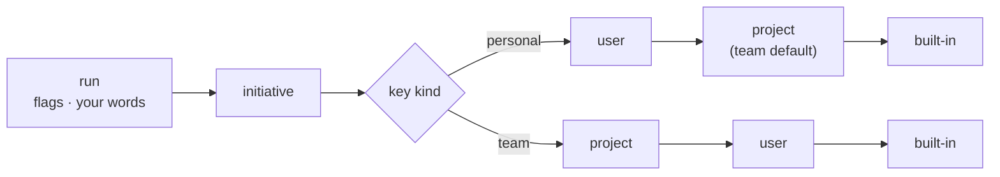

# Configuration — what you can set, where it lives, who wins

> **TL;DR** — There is nothing to configure before your first run: anything missing becomes a question, and the answer is remembered at the scope you choose. Settings come in two kinds. **Personal** settings (your interaction profile) follow you. **Team** settings (providers, slot bindings, lenses, templates) follow the repository.

> [!NOTE]
> **Status: ✅ implemented.** Schema, deterministic loader and `wl config show --explain` are available. Custom profile presets are loaded from manifest catalogs. External provider operations run through the client's MCP connection and are experimental. The key reference below is generated from the JSON Schema.

---

## Persistent delivery limits

Expanded delivery uses independent [run budgets](../tutorials/delivery-budgets.md), bound to its immutable plan and private grant. Original deadlines and counters survive recovery and stricter plan revisions; unknown usage remains unknown and unavailable hard metering refuses admission. Interaction profiles cannot expand these allowances or turn fixture evidence into actual execution. Existing gate rounds remain unchanged. The complete native unattended runner is subsequent Phase 6 work.

## Files

| Scope | Path | Committed? | Typical content |
| --- | --- | --- | --- |
| **User** | `$XDG_CONFIG_HOME/wholeloop/config.yml` (default `~/.config/wholeloop/`) | No | Your profile, your default providers, CLIs you use |
| **Project** | `<repo>/.wholeloop/config.yml` | **Yes** | Team providers and destinations, slot bindings, extra lenses, decision-point additions |
| **Project extensions** | `<repo>/.wholeloop/{providers,lenses,templates,profiles}/` | Yes | Manifests the team adds ([extending](../extending/README.md)) |
| **Initiative** | in the store, on the initiative | — | Work mode and destinations chosen for that initiative |
| **Run** | flags and your words in the session | — | `--pace guided`, "be more technical" |

The project file is the **only** harness file a repository holds, and people write it on purpose. Runtime state never goes there ([ADR-0004](../decisions/0004-state-outside-the-repo.md)).

## Who wins



- **Personal keys** (`profile.*`) — your user file beats the project's default. A team can suggest a profile; it cannot impose one.
- **Team keys** (`providers.*`, `slots.*`, `lenses.*`, `templates.*`, `gates.*`, `build.*`, `learn.*`, `flow.*`) — the project beats your user file, because the whole team must land artifacts in the same place and follow the same conventions. "Team" names the project scope: someone working alone sets these keys the same way, in the project they work on.
- A **run** override always wins, but only for that run.

## Example — project file

```yaml
# .wholeloop/config.yml — committed, reviewed like code
version: 1

providers:
  docs: notion                 # where specs, briefs, launch plans live
  tracker: linear              # scopes and slices as issues
  codehost: github
  sources: [web, codebase, posthog, sentry, zendesk]
  comms: slack

slots:
  build.frontend: .agents/skills/ui-kit          # our design-system skill
  verify.suite: "pnpm test && pnpm typecheck"
  open-pr.convention: .github/pull_request_template.md

lenses:
  add: [accessibility]          # an extra review lens from .wholeloop/lenses/

build:
  workspace: worktree         # worktree (default) | checkout

gates:
  verify: { rounds: 5 }       # default 4
  review: { rounds: 3 }       # default 3

learn:
  checkpoints: [launch, d7, d30]

flow:
  decisions:
    add: [security-signoff]     # an extra decision point before open-pr
```

## Example — user file

```yaml
# ~/.config/wholeloop/config.yml — personal, never committed
version: 1
profile:
  preset: pair
  challenge: adversarial        # override one dial of the preset
  language: es                  # talk to me in Spanish…
  artifact_language: en         # …but write every artifact in English
targets: [claude, codex, opencode]
```

## Inspect configuration

```text
wl config show --explain --json
wl config show --initiative-config /path/to/initiative.yml --run-config /path/to/run.yml --json
wl config schema --json
```

Missing user/project files use built-in defaults. Explicit initiative/run files must exist. Every file requires `version: 1`; unknown keys, duplicate YAML keys and invalid values reject the entire load with a path and expected type. Inspection only reads configuration. Explicit `answer --remember user|project` and `profile set|preset` actions update configuration atomically; project configuration writes are intentional, never runtime state. `--explain` adds each value's scope and source file.

Maps such as slots merge per key; arrays replace rather than concatenate, so a higher scope can explicitly clear optional additions. `targets` is personal, like `profile.*`. Required decision points cannot be removed through the schema; `flow.decisions.add` only adds.

## Key reference

Source: `src/config/schema.json`. Regenerate with `npm run docs:config` or `wl docs reference --kind config --write`; docs check and CI check drift.

<!-- config:start -->
| Key | Kind | Values | Default |
| --- | --- | --- | --- |
| `version` | team | integer | unset |
| `profile.preset` | personal | string | `"pair"` |
| `profile.verbosity` | personal | brief · standard · detailed | `"standard"` |
| `profile.depth` | personal | product · balanced · technical | `"balanced"` |
| `profile.challenge` | personal | supportive · balanced · adversarial | `"balanced"` |
| `profile.pace` | personal | guided · staged · parallel | `"guided"` |
| `profile.stops` | personal | decisions · every-step | `"decisions"` |
| `profile.teaching` | personal | off · on | `"off"` |
| `profile.language` | personal | string | `"auto"` |
| `profile.artifact_language` | personal | string | `"en"` |
| `targets` | personal | array of strings | `[]` |
| `providers.docs` | team | string | unset |
| `providers.tracker` | team | string | unset |
| `providers.codehost` | team | string | unset |
| `providers.comms` | team | string | unset |
| `providers.dashboards` | team | string | unset |
| `providers.flags` | team | string | unset |
| `providers.design` | team | string | unset |
| `providers.sources` | team | array of strings | unset |
| `slots` | team | map of strings | unset |
| `lenses.add` | team | array of strings | `[]` |
| `lenses.disable.correctness` | team | string | unset |
| `lenses.disable.design-fit` | team | string | unset |
| `lenses.disable.performance` | team | string | unset |
| `lenses.disable.security` | team | string | unset |
| `lenses.disable.simplicity` | team | string | unset |
| `lenses.disable.change-shape` | team | string | unset |
| `templates` | team | map of strings | unset |
| `gates.verify.rounds` | team | integer | `4` |
| `gates.review.rounds` | team | integer | `3` |
| `gates.verifiers` | team | 3 · 5 · 7 · 9 | `3` |
| `build.workspace` | team | worktree · checkout | `"worktree"` |
| `learn.checkpoints` | team | array of strings | `["launch","d7","d30"]` |
| `flow.decisions.add` | team | array of strings | `[]` |
| `answers` | team | map of strings | unset |
| `extensions` | team | array of strings | `[]` |
| `research.verifiers` | team | 3 · 5 · 7 · 9 | `3` |
<!-- config:end -->

## Where to go next

| Page | Covers |
| --- | --- |
| [Interaction profile](./profile.md) | Every dial, presets, and what no dial can change |
| [Providers](./providers.md) | Capabilities, the built-in catalogue, detection, installing MCP servers per CLI |
| [Repo skills and slots](./repo-skills.md) | How each step finds and follows your repository's own skills |

---

## Application environment recipes

[Environment planning](../tutorials/delivery-environments.md) uses an explicit per-run recipe rather than auto-executing project configuration. Discovery is inert; image digests, selected bytes, command origins, network phases, logical mounts and finite limits are pinned separately from operator authority and actual backend observations. Existing environment undo declarations stay unexecuted.

<!-- docnav -->
[◀ Utilities](../flow/utilities.md)  ·  [📖 Docs index](../README.md)  ·  [🧭 Concepts](../concepts.md)  ·  [Interaction profile ▶](profile.md)
