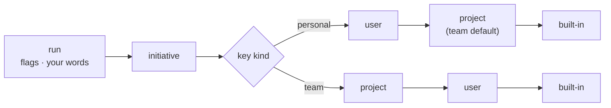

# Configuration — what you can set, where it lives, who wins

> **TL;DR** — There is nothing to configure before your first run: anything missing becomes a question, and the answer is remembered at the scope you choose. Settings come in two kinds. **Personal** settings (your interaction profile) follow you. **Team** settings (providers, slot bindings, lenses, templates) follow the repository.

## Contents

- [Files](#files)
- [Who wins](#who-wins)
- [Example — project file](#example--project-file)
- [Example — user file](#example--user-file)
- [Worker models](#worker-models)
- [Inspect configuration](#inspect-configuration)
- [Autonomous delivery limits](#autonomous-delivery-limits)
- [Key reference](#key-reference)

## Files

| Scope | Path | Committed? | Typical content |
| --- | --- | --- | --- |
| **User** | `$XDG_CONFIG_HOME/wholeloop/config.yml` (default `~/.config/wholeloop/`) | No | Your profile, your default providers, CLIs you use |
| **Project** | `<repo>/.wholeloop/config.yml` | **Yes** | Team providers and destinations, slot bindings, extra lenses, decision-point additions |
| **Project extensions** | `<repo>/.wholeloop/{providers,lenses,templates,profiles}/` | Yes | Manifests the team adds ([extending](../extending/README.md)) |
| **Initiative** | in the store, on the initiative | — | Work mode and destinations chosen for that initiative |
| **Run** | flags and your words in the session | — | `--pace guided`, "be more technical" |

The project file is the **only** harness file a repository holds, and people write it on purpose. Runtime state never goes there: your work history stays in your personal store, so a repository never fills up with run logs or private notes.

## Who wins



- **Personal keys** (`profile.*`, `targets`): your user file beats the project's default. A team can suggest a profile; it cannot impose one.
- **Team keys** (`providers.*`, `slots.*`, `lenses.*`, `templates.*`, `gates.*`, `build.*`, `learn.*`, `flow.*`): the project beats your user file, because everyone must land artifacts in the same place and follow the same conventions. "Team" just means the project scope; someone working alone sets these keys the same way.
- A **run** override always wins, but only for that run.

## Example — project file

```yaml
# .wholeloop/config.yml — committed, reviewed like code
version: 1

providers:
  docs: notion                 # where specs, briefs, launch plans live
  tracker: linear              # scopes and slices as issues
  codehost: github
  sources: [web, codebase, posthog, sentry, zendesk]
  comms: slack

slots:
  build.frontend: .agents/skills/ui-kit          # our design-system skill
  verify.suite: "pnpm test && pnpm typecheck"
  open-pr.convention: .github/pull_request_template.md

lenses:
  add: [accessibility]          # an extra review lens from .wholeloop/lenses/

build:
  workspace: worktree         # worktree (default) | checkout

gates:
  verify: { rounds: 5 }       # default 4
  review: { rounds: 3 }       # default 3

learn:
  checkpoints: [launch, d7, d30]

flow:
  decisions:
    add: [security-signoff]     # an extra decision point before open-pr
```

## Example — user file

```yaml
# ~/.config/wholeloop/config.yml — personal, never committed
version: 1
profile:
  preset: pair
  challenge: adversarial        # override one dial of the preset
  language: es                  # talk to me in Spanish…
  artifact_language: en         # …but write every artifact in English
targets: [claude, codex, opencode]
```

## Worker models

**Choose which model each kind of worker runs on, per client.** Every worker role has a **tier**: `fast`, `standard` or `deep`. Verifiers and reviewers are `standard`, researchers and challengers `deep`. Map a tier to a model you can use in that client, and the roles installed afterwards carry it. Until you map one, nothing changes:

| Client | An unmapped tier uses |
| --- | --- |
| Claude Code | its own aliases: `fast` → `haiku`, `standard` → `sonnet`, `deep` → `opus` |
| Every other client | the model selected in your session |

Save a mapping with `wl setup`, or answer the model questions the `wl-setup` skill asks for the client you are using:

```bash
wl setup --models claude:standard=haiku,codex:deep=gpt-6.1-sol --scope user
```

It prints the saved scope and file. Mappings are remembered as answers:

```yaml
# ~/.config/wholeloop/config.yml
version: 1
answers:
  "model:claude:standard": haiku
  "model:codex:deep": gpt-6.1-sol
```

- **A value is `inherit` or a model name** as your client spells it: letters, digits and `. _ : / @ + -`, without spaces. `inherit` uses your session model, which on Claude Code also replaces its alias.
- **Reinstall to apply it.** `wl install --scope user` reads only your user file and `wl install --scope project` only the project file, so a personal choice never lands in files a repository commits. `wl doctor` reports an installation older than its mapping as out of date.
- **The cost preview names the configured model** next to each tier, labelled "configured", because the client decides whether that model is available to you. A plugin installed from a marketplace keeps the built-in choice.
- **Coverage never changes.** A cheaper model runs the same checks; it does not remove any.

## Inspect configuration

`wl config show` prints the resolved values; it only reads.

```console
$ wl config show
{
  "schema": "wholeloop/config-show@1",
  "values": {
    "version": 1,
    "profile": {
      "preset": "pair",
      …
    },
    "providers": {
      "docs": "local-docs",
      "tracker": "local-tracker"
    },
    "gates": {
      "verify": {
        "rounds": 4
      },
      …
}
```

Add `--explain --json` to see where each value came from:

```console
$ wl config show --explain --json | jq '.sources["gates.verify.rounds"], .sources["profile.preset"]'
{
  "value": 4,
  "scope": "built-in"
}
{
  "value": "pair",
  "scope": "user",
  "file": "~/.config/wholeloop/config.yml"
}
```

Other inspection commands:

```text
wl config show --initiative-config /path/to/initiative.yml --run-config /path/to/run.yml --json
wl config schema --json
```

How loading works:

- **Missing user or project files** fall back to the built-in defaults. Initiative and run files you name explicitly must exist.
- **Every file needs `version: 1`.** An unknown key, a duplicated YAML key or an invalid value rejects the whole load, with the path and the expected type.
- **Maps merge per key; lists replace.** `slots` merges key by key, while a list in a higher scope replaces the lower one, so it can clear optional additions.
- **Decision points can only be added.** `flow.decisions.add` adds; nothing in the schema removes a required one.

Configuration changes only when you ask: `wl answer … --remember user|project`, `wl profile set` and `wl profile preset` write it in one step.

## Autonomous delivery limits

[Autonomous delivery](../concepts.md#autonomous-delivery) has its own [run budgets](../tutorials/delivery-budgets.md), tied to the plan and the grant rather than to this file.

- Deadlines and counters survive recovery and stricter plan revisions; nothing refills them.
- Usage that cannot be measured stays unknown, and a hard limit that cannot be metered is refused instead of assumed.
- No interaction profile can widen these limits. Gate rounds for the supervised flow stay as configured here.
- Application environments for a run come from an explicit [recipe](../tutorials/delivery-environments.md), never from running your project's configuration automatically.

## Key reference

Source: `src/config/schema.json`. Regenerate with `npm run docs:config` or `wl docs reference --kind config --write`; docs check and CI check drift.

<!-- config:start -->
| Key | Kind | Values | Default |
| --- | --- | --- | --- |
| `version` | team | integer | unset |
| `profile.preset` | personal | string | `"pair"` |
| `profile.verbosity` | personal | brief · standard · detailed | `"standard"` |
| `profile.depth` | personal | product · balanced · technical | `"balanced"` |
| `profile.challenge` | personal | supportive · balanced · adversarial | `"balanced"` |
| `profile.pace` | personal | guided · staged · parallel | `"guided"` |
| `profile.stops` | personal | decisions · every-step | `"decisions"` |
| `profile.teaching` | personal | off · on | `"off"` |
| `profile.language` | personal | string | `"auto"` |
| `profile.artifact_language` | personal | string | `"en"` |
| `targets` | personal | array of strings | `[]` |
| `providers.docs` | team | string | unset |
| `providers.tracker` | team | string | unset |
| `providers.codehost` | team | string | unset |
| `providers.comms` | team | string | unset |
| `providers.dashboards` | team | string | unset |
| `providers.flags` | team | string | unset |
| `providers.design` | team | string | unset |
| `providers.sources` | team | array of strings | unset |
| `slots` | team | map of strings | unset |
| `lenses.add` | team | array of strings | `[]` |
| `lenses.disable.correctness` | team | string | unset |
| `lenses.disable.design-fit` | team | string | unset |
| `lenses.disable.performance` | team | string | unset |
| `lenses.disable.security` | team | string | unset |
| `lenses.disable.simplicity` | team | string | unset |
| `lenses.disable.change-shape` | team | string | unset |
| `templates` | team | map of strings | unset |
| `gates.verify.rounds` | team | integer | `4` |
| `gates.review.rounds` | team | integer | `3` |
| `gates.verifiers` | team | 3 · 5 · 7 · 9 | `3` |
| `build.workspace` | team | worktree · checkout | `"worktree"` |
| `learn.checkpoints` | team | array of strings | `["launch","d7","d30"]` |
| `flow.decisions.add` | team | array of strings | `[]` |
| `answers` | team | map of strings | unset |
| `extensions` | team | array of strings | `[]` |
| `research.verifiers` | team | 3 · 5 · 7 · 9 | `3` |
<!-- config:end -->

## Where to go next

| Page | Covers |
| --- | --- |
| [Interaction profile](./profile.md) | Every dial, presets, and what no dial can change |
| [Providers](./providers.md) | Capabilities, the built-in catalogue, detection, installing MCP servers per CLI |
| [Repo skills and slots](./repo-skills.md) | How each step finds and follows your repository's own skills |

<!-- docnav -->
[◀ Utilities](../flow/utilities.md)  ·  [📖 Docs index](../README.md)  ·  [🧭 Concepts](../concepts.md)  ·  [Interaction profile ▶](profile.md)
