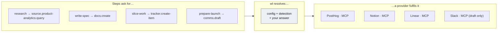
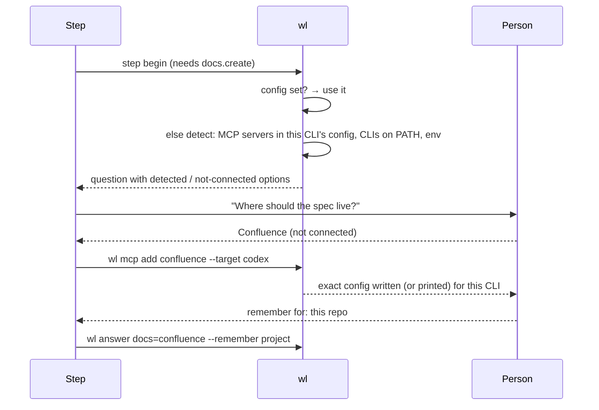

# Providers — bring your own tools

> **TL;DR** — Steps ask for **capabilities** (write a document, track a work item, query product analytics); **providers** fulfil them through MCP servers, CLIs or the host's native tools. `wholeloop` ships with the most common providers in the industry, detects what you already have connected, asks where things should go the first time, and lets anyone add a provider with a small manifest — no fork, no release needed.

> [!NOTE]
> **Status: 📐 design.** Decision: [ADR-0008](../decisions/0008-extensibility-through-manifests.md). Registry: [P1-08](../../roadmap/phase-1-walking-skeleton.md#p1-08--provider-registry-v1); built-in providers land with the steps that need them (Phases 2–4).

---

## Capabilities, not vendors

A step never names a vendor, so swapping Confluence for Notion, or adding Zendesk as a research source, never touches a skill.

## The capability taxonomy

The taxonomy is the **stable contract**. It versions slowly, and every verb in it is safe for a machine to perform.

### Sources — read-only evidence

| Capability | Answers | Used by |
|---|---|---|
| `source.web` | What does the outside world say? | research, frame-problem |
| `source.code` | What does the code actually do? | every step |
| `source.product-analytics` | What do users do? Events, funnels, retention | research, write-spec, measure-impact |
| `source.bi` | What do the business tables say? SQL / BI queries | research, measure-impact |
| `source.support` | What are users telling support? | research, measure-impact |
| `source.errors` | What is breaking? | research, ramp-exposure, measure-impact |
| `source.observability` | How is the system behaving? Metrics, logs, traces | ramp-exposure, measure-impact |
| `source.knowledge` | What have we already written down? | research, frame-problem |
| `source.feedback` | What do research notes, surveys and feature requests say? | research, decide-next |
| `source.meetings` | What was said in calls and interviews? | frame-problem, measure-impact |

Every source has one verb: **`query`**.

### Destinations and services

| Capability | Verbs | Used by |
|---|---|---|
| `docs` | `create` · `read` · `update` (always read-modify-write) · `link` | Define, Rollout, Learn |
| `tracker` | `create-item` · `read-item` · `update-item` · `link-items` · `transition` | cut-scopes, slice-work, sync |
| `codehost` | `open-draft-pr` · `read-pr` · `pr-status` | open-pr, review-code, sync |
| `dashboards` | `create` · `update` · `read` | prepare-launch, measure-impact |
| `flags` | `read-state` · `propose-change` | cut-scopes, ramp-exposure |
| `comms` | `draft` | prepare-launch, measure-impact |
| `design` | `read-context` | write-spec, build-slice |

> [!IMPORTANT]
> There is **no verb** for sending a message, toggling a flag, merging a pull request or deleting a document. What must never happen is not expressible in the contract, so no provider — built-in or community — can be asked to do it.

## The built-in catalogue

Defaults chosen for breadth of real-world use. **v1** ships with the phase that first needs it; **catalogue** entries are planned or welcome as community manifests.

| Capability | v1 built-ins | Catalogue |
|---|---|---|
| `source.web` · `source.code` | native (the host CLI's own search, fetch and file tools) | — |
| `source.product-analytics` | PostHog · Mixpanel · Amplitude | Google Analytics 4 · Heap · Pendo |
| `source.bi` | Metabase · BigQuery · PostgreSQL (read-only) | Looker · Snowflake · Redash · Databricks |
| `source.support` | Zendesk · Intercom | Freshdesk · Front · HubSpot Service |
| `source.errors` | Sentry | Bugsnag · Rollbar |
| `source.observability` | Datadog · Grafana (Prometheus, Loki, Tempo) | New Relic · Honeycomb · Elastic |
| `source.knowledge` | local files · Confluence · Notion | Google Drive · SharePoint · GitHub Wiki |
| `source.feedback` · `source.meetings` | — | Dovetail · Productboard · Canny · Gong · Granola |
| `docs` | **local Markdown** (default) · Confluence · Notion · Google Docs · repo `docs/` | Coda · SharePoint |
| `tracker` | **local** (default) · GitHub Issues · Jira · Linear · GitLab Issues | Shortcut · Azure Boards · ClickUp · Asana |
| `codehost` | GitHub (`gh`) · GitLab (`glab`) | Bitbucket · Azure Repos · Gitea |
| `dashboards` | PostHog · Mixpanel · Amplitude · Metabase · Grafana | Datadog · Looker |
| `flags` | LaunchDarkly · Unleash · GrowthBook · PostHog · config-file flags | Flagsmith · ConfigCat · Statsig · Split |
| `comms` | Slack · Microsoft Teams · email (draft) | Discord · Google Chat |
| `design` | Figma | Penpot |

One provider can serve several capabilities — PostHog covers product analytics, dashboards and flags; Confluence covers `docs` and `source.knowledge`.

## Detection and first use

- **Detection is deterministic.** `wl` reads the host CLI's MCP configuration files and checks binaries on `PATH`; it never guesses whether something is connected. Whether a connected server is *authenticated* is checked by the skill with one cheap probe call.
- **`wl mcp add <provider> --target <cli>`** writes the provider's MCP entry in the dialect that CLI expects (JSON, TOML, `serverUrl` vs `url`…), or prints it if you prefer to paste it yourself.
- **Not available? Never a silent skip.** The step produces a hand-off artifact instead (a ready-to-paste document, an issue list, a dashboard spec with its queries) and records the gap so it can be backfilled later.

## Local by default, shared when you want

With nothing configured, everything lands in the local store as Markdown — the flow works with zero integrations. Configure a `docs` and `tracker` provider and each step also publishes there as it goes, which is what lets someone else pick the work up from a URL.

---

<!-- docnav -->
[◀ Interaction profile](profile.md)  ·  [📖 Docs index](../README.md)  ·  [🧭 Concepts](../concepts.md)  ·  [Repo skills ▶](repo-skills.md)
