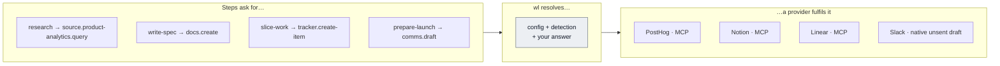
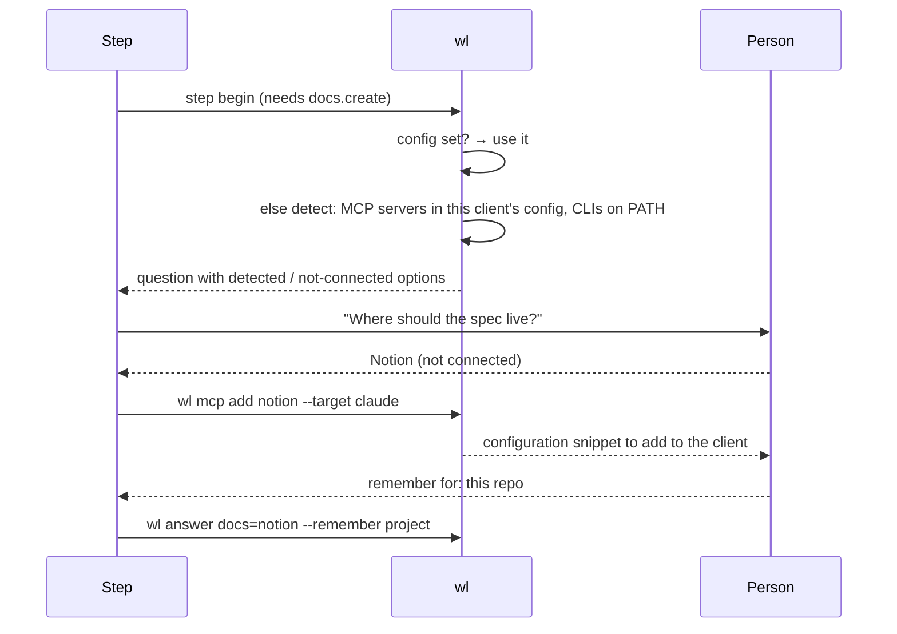

# Providers — bring your own tools

> **TL;DR** — Steps ask for **capabilities**, such as "write a document", "track a work item" or "query product analytics". **Providers** fulfil them through your client's MCP connection, a command-line client or the client's own tools. wholeloop ships with the most common providers, detects what you already have connected, asks where things should go the first time, and lets anyone add a provider with a small manifest: no fork, no release.

> [!IMPORTANT]
> **Experimental.** The registry, manifests, local defaults and routing are tested. wholeloop never talks to a service itself: remote operations run through your client's MCP connection or a command-line client you installed, and they are not certified against each real service.

## Contents

- [Capabilities, not vendors](#capabilities-not-vendors)
- [Local by default, shared when you want](#local-by-default-shared-when-you-want)
- [Detection and first use](#detection-and-first-use)
- [The capability taxonomy](#the-capability-taxonomy)
- [The built-in catalogue](#the-built-in-catalogue)
- [How much is verified](#how-much-is-verified)
- [Reference](#reference)

## Capabilities, not vendors



A step never names a vendor, so swapping Confluence for Notion, or adding Zendesk as a research source, never touches a skill.

With nothing configured, `docs.create` resolves to the local provider:

```console
$ wl provider resolve docs.create
{
  "schema": "wholeloop/provider-resolve@1",
  "operation": "docs.create",
  "manifest": {
    "schema": 1,
    "id": "local-docs",
    "name": "Local documents",
    "description": "Store documents locally without integrations.",
    …
}
```

## Local by default, shared when you want

With nothing configured, everything lands in your local store as Markdown, and the whole flow works with **zero integrations**. Configure a `docs` and a `tracker` provider and each step also publishes there as it goes, which is what lets someone else pick the work up from a URL.

## Detection and first use

The first time a step needs a capability you have not configured, it asks, offering what it detected:



- **Detection is deterministic.** `wl` reads the client's MCP configuration files and checks executables on `PATH`; it never guesses. `available: true` means declared or configured; whether a server is *signed in* stays `authenticated: false` until the skill checks it with one cheap call. Configuration errors are reported without their contents, and no command from a manifest is run to detect anything.
- **`wl mcp add <provider> --target <client>`** prints the snippet in the format that client expects. It never edits the client's configuration and never reads a token:

  ```console
  $ wl mcp add notion --target claude
  Merge into .mcp.json:
  {
    "mcpServers": {
      "notion": {
        "type": "http",
        "url": "https://mcp.notion.com/mcp"
      }
    }
  }
  ```

- **Not available? Never a silent skip.** The step produces a hand-off instead, such as a ready-to-paste document, an issue list or a dashboard specification with its queries, and records the gap so it can be filled in later.

## The capability taxonomy

The taxonomy is the **stable contract**. It changes slowly, and every verb in it is safe for a machine to perform.

### Sources — read-only evidence

| Capability | Answers | Used by |
| --- | --- | --- |
| `source.web` | What does the outside world say? | research, frame-problem |
| `source.code` | What does the code actually do? | every step |
| `source.product-analytics` | What do users do? Events, funnels, retention | research, write-spec, measure-impact |
| `source.bi` | What do the business tables say? SQL / BI queries | research, measure-impact |
| `source.support` | What are users telling support? | research, measure-impact |
| `source.errors` | What is breaking? | research, ramp-exposure, measure-impact |
| `source.observability` | How is the system behaving? Metrics, logs, traces | ramp-exposure, measure-impact |
| `source.knowledge` | What have we already written down? | research, frame-problem |
| `source.feedback` | What do research notes, surveys and feature requests say? | research, decide-next |
| `source.meetings` | What was said in calls and interviews? | frame-problem, measure-impact |

Every source has one verb: **`query`**.

### Destinations and services

| Capability | Verbs | Used by |
| --- | --- | --- |
| `docs` | `create` · `read` · `update` (always read-modify-write) · `link` | Define, Rollout, Learn |
| `tracker` | `create-item` · `read-item` · `update-item` · `link-items` · `transition` | cut-scopes, slice-work, sync |
| `codehost` | `open-draft-pr` · `read-pr` · `pr-status` · `comment-pr` | open-pr, review-code, sync |
| `dashboards` | `create` · `update` · `read` | prepare-launch, measure-impact |
| `flags` | `read-state` · `propose-change` | cut-scopes, ramp-exposure |
| `comms` | `draft` | prepare-launch, measure-impact |
| `design` | `read-context` | write-spec, build-slice |

> [!IMPORTANT]
> There is **no verb** for sending a message, toggling a flag, merging a pull request or deleting a document. What must never happen is not expressible in the contract, so no provider, built-in or community, can be asked to do it.

## The built-in catalogue

Defaults chosen for breadth of real-world use. **Built-ins** ship today; **catalogue** entries are planned or welcome as community manifests.

| Capability | v1 built-ins | Catalogue |
| --- | --- | --- |
| `source.web` · `source.code` | native (the host CLI's own search, fetch and file tools) | — |
| `source.product-analytics` | PostHog · Mixpanel · Amplitude | Google Analytics 4 · Heap · Pendo |
| `source.bi` | Metabase · BigQuery · PostgreSQL (read-only) | Looker · Snowflake · Redash · Databricks |
| `source.support` | Zendesk · Intercom | Freshdesk · Front · HubSpot Service |
| `source.errors` | Sentry | Bugsnag · Rollbar |
| `source.observability` | Datadog · Grafana (Prometheus, Loki, Tempo) | New Relic · Honeycomb · Elastic |
| `source.knowledge` | local files · Confluence · Notion | Google Drive · SharePoint · GitHub Wiki |
| `source.feedback` · `source.meetings` | — | Dovetail · Productboard · Canny · Gong · Granola |
| `docs` | **local Markdown** (default) · Confluence · Notion · Google Docs · repo `docs/` | Coda · SharePoint |
| `tracker` | **local** (default) · GitHub Issues · Jira · Linear · GitLab Issues | Shortcut · Azure Boards · ClickUp · Asana |
| `codehost` | GitHub (`gh`) · GitLab (`glab`) | Bitbucket · Azure Repos · Gitea |
| `dashboards` | PostHog · Mixpanel · Amplitude · Metabase · Grafana | Datadog · Looker |
| `flags` | LaunchDarkly · Unleash · GrowthBook · PostHog · config-file flags | Flagsmith · ConfigCat · Statsig · Split |
| `comms` | Slack · Microsoft Teams · email (draft) | Discord · Google Chat |
| `design` | Figma | Penpot |

One provider can serve several capabilities: PostHog covers product analytics, dashboards and flags; Confluence covers `docs` and `source.knowledge`.

### Generated declared mappings

These rows come from the bundled manifests. They describe what each manifest declares, not live server support, sign-in, behaviour or which provider you selected.

<!-- providers:start -->
| ID | Capabilities | Declared operations | Access |
| --- | --- | --- | --- |
| `amplitude` | `dashboards` · `source.product-analytics` | `dashboards.create` · `source.product-analytics.query` | native host · MCP: amplitude |
| `bigquery` | `source.bi` | `source.bi.query` | MCP: bigquery |
| `config-flags` | `flags` | `flags.propose-change` · `flags.read-state` | native host |
| `confluence` | `docs` · `source.knowledge` | `docs.create` · `docs.read` · `docs.update` · `source.knowledge.query` | MCP: atlassian |
| `datadog` | `source.errors` · `source.observability` | `source.errors.query` · `source.observability.query` | MCP: datadog |
| `email` | `comms` | `comms.draft` | native host |
| `figma` | `design` | `design.read-context` | MCP: figma |
| `github` | `codehost` | `codehost.comment-pr` · `codehost.open-draft-pr` · `codehost.pr-status` · `codehost.read-pr` | CLI: gh |
| `github-issues` | `tracker` | `tracker.create-item` · `tracker.read-item` · `tracker.transition` · `tracker.update-item` | MCP: github |
| `gitlab` | `codehost` | `codehost.comment-pr` · `codehost.open-draft-pr` · `codehost.pr-status` · `codehost.read-pr` | CLI: glab |
| `gitlab-issues` | `tracker` | `tracker.create-item` · `tracker.link-items` · `tracker.read-item` · `tracker.update-item` | MCP: gitlab |
| `google-docs` | `docs` | `docs.create` · `docs.read` · `docs.update` | CLI: gws |
| `grafana` | `dashboards` · `source.errors` · `source.observability` | `dashboards.create` · `source.errors.query` · `source.observability.query` | native host · MCP: grafana |
| `growthbook` | `flags` | `flags.propose-change` · `flags.read-state` | native host |
| `intercom` | `source.support` | `source.support.query` | MCP: intercom |
| `jira` | `tracker` | `tracker.create-item` · `tracker.link-items` · `tracker.read-item` · `tracker.transition` · `tracker.update-item` | MCP: atlassian |
| `launchdarkly` | `flags` | `flags.propose-change` · `flags.read-state` | native host |
| `linear` | `tracker` | `tracker.create-item` · `tracker.read-item` · `tracker.transition` · `tracker.update-item` | MCP: linear |
| `local-docs` | `docs` | `docs.create` · `docs.link` · `docs.read` · `docs.update` | local |
| `local-tracker` | `tracker` | `tracker.create-item` · `tracker.link-items` · `tracker.read-item` · `tracker.transition` · `tracker.update-item` | local |
| `metabase` | `dashboards` · `source.bi` | `dashboards.create` · `source.bi.query` | native host · MCP: metabase |
| `microsoft-teams` | `comms` | `comms.draft` | native host |
| `mixpanel` | `dashboards` · `source.product-analytics` | `dashboards.create` · `source.product-analytics.query` | native host · MCP: mixpanel |
| `native-code` | `source.code` | `source.code.query` | native host |
| `native-web` | `source.web` | `source.web.query` | native host |
| `notion` | `docs` · `source.knowledge` | `docs.create` · `docs.read` · `docs.update` · `source.knowledge.query` | MCP: notion |
| `postgresql` | `source.bi` | `source.bi.query` | CLI: psql |
| `posthog` | `dashboards` · `flags` · `source.product-analytics` | `dashboards.create` · `flags.propose-change` · `flags.read-state` · `source.product-analytics.query` | native host · MCP: posthog |
| `repo-docs` | `docs` | `docs.create` · `docs.read` · `docs.update` | native host |
| `sentry` | `source.errors` | `source.errors.query` | MCP: sentry |
| `slack` | `comms` | `comms.draft` | native host |
| `unleash` | `flags` | `flags.propose-change` · `flags.read-state` | native host |
| `zendesk` | `source.support` | `source.support.query` | CLI: curl |
<!-- providers:end -->

## How much is verified

Every remote vendor in this catalogue carries the same label: **experimental · fixture-tested · service-unverified**. That covers the analytics, BI, observability, tracker, document, code-host and rollout integrations alike.

- **Fixture tests** check the contracts wholeloop wrote: the exact tool, its arguments and how the result is normalized. They do not show that an account has access, that a vendor's API still matches or what a dashboard renders.
- **You do not need an account with every vendor.** Real-service checks are optional. When you check one, record the date, version, operations and permissions before calling that use verified; no remote integration has that status yet.
- **A missing operation stays unavailable**, even when the provider's other operations are tested.
- **Local providers** (local documents, local tracker and repository files) have their own local evidence, and coding clients have their own [conformance matrix](../platforms/README.md).

## Reference

Detail for provider authors and for checking exactly what a mapping does.

### Registry commands

```text
wl provider list --json
wl provider show local-docs --json
wl provider resolve docs.create --json
wl provider test local-tracker --json
wl provider scaffold acme-support --json
wl mcp add acme-support --target codex --json
```

- With no configuration, `docs.create` resolves to `local-docs` and `tracker.create-item` to `local-tracker`. `native-web` and `native-code` declare the client's own search and file tools.
- The registry resolves which operation to call; it never runs an external tool or claims a sign-in. Steps store their artifacts through the core.
- `wl provider test <id>` without fixtures only inspects metadata, and no provider test makes a network call.

### Client-owned MCP transport

`wl mcp add` prints a snippet with `applied: false` for you to merge. OAuth is left to the client. Header authentication names an environment variable (`token_env`), never a value. Confirm sign-in in a real client session.

| Client | Snippet target | Notes |
| --- | --- | --- |
| Claude Code | `.mcp.json` | HTTP or stdio |
| Codex · OpenCode | their own MCP configuration | HTTP or stdio |
| Copilot | its MCP configuration | Header recipes are refused: Copilot does not expand environment references in remote headers, so the only alternative would be embedding a credential |
| Gemini CLI | the `mcpServers` map in `.gemini/settings.json` (under `GEMINI_CLI_HOME` when set) | HTTP uses `httpUrl`; requested OAuth is enabled explicitly, which Gemini 0.27.0 needs; header auth uses a bearer environment placeholder |
| Antigravity | `.gemini/config/mcp_config.json`, or `.agents/mcp_config.json` merged by hand for a project | HTTP uses `serverUrl`; OAuth discovery stays native; header recipes are refused because safe expansion is unverified |
| Cursor | `.cursor/mcp.json` under your home, or a project merge by hand | HTTP uses `url`; headers contain only an environment reference such as `${env:SUPPORT_AUTH}` |

Rendering never applies a snippet, expands a credential or contacts the server; detection reads only server declarations and their enabled or allowed metadata. The renderers follow the official [Claude Code](https://code.claude.com/docs/en/mcp), [OpenAI](https://developers.openai.com/codex/mcp), [OpenCode](https://opencode.ai/docs/mcp-servers/), [Copilot](https://docs.github.com/en/copilot/reference/copilot-cli-reference/cli-command-reference#mcp-server-configuration), [Antigravity](https://www.antigravity.google/docs/mcp) and [Cursor](https://cursor.com/docs/mcp) formats, checked on 2026-10-18. Golden files check the generated shape; they are not runs in a real client.

Service execution stays in your client. `wl provider read-flags <id> --flag <key> --environment <key> --mcp <inventory>` and `wl launch dispatch --for <id> --key <key> --mcp <inventory>` name the exact MCP call the client should make, or fall back to an open question or a local hand-off. Neither reads a credential.

### Destination mappings

| ID | Mapping | Verification |
| --- | --- | --- |
| `github-issues` | Official GitHub MCP issues tools | Synthetic host transcript; live OAuth/toolset pending |
| `gitlab-issues` | Official GitLab MCP work-item tools | Synthetic host transcript; self-managed version pending |
| `jira` | Atlassian Rovo Jira tools | Synthetic host transcript; site fields/transitions pending |
| `linear` | Official Linear MCP save/get issue | Synthetic host transcript; workspace schema pending |
| `confluence` | Rovo create/read/update content | Synthetic host transcript; page-format/revision pending |
| `notion` | Official create-pages/fetch/update-page | Synthetic host transcript; aliases/async behavior pending |
| `google-docs` | Optional gws documents create/get/batchUpdate | Synthetic host transcript; CLI/auth/format pending |
| `repo-docs` | Native files with a core repository-docs host | Real temporary-file tests; no automatic commit/push |

These mappings were checked against official documentation on 2026-10-18: [GitHub](https://github.com/github/github-mcp-server), [GitLab](https://docs.gitlab.com/user/model_context_protocol/mcp_server_tools/), [Atlassian](https://developer.atlassian.com/cloud/rovo-mcp/guides/supported-tools/), [Linear](https://linear.app/integrations/slack), [Notion](https://developers.notion.com/guides/mcp/mcp-supported-tools), and [Google Workspace CLI](https://github.com/googleworkspace/cli). The [Docs MCP reference](https://developers.google.com/workspace/docs/api/reference/mcp) currently exposes read/update, so document creation uses optional gws. No tool was installed and no authenticated operation was performed here. Discover the actual live schema before translating generic input into vendor arguments. No tool was installed and no authenticated operation was performed for this table. Discover the live schema before translating generic input into vendor arguments.

### Source mappings

| ID | Capability | Mapping |
| --- | --- | --- |
| `posthog` | product analytics | execute-sql, explicitly selected tools roster |
| `mixpanel` | product analytics | Run-Query |
| `amplitude` | product analytics | query_amplitude_data |
| `metabase` | BI | query; requires actual instance endpoint |
| `bigquery` | BI | execute_sql_readonly |
| `postgresql` | BI | psql run by the client inside a read-only transaction |
| `sentry` | errors | search_events |
| `zendesk` | support | Official Search REST API through host-managed curl |
| `intercom` | support | Official MCP search |
| `confluence` | knowledge | searchConfluence; fetch citations through the host |
| `notion` | knowledge | notion-search; fetch citations through the host |

Each mapping includes tool-specific guidance of at most thirty lines and says how it degrades into an open question. Fixtures are synthetic, never real product data. Official references checked on 2026-10-18: [PostHog](https://github.com/PostHog/posthog/blob/master/services/mcp/schema/tool-definitions.json), [Mixpanel](https://docs.mixpanel.com/docs/mcp), [Amplitude](https://amplitude.com/docs/amplitude-ai/amplitude-mcp), [Metabase](https://www.metabase.com/docs/latest/ai/mcp), [BigQuery read-only tool](https://docs.cloud.google.com/bigquery/docs/reference/mcp/tools_list/execute_sql_readonly), [PostgreSQL](https://www.postgresql.org/docs/current/sql-set-transaction.html), [Sentry](https://mcp.sentry.dev/), [Zendesk](https://developer.zendesk.com/api-reference/ticketing/ticket-management/search/), and [Intercom](https://developers.intercom.com/docs/guides/mcp). Knowledge provider references are listed with their destination mappings above.

How a source query behaves:

- `querySource` pins the query, operation, owner and an explicit time window with its time zone.
- A complete successful result keeps its observed content and reference. A failed, pending or partial result becomes an open question with someone to answer it; missing results never become zero, and no claim is inferred from raw rows.
- The client translates vendor arguments without changing the pinned plan.
- Research offers only the sources you configured or that were detected, not the whole catalogue. `curl` alone does not count as a Zendesk connection: configure the source and the real tenant.

Some sources need extra care:

- **PostgreSQL** is reached through the `psql` client you installed, run by your coding client: an explicit libpq service, a read-only role, `BEGIN READ ONLY` with a statement timeout, then `ROLLBACK`. wholeloop does not run `psql` itself, and the read-only role is what actually protects the database.
- **PostHog** installation accepts only `mode=tools` or `mode=cli` as a query parameter without credentials; the built-in named tool uses tools mode.
- **Metabase**'s example host must be replaced with your real instance.

### Rollout targets

| Target | Implemented locally | Still pending |
| --- | --- | --- |
| Slack · Microsoft Teams · email | Destination-labelled unsent JSON drafts in the external store | A person reviews and posts; no sending operation exists |
| LaunchDarkly · Unleash · GrowthBook · PostHog | Flag reads planned through a reviewed client MCP binding and stored unapplied proposals; without a binding the state is an open question | A client MCP tool returning normalized flag state; LaunchDarkly, Unleash and GrowthBook declare no MCP server yet |
| Config-file flags | Contained explicit JSON reads and unapplied proposals | A person changes configuration through normal review |
| PostHog · Mixpanel · Metabase · Grafana | Metric-linked dashboard handoffs; `wl launch dispatch` plans creation through a reviewed client MCP binding | A client MCP write contract and optional live certification |
| Amplitude dashboards | Manifest and exact-metric pending handoff with source pointers | Known client MCP write contract and optional live certification |
| Datadog · Grafana stack | Declared read-only query tool mappings and offline fixtures | Actual roster, site/datasource, auth and complete scalar normalization |
| Figma | Official remote context-read mapping and offline fixture | Actual client access and referenced design observations |

Run an explicit fixture after building:

```bash
wl provider test slack --fixtures test/fixtures/providers/rollout/slack.json --json
wl provider test grafana --fixtures test/fixtures/providers/rollout/grafana.json --json
```

- All fourteen rollout fixtures live in `test/fixtures/providers/rollout`. Each covers every declared operation with exact tool and argument bindings and normalized results; missing coverage, changed calls or malformed results fail.
- `remoteProbed=false` is mandatory: synthetic fixtures establish no real server schema, credentials or permissions.
- An SDK conductor can wrap its `ProviderHost` with `rolloutHost` from `src/providers/rollout.ts`, which implements unsent drafts, flag proposals, dashboard hand-offs and configuration reads. Anything else needs a reviewed client MCP binding.
- Adding a catalogue entry never selects it or authorizes remote execution; providers are chosen explicitly in configuration.

**Configuration-file flags** default to `wholeloop.flags.json` in the repository, with this shape:

```json
{ "schema": "wholeloop/config-flags@1", "flags": [{ "flag": "orders", "environment": "disposable", "enabled": false, "exposure": 0, "audience": "all" }] }
```

A repository manifest override can point at another contained file. A bare boolean cannot express an audience or a percentage, and the reader never changes repository files.

Provider references checked 2026-10-19: [Figma](https://help.figma.com/hc/en-us/articles/39216419318551-Get-started-with-the-Figma-MCP-server), [Datadog setup](https://github.com/datadog-labs/mcp-server) and [tools](https://docs.datadoghq.com/mcp_server/tools/), [Grafana](https://github.com/grafana/mcp-grafana), [LaunchDarkly representation](https://launchdarkly.com/docs/fed-docs/api/feature-flags), [Unleash environment](https://docs.getunleash.io/api/get-feature-environment), [GrowthBook versioning](https://docs.growthbook.io/api/introduction) and [PostHog tool surface](https://github.com/PostHog/posthog/blob/master/services/mcp/README.md). These describe the vendors' own surfaces; the normalized fixtures do not replace their raw schemas. The Grafana recipe is a pinned read-only Prometheus and Loki container invocation that was not pulled or run. Keep credentials in your client's credential store and put environment variable names, never values, in recipes.

### Code hosts

`github` uses `gh api` and `gitlab` uses `glab api`.

- Both resolve one explicit remote, push a pinned tested commit and check that a matching open draft PR came back.
- Reads normalize the source commit and branch, target, repository, draft and merge state.
- Bodies go through standard input, and credentials stay in each CLI's own store.
- Optional comments look for a stable round marker before posting, so they are not duplicated.

Local tests use synthetic API-shaped responses and a real push to a temporary local bare repository. Live sign-in, self-managed versions and network interruptions remain manual checks.

### Read-modify-write boundary

`performOperation` runs taxonomy operations through a host that owns sign-in, tool calls and response normalization. Fixed manifest arguments take precedence over caller input, placeholders keep their JSON types, and no value is ever interpolated into a shell command. It is an interface for workflows, not an automatic remote command.

Documents are never overwritten blindly:

- Generic invocation refuses `docs.update`. `updateDocument` reads the same document first, requires its complete body and revision, applies the change to that snapshot and sends the new body with the source digest and revision. An unchanged result skips the write.
- A truncated, pending or mismatched read fails before any change. Hosts apply their own revision checks and keep rich formats. A queued write stays pending.
- `RepositoryDocuments` publishes only explicit `docs/*.md` output: exclusive creation, path containment, digest conflict checks and atomic replacement. Its lock is external, so other editors do not share it.
- Record a real link with `wl link <id> <URL> --json` only after the client confirms the write. wholeloop's runtime state never becomes tracked repository content.

### Delivery source observations

Autonomous delivery [intake](../tutorials/delivery-intake.md) reuses the `tracker.read-item` and `docs.read` operations through a `SourceProviderHost` you supply.

- The client must return the repository or tenant scope it observed, the complete content and pages, a non-empty revision and the digests of relevant attachments.
- The core compares provider, reference and scope with the request before storing anything. It never infers ownership from a URL and never calls a write operation.
- `wl delivery source` imports an observation you supply and labels it as an import; it signs in to nothing. Only a read made through `DeliverySources.captureFromHost` records host provenance, which still certifies neither the service nor containment.
- Missing, partial or inconsistent observations return *missing input* and start nothing.

### Maintaining the catalogue

Canonical manifests live under `harness/providers`. After changing them, run `npm run providers:catalog`, then `npm run docs:providers` and `npm run lint:fix`. The catalogue check catches drift between sources; the docs check compares the generated table above with the built-in registry. The bundled registry returns each provider's guidance even without a source checkout, and repository or user manifests keep their file paths and precedence.

<!-- docnav -->
[◀ Interaction profile](profile.md)  ·  [📖 Docs index](../README.md)  ·  [🧭 Concepts](../concepts.md)  ·  [Repo skills ▶](repo-skills.md)
