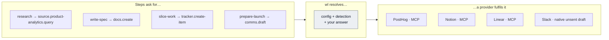
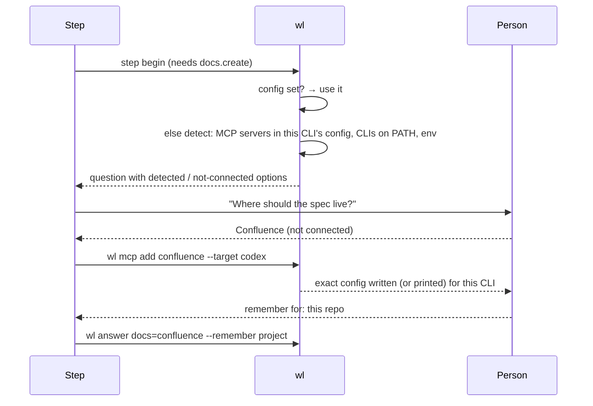

# Providers — bring your own tools

> **TL;DR** — Steps ask for **capabilities** (write a document, track a work item, query product analytics); **providers** fulfil them through MCP servers, CLIs or the host's native tools. `wholeloop` ships with the most common providers in the industry, detects what you already have connected, asks where things should go the first time, and lets anyone add a provider with a small manifest — no fork, no release needed.

> [!NOTE]
> **Status: 🚧 partial.** Registry v1, validated manifests, local/native defaults, declaration/PATH detection and tier-A MCP snippet renderers are implemented. Eight destination manifests, bundled guidance, a typed host invocation boundary and same-operation document updates are implemented with synthetic fixture transcripts. Eleven source mappings pin evidence queries and explicit unknowns, with a guarded PostgreSQL process host. GitHub/GitLab CLI code-host mappings and explicit draft-only publication hosts are tested locally. Fourteen rollout provider targets have explicit offline binding fixtures plus native unsent drafts, unapplied flag proposals, metric-linked dashboard handoffs and config-file flag reads. Authenticated remote flag bridges and actual dashboard creation remain open P4-05 work; local artifacts are not remote objects. Decision: [ADR-0008](../decisions/0008-extensibility-through-manifests.md). Registry: [P1-08](../../roadmap/phase-1-walking-skeleton.md#p1-08--provider-registry-v1); built-in providers land with the steps that need them (Phases 2–4).

---

## Capabilities, not vendors



A step never names a vendor, so swapping Confluence for Notion, or adding Zendesk as a research source, never touches a skill.

## Rollout implementation boundaries

| Target | Implemented locally | Still pending |
| --- | --- | --- |
| Slack · Microsoft Teams · email | Destination-labelled unsent JSON drafts in the external store | A person reviews and posts; no sending operation exists |
| LaunchDarkly · Unleash · GrowthBook · PostHog | Explicit host-read contracts and stored unapplied proposals | Authenticated service read/normalization bridges and real cohort semantics |
| Config-file flags | Contained explicit JSON reads and unapplied proposals | A person changes configuration through normal review |
| PostHog · Mixpanel · Amplitude · Metabase · Grafana | Exact-metric JSON handoffs with source pointers | Actual remote chart creation and service-specific normalization |
| Datadog · Grafana stack | Declared read-only query tool mappings and offline fixtures | Actual roster, site/datasource, auth and complete scalar normalization |
| Figma | Official remote context-read mapping and offline fixture | Actual client access and referenced design observations |

Run an explicit fixture after building:

```bash
wl provider test slack --fixtures test/fixtures/providers/rollout/slack.json --json
wl provider test grafana --fixtures test/fixtures/providers/rollout/grafana.json --json
```

All fourteen fixture files live under test/fixtures/providers/rollout. Each covers
every declared operation with exact tool/argument bindings and normalized results.
Missing coverage, changed calls or malformed results fail. remoteProbed=false is
mandatory: these synthetic fixtures establish no actual server schema, credentials
or permissions. `wl provider test <id>` without a fixture only inspects metadata.

An explicit SDK conductor can wrap its actual ProviderHost with `rolloutHost`
from src/providers/rollout.ts. It implements native unsent drafts, flag proposals,
dashboard handoffs and config reads. Other calls require an explicit host bridge;
missing service access stays unknown. Providers are selected explicitly in config;
adding a catalogue entry never selects it or authorizes remote execution.

Config flags default to wholeloop.flags.json under the repository. The versioned
shape is `{ "schema": "wholeloop/config-flags@1", "flags": [{ "flag": "orders",
"environment": "disposable", "enabled": false, "exposure": 0, "audience": "all" }] }`.
Use a repository manifest override for another contained file. A boolean alone
cannot establish audience or percentage. The reader changes no repository bytes.

Provider references checked 2026-10-19: [Figma](https://help.figma.com/hc/en-us/articles/39216419318551-Get-started-with-the-Figma-MCP-server),
[Datadog setup](https://github.com/datadog-labs/mcp-server) and
[tools](https://docs.datadoghq.com/mcp_server/tools/),
[Grafana](https://github.com/grafana/mcp-grafana),
[LaunchDarkly representation](https://launchdarkly.com/docs/fed-docs/api/feature-flags),
[Unleash environment](https://docs.getunleash.io/api/get-feature-environment),
[GrowthBook versioning](https://docs.growthbook.io/api/introduction) and
[PostHog tool surface](https://github.com/PostHog/posthog/blob/master/services/mcp/README.md).
These references describe upstream surfaces; their raw schemas are not replaced by
our normalized fixtures. The Grafana recipe is a pinned read-only Prometheus/Loki
container invocation; it was not pulled or run. Keep credentials in the host's
credential store and pass environment names rather than secret values in recipes.

P4-05 stays partial for real flag bridges and dashboard creation.
[ADR-0042](../decisions/0042-offline-provider-fixtures-and-explicit-rollout-handoffs.md)
explains why local handoffs remain explicit instead of fabricated integrations.

## The capability taxonomy

The taxonomy is the **stable contract**. It versions slowly, and every verb in it is safe for a machine to perform.

### Sources — read-only evidence

| Capability | Answers | Used by |
| --- | --- | --- |
| `source.web` | What does the outside world say? | research, frame-problem |
| `source.code` | What does the code actually do? | every step |
| `source.product-analytics` | What do users do? Events, funnels, retention | research, write-spec, measure-impact |
| `source.bi` | What do the business tables say? SQL / BI queries | research, measure-impact |
| `source.support` | What are users telling support? | research, measure-impact |
| `source.errors` | What is breaking? | research, ramp-exposure, measure-impact |
| `source.observability` | How is the system behaving? Metrics, logs, traces | ramp-exposure, measure-impact |
| `source.knowledge` | What have we already written down? | research, frame-problem |
| `source.feedback` | What do research notes, surveys and feature requests say? | research, decide-next |
| `source.meetings` | What was said in calls and interviews? | frame-problem, measure-impact |

Every source has one verb: **`query`**.

### Destinations and services

| Capability | Verbs | Used by |
| --- | --- | --- |
| `docs` | `create` · `read` · `update` (always read-modify-write) · `link` | Define, Rollout, Learn |
| `tracker` | `create-item` · `read-item` · `update-item` · `link-items` · `transition` | cut-scopes, slice-work, sync |
| `codehost` | `open-draft-pr` · `read-pr` · `pr-status` · `comment-pr` | open-pr, review-code, sync |
| `dashboards` | `create` · `update` · `read` | prepare-launch, measure-impact |
| `flags` | `read-state` · `propose-change` | cut-scopes, ramp-exposure |
| `comms` | `draft` | prepare-launch, measure-impact |
| `design` | `read-context` | write-spec, build-slice |

> [!IMPORTANT]
> There is **no verb** for sending a message, toggling a flag, merging a pull request or deleting a document. What must never happen is not expressible in the contract, so no provider — built-in or community — can be asked to do it.

## The built-in catalogue

Defaults chosen for breadth of real-world use. **v1** ships with the phase that first needs it; **catalogue** entries are planned or welcome as community manifests.

| Capability | v1 built-ins | Catalogue |
| --- | --- | --- |
| `source.web` · `source.code` | native (the host CLI's own search, fetch and file tools) | — |
| `source.product-analytics` | PostHog · Mixpanel · Amplitude | Google Analytics 4 · Heap · Pendo |
| `source.bi` | Metabase · BigQuery · PostgreSQL (read-only) | Looker · Snowflake · Redash · Databricks |
| `source.support` | Zendesk · Intercom | Freshdesk · Front · HubSpot Service |
| `source.errors` | Sentry | Bugsnag · Rollbar |
| `source.observability` | Datadog · Grafana (Prometheus, Loki, Tempo) | New Relic · Honeycomb · Elastic |
| `source.knowledge` | local files · Confluence · Notion | Google Drive · SharePoint · GitHub Wiki |
| `source.feedback` · `source.meetings` | — | Dovetail · Productboard · Canny · Gong · Granola |
| `docs` | **local Markdown** (default) · Confluence · Notion · Google Docs · repo `docs/` | Coda · SharePoint |
| `tracker` | **local** (default) · GitHub Issues · Jira · Linear · GitLab Issues | Shortcut · Azure Boards · ClickUp · Asana |
| `codehost` | GitHub (`gh`) · GitLab (`glab`) | Bitbucket · Azure Repos · Gitea |
| `dashboards` | PostHog · Mixpanel · Amplitude · Metabase · Grafana | Datadog · Looker |
| `flags` | LaunchDarkly · Unleash · GrowthBook · PostHog · config-file flags | Flagsmith · ConfigCat · Statsig · Split |
| `comms` | Slack · Microsoft Teams · email (draft) | Discord · Google Chat |
| `design` | Figma | Penpot |

### Generated declared mappings

These rows come from the bundled manifests. They describe declarations, not live
server support, authentication, operation semantics or a selected provider. Native
bridges can remain pending handoffs; the verification limits below still apply.

<!-- providers:start -->
| ID | Capabilities | Declared operations | Access |
| --- | --- | --- | --- |
| `amplitude` | `dashboards` · `source.product-analytics` | `dashboards.create` · `source.product-analytics.query` | native host · MCP: amplitude |
| `bigquery` | `source.bi` | `source.bi.query` | MCP: bigquery |
| `config-flags` | `flags` | `flags.propose-change` · `flags.read-state` | native host |
| `confluence` | `docs` · `source.knowledge` | `docs.create` · `docs.read` · `docs.update` · `source.knowledge.query` | MCP: atlassian |
| `datadog` | `source.errors` · `source.observability` | `source.errors.query` · `source.observability.query` | MCP: datadog |
| `email` | `comms` | `comms.draft` | native host |
| `figma` | `design` | `design.read-context` | MCP: figma |
| `github` | `codehost` | `codehost.comment-pr` · `codehost.open-draft-pr` · `codehost.pr-status` · `codehost.read-pr` | CLI: gh |
| `github-issues` | `tracker` | `tracker.create-item` · `tracker.read-item` · `tracker.transition` · `tracker.update-item` | MCP: github |
| `gitlab` | `codehost` | `codehost.comment-pr` · `codehost.open-draft-pr` · `codehost.pr-status` · `codehost.read-pr` | CLI: glab |
| `gitlab-issues` | `tracker` | `tracker.create-item` · `tracker.link-items` · `tracker.read-item` · `tracker.update-item` | MCP: gitlab |
| `google-docs` | `docs` | `docs.create` · `docs.read` · `docs.update` | CLI: gws |
| `grafana` | `dashboards` · `source.errors` · `source.observability` | `dashboards.create` · `source.errors.query` · `source.observability.query` | native host · MCP: grafana |
| `growthbook` | `flags` | `flags.propose-change` · `flags.read-state` | native host |
| `intercom` | `source.support` | `source.support.query` | MCP: intercom |
| `jira` | `tracker` | `tracker.create-item` · `tracker.link-items` · `tracker.read-item` · `tracker.transition` · `tracker.update-item` | MCP: atlassian |
| `launchdarkly` | `flags` | `flags.propose-change` · `flags.read-state` | native host |
| `linear` | `tracker` | `tracker.create-item` · `tracker.read-item` · `tracker.transition` · `tracker.update-item` | MCP: linear |
| `local-docs` | `docs` | `docs.create` · `docs.link` · `docs.read` · `docs.update` | local |
| `local-tracker` | `tracker` | `tracker.create-item` · `tracker.link-items` · `tracker.read-item` · `tracker.transition` · `tracker.update-item` | local |
| `metabase` | `dashboards` · `source.bi` | `dashboards.create` · `source.bi.query` | native host · MCP: metabase |
| `microsoft-teams` | `comms` | `comms.draft` | native host |
| `mixpanel` | `dashboards` · `source.product-analytics` | `dashboards.create` · `source.product-analytics.query` | native host · MCP: mixpanel |
| `native-code` | `source.code` | `source.code.query` | native host |
| `native-web` | `source.web` | `source.web.query` | native host |
| `notion` | `docs` · `source.knowledge` | `docs.create` · `docs.read` · `docs.update` · `source.knowledge.query` | MCP: notion |
| `postgresql` | `source.bi` | `source.bi.query` | CLI: psql |
| `posthog` | `dashboards` · `flags` · `source.product-analytics` | `dashboards.create` · `flags.propose-change` · `flags.read-state` · `source.product-analytics.query` | native host · MCP: posthog |
| `repo-docs` | `docs` | `docs.create` · `docs.read` · `docs.update` | native host |
| `sentry` | `source.errors` | `source.errors.query` | MCP: sentry |
| `slack` | `comms` | `comms.draft` | native host |
| `unleash` | `flags` | `flags.propose-change` · `flags.read-state` | native host |
| `zendesk` | `source.support` | `source.support.query` | CLI: curl |
<!-- providers:end -->

One provider can serve several capabilities — PostHog covers product analytics, dashboards and flags; Confluence covers `docs` and `source.knowledge`.

### Implemented destination mappings

| ID | Mapping | Verification |
| --- | --- | --- |
| `github-issues` | Official GitHub MCP issues tools | Synthetic host transcript; live OAuth/toolset pending |
| `gitlab-issues` | Official GitLab MCP work-item tools | Synthetic host transcript; self-managed version pending |
| `jira` | Atlassian Rovo Jira tools | Synthetic host transcript; site fields/transitions pending |
| `linear` | Official Linear MCP save/get issue | Synthetic host transcript; workspace schema pending |
| `confluence` | Rovo create/read/update content | Synthetic host transcript; page-format/revision pending |
| `notion` | Official create-pages/fetch/update-page | Synthetic host transcript; aliases/async behavior pending |
| `google-docs` | Optional gws documents create/get/batchUpdate | Synthetic host transcript; CLI/auth/format pending |
| `repo-docs` | Native files with a core repository-docs host | Real temporary-file tests; no automatic commit/push |

These mappings were checked against official documentation on 2026-10-18:
[GitHub](https://github.com/github/github-mcp-server),
[GitLab](https://docs.gitlab.com/user/model_context_protocol/mcp_server_tools/),
[Atlassian](https://developer.atlassian.com/cloud/rovo-mcp/guides/supported-tools/),
[Linear](https://linear.app/integrations/slack),
[Notion](https://developers.notion.com/guides/mcp/mcp-supported-tools), and
[Google Workspace CLI](https://github.com/googleworkspace/cli).
The [Docs MCP reference](https://developers.google.com/workspace/docs/api/reference/mcp)
currently exposes read/update, so document creation uses optional gws. No tool was
installed and no authenticated operation was performed here. Discover the actual
live schema before translating generic input into vendor arguments.

Canonical resources live under harness/providers. Run `npm run providers:catalog`
after changing them, then `npm run docs:providers` and `npm run lint:fix`. The provider JSON catalog check enforces semantic source drift; docs check independently verifies the generated declared-mapping table against the built-in registry.
The bundled registry returns guidanceText even without the source checkout.
Repository/user resources also retain their file paths and inheritance precedence.

### Implemented source mappings

| ID | Capability | Mapping |
| --- | --- | --- |
| `posthog` | product analytics | execute-sql, explicitly selected tools roster |
| `mixpanel` | product analytics | Run-Query |
| `amplitude` | product analytics | query_amplitude_data |
| `metabase` | BI | query; requires actual instance endpoint |
| `bigquery` | BI | execute_sql_readonly |
| `postgresql` | BI | psql through a guarded read-only process host |
| `sentry` | errors | search_events |
| `zendesk` | support | Official Search REST API through host-managed curl |
| `intercom` | support | Official MCP search |
| `confluence` | knowledge | searchConfluence; fetch citations through the host |
| `notion` | knowledge | notion-search; fetch citations through the host |

Each mapping includes tool-specific guidance within thirty lines and
open-question degradation. Fixtures are synthetic, never observed product data.
Official references checked on 2026-10-18:
[PostHog](https://github.com/PostHog/posthog/blob/master/services/mcp/schema/tool-definitions.json),
[Mixpanel](https://docs.mixpanel.com/docs/mcp),
[Amplitude](https://amplitude.com/docs/amplitude-ai/amplitude-mcp),
[Metabase](https://www.metabase.com/docs/latest/ai/mcp),
[BigQuery read-only tool](https://docs.cloud.google.com/bigquery/docs/reference/mcp/tools_list/execute_sql_readonly),
[PostgreSQL](https://www.postgresql.org/docs/current/sql-set-transaction.html),
[Sentry](https://mcp.sentry.dev/),
[Zendesk](https://developer.zendesk.com/api-reference/ticketing/ticket-management/search/),
and [Intercom](https://developers.intercom.com/docs/guides/mcp).
Knowledge provider references are listed with their destination mappings above.

`querySource` pins the query, operation, owner and explicit timestamp/timezone
window. A complete successful host result retains its observed content/ref;
failed, pending or partial results become answerable open questions. It does not
turn missing results into zero or infer claims from rows. The host translates
vendor arguments without changing the pinned plan. Research offers exactly
configured or detected sources, not every catalog entry. curl alone does not
detect a Zendesk connection; configure the source and actual tenant in the host.

PostgreSqlSource accepts a configured libpq service name, sends one conservatively
validated SELECT/WITH statement over stdin, and wraps it in BEGIN READ ONLY,
statement timeout and ROLLBACK. It rejects transaction escapes, modifying CTEs,
psql commands and unsupported quoting. Tests execute a fixture process; live
read-only role/function privileges still need verification. Credentials remain
in the host/tool store. No driver or integration dependency was added.

PostHog installation permits only mode=tools or mode=cli as one credential-free
query parameter. Its built-in named tool uses tools mode; arbitrary parameters
and credential values remain forbidden. Metabase's example host must be replaced
with the real instance. See
[ADR-0027](../decisions/0027-read-only-source-evidence-and-degradation.md).

### Read-modify-write boundary

`performOperation` accepts taxonomy mappings through an injected host that owns
authentication, tool invocation and vendor-specific response normalization. Fixed
manifest arguments take precedence over caller input. Exact placeholders preserve
JSON types; argument values are never interpolated into shell commands by the core.
This is an execution interface for workflows, not an automatic remote command.

Generic invocation rejects docs.update. `updateDocument` reads the same reference
inside that invocation, requires a complete body and revision, then gives the
snapshot to the transform. It passes source digest/revision with the new body;
no-op changes skip the write. Truncated, pending or mismatched reads fail before
the transform. Hosts apply native revision preconditions and preserve rich
formats. A queued write remains pending. See
[ADR-0026](../decisions/0026-destination-host-contract-and-document-updates.md).

RepositoryDocuments publishes only explicit docs/*.md output, using exclusive
creation, path containment, observed digest conflicts and atomic replacement.
The writer lock stays external. Other editors do not share it, so this does not
promise filesystem-wide compare-and-swap. Wholeloop runtime state never becomes
tracked repository content. Record real links with `wl link <id> <URL> --json`
after the host confirms success; Define completion still returns pending remote
handoffs until a host performs that work.

## Available registry commands

```text
wl provider list --json
wl provider show local-docs --json
wl provider resolve docs.create --json
wl provider test local-tracker --json
wl provider scaffold acme-support --json
wl mcp add acme-support --target codex --json
```

With no configuration, `docs.create` resolves to `local-docs` and `tracker.create-item` to `local-tracker`. `native-web` and `native-code` declare host-native evidence tools. The registry resolves operation mappings; it does not execute external tools or claim authentication. Steps currently store their artifacts through the core.

Detection reads MCP declarations for all four tier-A clients plus Gemini/Antigravity/Cursor and executable availability on `PATH`; `available: true` means declared/configured, and `authenticated: false` remains explicit. Config parsing errors omit contents. No detection command from a manifest is executed. Provider tests do not make network probes.

`mcp add` prints a mergeable snippet with `applied: false`; it never overwrites client configuration or reads a token. OAuth is delegated to the client. Header authentication uses `token_env`, an environment variable name. Copilot remote headers do not expand environment references, so that recipe is explicitly rejected for Copilot and Antigravity instead of embedding credentials. Confirm authentication in a real client session.

Gemini snippets merge into the native .gemini/settings.json mcpServers map (under
GEMINI_CLI_HOME when set). HTTP recipes use httpUrl, with explicit OAuth enablement
for requested OAuth and bearer environment placeholders for header auth; stdio
uses command/args. Gemini 0.27.0 needs explicit OAuth enablement even where newer
documentation permits discovery. Rendering never applies the snippet, expands a
credential or contacts the server. Detection reads project/user declarations and
allowed/excluded server metadata only. Actual auth/tool execution remains unverified.

Antigravity snippets target .gemini/config/mcp_config.json (or a manual project
merge into .agents/mcp_config.json). HTTP uses serverUrl; stdio uses command/args.
OAuth discovery stays native. Header recipes are refused because safe environment
expansion is unverified. Detection reads only declarations and disabled/enabled
metadata. See the official [MCP format](https://www.antigravity.google/docs/mcp).

Cursor snippets target .cursor/mcp.json under HOME (or a manual project merge).
HTTP uses url, stdio uses type/command/args, and header recipes contain only a
Bearer environment reference such as ${env:SUPPORT_AUTH}. OAuth stays native;
rendering does not expand a value or authenticate. Detection reads declaration
metadata only. See the official [MCP format](https://cursor.com/docs/mcp).

The renderers follow the official [Claude Code MCP configuration](https://code.claude.com/docs/en/mcp), [OpenAI MCP configuration](https://developers.openai.com/codex/mcp), [OpenCode MCP configuration](https://opencode.ai/docs/mcp-servers/) and [Copilot MCP configuration](https://docs.github.com/en/copilot/reference/copilot-cli-reference/cli-command-reference#mcp-server-configuration), checked on 2026-10-18. Golden files verify generated shape; they are not native-client conformance runs.

## Detection and first use



- **Detection is deterministic.** `wl` reads the host CLI's MCP configuration files and checks binaries on `PATH`; it never guesses whether something is connected. Whether a connected server is *authenticated* is checked by the skill with one cheap probe call.
- **`wl mcp add <provider> --target <cli>`** writes the provider's MCP entry in the dialect that CLI expects (JSON, TOML, `serverUrl` vs `url`…), or prints it if you prefer to paste it yourself.
- **Not available? Never a silent skip.** The step produces a hand-off artifact instead (a ready-to-paste document, an issue list, a dashboard spec with its queries) and records the gap so it can be backfilled later.

## Local by default, shared when you want

With nothing configured, everything lands in the local store as Markdown — the flow works with zero integrations. Configure a `docs` and `tracker` provider and each step also publishes there as it goes, which is what lets someone else pick the work up from a URL.

---

### Tested code-host boundary

`github` uses gh api; `gitlab` uses glab api. Both resolve one explicit remote,
push a pinned tested commit and verify a matching open draft response. Read/status
normalize source SHA/branch, target, repository, draft and merge state. Bodies use
stdin and each CLI's credential store. Optional comments reconcile a stable round
marker before posting. Local tests use synthetic API-shaped responses and a
separate real push to a temporary local bare repository; live authentication,
self-managed versions and network interruption remain owner verification.

<!-- docnav -->
[◀ Interaction profile](profile.md)  ·  [📖 Docs index](../README.md)  ·  [🧭 Concepts](../concepts.md)  ·  [Repo skills ▶](repo-skills.md)
