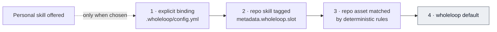

# Repo skills and slots — follow what your repository already knows

> **TL;DR** — Each step declares named **slots**: places where your repository's own guidance should take over, such as `build.frontend`, `verify.suite` or `review.rubric`. Before acting, `wl discover` scans your repository for the skills, agents, rules and commands it already has, for every major client and not just the one you are using, and binds each slot to the most specific match. Personal skills are offered only when relevant and never selected for you; the initial choice is your repository's guidance or wholeloop's default.

> [!NOTE]
> **Partial.** Discovery, cached capability maps, slot resolution, explicit choices and step bindings work. Discovering a design system's MCP server and richer language-specific rules are planned.

## Why

A generic harness that ignores your repository writes generic code. Your repository may already have a skill for its backend architecture, a design-system guide, a migration checklist, a PR template, or a `make check` that is the real test suite. Those are the team's agreements in executable form. wholeloop is the layer that **sequences** them, not the one that replaces them.

## What `wl discover` looks at

| Kind | Where |
| --- | --- |
| **Skills** | `.agents/skills/` · `.claude/skills/` · `.codex/skills/` · `.opencode/skills/` · `.gemini/skills/` · `.cursor/skills/` · `.github/skills/` |
| **Agents** | `.claude/agents/` · `.codex/agents/` · `.opencode/agents/` · `.gemini/agents/` · `.agents/agents/` · `.cursor/agents/` · `.github/agents/` |
| **Instructions & rules** | `AGENTS.md` (nested) · `CLAUDE.md` · `GEMINI.md` · `.cursor/rules/` · `.agents/rules/` · `.github/copilot-instructions.md` |
| **Conventions** | `CONTRIBUTING.md` · PR and issue templates · `docs/adr/` · commit-lint config · `CODEOWNERS` |
| **Commands** | `package.json` scripts · `Makefile` · `justfile` · `Taskfile` · `bin/` · language-specific runners (`pytest`, `go test`, `cargo`, `rspec`, …) |
| **Quality tools** | linters, formatters, type checkers, architecture checkers — from their config files |
| **Design system** | UI kit packages, token files, Storybook, an MCP server for the design system |

The result is a **capability map**, cached in your store and refreshed when the files it read change. `wl discover --json` returns what it found and any parse problems; **it never runs a script**.

- **Commands** carry their exact arguments and working directory. Nested packages inherit the workspace's declared package manager. Go, Rust, pytest, RSpec, Make, just and Taskfile runners are found from their declarations, which does not prove they are installed or that their tests pass.
- **Skipped:** dependency and build directories, files over 1 MiB, and symlinks that leave the repository or are broken, each with a warning. Symlinks inside the repository are followed once.
- **Your own skills** are scanned only in the current client’s skill locations, including its native directory overrides. An ordinary terminal without a declared client scans none; use `--client <name>` to choose the client. Other detected locations are labelled **configured for another client**. `--include-other-clients` explicitly includes their personal skills; it never changes the repository scan.
- **Copies with identical content** count once, with the repository’s copy preferred. Description-only matches never become candidates. A personal name must match the whole method name, so an unrelated `medical-research` skill does not become research guidance.
- **Invalid metadata or runner configuration stops resolution** instead of choosing from a partial map.

Two kinds of files never compete for a slot:

- **wholeloop's own installed copies** under `.wholeloop/distribution`, so a project install does not compete with itself.
- **wholeloop's own skills and roles.** They carry an entrypoint marker, appear in discovery as `entrypoint: true`, and are left out of the heuristic matching, so that installing several clients does not create false ties. An explicit tag or binding to one of them still works.

Codex TOML agents are listed by path; their format and read-only behaviour still need checking in the real client.

## Slots

| Slot | Bound to, typically | Used by |
| --- | --- | --- |
| `research.method` | a team research or discovery skill | research |
| `spec.template` | a spec / PRD skill or template | write-spec |
| `flags.naming` | a feature-flag naming convention | cut-scopes, ramp-exposure |
| `slice.conventions` | a story or ticket-writing skill | slice-work |
| `build.<area>` (`backend`, `frontend`, `mobile`, `infra`, `data`…) | the repo's implementation skills for that area | build-slice |
| `build.design-system` | design-system guide, tokens, component docs | build-slice, review-code |
| `verify.suite` | the authoritative test / typecheck / lint command | verify-works |
| `review.rubric` | a repo review skill or checklist | review-code |
| `commit.convention` | commit skill, commit-lint config | build-slice |
| `open-pr.convention` | PR template or PR skill | open-pr |
| `comms.voice` | brand voice and tone guide | prepare-launch |
| `launch.templates` | release-notes, support-guide or runbook templates | prepare-launch |
| `ramp.criteria` | the team's standard exit criteria for each exposure stage | ramp-exposure |
| `learn.report` | an impact-review format | measure-impact |
| `learn.decision` | a decision-record format | decide-next |

## Precedence



1. **Explicit binding** wins, always.
2. **Tagged skill**: a repository skill can declare the slot it serves in its standard `metadata`:

   ```yaml
   ---
   name: ui-kit
   description: How to build UI with our design system — components, tokens, accessibility.
   metadata:
     wholeloop.slot: build.frontend build.design-system
   ---
   ```

3. **Rule match**: deterministic name and file-type rules. A description alone is never a match.
4. **Wholeloop default**: the built-in guidance. A personal name match or explicit personal tag is offered with this default first; it does not replace the default until you choose it.

**Distinct repository ties need a choice.** Identical copies count once. Personal offers are optional and keep the default available, so a collection of unrelated personal skills never blocks a step.

## Transparency

Every preflight lists the bindings in force. An example:

```text
Bindings  build.backend   → .agents/skills/api-architecture   (repo, tagged)
          build.frontend  → .agents/skills/ui-kit              (repo, tagged)
          verify.suite    → pnpm test && pnpm typecheck         (package.json)
          review.rubric   → harness default                     (nothing found)
```

`wl resolve <slot>` shows the same for one slot, with every candidate and why it won or lost. In a repository with the tagged `ui-kit` skill above and three `package.json` scripts:

```console
$ wl resolve build.frontend
{
  "schema": "wholeloop/resolve@1",
  "slot": "build.frontend",
  "selected": {
    "ref": ".agents/skills/ui-kit/SKILL.md",
    "origin": "repo",
    "reason": "Explicit metadata.wholeloop.slot tag for build.frontend"
  },
  …
  "questions": []
}
$ wl resolve verify.suite
{
  "schema": "wholeloop/resolve@1",
  "slot": "verify.suite",
  "selected": {
    "ref": "package.json#test",
    "origin": "repo",
    "reason": "Declared npm script test"
  },
  "candidates": [
    …
    {
      "ref": "package.json#typecheck",
      "origin": "repo",
      "score": 216,
      "confident": true,
      "reason": "Declared npm script typecheck",
      "selected": false,
      "outcome": "Lost to a higher-precedence or stronger candidate"
    },
    …
```

- **A tie between distinct repository matches** returns a question and exit code 2. Its first option is wholeloop’s default. A description-only match contributes no candidate or question.
- **No match** returns the harness default. Binding a slot to `default` explicitly opts out of repository guidance for it.
- **Remember a choice** with an answer using `--remember project`, `--remember user` or `--remember run`. The returned `file` says where the choice was written. Unoffered values are rejected before writing. A run choice uses external configuration and never edits the project or user configuration.
- **Before an item exists**, answer with the `--run` returned by the question and repeat `step begin --run` with that ID. After a step starts, `--for` selects its active run. The choice applies only to that run; reusing a started run for another item is refused.

Every `wl step begin` payload includes its resolved guidance and any optional personal offers. Only unresolved required repository choices block the step. Other-client locations remain a listing until you request their inspection.

## In autonomous runs

Workers in [autonomous delivery](../concepts.md#autonomous-delivery) cannot load your skills or instruction files themselves. Their client's own loading is switched off, so every input stays inside the authorized plan. Instead, the guidance is **pinned into the plan**:

1. Before preparing a plan, run `wl delivery guidance --file <proposal.json> --json`. It resolves the same slots at each repository's pinned base commit.
2. It prints pins to copy into the plan's `guidance`: one per resolved slot (a skill directory as a whole, with a digest per file) and `repo.instructions` for `AGENTS.md` and its peers.
3. Ties come back as questions. Answer them in a `wholeloop/delivery-guidance-answers@1` file passed with `--answers`, or choose `default`.

Each worker then receives only its role's guidance: builders get the build slots and conventions, reviewers the rubric, and everyone the instructions. Your user-level skills are not used in autonomous runs.

## Gotchas & FAQ

**"My repo has Claude skills but I use Codex."** Discovery reads every CLI's folders, so a `.claude/skills/` guide still binds to a slot when you run in Codex.

**"A repo skill contradicts the harness."** The repo wins inside its slot. The harness only keeps what no slot can override: decision points, coverage, the output contract and *ask, never guess*.

**"I don't want a repo skill used."** Bind the slot explicitly, to another skill or to `default`.

<!-- docnav -->
[◀ Providers](providers.md)  ·  [📖 Docs index](../README.md)  ·  [🧭 Concepts](../concepts.md)  ·  [Autonomous delivery design ▶](../architecture/autonomous-delivery.md)
