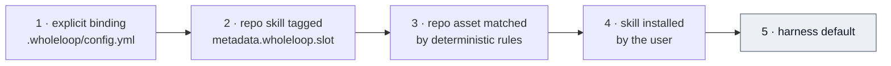

# Repo skills and slots — follow what your repository already knows

> **TL;DR** — Each step declares named **slots** (`build.frontend`, `verify.suite`, `review.rubric`…). Before acting, `wl discover` scans your repository for the skills, agents, rules and commands it already has — for every major CLI, not just the one you are using — and binds each slot to the most specific match. The harness's own defaults are the last resort, never the first.

> [!NOTE]
> **Status: 🚧 partial.** Discovery v1, cached capability maps, slot resolution, explicit choices and step bindings are implemented. Design-system MCP discovery and richer language-specific rules arrive with providers and build workflows. Decision: [ADR-0009](../decisions/0009-repo-first-capability-resolution.md). Implementation: [P1-07](../../roadmap/phase-1-walking-skeleton.md#p1-07--discover-v1-and-slot-resolution), extended in [P3-04](../../roadmap/phase-3-build.md#p3-04--build-slice-and-the-builder).

---

## Why

A generic harness that ignores your repository writes generic code. Your repo may already have a skill for its backend architecture, a design-system guide, a migration checklist, a PR template, a `make check` that is the real test suite. Those are the team's agreements in executable form; `wholeloop` is the layer that **sequences** them, not the one that replaces them.

## What `wl discover` looks at

| Kind | Where |
| --- | --- |
| **Skills** | `.agents/skills/` · `.claude/skills/` · `.codex/skills/` · `.opencode/skills/` · `.gemini/skills/` · `.cursor/skills/` · `.github/skills/` |
| **Agents** | `.claude/agents/` · `.codex/agents/` · `.opencode/agents/` · `.gemini/agents/` · `.agents/agents/` · `.cursor/agents/` · `.github/agents/` |
| **Instructions & rules** | `AGENTS.md` (nested) · `CLAUDE.md` · `GEMINI.md` · `.cursor/rules/` · `.agents/rules/` · `.github/copilot-instructions.md` |
| **Conventions** | `CONTRIBUTING.md` · PR and issue templates · `docs/adr/` · commit-lint config · `CODEOWNERS` |
| **Commands** | `package.json` scripts · `Makefile` · `justfile` · `Taskfile` · `bin/` · language-specific runners (`pytest`, `go test`, `cargo`, `rspec`, …) |
| **Quality tools** | linters, formatters, type checkers, architecture checkers — from their config files |
| **Design system** | UI kit packages, token files, Storybook, an MCP server for the design system |

The result is a **capability map**, cached in the external store and refreshed when selected file contents change. `wl discover --json` returns declarations and parse problems; it never executes scripts. Package scripts carry structured `argv` plus `cwd`, and nested packages inherit a declared workspace package manager. Go, Rust, pytest, RSpec, Make, just and Taskfile runners are detected from their declarations; detection does not prove that a runner is installed or that its tests pass.

Discovery skips dependency/build directories, files over 1 MiB and external or broken repository symlinks, reporting warnings. Internal symlinks are followed once. User discovery scans only skill directories, with lower precedence than repository assets. Codex TOML agents are inventoried by path; format and read-only conformance still require P0-03. Invalid metadata or runner configuration blocks resolution instead of silently choosing from a partial map.

## Slots

| Slot | Bound to, typically | Used by |
| --- | --- | --- |
| `research.method` | a team research or discovery skill | research |
| `spec.template` | a spec / PRD skill or template | write-spec |
| `flags.naming` | a feature-flag naming convention | cut-scopes, ramp-exposure |
| `slice.conventions` | a story or ticket-writing skill | slice-work |
| `build.<area>` (`backend`, `frontend`, `mobile`, `infra`, `data`…) | the repo's implementation skills for that area | build-slice |
| `build.design-system` | design-system guide, tokens, component docs | build-slice, review-code |
| `verify.suite` | the authoritative test / typecheck / lint command | verify-works |
| `review.rubric` | a repo review skill or checklist | review-code |
| `commit.convention` | commit skill, commit-lint config | build-slice |
| `open-pr.convention` | PR template or PR skill | open-pr |
| `comms.voice` | brand voice and tone guide | prepare-launch |
| `launch.templates` | release-notes, support-guide or runbook templates | prepare-launch |
| `ramp.criteria` | the team's standard exit criteria for each exposure stage | ramp-exposure |
| `learn.report` | an impact-review format | measure-impact |
| `learn.decision` | a decision-record format | decide-next |

## Precedence



1. **Explicit binding** wins, always.
2. **Tagged skill** — a repo skill can declare the slot it serves in its standard `metadata`:

   ```yaml
   ---
   name: ui-kit
   description: How to build UI with our design system — components, tokens, accessibility.
   metadata:
     wholeloop.slot: build.frontend build.design-system
   ---
   ```

3. **Rule match** — deterministic keyword and path rules over names, descriptions and file types. Rules are data, versioned and tested against fixture repositories.
4. **User skill** — something you installed for yourself.
5. **Harness default** — `wholeloop`'s own minimal guidance.

**Ambiguity is a question, not a coin toss.** Two equally good matches, or a match with low confidence, produce one question; the answer is remembered as an explicit binding.

## Transparency

Every preflight lists the bindings in force:

```text
Bindings  build.backend   → .agents/skills/api-architecture   (repo, tagged)
          build.frontend  → .agents/skills/ui-kit              (repo, tagged)
          verify.suite    → pnpm test && pnpm typecheck         (package.json)
          review.rubric   → harness default                     (nothing found)
```

`wl resolve <slot> --json` shows the same for one slot, with every candidate and why it won or lost. Ambiguity or a description-only match returns a structured question and exit 2. No match returns the harness default. An explicit `default` binding opts out of repository guidance for that slot.

Remember a choice with `wl answer slot:build.frontend=.agents/skills/ui-kit/SKILL.md --remember project --json`. User scope is also available. Step begin payloads expose their slot resolutions and include unresolved choices in their missing-input questions.

## Gotchas & FAQ

**"My repo has Claude skills but I use Codex."** Discovery reads every CLI's folders, so a `.claude/skills/` guide still binds to a slot when you run in Codex.

**"A repo skill contradicts the harness."** The repo wins inside its slot. The harness only keeps what no slot can override: decision points, coverage, the output contract and *ask, never guess*.

**"I don't want a repo skill used."** Bind the slot explicitly — to another skill, or to `default`.

---

<!-- docnav -->
[◀ Providers](providers.md)  ·  [📖 Docs index](../README.md)  ·  [🧭 Concepts](../concepts.md)  ·  [Extending ▶](../extending/README.md)
