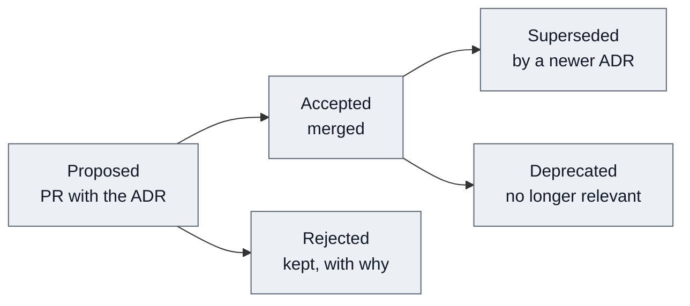

# Decisions — why wholeloop is shaped the way it is

> **TL;DR** — Every choice that would be expensive to reverse, or that someone will one day want to undo, is written down here as a short Architecture Decision Record: the context, the decision, what it costs, and what we turned down. Read the relevant ADR before changing a rule; write one before changing a decision.

> [!NOTE]
> **Status: ✅ in force.** These records are the reference the rest of the documentation links to.

---

## Index

| # | Decision | Status | Date |
| --- | --- | --- | --- |
| [0001](./0001-record-architecture-decisions.md) | Record architecture decisions | Accepted | 2026-10-14 |
| [0002](./0002-open-standards-canonical-source.md) | Open standards as the canonical source, adapters generated per CLI | Accepted | 2026-10-14 |
| [0003](./0003-deterministic-core-cli.md) | A deterministic TypeScript core (`wl`); skills stay thin | Accepted | 2026-10-14 |
| [0004](./0004-state-outside-the-repo.md) | State lives outside every repository | Accepted | 2026-10-14 |
| [0005](./0005-supported-clis-and-tiers.md) | Supported CLIs and their tiers | Accepted | 2026-10-14 |
| [0006](./0006-orchestration-tiers.md) | Three orchestration engines, one decision layer | Accepted | 2026-10-14 |
| [0007](./0007-standalone-steps-opt-in-flow.md) | Every step stands alone; the flow is opt-in | Accepted | 2026-10-14 |
| [0008](./0008-extensibility-through-manifests.md) | Extensibility through declarative manifests | Accepted | 2026-10-14 |
| [0009](./0009-repo-first-capability-resolution.md) | Repo-first capability resolution through slots | Accepted | 2026-10-14 |
| [0010](./0010-interaction-profile-never-changes-coverage.md) | The interaction profile never changes coverage | Accepted | 2026-10-14 |
| [0011](./0011-size-budgets-and-enforcement.md) | Size budgets, and an enforcer for every hard rule | Accepted | 2026-10-14 |
| [0012](./0012-step-naming-verb-object.md) | Steps are named verb + object | Accepted | 2026-10-14 |
| [0013](./0013-git-worktrees-for-parallel-builds.md) | Git worktrees for parallel builds | Accepted | 2026-10-14 |
| [0014](./0014-configurable-gate-round-budgets.md) | Configurable gate round budgets | Accepted | 2026-10-14 |
| [0015](./0015-distribution.md) | Distribution: npm, plugin marketplaces, binaries later | Accepted | 2026-10-14 |
| [0016](./0016-documentation-is-part-of-the-product.md) | Documentation is part of the product | Accepted | 2026-10-14 |
| [0017](./0017-no-tool-attribution-in-history.md) | No tool attribution in project history | Accepted | 2026-10-14 |
| [0018](./0018-project-name.md) | Project name: wholeloop | Accepted | 2026-10-14 |
| [0019](./0019-typescript-toolchain.md) | TypeScript toolchain | Accepted | 2026-10-14 |
| [0020](./0020-journal-atomicity-and-lock-recovery.md) | Journal atomicity and lock recovery | Accepted | 2026-10-18 |
| [0021](./0021-journaled-research-plans-and-refutations.md) | Journal research plans and count active refutations | Accepted | 2026-10-18 |
| [0022](./0022-framing-identity-and-explicit-outcomes.md) | Framing identity and explicit outcomes | Accepted | 2026-10-18 |
| [0023](./0023-structured-spec-plans-and-revision-approval.md) | Structured spec plans and revision approval | Accepted | 2026-10-18 |
| [0024](./0024-atomic-scope-plans-and-parent-approval.md) | Atomic scope plans and parent approval | Accepted | 2026-10-18 |
| [0025](./0025-explicit-criteria-constraints-and-challenge-modes.md) | Explicit criteria constraints and challenge modes | Accepted | 2026-10-18 |
| [0026](./0026-destination-host-contract-and-document-updates.md) | Destination host contract and document updates | Accepted | 2026-10-18 |
| [0027](./0027-read-only-source-evidence-and-degradation.md) | Read-only source evidence and degradation | Accepted | 2026-10-18 |
| [0028](./0028-definition-eval-seeds-and-external-predictions.md) | Definition eval seeds and external predictions | Accepted | 2026-10-18 |
| [0029](./0029-vertical-slice-contracts-and-repository-parts.md) | Vertical slice contracts and repository parts | Accepted | 2026-10-18 |
| [0030](./0030-worktree-intents-leases-and-conservative-pruning.md) | Worktree intents, leases and conservative pruning | Accepted | 2026-10-18 |
| [0031](./0031-pinned-gate-rounds-and-fail-safe-verdicts.md) | Pinned gate rounds and fail-safe verdicts | Accepted | 2026-10-18 |
| [0032](./0032-repository-first-build-plans-and-gate-backed-receipts.md) | Repository-first build plans and gate-backed receipts | Accepted | 2026-10-18 |
| [0033](./0033-once-per-round-suites-and-explicit-verification-inputs.md) | Once-per-round suites and explicit verification inputs | Accepted | 2026-10-18 |
| [0034](./0034-private-incremental-review-inputs-and-pinned-rubrics.md) | Private incremental review inputs and pinned rubrics | Accepted | 2026-10-19 |
| [0035](./0035-tested-draft-plans-and-once-only-publication.md) | Tested draft plans and once-only publication | Accepted | 2026-10-19 |
| [0036](./0036-declarative-environment-undo-ledger.md) | Declarative environment undo ledger | Accepted | 2026-10-19 |
| [0037](./0037-gate-evaluation-observations-and-refutation-matrices.md) | Gate evaluation observations and refutation matrices | Accepted | 2026-10-19 |
| [0038](./0038-pinned-launch-kits-and-separate-publication-capabilities.md) | Pinned launch kits and separate publication capabilities | Accepted | 2026-10-19 |
| [0039](./0039-evidence-bound-human-exposure-stages.md) | Evidence-bound human exposure stages | Accepted | 2026-10-19 |
| [0040](./0040-pinned-impact-observations-and-report-layouts.md) | Pinned impact observations and report layouts | Accepted | 2026-10-19 |
| [0041](./0041-challenged-learning-decisions-and-scope-closure.md) | Challenged learning decisions and scope closure | Accepted | 2026-10-19 |
| [0042](./0042-offline-provider-fixtures-and-explicit-rollout-handoffs.md) | Offline provider fixtures and explicit rollout handoffs | Accepted | 2026-10-19 |
| [0043](./0043-certified-delivery-sync-and-recoverable-tracker-status.md) | Certified delivery sync and recoverable tracker status | Accepted | 2026-10-19 |
| [0044](./0044-grounding-fixtures-and-exact-numeric-provenance.md) | Grounding fixtures and exact numeric provenance | Accepted | 2026-10-19 |
| [0045](./0045-canonical-url-adoption-and-recoverable-shared-publication.md) | Canonical URL adoption and recoverable shared publication | Accepted | 2026-10-19 |
| [0046](./0046-bounded-headless-workers-and-shared-gate-aggregation.md) | Bounded headless workers and shared gate aggregation | Accepted | 2026-10-19 |
| [0047](./0047-self-contained-client-artifacts-and-owned-output-upgrades.md) | Self-contained client artifacts and owned output upgrades | Accepted | 2026-10-19 |
| [0048](./0048-native-target-layouts-and-checked-launcher-roots.md) | Native target layouts and checked launcher roots | Accepted | 2026-10-19 |
| [0049](./0049-shared-guards-and-owned-git-fallbacks.md) | Shared guards and owned Git fallbacks | Accepted | 2026-10-19 |
| [0050](./0050-owned-native-overlays-and-explicit-activation.md) | Owned native overlays and explicit activation | Accepted | 2026-10-19 |
| [0051](./0051-disposable-conformance-and-explicit-evidence.md) | Disposable conformance and explicit evidence | Accepted | 2026-10-19 |
| [0052](./0052-generated-reference-checks-in-the-core.md) | Generated reference checks in the core | Accepted | 2026-10-19 |
| [0053](./0053-gemini-extension-overlays-and-safe-hook-boundary.md) | Gemini extension overlays and safe hook boundary | Accepted | 2026-10-19 |
| [0054](./0054-entrypoints-are-not-heuristic-repository-guidance.md) | Entrypoints are not heuristic repository guidance | Accepted | 2026-10-19 |
| [0055](./0055-antigravity-native-overlays-and-pinned-hook-transport.md) | Antigravity native overlays and pinned hook transport | Accepted | 2026-10-19 |
| [0056](./0056-gemini-hook-roots-through-native-environment.md) | Gemini hook roots through the native environment | Accepted | 2026-10-20 |
| [0057](./0057-cursor-native-formats-and-non-granting-hooks.md) | Cursor native formats and non-granting hooks | Accepted | 2026-10-20 |
| [0058](./0058-additional-read-only-headless-recipes.md) | Additional read-only headless recipes | Accepted | 2026-10-20 |
| [0059](./0059-conformance-observations-and-regression-candidates.md) | Conformance observations and regression candidates | Accepted | 2026-10-20 |
| [0060](./0060-cursor-observer-workers-and-private-native-policy.md) | Cursor observer workers and private native policy | Accepted | 2026-10-20 |
| [0061](./0061-generated-local-adapter-declarations.md) | Generated local adapter declarations | Accepted | 2026-10-20 |
| [0062](./0062-owned-seven-client-distribution-previews.md) | Owned seven-client distribution previews | Accepted | 2026-10-20 |
| [0063](./0063-local-conventional-release-drafts.md) | Local Conventional Commit release drafts | Accepted | 2026-10-20 |
| [0064](./0064-explicit-conformance-page-projections.md) | Explicit conformance page projections | Accepted | 2026-10-20 |
| [0065](./0065-public-output-schema-registration.md) | Public output registration and event-map identities | Accepted | 2026-10-20 |
| [0066](./0066-v1-compatibility-baseline-and-deprecation.md) | V1 compatibility baseline and deprecation | Accepted | 2026-10-20 |

## Lifecycle



- **Propose** by opening a pull request with a new file `NNNN-short-title.md` (next free number) and a row in the index. The discussion happens on the PR; the ADR records the outcome.
- **Never rewrite history.** An accepted ADR is edited only to fix typos or add links. To change a decision, write a new ADR and mark the old one `Superseded by NNNN`.
- **Rejected ideas stay.** A rejected ADR is as useful as an accepted one: it stops the same debate from starting over.
- **Small is fine.** If it fits in 30 lines, it fits in 30 lines.

## Template

```markdown
# NNNN — Short decision title

- **Status:** Proposed | Accepted | Rejected | Superseded by NNNN | Deprecated
- **Date:** YYYY-MM-DD

## Context

What forces are at play? What problem, constraint or observation makes a decision necessary now?

## Decision

What we do, stated plainly. One paragraph or a short list.

## Consequences

**Positive**
- …

**Negative**
- …

## Alternatives considered

| Option | Why not |
|---|---|
| … | … |

## Links

- Docs pages, roadmap tasks, related ADRs.

[◀ Decisions index](./README.md)
```

---

<!-- docnav -->
[◀ Determinism and testing](../architecture/determinism-and-testing.md)  ·  [📖 Docs index](../README.md)  ·  [🧭 Concepts](../concepts.md)  ·  [Authoring ▶](../contributing/authoring.md)
