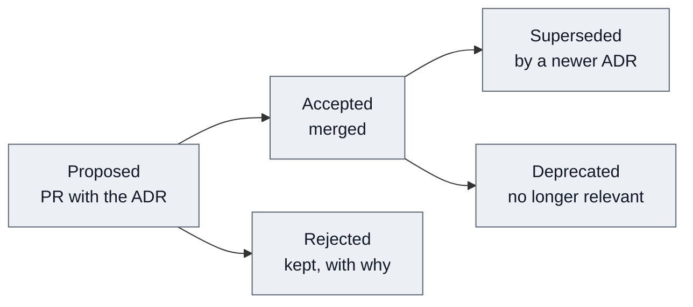

# Decisions — why wholeloop is shaped the way it is

> **TL;DR** — Every choice that would be expensive to reverse, or that someone will one day want to undo, is written down here as a short Architecture Decision Record: the context, the decision, what it costs, and what we turned down. Read the relevant ADR before changing a rule; write one before changing a decision.

> [!NOTE]
> **Status: ✅ in force.** These records are the reference the rest of the documentation links to.

---

## Index

| # | Decision | Status | Date |
| --- | --- | --- | --- |
| [0001](./0001-record-architecture-decisions.md) | Record architecture decisions | Accepted | 2026-10-14 |
| [0002](./0002-open-standards-canonical-source.md) | Open standards as the canonical source, adapters generated per CLI | Accepted | 2026-10-14 |
| [0003](./0003-deterministic-core-cli.md) | A deterministic TypeScript core (`wl`); skills stay thin | Accepted | 2026-10-14 |
| [0004](./0004-state-outside-the-repo.md) | State lives outside every repository | Accepted | 2026-10-14 |
| [0005](./0005-supported-clis-and-tiers.md) | Supported CLIs and their tiers | Accepted | 2026-10-14 |
| [0006](./0006-orchestration-tiers.md) | Three orchestration engines, one decision layer | Accepted | 2026-10-14 |
| [0007](./0007-standalone-steps-opt-in-flow.md) | Every step stands alone; the flow is opt-in | Accepted | 2026-10-14 |
| [0008](./0008-extensibility-through-manifests.md) | Extensibility through declarative manifests | Accepted | 2026-10-14 |
| [0009](./0009-repo-first-capability-resolution.md) | Repo-first capability resolution through slots | Accepted | 2026-10-14 |
| [0010](./0010-interaction-profile-never-changes-coverage.md) | The interaction profile never changes coverage | Accepted | 2026-10-14 |
| [0011](./0011-size-budgets-and-enforcement.md) | Size budgets, and an enforcer for every hard rule | Accepted | 2026-10-14 |
| [0012](./0012-step-naming-verb-object.md) | Steps are named verb + object | Accepted | 2026-10-14 |
| [0013](./0013-git-worktrees-for-parallel-builds.md) | Git worktrees for parallel builds | Accepted | 2026-10-14 |
| [0014](./0014-configurable-gate-round-budgets.md) | Configurable gate round budgets | Accepted | 2026-10-14 |
| [0015](./0015-distribution.md) | Distribution: npm, plugin marketplaces, binaries later | Accepted | 2026-10-14 |
| [0016](./0016-documentation-is-part-of-the-product.md) | Documentation is part of the product | Accepted | 2026-10-14 |
| [0017](./0017-no-tool-attribution-in-history.md) | No tool attribution in project history | Accepted | 2026-10-14 |
| [0018](./0018-project-name.md) | Project name: wholeloop | Accepted | 2026-10-14 |
| [0019](./0019-typescript-toolchain.md) | TypeScript toolchain | Accepted | 2026-10-14 |
| [0020](./0020-journal-atomicity-and-lock-recovery.md) | Journal atomicity and lock recovery | Accepted | 2026-10-18 |
| [0021](./0021-journaled-research-plans-and-refutations.md) | Journal research plans and count active refutations | Accepted | 2026-10-18 |
| [0022](./0022-framing-identity-and-explicit-outcomes.md) | Framing identity and explicit outcomes | Accepted | 2026-10-18 |
| [0023](./0023-structured-spec-plans-and-revision-approval.md) | Structured spec plans and revision approval | Accepted | 2026-10-18 |
| [0024](./0024-atomic-scope-plans-and-parent-approval.md) | Atomic scope plans and parent approval | Accepted | 2026-10-18 |
| [0025](./0025-explicit-criteria-constraints-and-challenge-modes.md) | Explicit criteria constraints and challenge modes | Accepted | 2026-10-18 |
| [0026](./0026-destination-host-contract-and-document-updates.md) | Destination host contract and document updates | Accepted | 2026-10-18 |
| [0027](./0027-read-only-source-evidence-and-degradation.md) | Read-only source evidence and degradation | Accepted | 2026-10-18 |
| [0028](./0028-definition-eval-seeds-and-external-predictions.md) | Definition eval seeds and external predictions | Accepted | 2026-10-18 |
| [0029](./0029-vertical-slice-contracts-and-repository-parts.md) | Vertical slice contracts and repository parts | Accepted | 2026-10-18 |
| [0030](./0030-worktree-intents-leases-and-conservative-pruning.md) | Worktree intents, leases and conservative pruning | Accepted | 2026-10-18 |
| [0031](./0031-pinned-gate-rounds-and-fail-safe-verdicts.md) | Pinned gate rounds and fail-safe verdicts | Accepted | 2026-10-18 |
| [0032](./0032-repository-first-build-plans-and-gate-backed-receipts.md) | Repository-first build plans and gate-backed receipts | Accepted | 2026-10-18 |
| [0033](./0033-once-per-round-suites-and-explicit-verification-inputs.md) | Once-per-round suites and explicit verification inputs | Accepted | 2026-10-18 |
| [0034](./0034-private-incremental-review-inputs-and-pinned-rubrics.md) | Private incremental review inputs and pinned rubrics | Accepted | 2026-10-19 |
| [0035](./0035-tested-draft-plans-and-once-only-publication.md) | Tested draft plans and once-only publication | Accepted | 2026-10-19 |
| [0036](./0036-declarative-environment-undo-ledger.md) | Declarative environment undo ledger | Accepted | 2026-10-19 |
| [0037](./0037-gate-evaluation-observations-and-refutation-matrices.md) | Gate evaluation observations and refutation matrices | Accepted | 2026-10-19 |
| [0038](./0038-pinned-launch-kits-and-separate-publication-capabilities.md) | Pinned launch kits and separate publication capabilities | Accepted | 2026-10-19 |
| [0039](./0039-evidence-bound-human-exposure-stages.md) | Evidence-bound human exposure stages | Accepted | 2026-10-19 |
| [0040](./0040-pinned-impact-observations-and-report-layouts.md) | Pinned impact observations and report layouts | Accepted | 2026-10-19 |
| [0041](./0041-challenged-learning-decisions-and-scope-closure.md) | Challenged learning decisions and scope closure | Accepted | 2026-10-19 |
| [0042](./0042-offline-provider-fixtures-and-explicit-rollout-handoffs.md) | Offline provider fixtures and explicit rollout handoffs | Accepted | 2026-10-19 |
| [0043](./0043-certified-delivery-sync-and-recoverable-tracker-status.md) | Certified delivery sync and recoverable tracker status | Accepted | 2026-10-19 |
| [0044](./0044-grounding-fixtures-and-exact-numeric-provenance.md) | Grounding fixtures and exact numeric provenance | Accepted | 2026-10-19 |
| [0045](./0045-canonical-url-adoption-and-recoverable-shared-publication.md) | Canonical URL adoption and recoverable shared publication | Accepted | 2026-10-19 |
| [0046](./0046-bounded-headless-workers-and-shared-gate-aggregation.md) | Bounded headless workers and shared gate aggregation | Accepted | 2026-10-19 |
| [0047](./0047-self-contained-client-artifacts-and-owned-output-upgrades.md) | Self-contained client artifacts and owned output upgrades | Accepted | 2026-10-19 |
| [0048](./0048-native-target-layouts-and-checked-launcher-roots.md) | Native target layouts and checked launcher roots | Accepted | 2026-10-19 |
| [0049](./0049-shared-guards-and-owned-git-fallbacks.md) | Shared guards and owned Git fallbacks | Accepted | 2026-10-19 |
| [0050](./0050-owned-native-overlays-and-explicit-activation.md) | Owned native overlays and explicit activation | Accepted | 2026-10-19 |
| [0051](./0051-disposable-conformance-and-explicit-evidence.md) | Disposable conformance and explicit evidence | Accepted | 2026-10-19 |
| [0052](./0052-generated-reference-checks-in-the-core.md) | Generated reference checks in the core | Accepted | 2026-10-19 |
| [0053](./0053-gemini-extension-overlays-and-safe-hook-boundary.md) | Gemini extension overlays and safe hook boundary | Accepted | 2026-10-19 |
| [0054](./0054-entrypoints-are-not-heuristic-repository-guidance.md) | Entrypoints are not heuristic repository guidance | Accepted | 2026-10-19 |
| [0055](./0055-antigravity-native-overlays-and-pinned-hook-transport.md) | Antigravity native overlays and pinned hook transport | Accepted | 2026-10-19 |
| [0056](./0056-gemini-hook-roots-through-native-environment.md) | Gemini hook roots through the native environment | Accepted | 2026-10-20 |
| [0057](./0057-cursor-native-formats-and-non-granting-hooks.md) | Cursor native formats and non-granting hooks | Accepted | 2026-10-20 |
| [0058](./0058-additional-read-only-headless-recipes.md) | Additional read-only headless recipes | Accepted | 2026-10-20 |
| [0059](./0059-conformance-observations-and-regression-candidates.md) | Conformance observations and regression candidates | Accepted | 2026-10-20 |
| [0060](./0060-cursor-observer-workers-and-private-native-policy.md) | Cursor observer workers and private native policy | Accepted | 2026-10-20 |
| [0061](./0061-generated-local-adapter-declarations.md) | Generated local adapter declarations | Accepted | 2026-10-20 |
| [0062](./0062-owned-seven-client-distribution-previews.md) | Owned seven-client distribution previews | Accepted | 2026-10-20 |
| [0063](./0063-local-conventional-release-drafts.md) | Local Conventional Commit release drafts | Accepted | 2026-10-20 |
| [0064](./0064-explicit-conformance-page-projections.md) | Explicit conformance page projections | Accepted | 2026-10-20 |
| [0065](./0065-public-output-schema-registration.md) | Public output registration and event-map identities | Accepted | 2026-10-20 |
| [0066](./0066-v1-compatibility-baseline-and-deprecation.md) | V1 compatibility baseline and deprecation | Accepted | 2026-10-20 |
| [0067](./0067-isolated-offline-npm-package-verification.md) | Isolated offline npm package verification | Accepted | 2026-10-20 |
| [0068](./0068-read-only-release-consistency-preflight.md) | Read-only release consistency preflight | Accepted | 2026-10-20 |
| [0069](./0069-reviewed-release-bundles-and-explicit-activation.md) | Reviewed release bundles and explicit activation | Accepted | 2026-10-20 |
| [0070](./0070-explicit-fresh-conformance-collection.md) | Explicit fresh conformance collection | Accepted | 2026-10-20 |
| [0071](./0071-gemini-observer-registry-and-private-policy.md) | Gemini observer registry and private policy | Accepted | 2026-10-20 |
| [0072](./0072-antigravity-startup-gated-observer-workers.md) | Antigravity startup-gated observer workers | Accepted | 2026-10-20 |
| [0073](./0073-structural-regression-drafts-and-explicit-issue-delivery.md) | Structural regression drafts and explicit issue delivery | Accepted | 2026-10-20 |
| [0074](./0074-exact-native-acquisition-and-private-prefixes.md) | Exact native acquisition and private prefixes | Accepted | 2026-10-20 |
| [0075](./0075-disabled-nightly-pipeline-and-separated-issue-authority.md) | Disabled nightly pipeline and separated issue authority | Accepted | 2026-10-20 |
| [0076](./0076-explicit-read-only-flag-bridges-and-conservative-cohorts.md) | Explicit read-only flag bridges and conservative cohorts | Accepted | 2026-10-20 |
| [0077](./0077-explicit-unleash-environments-and-unrestricted-strategies.md) | Explicit Unleash environments and unrestricted strategies | Accepted | 2026-10-20 |
| [0078](./0078-published-growthbook-rules-and-explicit-hash-cohorts.md) | Published GrowthBook rules and explicit hash cohorts | Accepted | 2026-10-20 |
| [0079](./0079-exact-posthog-reads-and-configured-environment-scope.md) | Exact PostHog reads and configured environment scope | Accepted | 2026-10-21 |
| [0080](./0080-create-only-grafana-dashboards-from-pinned-metrics.md) | Create-only Grafana dashboards from pinned metrics | Accepted | 2026-10-21 |
| [0081](./0081-posthog-dashboard-creation-and-partial-receipts.md) | PostHog dashboard creation and partial receipts | Accepted | 2026-10-21 |
| [0082](./0082-metabase-owned-questions-and-explicit-sql-window-review.md) | Metabase-owned questions and explicit SQL window review | Accepted | 2026-10-21 |
| [0083](./0083-mixpanel-workspace-bound-dashboards-and-native-reports.md) | Mixpanel workspace-bound dashboards and native reports | Accepted | 2026-10-21 |
| [0084](./0084-experimental-integrations-and-scoped-live-verification.md) | Experimental integrations and scoped live verification | Accepted | 2026-10-22 |
| [0085](./0085-client-owned-mcp-first-provider-transport.md) | Client-owned MCP-first provider transport | Accepted | 2026-10-22 |
| [0086](./0086-exact-final-framing-review-and-owner-decisions.md) | Exact final framing review and owner decisions | Accepted | 2026-10-22 |
| [0087](./0087-redacted-native-diagnostics-and-explicit-invocations.md) | Redacted native diagnostics and explicit invocations | Accepted | 2026-10-22 |
| [0088](./0088-version-specific-opencode-native-transports.md) | Version-specific OpenCode native transports | Accepted | 2026-10-22 |
| [0089](./0089-scripted-final-approval-in-framing-conformance.md) | Scripted final approval in framing conformance | Accepted | 2026-10-22 |
| [0090](./0090-explicit-nightly-native-model-selection.md) | Explicit nightly native model selection | Accepted | 2026-10-22 |
| [0091](./0091-native-exact-headless-response-schemas.md) | Native exact headless response schemas | Accepted | 2026-10-22 |
| [0092](./0092-expanded-v1-autonomous-delivery-planning.md) | Expanded V1 planning; runtime authority unchanged | Accepted | 2026-10-24 |
| [0093](./0093-immutable-delivery-source-intake.md) | Immutable delivery sources without execution authority | Accepted | 2026-10-24 |
| [0094](./0094-revision-bound-delivery-plans-and-envelopes.md) | Revision-bound delivery plans and request envelopes | Accepted | 2026-10-24 |
| [0095](./0095-operator-grants-and-scoped-worker-claims.md) | Operator grants and scoped worker claims | Accepted | 2026-10-24 |
| [0096](./0096-replayable-delivery-journal-without-authority-recovery.md) | Replayable delivery journal without authority recovery | Accepted | 2026-10-24 |
| [0097](./0097-durable-queue-reservations-and-current-attempt-fences.md) | Durable queue reservations and current attempt fences | Accepted | 2026-10-24 |
| [0098](./0098-checkpoint-recovery-and-observed-effect-reconciliation.md) | Checkpoint recovery and observed effect reconciliation | Accepted | 2026-10-24 |
| [0099](./0099-persistent-finite-delivery-budgets.md) | Persistent finite delivery budgets | Accepted | 2026-10-24 |
| [0100](./0100-role-bound-worker-contexts-and-execution-observations.md) | Role-bound worker contexts and execution observations | Accepted | 2026-10-24 |
| [0101](./0101-dedicated-native-delivery-hosts-and-runtime-proof.md) | Dedicated native delivery hosts and runtime proof | Accepted | 2026-10-25 |
| [0102](./0102-inert-environment-recipes-and-pinned-setup-origins.md) | Pin environment recipes without treating discovery as execution | Accepted | 2026-10-25 |
| [0103](./0103-owned-docker-environments-and-isolated-publication.md) | Own Docker resources and isolate application publication | Accepted | 2026-10-25 |
| [0104](./0104-owned-environment-lifecycle-and-private-cancellation.md) | Recover owned environment lifecycle through private cancellation | Accepted | 2026-10-25 |
| [0105](./0105-pinned-acceptance-and-observed-evidence.md) | Pin acceptance definitions and separate observed evidence | Accepted | 2026-10-25 |
| [0106](./0106-observe-declared-api-and-cli-behavior.md) | Observe declared API and CLI behavior in owned applications | Accepted | 2026-10-25 |
| [0107](./0107-private-stdio-browser-acceptance.md) | Private stdio browser acceptance and grounded observations | Accepted | 2026-10-25 |
| [0108](./0108-evaluator-only-inputs-and-observed-regression-sensitivity.md) | Evaluator-only inputs and observed regression sensitivity | Accepted | 2026-10-25 |
| [0109](./0109-exact-read-only-integrated-milestone-candidates.md) | Exact read-only integrated milestone candidates | Accepted | 2026-10-25 |
| [0110](./0110-owned-assembly-and-complete-milestone-verification.md) | Owned assembly and complete milestone verification | Accepted | 2026-10-25 |
| [0111](./0111-original-delivery-fixtures-and-controller-owned-oracles.md) | Original delivery fixtures and controller-owned oracles | Accepted | 2026-10-25 |
| [0112](./0112-private-delegation-and-independent-machine-decisions.md) | Private delegation and independent machine decisions | Accepted | 2026-10-25 |
| [0113](./0113-owned-foreground-routes-and-native-recovery.md) | Owned foreground routes and native recovery | Accepted | 2026-10-26 |
| [0114](./0114-private-group-bound-foreground-bootstrap.md) | Private group-bound foreground bootstrap | Accepted | 2026-10-26 |
| [0115](./0115-bounded-inline-worker-artifact-proposals.md) | Bounded inline worker artifact proposals | Accepted | 2026-10-26 |
| [0116](./0116-owned-native-decision-purpose-attempts.md) | Owned native decision purpose attempts | Accepted | 2026-10-26 |
| [0117](./0117-owned-delivery-topic-workspaces.md) | Owned delivery topic workspaces | Accepted | 2026-10-26 |
| [0118](./0118-owned-candidate-commits-and-current-heads.md) | Owned candidate commits and current heads | Accepted | 2026-10-26 |
| [0119](./0119-runner-owned-git-stage-bindings.md) | Runner-owned Git stage bindings | Accepted | 2026-10-26 |
| [0120](./0120-observed-native-boundaries-and-asynchronous-admission.md) | Observed native boundaries and asynchronous admission | Accepted | 2026-10-26 |
| [0121](./0121-owned-worker-stage-bindings-and-recovery.md) | Owned worker stage bindings and recovery | Accepted | 2026-10-26 |
| [0122](./0122-owned-stage-decisions-without-semantic-promotion.md) | Owned stage decisions without semantic promotion | Accepted | 2026-10-26 |
| [0123](./0123-owned-native-review-rounds-and-recovery.md) | Owned native review rounds and recovery | Accepted | 2026-10-26 |
| [0124](./0124-owned-application-operation-stage-boundaries.md) | Owned application operation stage boundaries | Accepted | 2026-10-26 |
| [0125](./0125-owned-artifact-production-before-delegated-decisions.md) | Owned artifact production before delegated decisions | Accepted | 2026-10-26 |
| [0126](./0126-owned-suite-observations-and-recovery.md) | Owned suite observations and recovery | Accepted | 2026-10-26 |
| [0127](./0127-owned-criterion-verification-rounds.md) | Owned criterion verification rounds | Accepted | 2026-10-26 |
| [0128](./0128-owned-builder-plan-decision-composition.md) | Owned builder-plan decision composition | Accepted | 2026-10-26 |
| [0129](./0129-approved-definition-revision-reservation.md) | Approved definition revision reservation | Accepted | 2026-10-26 |
| [0130](./0130-owned-pre-builder-acceptance-definitions.md) | Owned pre-builder acceptance definitions | Accepted | 2026-10-26 |
| [0131](./0131-current-plan-authorization-stage.md) | Current plan authorization stage | Accepted | 2026-10-26 |
| [0132](./0132-committed-contract-artifact-observation.md) | Committed contract artifact observation | Accepted | 2026-10-26 |
| [0133](./0133-independent-contract-only-verification.md) | Independent contract-only verification | Accepted | 2026-10-26 |
| [0134](./0134-original-failure-feedback-before-repair.md) | Original failure feedback before repair | Accepted | 2026-10-26 |
| [0135](./0135-original-repair-budget-admission.md) | Original repair budget admission | Accepted | 2026-10-27 |
| [0136](./0136-parent-bounded-worker-reservations.md) | Parent-bounded worker reservations | Accepted | 2026-10-27 |
| [0137](./0137-one-shot-original-correction-workers.md) | One-shot original correction workers | Accepted | 2026-10-27 |
| [0138](./0138-unambiguous-git-worktree-runtime.md) | Unambiguous Git worktree runtime | Accepted | 2026-10-27 |
| [0139](./0139-owned-original-correction-commits.md) | Owned original correction commits | Accepted | 2026-10-27 |
| [0140](./0140-suite-only-correction-ownership.md) | Suite-only correction ownership | Accepted | 2026-10-27 |
| [0141](./0141-historical-owned-commit-receipts.md) | Historical owned commit receipts | Accepted | 2026-10-27 |
| [0142](./0142-explicit-original-correction-successors.md) | Explicit original correction successors | Accepted | 2026-10-27 |
| [0143](./0143-original-correction-calls-across-later-qa.md) | Original correction calls across later QA | Accepted | 2026-10-27 |
| [0144](./0144-original-review-continuation-after-correction.md) | Original review continuation after correction | Accepted | 2026-10-28 |
| [0145](./0145-distinct-owned-environment-phases.md) | Distinct owned environment phases | Accepted | 2026-10-28 |
| [0146](./0146-original-correction-suite-phases.md) | Original correction suite phases | Accepted | 2026-10-28 |
| [0147](./0147-original-verification-continuation.md) | Original verification continuation | Accepted | 2026-10-28 |
| [0148](./0148-observed-repair-progress-across-candidates.md) | Observed repair progress across candidates | Accepted | 2026-10-28 |
| [0149](./0149-historical-native-completion-after-fencing.md) | Historical native completion after fencing | Accepted | 2026-10-28 |
| [0150](./0150-owned-correction-successors.md) | Owned correction successors | Accepted | 2026-10-28 |
| [0151](./0151-original-repeated-qa-continuations.md) | Original repeated QA continuations | Accepted | 2026-10-28 |
| [0152](./0152-candidate-lineage-and-stage-continuations.md) | Candidate lineage and stage continuations | Accepted | 2026-10-29 |
| [0153](./0153-current-joint-unit-qa-readiness.md) | Current joint unit QA readiness | Accepted | 2026-10-29 |
| [0154](./0154-recorded-correction-checkpoint-reconstruction.md) | Recorded correction checkpoint reconstruction | Accepted | 2026-10-29 |
| [0155](./0155-qa-ready-predecessor-incorporation.md) | QA-ready predecessor incorporation | Accepted | 2026-10-29 |
| [0156](./0156-original-runner-controls-for-assembly.md) | Original runner controls for assembly | Accepted | 2026-10-29 |
| [0157](./0157-complete-current-unit-vectors-before-assembly.md) | Complete current unit vectors before assembly | Accepted | 2026-10-29 |
| [0158](./0158-current-unit-qa-and-owned-assembly.md) | Current unit QA and owned assembly | Accepted | 2026-10-29 |
| [0159](./0159-original-docker-assertion-observations.md) | Original Docker assertion observations | Accepted | 2026-10-29 |
| [0160](./0160-original-integrated-verification-observations.md) | Original integrated verification observations | Accepted | 2026-10-29 |
| [0161](./0161-original-parent-controls-for-acceptance.md) | Original parent controls for acceptance | Accepted | 2026-10-29 |
| [0162](./0162-owned-root-product-verification.md) | Owned root product verification | Accepted | 2026-10-29 |
| [0163](./0163-owned-private-product-verification.md) | Owned private product verification | Accepted | 2026-10-29 |
| [0164](./0164-owned-browser-product-verification.md) | Owned browser product verification | Accepted | 2026-10-29 |
| [0165](./0165-current-whole-feature-product-input.md) | Current whole-feature product input | Accepted | 2026-10-29 |
| [0166](./0166-owned-delegated-feature-acceptance.md) | Owned delegated feature acceptance | Accepted | 2026-10-29 |
| [0167](./0167-owned-local-handoff-endpoints.md) | Owned local handoff endpoints | Accepted | 2026-10-29 |
| [0168](./0168-fixed-original-domain-stage-dispatch.md) | Fixed original domain-stage dispatch | Accepted | 2026-10-29 |
| [0169](./0169-original-parent-controls-for-provisioning.md) | Original parent controls for provisioning | Accepted | 2026-10-29 |
| [0170](./0170-original-provisioning-request-capture.md) | Original provisioning request capture | Accepted | 2026-10-30 |
| [0171](./0171-original-runner-provisioning-owners.md) | Original runner provisioning owners | Accepted | 2026-10-30 |
| [0172](./0172-recorded-original-environment-inputs.md) | Recorded original environment inputs | Accepted | 2026-10-30 |
| [0173](./0173-fixed-product-environment-selection.md) | Fixed product environment selection | Accepted | 2026-10-30 |
| [0174](./0174-exact-byte-delivery-replay-reuse.md) | Exact-byte delivery replay reuse | Accepted | 2026-10-31 |
| [0175](./0175-original-milestone-product-production.md) | Original milestone product production | Accepted | 2026-10-31 |
| [0176](./0176-static-fixed-dispatch-route-preflight.md) | Static fixed-dispatch route preflight | Accepted | 2026-10-31 |
| [0177](./0177-review-reentry-verification.md) | Review re-entry verification | Accepted | 2026-11-01 |
| [0178](./0178-recorded-human-decisions-for-supervised-routes.md) | Recorded human decisions for supervised routes | Accepted | 2026-11-01 |
| [0179](./0179-research-dispatch-boundary.md) | Research dispatch boundary between the runner and the research host | Accepted | 2026-11-01 |
| [0180](./0180-trusted-native-bindings.md) | Trusted native bindings for unattended runs | Accepted | 2026-11-01 |
| [0181](./0181-supervised-plans-require-exact-grants.md) | Supervised fixed dispatch requires exact-plan grants | Accepted | 2026-11-01 |
| [0182](./0182-fresh-exact-grants-for-derived-supervised-plans.md) | Fresh exact-plan grants for derived supervised plans | Accepted | 2026-11-01 |
| [0183](./0183-public-foreground-runner-host.md) | Public foreground runner host | Accepted | 2026-11-01 |
| [0184](./0184-unattended-research-host.md) | Unattended research host | Accepted | 2026-11-01 |
| [0185](./0185-authorized-pr-publication.md) | Authorized pull request publication | Accepted | 2026-11-01 |
| [0186](./0186-revision-bound-ci-observations.md) | Revision-bound CI observations | Accepted | 2026-11-01 |
| [0187](./0187-bounded-ci-repair-requests.md) | Bounded CI repair requests | Accepted | 2026-11-01 |
| [0188](./0188-conditional-merge-eligibility.md) | Conditional merge eligibility | Accepted | 2026-11-01 |
| [0189](./0189-conditional-merge-execution.md) | Conditional merge execution | Accepted | 2026-11-01 |
| [0190](./0190-operator-report-diagnostics-and-recovery-bundles.md) | Operator report, diagnostics and recovery bundles | Accepted | 2026-11-01 |
| [0191](./0191-effect-boundary-fault-evaluation.md) | Effect-boundary fault evaluation | Accepted | 2026-11-01 |
| [0192](./0192-revision-impact-and-explicit-adoption.md) | Revision impact and explicit adoption | Accepted | 2026-11-01 |
| [0193](./0193-cross-invocation-correction-protocol.md) | Cross-invocation correction protocol | Accepted | 2026-11-01 |
| [0194](./0194-scheduled-observations-and-learning-recommendations.md) | Scheduled observations and learning recommendations | Accepted | 2026-11-01 |
| [0195](./0195-maintenance-proposals-and-recurring-admission.md) | Maintenance proposals and recurring admission | Accepted | 2026-11-02 |
| [0196](./0196-maintenance-commands-and-recurring-delivery-intake.md) | Maintenance commands and recurring delivery intake | Accepted | 2026-11-02 |
| [0197](./0197-correction-revisions-and-stage-reuse.md) | Correction revisions and stage reuse | Accepted | 2026-11-02 |
| [0199](./0199-composed-conditional-merge-routes.md) | Composed conditional merge routes | Accepted | 2026-11-02 |
| [0200](./0200-learning-observation-runs.md) | Learning observation runs | Accepted | 2026-11-02 |
| [0201](./0201-learning-observation-host.md) | Learning observation host | Accepted | 2026-11-02 |
| [0202](./0202-campaign-reference-client-versions.md) | Campaign reference client versions | Accepted | 2026-11-03 |
| [0203](./0203-contained-claude-code-boundary.md) | Contained Claude Code boundary | Accepted | 2026-11-03 |
| [0204](./0204-research-web-reads.md) | Research web reads | Accepted | 2026-11-03 |

## Lifecycle



- **Propose** with a new file `NNNN-short-title.md` (next free number). Keep a Proposed draft unreferenced until accepted; add the published index row/references with the settled status. During bootstrap, the owner-authorized main workflow applies; after a switch to PRs, discussion happens on the PR. The ADR records the outcome.
- **Never rewrite history.** An accepted ADR is edited only to fix typos or add links. To change a decision, write a new ADR and mark the old one `Superseded by NNNN`.
- **Rejected ideas stay.** A rejected ADR is as useful as an accepted one: it stops the same debate from starting over.
- **Check references.** Docs check requires one Accepted or explicit Superseded metadata declaration in the first fifteen lines. Both Superseded by NNNN and a matching relative Markdown ADR link are supported. Successors must resolve uniquely and be settled; cycles are rejected. This verifies lifecycle metadata, not the truth of platform claims.
- **Small is fine.** If it fits in 30 lines, it fits in 30 lines.

## Template

```markdown
# NNNN — Short decision title

- **Status:** Proposed | Accepted | Rejected | Superseded by NNNN | Deprecated
- **Date:** YYYY-MM-DD

## Context

What forces are at play? What problem, constraint or observation makes a decision necessary now?

## Decision

What we do, stated plainly. One paragraph or a short list.

## Consequences

**Positive**
- …

**Negative**
- …

## Alternatives considered

| Option | Why not |
|---|---|
| … | … |

## Links

- Docs pages, roadmap tasks, related ADRs.

[◀ Decisions index](./README.md)
```

---

<!-- docnav -->
[◀ Determinism and testing](../architecture/determinism-and-testing.md)  ·  [📖 Docs index](../README.md)  ·  [🧭 Concepts](../concepts.md)  ·  [Authoring ▶](../contributing/authoring.md)
