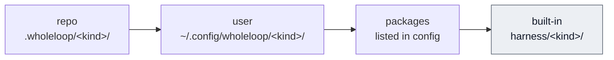

# Extending wholeloop — add, don't fork

> **TL;DR** — Almost everything a team would want to customise is a **declarative manifest**, discovered from four places, validated by a schema and testable with one command: providers, review and verify lenses, artifact templates, profile presets and extra decision points. Code is the exception, reserved for new CLI adapters.

> [!NOTE]
> **Status: 🚧 partial.** Providers, templates, profiles and lenses load and validate from all four layers. Custom profiles are consumed by configuration; spec template selection is consumed by the core and lens manifests by gate planning, while templates for other workflows remain planned. Decision: [ADR-0008](../decisions/0008-extensibility-through-manifests.md).

---

## Extension points

| Extension | What it adds | Format | Guide |
| --- | --- | --- | --- |
| **Provider** | A source, destination or service (Zendesk, Shortcut, Statsig…) | `provider.yml` + short guidance files | [providers](./providers.md) |
| **Lens** | An extra review or verify dimension (accessibility, i18n, privacy…) | `lens.yml` + prompt | [lenses, templates, profiles](./lenses-templates-profiles.md#lenses) |
| **Template** | Your own shape for a brief, spec, launch plan… | Markdown with front matter | [templates](./lenses-templates-profiles.md#templates) |
| **Profile preset** | A named bundle of interaction dials | `profile.yml` | [profiles](./lenses-templates-profiles.md#profiles) |
| **Decision point** | An extra stop for a person (security sign-off, legal review…) | config entry | [decision points](./lenses-templates-profiles.md#decision-points) |
| **CLI adapter** | Support for another agentic CLI | TypeScript module | [platforms](../platforms/README.md#adding-a-cli) |

What you **cannot** extend away: the six built-in decision points, built-in lenses (without a recorded reason), the output contract, and *ask, never guess* ([ADR-0010](../decisions/0010-interaction-profile-never-changes-coverage.md)).

## Where extensions are found



Highest first. An extension with the same `id` as a lower one **replaces** it — so a team can override a built-in provider's guidance without copying the whole thing (`extends:` merges instead of replacing).

**Packages** are plain npm packages that contain manifests — `wholeloop-provider-zendesk`, `@acme/wholeloop-kit` — declared in config:

```yaml
extensions:
  - "@acme/wholeloop-kit@^1"     # providers, lenses and templates for the whole company
```

Install packages with npm first. The loader reads `<kind>/<id>/<manifest>` (or JSON/YAML; templates use Markdown) from each installed package; it does not install packages or enforce version ranges itself. npm owns version selection. Later packages in the list override earlier ones, below user/project manifests. No code from a package is executed: `wl` only resolves its package.json and reads manifests.

## The lifecycle of an extension

```text
wl provider scaffold acme-support      # prints a manifest skeleton
wl provider test acme-support          # schema, resource and access declaration checks; no probe
wl provider list                       # where every provider comes from and what it can do
```

Lenses, templates and profiles have the same trio (`scaffold`, `test`, `list`). A manifest that fails its schema is reported by list/test and ignored as an entry; configuration rejects broken profile catalogs. `wl doctor` reporting remains planned. It never half-loads.

## Contributing an extension upstream

Built-in status is earned by breadth of use. Open a pull request with the manifest under `harness/<kind>/<id>/`, its fixture test, and a line in the catalogue table. The review checks three things: it uses only contract verbs, it degrades to a hand-off artifact, and its guidance stays within the size budget.

---

<!-- docnav -->
[◀ Repo skills](../configuration/repo-skills.md)  ·  [📖 Docs index](../README.md)  ·  [🧭 Concepts](../concepts.md)  ·  [Writing a provider ▶](providers.md)
