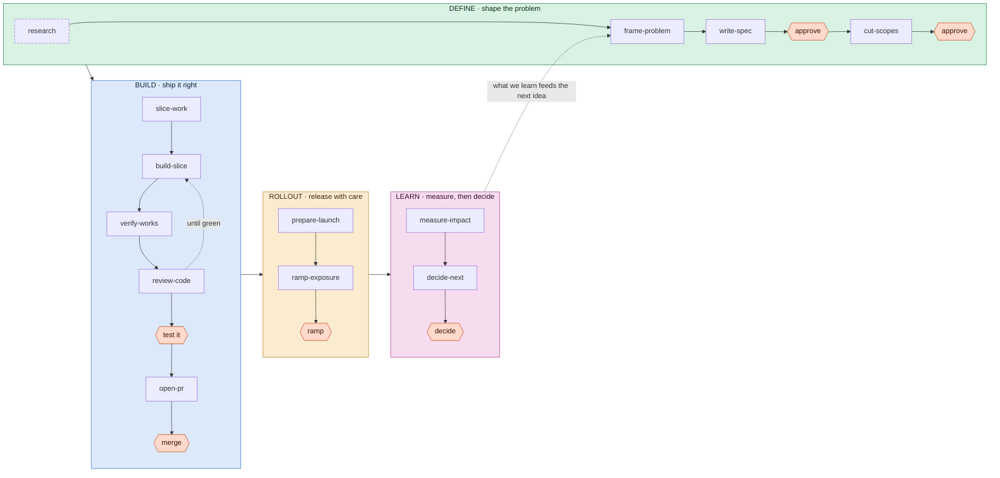

# The flow — four blocks, thirteen steps, one line

> **TL;DR** — Define shapes the problem, Build ships it right, Rollout releases it with care, Learn measures and decides. Each step is a skill you can run on its own; `next` chains them and stops wherever a person has to decide.

> [!NOTE]
> **Status: 🚧 partial.** All thirteen local step cores and canonical skills are implemented, including human decisions, recoverable handoffs and measured closure. Generated clients still need actual model/permission checks; remote dashboard/flag bridges and unsupported transports remain open. Per-step pages and the [manual checklist](../../roadmap/manual-verification.md) state those limits.

---

## The whole line

## Every step

| Block | # | Step | You get | Decision point |
| --- | --- | --- | --- | --- |
| Define | 0 | [`research`](./define/research.md) | An evidence-first brief with confidence and open questions | — |
| Define | 1 | [`frame-problem`](./define/frame-problem.md) | A framed problem with an owner — or an argued no-go | — |
| Define | 2 | [`write-spec`](./define/write-spec.md) | A spec with user stories, acceptance criteria and a measurement plan | **approve** |
| Define | 3 | [`cut-scopes`](./define/cut-scopes.md) | One scope per deliverable, each with its flag and metrics | **approve** |
| Build | 4 | [`slice-work`](./build/slice-work.md) | Sequential vertical slices with criteria written before code | — |
| Build | 5 | [`build-slice`](./build/build-slice.md) | One slice built on a branch, following your repo's skills, to green | — |
| Build | 6 | [`verify-works`](./build/verify-works.md) | Does it work, and does it solve the problem? | until green |
| Build | 7 | [`review-code`](./build/review-code.md) | Is it well written? | until green |
| Build | 8 | [`open-pr`](./build/open-pr.md) | A draft PR per repository, after you tested it | **test it** · **merge** |
| Rollout | 9 | [`prepare-launch`](./rollout/prepare-launch.md) | Comms drafts, measurement/rollout plans, dashboard handoffs and enablement — nothing sent | — |
| Rollout | 10 | [`ramp-exposure`](./rollout/ramp-exposure.md) | A staged ramp plan with exit criteria checked at each stage | **ramp** |
| Learn | 11 | [`measure-impact`](./learn/measure-impact.md) | Grounded measurements or explicit unknowns at launch, D+7 and D+30 | — |
| Learn | 12 | [`decide-next`](./learn/decide-next.md) | Keep, iterate, kill or unflag — recorded, and fed back | **decide** |
| — | — | [utilities](./utilities.md) | `next` · `status` · `setup` · `sync` | — |

## Three ways in

| You have… | Run | What happens |
| --- | --- | --- |
| A loose idea and want the whole thing | `next "idea"` | Each step in order, stopping at every decision point |
| A specific job | the step itself | That step only — it asks for what it is missing |
| Something half done, maybe by someone else | `next <id or URL>` | Finds the first step whose output is missing and continues |

## Naming

Step names are **verb + object** and say what you get, not which methodology they come from. Where a team already uses its own vocabulary (Frame, Shape, Bet, PRD…), the [glossary](../glossary.md) maps it.

---

<!-- docnav -->
[◀ Concepts](../concepts.md)  ·  [📖 Docs index](../README.md)  ·  [research ▶](define/research.md)
