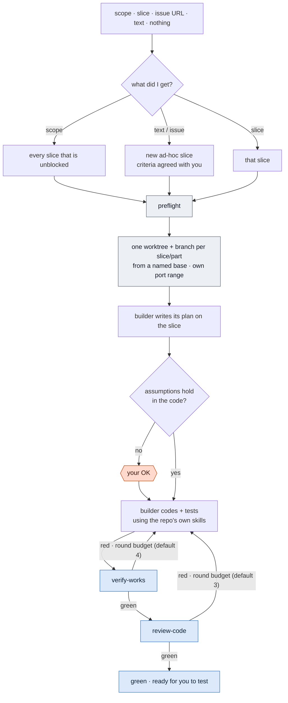

# build-slice — slices built your repo's way, in parallel, until green

> **TL;DR** — Builds each slice in its **own git worktree** on its own branch, so several builders work at once — even in the same repository — while your checkout stays exactly as you left it. Builders follow the skills and conventions your repository already has, and every slice runs [`verify-works`](./verify-works.md) then [`review-code`](./review-code.md) until both are green. Give it a scope, a slice, an issue URL or a one-line fix. It finishes at green: no push, no PR.

> [!NOTE]
> **Status: 📐 design.** Tracked in [P3-04](../../../roadmap/phase-3-build.md#p3-04--build-slice-and-the-builder).

---

## At a glance

| | |
|---|---|
| **Block** | Build |
| **Invoke** | `/throughline:build-slice` · `$tl-build-slice` · `/tl-build-slice` |
| **Decision point** | None inside — it hands over to **test it** |
| **Reads** | A scope, a slice, an issue URL, free text, or nothing (it asks) |
| **Writes** | One worktree + branch per slice or part · the builder's plan, gate results and evidence on the slice · a list of anything changed outside the repository, each with its undo |
| **Slots** | `build.<area>` (e.g. `build.backend`, `build.frontend`) · `build.design-system` · `verify.suite` · `review.rubric` |
| **Config** | `build.workspace: worktree` (default) \| `checkout` |
| **Capabilities** | `source.code` · `tracker.read-item` (for issue URLs) |
| **Agents** | `builder` (one per slice or part) · `verifier` and `reviewer` (inside the gates) · `conductor` (coordinates) |

## When to use it — and when not

**Use it when** you want code written against agreed criteria — a planned slice or a quick fix — and checked the same way no matter who started it.

**Skip it when** the code already exists and you only want an opinion on it: run [`verify-works`](./verify-works.md) or [`review-code`](./review-code.md) on their own.

## How it works



1. **It works out what you meant.** A scope builds every unblocked slice; a slice builds that one; an issue URL or a sentence becomes **one ad-hoc slice** with criteria you confirm in a single question. Even a one-line fix goes through both gates.
2. **Every slice gets a worktree.** By default each slice (or part, for multi-repo slices) is checked out under the store — `$XDG_STATE_HOME/throughline/worktrees/<repo>/<slice-id>` — on its own branch from a named base. Consequences:
   - builders run **in parallel**, including several slices of the same repository;
   - **your checkout is never touched** — it can be dirty, on any branch, with a dev server running;
   - **blocked-by order still holds**: a slice waits until the ones it depends on are green, and a chained slice can branch from the one below it (stacked branches).
3. **Ports don't collide.** Each worktree gets its own port range, recorded on the slice, so two dev servers can run side by side.
4. **Your repository's skills come first.** Before coding, the builder loads whatever the `build.<area>` and `build.design-system` slots resolved to — your backend guide, your design-system skill — and only falls back to defaults when nothing more specific exists ([repo skills](../../configuration/repo-skills.md)).
5. **Plans are always visible; pausing is the exception.** The builder writes its plan on the slice before touching code, in every pace. It waits for you only when something it was told contradicts — or can't be checked against — the code.
6. **Gates only observe.** Verifier and reviewer never edit. Findings go back to the builder; when the round budget runs out the slice stops, reports what's still open and offers more rounds — the bar never drops to get to green ([gates](../../architecture/orchestration-and-gates.md)).
7. **Pace sets concurrency, nothing else.** `guided` runs one builder at a time, `staged` runs builders together but gates one slice at a time, `parallel` runs everything at once. The checks are identical ([profile](../../configuration/profile.md)).
8. **Anything outside the repository is announced first.** A database, a container stack, a seeded index: listed with how to undo it before it happens, and again in the receipt.

The preflight, before any worktree exists:

```text
Plan       3 slices → 3 builders · pace staged
Workspace  worktrees under ~/.local/state/throughline/worktrees/shop-web/
           slice-0d4e  branch tl/slice-0d4e  from origin/main (3f9a1c2)  ports 5200–5209
           slice-77ab  waits for slice-0d4e · will branch from tl/slice-0d4e
Your copy  ~/code/shop-web untouched (it's on feat/other with local changes — that's fine)
Skills     build.frontend → design-system-guide (repo) · verify.suite → npm test + tsc (detected)
Gates      verify ≤ 4 rounds · review ≤ 3 · finishes at green  (--rounds to change)
Won't      commit to main · push · open a PR · flip a flag · message anyone
Stop       "stop" halts every builder; worktrees and branches stay as they are
```

## Testing it yourself

When a slice is green, **test it** is yours:

```text
tl worktree open slice-0d4e
  path   ~/.local/state/throughline/worktrees/shop-web/slice-0d4e
  branch tl/slice-0d4e
  ports  5200–5209 (dev server suggestion: PORT=5200 npm run dev)
```

Worktrees are removed by [`sync`](../utilities.md) once their PR is merged, or anytime with `tl worktree prune`. Rather have branches appear in the copy you already work in? Set `build.workspace: checkout` — slices of the same repository then take turns there instead of running side by side.

## Standalone use

This is the step people run on its own most. `build-slice "add CSV export to the orders list"` drafts the acceptance criteria, asks you to confirm them once, builds in a fresh worktree and runs both gates — no initiative, spec or scope needed.

## Run it

```text
> /throughline:build-slice "add CSV export to the orders list"

Ad-hoc slice — "add CSV export to the orders list"
Criteria (confirm or edit)
  1. An "Export CSV" action on the orders list downloads the visible rows
  2. Columns: number, date, status, total
  3. Exports above 10k rows are refused with a clear message
[confirm] [edit]

(preflight…)

▸ builder:slice-5e1a plan written · assumptions hold in the code
▸ builder: src/orders/export.ts · src/orders/OrdersList.tsx · 2 tests
▸ verify round 1 · suite ✓ · criterion 3 ✗ (no message shown) → back to builder
▸ verify round 2 · green
▸ review round 1 · green

Produced
  Worktree   slice-5e1a                  tl worktree open slice-5e1a
  Branch     tl/slice-5e1a               (local only)
  Slice      slice-5e1a · green          tl open slice-5e1a
Next         test it, then /throughline:open-pr slice-5e1a
```

| CLI | Invoke | Parallel builders |
|---|---|---|
| Claude Code | `/throughline:build-slice …` | native subagents |
| Codex CLI | `$tl-build-slice …` | native subagents |
| OpenCode · Copilot CLI | `/tl-build-slice …` | native subagents |
| Tier B | `/tl-build-slice …` | native, headless or sequential |

## Before & after

- **Fed by:** [`slice-work`](./slice-work.md) (slices, criteria, test cases) — or nothing more than your sentence.
- **Feeds:** **test it** (`tl worktree open`) → [`open-pr`](./open-pr.md).

## Gotchas & FAQ

**"Is there a shortcut that skips the gates for tiny changes?"** No. A one-liner costs one or two rounds; that's cheap insurance and keeps everyone's work comparable.

**"Do I need to commit or stash before running it?"** No. With worktrees your checkout is never read from or switched.

**"Too many agents at once for my taste."** Set `pace: guided` — one builder at a time, identical checks.

**"It ran out of rounds."** The slice stops with its open findings attached. Grant more rounds (`--rounds verify=6`), fix them by hand in the worktree, or sharpen the criteria and run it again.

**"Where did my disk space go?"** Worktrees share git objects, so they're light — but `tl worktree prune` clears every one whose branch is merged or abandoned.

---

<!-- docnav -->
[◀ slice-work](slice-work.md)  ·  [📖 Docs index](../../README.md)  ·  [🧭 Concepts](../../concepts.md)  ·  [verify-works ▶](verify-works.md)
