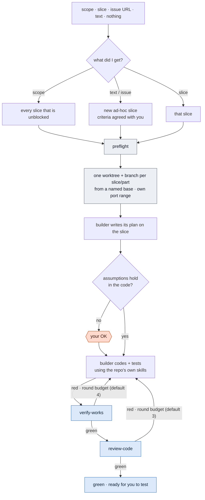

# build-slice — slices built your repo's way, in parallel, until green

> **TL;DR** — Builds each slice in its **own git worktree** on its own branch, so several builders work at once — even in the same repository — while your checkout stays exactly as you left it. Builders follow the skills and conventions your repository already has, and every slice runs [`verify-works`](./verify-works.md) then [`review-code`](./review-code.md) until both are green. Give it a scope, a slice, an issue URL or a one-line fix. It finishes at green: no push, no PR.

> [!NOTE]
> **Status: 🚧 partial.** The worktree lifecycle, named bases, stacked branches, port reservations and explicit checkout opt-out are implemented with real Git fixtures. Repository-first preflights, explicit ad-hoc agreement, builder plans, revision-bound assumption decisions and bounded verify/review repair orchestration are implemented through a typed host with real temporary Git/stub-worker fixtures. The separate verify workflow executes real suites; live client workers and incremental review remain pending. Tracked in [P3-04](../../../roadmap/phase-3-build.md#p3-04--build-slice-and-the-builder).

---

## At a glance

| | |
| --- | --- |
| **Block** | Build |
| **Invoke** | `/wholeloop:build-slice` · `$wl-build-slice` · `/wl-build-slice` |
| **Decision point** | None inside — it hands over to **test it** |
| **Reads** | A scope, a slice, an issue URL, free text, or nothing (it asks) |
| **Writes** | One worktree + branch per slice or part · the builder's plan, gate results and evidence on the slice · a list of anything changed outside the repository, each with its undo |
| **Slots** | `build.<area>` (e.g. `build.backend`, `build.frontend`) · `build.design-system` · `verify.suite` · `review.rubric` |
| **Config** | `build.workspace: worktree` (default) \| `checkout` |
| **Capabilities** | `source.code` · `tracker.read-item` (for issue URLs) |
| **Agents** | `builder` (one per slice or part) · `verifier` and `reviewer` (inside the gates) · `conductor` (coordinates) |

## When to use it — and when not

**Use it when** you want code written against agreed criteria — a planned slice or a quick fix — and checked the same way no matter who started it.

**Skip it when** the code already exists and you only want an opinion on it: run [`verify-works`](./verify-works.md) or [`review-code`](./review-code.md) on their own.

## How it works



1. **It works out what you meant.** A scope builds every unblocked slice; a slice builds that one; an issue URL or a sentence becomes **one ad-hoc slice** with criteria you confirm in a single question. Even a one-line fix goes through both gates.
2. **Every slice gets a worktree.** By default each slice (or part, for multi-repo slices) is checked out under the store — `$XDG_STATE_HOME/wholeloop/worktrees/<repo>/<slice-id>` — on its own branch from a named base. Consequences:
   - builders run **in parallel**, including several slices of the same repository;
   - **your checkout is never touched** — it can be dirty, on any branch, with a dev server running;
   - **blocked-by order still holds**: a slice waits until the ones it depends on are green, and a chained slice can branch from the one below it (stacked branches).
3. **Ports don't collide.** Each worktree gets its own port range, recorded on the slice, so two dev servers can run side by side.
4. **Your repository's skills come first.** Before coding, the builder loads whatever the `build.<area>` and `build.design-system` slots resolved to — your backend guide, your design-system skill — and only falls back to defaults when nothing more specific exists ([repo skills](../../configuration/repo-skills.md)).
5. **Plans are always visible; pausing is the exception.** The builder writes its plan on the slice before touching code, in every pace. It waits for you only when something it was told contradicts — or can't be checked against — the code.
6. **Gates only observe.** Verifier and reviewer never edit. Findings go back to the builder; when the round budget runs out the slice stops, reports what's still open and offers more rounds — the bar never drops to get to green ([gates](../../architecture/orchestration-and-gates.md)).
7. **Pace sets concurrency, nothing else.** `guided` runs one builder at a time, `staged` runs builders together but gates one slice at a time, `parallel` runs everything at once. The checks are identical ([profile](../../configuration/profile.md)).
8. **Anything outside the repository is announced first.** A database, a container stack, a seeded index: listed with how to undo it before it happens, and again in the receipt.

The preflight, before any worktree exists:

```text
Plan       3 slices → 3 builders · pace staged
Workspace  worktrees under ~/.local/state/wholeloop/worktrees/shop-web/
           slice-0d4e  branch wl/slice-0d4e  from origin/main (3f9a1c2)  ports 5200–5209
           slice-77ab  waits for slice-0d4e · will branch from wl/slice-0d4e
Your copy  ~/code/shop-web untouched (it's on feat/other with local changes — that's fine)
Skills     build.frontend → design-system-guide (repo) · verify.suite → npm test + tsc (detected)
Gates      verify ≤ 4 rounds · review ≤ 3 · finishes at green  (--rounds to change)
Won't      commit to main · push · open a PR · flip a flag · message anyone
Stop       "stop" halts every builder; worktrees and branches stay as they are
```

## Testing it yourself

When a slice is green, **test it** is yours:

```text
wl worktree open slice-0d4e
  path   ~/.local/state/wholeloop/worktrees/shop-web/slice-0d4e
  branch wl/slice-0d4e
  ports  5200–5209 (dev server suggestion: PORT=5200 npm run dev)
```

Worktrees are removed by [`sync`](../utilities.md) once their PR is merged, or anytime with `wl worktree prune`. Rather have branches appear in the copy you already work in? Set `build.workspace: checkout` — slices of the same repository then take turns there instead of running side by side.

## Available workspace lifecycle

```text
wl worktree create slice-0123abcd --base main --json
wl worktree create slice-89abcdef --after slice-0123abcd --json
wl worktree open slice-0123abcd --json
wl worktree list --json
wl worktree stop slice-0123abcd --json
wl worktree prune slice-0123abcd --dry-run --json
wl worktree prune slice-0123abcd --json
```

Create requires an open slice or repository part. A multi-repository slice uses
its individual part IDs. The repository comes from the recorded definition or
an explicit --repo root. Supply a named local/remote base; a raw commit is not a
cleanup target. --after stacks on a recorded predecessor while retaining the
original integration target. No fetch, push or commit occurs during provisioning.

Allocation intent precedes Git mutations. Repeating create reuses active identity
or recovers a matching unfinished intent. The person's branch, index and working
files stay unchanged in default worktree mode, including dirty staged/untracked
work. Provisioning disables checkout hooks for that Git invocation only; later
builder commits retain normal hooks. Stale locks require owner inspection.

Ten-port blocks are reserved within this store from 5200 through 6199. These are
reservations, not live port probes. Open reports actual HEAD, path, ports and
detected quality commands without starting anything or recording test-it approval.
Status and resume link the external workspace projection.

Stop records the lease state and preserves files/branches; this manager does not
control worker/dev-server processes. To reject work explicitly, use
`worktree stop <id> --abandon --reason "<why>"`. Prune removes only recorded stopped,
clean work merged into its integration target or explicitly abandoned. It honors
Git locks, preserves unmerged/dirty/changed-identity work and every topic branch,
and continues checking other records when one cannot be cleaned. It never runs a
broad Git metadata sweep or force removal. Dry-run records no lifecycle change.

The checkout opt-out requires a clean, exclusive repository, creates its topic
branch there, and restores the original branch or detached commit on eligible
cleanup. It never deletes the person's directory. See
[ADR-0030](../../decisions/0030-worktree-intents-leases-and-conservative-pruning.md).
These lifecycle commands are available independently of builder orchestration.

## Available build contracts

```bash
wl build route "Reject empty requests" --json
wl build agree "Reject empty requests" --owner Owner --by Owner --criteria criteria.json --json
wl build preflight slice-0123abcd --json
wl build prepare slice-0123abcd --base main --json
wl build schema --json
wl build plan slice-0123abcd --file plan.json --basis '<prepared-snapshot>' --json
wl build complete slice-0123abcd --json
```

Criteria files use `wholeloop/criteria@1`. The builder plan uses
`wholeloop/builder-plan@1` with steps, tests and assumptions (text, verified/unknown/
contradicted status, evidence). Plan recording checks the prepared snapshot before
any code write. Unknown/contradicted assumptions require an explicit
`wl answer decision.approve-build-plan=approved --for <id> --by <person> --json`.
Changing the plan requires a fresh assumption decision when still unresolved.

The shared `harness/workflows/build.ts` host contract supplies planning, implementation,
unit inspection, independent refutations and stop state. The core loads selected
build guidance into that context. `runBuild` resumes existing plans and partial
rounds; `runBuildGroup` schedules ready dependency waves according to pace. Staged
uses a whole-round gate lease. Host cancellation of already-running tools remains
its responsibility. Gate results are observations supplied by that host; planning
alone never runs project tests or proves semantic correctness.

Every repair that changes code invalidates older passes. Completion requires verify
and review PASS after the latest plan on identical current bytes, constructs the
receipt and advances to open-pr without inventing separate standalone step runs.
Stacking during a build refuses uncommitted predecessor files: commit them only
when authorized and rerun gates after HEAD changes, because a Git branch cannot
include another worktree's uncommitted changes. Scope routing preserves declared
dependency order; choose a named base or explicit stacked predecessor per build.
The item stays open for human testing and PR work; dependent work can use its green
build. A later active rebuild blocks those dependencies again. Resume links the
external builder-plan projection. [ADR-0032](../../decisions/0032-repository-first-build-plans-and-gate-backed-receipts.md)
records the host and recovery boundaries.

Issue routing asks for criteria. A host can read the selected tracker through
`BuildWorkflow.readIssue`; it requires a complete same-reference body/revision.
CLI agreement can record observed `--issue <url> --revision <revision>` but never
claims it fetched/authenticated that source. Live normalized reads remain owner
verification. No push or PR operation exists in this workflow.

## Standalone use

This is the step people run on its own most. `build-slice "add CSV export to the orders list"` drafts the acceptance criteria, asks you to confirm them once, builds in a fresh worktree and runs both gates — no initiative, spec or scope needed.

## Run it

```text
> /wholeloop:build-slice "add CSV export to the orders list"

Ad-hoc slice — "add CSV export to the orders list"
Criteria (confirm or edit)
  1. An "Export CSV" action on the orders list downloads the visible rows
  2. Columns: number, date, status, total
  3. Exports above 10k rows are refused with a clear message
[confirm] [edit]

(preflight…)

▸ builder:slice-5e1a plan written · assumptions hold in the code
▸ builder: src/orders/export.ts · src/orders/OrdersList.tsx · 2 tests
▸ verify round 1 · suite ✓ · criterion 3 ✗ (no message shown) → back to builder
▸ verify round 2 · green
▸ review round 1 · green

Produced
  Worktree   slice-5e1a                  wl worktree open slice-5e1a
  Branch     wl/slice-5e1a               (local only)
  Slice      slice-5e1a · green          wl open slice-5e1a
Next         test it, then /wholeloop:open-pr slice-5e1a
```

| CLI | Invoke | Parallel builders |
| --- | --- | --- |
| Claude Code | `/wholeloop:build-slice …` | native subagents |
| Codex CLI | `$wl-build-slice …` | native subagents |
| OpenCode · Copilot CLI | `/wl-build-slice …` | native subagents |
| Tier B | `/wl-build-slice …` | native, headless or sequential |

## Before & after

- **Fed by:** [`slice-work`](./slice-work.md) (slices, criteria, test cases) — or nothing more than your sentence.
- **Feeds:** **test it** (`wl worktree open`) → [`open-pr`](./open-pr.md).

## Gotchas & FAQ

**"Is there a shortcut that skips the gates for tiny changes?"** No. A one-liner costs one or two rounds; that's cheap insurance and keeps everyone's work comparable.

**"Do I need to commit or stash before running it?"** No. With worktrees your checkout is never read from or switched.

**"Too many agents at once for my taste."** Set `pace: guided` — one builder at a time, identical checks.

**"It ran out of rounds."** The slice stops with its open findings attached. Grant more rounds (`--rounds verify=6`), fix them by hand in the worktree, or sharpen the criteria and run it again.

**"Where did my disk space go?"** Worktrees share git objects, so they're light — but `wl worktree prune` clears every one whose branch is merged or abandoned.

---

## External effects and undo

Record outside-repository effects with `wl env declare --for <id> --file
<non-secret-declaration.json> --json`. The declaration contains a stable key,
resource, effect, person and explicit undo working directory/argv. Relative cwd in
the CLI file resolves at runtime. Never include credential values; use the tool's
own credential store or a credential-aware wrapper.

`wl env report --for <id> --json` returns current effects and recipes, including
this item's descendants and shared ancestor effects without unrelated siblings.
Build and PR receipts include all declarations present at completion. Resume packs
point to the current report, so later human-testing effects remain visible without
rewriting a historical artifact. Undo is displayed in reverse declaration order;
inspect actual dependencies first. The ledger executes nothing and does not claim
that either the effect or cleanup succeeded. See [ADR-0036](../../decisions/0036-declarative-environment-undo-ledger.md).

```json
{
  "key": "seed-orders",
  "resource": "local-db://orders/demo-seed",
  "effect": "Seeded local demo orders",
  "by": "Project owner",
  "undo": {
    "cwd": ".",
    "argv": ["project-db", "remove-seed", "--name", "demo-orders"]
  }
}
```

This is a recipe example, not a command the harness ran. Owner verification must
exercise actual undo on disposable resources before relying on it for cleanup.

<!-- docnav -->
[◀ slice-work](slice-work.md)  ·  [📖 Docs index](../../README.md)  ·  [🧭 Concepts](../../concepts.md)  ·  [verify-works ▶](verify-works.md)
