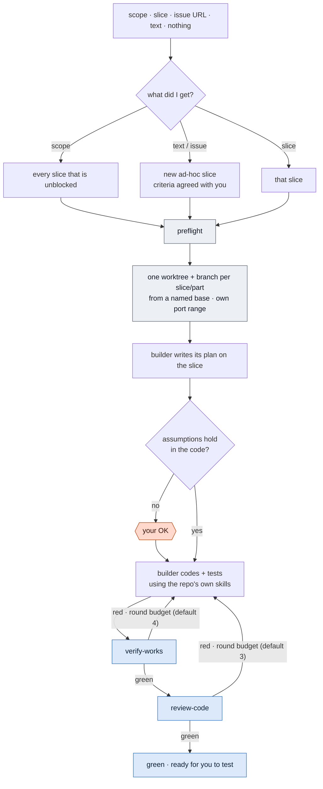
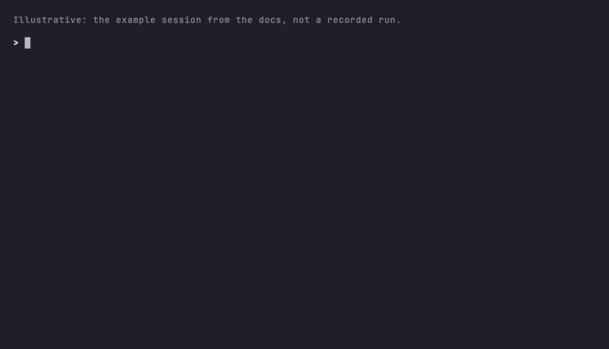

# build-slice — slices built your repo's way, in parallel, until green

> **TL;DR** — Builds each slice in its **own git worktree** on its own branch, so several builders work at once — even in the same repository — while your checkout stays exactly as you left it. Builders follow the skills and conventions your repository already has, and every slice runs [`verify-works`](./verify-works.md) then [`review-code`](./review-code.md) until both are green. Give it a scope, a slice, an issue URL or a one-line fix. It finishes at green: no push, no PR.

How well the model builds depends on your client and model; the tests cover everything around it.

## At a glance

| | |
| --- | --- |
| **Block** | Build |
| **Invoke** | `/wholeloop:build-slice` · `$wl-build-slice` · `/wl-build-slice` |
| **Decision point** | None inside — it hands over to **test it** |
| **Reads** | A scope, a slice, an issue URL, free text, or nothing (it asks) |
| **Writes** | One worktree + branch per slice or part · the builder's plan, gate results and evidence on the slice · a list of anything changed outside the repository, each with its undo |
| **Slots** | `build.<area>` (e.g. `build.backend`, `build.frontend`) · `build.design-system` · `verify.suite` · `review.rubric` |
| **Config** | `build.workspace: worktree` (default) \| `checkout` |
| **Capabilities** | `source.code` · `tracker.read-item` (for issue URLs) |
| **Agents** | `builder` (one per slice or part) · `verifier` and `reviewer` (inside the gates) · `conductor` (coordinates) |

## When to use it — and when not

**Use it when** you want code written against agreed criteria, whether a planned slice or a quick fix, and checked the same way no matter who started it.

**Skip it when** the code already exists and you only want an opinion on it: run [`verify-works`](./verify-works.md) or [`review-code`](./review-code.md) on their own.

## How it works



1. **It works out what you meant.** A scope builds every unblocked slice; a slice builds that one; an issue URL or a sentence becomes **one ad-hoc slice** with criteria you confirm in a single question. Even a one-line fix goes through both gates.
2. **Every slice gets a worktree.** By default each slice (or part, for multi-repo slices) is checked out under the store — `$XDG_STATE_HOME/wholeloop/worktrees/<repo>/<slice-id>` — on its own branch from a named base. Consequences:
   - builders run **in parallel**, including several slices of the same repository;
   - **your checkout is never touched** — it can be dirty, on any branch, with a dev server running;
   - **blocked-by order still holds**: a slice waits until the ones it depends on are green, and a chained slice can branch from the one below it (stacked branches).
3. **Ports don't collide.** Each worktree gets its own port range, recorded on the slice, so two dev servers can run side by side.
4. **Your repository's skills come first.** Before coding, the builder loads whatever the `build.<area>` and `build.design-system` slots resolved to — your backend guide, your design-system skill — and only falls back to defaults when nothing more specific exists ([repo skills](../../configuration/repo-skills.md)).
5. **Plans are always visible; pausing is the exception.** The builder writes its plan on the slice before touching code, in every pace. It waits for you only when something it was told contradicts — or can't be checked against — the code.
6. **Gates only observe.** Verifier and reviewer never edit. Findings go back to the builder; when the round budget runs out the slice stops, reports what's still open and offers more rounds — the bar never drops to get to green ([gates](../../architecture/orchestration-and-gates.md)).
7. **Pace sets concurrency, nothing else.** `guided` runs one builder at a time, `staged` runs builders together but gates one slice at a time, `parallel` runs everything at once. The checks are identical ([profile](../../configuration/profile.md)).
8. **Anything outside the repository is announced first.** A database, a container stack, a seeded index: listed with how to undo it before it happens, and again in the receipt.

An example preflight, before any worktree exists:

```text
Plan       3 slices → 3 builders · pace staged
Workspace  worktrees under ~/.local/state/wholeloop/worktrees/shop-web/
           slice-0d4e  branch wl/slice-0d4e  from origin/main (3f9a1c2)  ports 5200–5209
           slice-77ab  waits for slice-0d4e · will branch from wl/slice-0d4e
Your copy  ~/code/shop-web untouched (it's on feat/other with local changes — that's fine)
Skills     build.frontend → design-system-guide (repo) · verify.suite → npm test + tsc (detected)
Gates      verify ≤ 4 rounds · review ≤ 3 · finishes at green  (--rounds to change)
Won't      commit to main · push · open a PR · flip a flag · message anyone
Stop       "stop" halts every builder; worktrees and branches stay as they are
```

## Testing it yourself

When a slice is green, **test it** is yours:

```text
wl worktree open slice-0d4e
  path   ~/.local/state/wholeloop/worktrees/shop-web/slice-0d4e
  branch wl/slice-0d4e
  ports  5200–5209 (dev server suggestion: PORT=5200 npm run dev)
```

Worktrees are removed by [`sync`](../utilities.md) once their PR is merged, or at any time with `wl worktree prune`.

Rather have branches appear in the copy you already work in? Set `build.workspace: checkout`. Slices of the same repository then take turns there instead of running side by side.

## Standalone use

This is the step people run on its own most. `build-slice "add CSV export to the orders list"` drafts the acceptance criteria, asks you to confirm them once, builds in a fresh worktree and runs both gates — no initiative, spec or scope needed.

## Run it



*Illustrative: the example session below, animated. Its wording depends on your client and model.*

The same session as text:

```text
> /wholeloop:build-slice "add CSV export to the orders list"

Ad-hoc slice — "add CSV export to the orders list"
Criteria (confirm or edit)
  1. An "Export CSV" action on the orders list downloads the visible rows
  2. Columns: number, date, status, total
  3. Exports above 10k rows are refused with a clear message
[confirm] [edit]

(preflight…)

▸ builder:slice-5e1a plan written · assumptions hold in the code
▸ builder: src/orders/export.ts · src/orders/OrdersList.tsx · 2 tests
▸ verify round 1 · suite ✓ · criterion 3 ✗ (no message shown) → back to builder
▸ verify round 2 · green
▸ review round 1 · green

Produced
  Worktree   slice-5e1a                  wl worktree open slice-5e1a
  Branch     wl/slice-5e1a               (local only)
  Slice      slice-5e1a · green          wl open slice-5e1a
Next         test it, then /wholeloop:open-pr slice-5e1a
```

| Client | Invoke | Parallel builders run as |
| --- | --- | --- |
| Claude Code | `/wl-build-slice …`, or `/wholeloop:build-slice …` with the plugin | native subagents |
| Codex CLI | `$wl-build-slice …` | native subagents |
| OpenCode | Ask for `wl-build-slice` | native subagents |
| Copilot CLI | Ask for `wl-build-slice` | native subagents (`/fleet`) |
| Gemini CLI · Cursor | Ask for `wl-build-slice` | native where available, otherwise headless or one by one |
| Antigravity | Ask for `wl-agy-build-slice` | native where available, otherwise headless or one by one |

## Before & after

- **Fed by:** [`slice-work`](./slice-work.md) (slices, criteria, test cases) — or nothing more than your sentence.
- **Feeds:** **test it** (`wl worktree open`) → [`open-pr`](./open-pr.md).

## Gotchas & FAQ

**"Is there a shortcut that skips the gates for tiny changes?"** No. A one-liner costs one or two rounds; that is cheap insurance, and it keeps everyone's work comparable.

**"Do I need to commit or stash before running it?"** No. With worktrees your checkout is never read from or switched.

**"Too many agents at once for my taste."** Set `pace: guided`: one builder at a time, identical checks.

**"It ran out of rounds."** The slice stops with its open findings attached. Grant more rounds (`--rounds verify=6`), fix them by hand in the worktree, or sharpen the criteria and run it again.

**"Where did my disk space go?"** Worktrees share Git objects, so they are light, but `wl worktree prune` clears every one whose branch is merged or abandoned.

**"Can it start my application in a container?"** [Autonomous delivery](../../tutorials/delivery-environments.md) can plan and start isolated Docker environments for a run. In this supervised step, the builder runs your repository's own commands in the worktree, and anything it changes outside the repository is recorded with its undo, as described below.

## Core commands

The commands behind the skill, for scripts and skill authors. Each group works on its own.

### Workspace lifecycle

```text
wl worktree create slice-0123abcd --base main --json
wl worktree create slice-89abcdef --after slice-0123abcd --json
wl worktree open slice-0123abcd --json
wl worktree list --json
wl worktree stop slice-0123abcd --json
wl worktree prune slice-0123abcd --dry-run --json
wl worktree prune slice-0123abcd --json
```

**Create** needs an open slice, or a repository part for a slice that spans repositories.

- The repository comes from the recorded definition, or from an explicit `--repo`.
- `--base` names a local or remote branch; a raw commit is never a cleanup target. `--after` stacks the work on a recorded predecessor and keeps the original integration target.
- Nothing is fetched, pushed or committed while provisioning.
- Your branch, index and working files stay untouched, even when they hold staged or untracked work. Checkout hooks are disabled for the provisioning command only; later commits run your hooks normally.
- Running create again reuses the active workspace, or finishes an interrupted one. A stale lock needs its owner to inspect it.

**Ports.** Each workspace reserves a block of ten ports between 5200 and 6199 in your store. These are reservations, not checks that the ports are free.

**Open** reports the actual HEAD, path, ports and detected quality commands. It starts nothing and does not record your test.

**Stop** records the state and keeps the files and the branch; it does not stop processes such as a dev server. To reject the work explicitly: `wl worktree stop <id> --abandon --reason "<why>"`.

**Prune** removes only work that is recorded as stopped, clean, and merged into its target or explicitly abandoned. It:

- respects Git locks;
- keeps anything unmerged, dirty or with a changed identity, and every topic branch;
- carries on with other records when one cannot be cleaned;
- never sweeps Git metadata broadly or forces a removal.

`--dry-run` changes nothing.

**Checkout mode** (`build.workspace: checkout`) needs a clean repository nobody else is using. It creates the topic branch there and restores your original branch, or detached commit, when the work is cleaned up. It never deletes your directory.

### Build contracts

```bash
wl build route "Reject empty requests" --json
wl build agree "Reject empty requests" --owner Owner --by Owner --criteria criteria.json --json
wl build preflight slice-0123abcd --json
wl build prepare slice-0123abcd --base main --json
wl build schema --json
wl build plan slice-0123abcd --file plan.json --basis '<prepared-snapshot>' --json
wl build complete slice-0123abcd --json
```

**Criteria and plan.** Criteria files use `wholeloop/criteria@1`. The builder plan uses `wholeloop/builder-plan@1`: steps, tests and assumptions, each assumption with its status (verified, unknown or contradicted) and evidence.

- Recording a plan checks the prepared snapshot before any code is written.
- An unknown or contradicted assumption needs explicit approval: `wl answer decision.approve-build-plan=approved --for <id> --by <person> --json`. Changing the plan while one is unresolved needs a new approval.

**The host contract.** `harness/workflows/build.ts` drives planning, implementation, unit inspection, independent refutation and stopping; the core loads the selected build guidance into it.

- `runBuild` resumes existing plans and partial rounds; `runBuildGroup` runs ready dependency waves at the pace you set.
- Gate results are observations reported by that host. Planning alone runs no project test and proves nothing about correctness.

**Completion.** Every repair that changes code invalidates older passes. `build complete` requires a verify **and** a review pass after the latest plan, on the same current bytes. It then writes the receipt and moves on to `open-pr`.

- The item stays open for your test and the pull request; dependent work can build on it.
- A later rebuild blocks those dependents again.
- Stacking refuses a predecessor with uncommitted files, because a branch cannot include another worktree's uncommitted changes. Commit them only when authorized, then rerun the gates.

**Issues.** Starting from an issue URL asks for criteria. A host can read the tracker through `BuildWorkflow.readIssue`, which needs the complete body at a known revision. `wl build agree --issue <url> --revision <revision>` records what you observed, without claiming that it fetched the issue.

This workflow has no push or pull request operation; that is [`open-pr`](./open-pr.md).

### External effects and undo

When building changes something **outside the repository**, such as seeding a local database, record it with its undo:

```bash
wl env declare --for <id> --file <declaration.json> --json
wl env report --for <id> --json
```

```json
{
  "key": "seed-orders",
  "resource": "local-db://orders/demo-seed",
  "effect": "Seeded local demo orders",
  "by": "Project owner",
  "undo": {
    "cwd": ".",
    "argv": ["project-db", "remove-seed", "--name", "demo-orders"]
  }
}
```

This is an example declaration, not a command wholeloop ran.

- **Never include a credential value.** Use the tool's own credential store or a wrapper that reads it.
- A relative `cwd` resolves when the undo runs.
- `env report` lists the item's effects, its descendants' and shared parent effects, without unrelated siblings. Build and PR receipts include every declaration present at completion, and the resume context points to the current report.
- Undo steps are listed in reverse order; check their real dependencies first.
- The ledger **executes nothing**, and never claims that an effect or its cleanup succeeded. Try an undo on disposable resources before relying on it.

<!-- docnav -->
[◀ slice-work](slice-work.md)  ·  [📖 Docs index](../../README.md)  ·  [🧭 Concepts](../../concepts.md)  ·  [verify-works ▶](verify-works.md)
