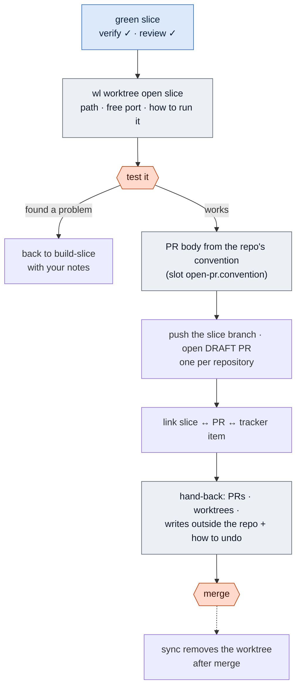

# open-pr — publish a tested change as a draft pull request

> **TL;DR** — The last step of Build, and the first time anything leaves your machine. You try the change in its slice's worktree; only then is the slice branch pushed and a draft PR opened per repository, written the way your repo writes PRs and linked to the work it delivers. It ends by handing back its PR and retained workspace; declared external writes and undo argv appear in its receipt. Merging stays with you.

> [!NOTE]
> **Status: ✅ implemented locally.** Local plans, exact-plan human testing, draft-only publication/reconciliation, gh/glab API hosts, template checks and canonical receipts are tested. Authenticated execution, actual client adapters, later sibling back-links and remote tracker mirroring remain owner/host verification. The declarative environment ledger is integrated into receipts. Tracked in [P3-07](../../../roadmap/phase-3-build.md#p3-07--open-pr-and-code-host-providers).

---

## At a glance

| | |
| --- | --- |
| **Block** | Build — final step |
| **Invoke** | `/wholeloop:open-pr` · `$wl-open-pr` · `/wl-open-pr` |
| **Decision points** | **test it** (before anything is pushed) · **merge** (yours, outside the harness) |
| **Reads** | A green slice and its worktree (or any branch) · its criteria and verdicts · the repo's PR conventions |
| **Writes** | The pushed slice branch and a **draft** PR per repository · links on the slice and the tracker item · a hand-back report |
| **Slots** | `open-pr.convention` — PR template, title format, labels, a repo PR skill |
| **Capabilities** | `codehost` (GitHub via `gh`, GitLab via `glab`, Bitbucket) · `tracker` (link the item) |
| **Agents** | None — the conductor runs it directly |

## When to use it — and when not

**Use it when** a slice is green and you have tried it yourself — or when you have a branch of your own and want a PR that follows the repo's conventions.

**Don't use it to** skip trying the change. Until you've run it, the step waits. Passing checks alone never publish anything.

## How it works



1. **You try it in the slice's worktree.** `wl worktree open <slice>` prints the worktree path, a free port allocated for it and the commands to run the change — so you can test this slice while your usual checkout, and other slices, keep running untouched. Your answer is recorded with the slice.
2. **Pushing is part of your approval.** The slice branch is pushed only after you say it works, as part of this step. No other step pushes.
3. **The repo decides what a PR looks like.** A PR template, a repo PR skill found by `wl discover` shape the body; the harness adds the links and the verification summary, never a template of its own on top.
4. **Always a draft.** Marking it ready, requesting reviewers and merging are yours.
5. **One PR per repository.** A slice that spans repos opens one PR per part, from each part's own branch, each carrying stored tracker/contract and already-known sibling references. Later sibling back-links need a host handoff.
6. **Everything is handed back.** Worktrees, servers started on their ports, local data seeded, containers: each listed with the command that reverses it. Worktrees stay until the PR merges, then [`sync`](../utilities.md#sync) removes them — or `wl worktree prune` does it by hand.

## Standalone use

| You give it | It opens |
| --- | --- |
| nothing | a draft PR for the current branch, after you confirm you tried it |
| `slice-0d4e` | the PR(s) for that slice, with its verdicts in the body |
| `--repo api,web` | PRs only for those parts of a multi-repo slice |

Without a slice there are no verdicts to report, and the PR body says the gates were not run — never that they passed.

The executable commands are:

```bash
wl pr prepare --for <part-or-slice> --body-file <external-draft.md> --json
wl worktree open <part-or-slice> --json
# After the person explicitly reports a successful test:
wl pr tested --for <id> --by <person> --note "Observed the expected behavior" --json
wl pr open --for <id> --json
# If a request was interrupted, inspect the remote and read its observed URL:
wl pr reconcile --for <id> --url <observed-pr-url> --json
```

Prepare never publishes. Configure providers.codehost as github or gitlab, or pass
`--provider` while preparing. Standalone use supplies `--base`, `--owner`, `--title`
and `--body-file` for the currently checked-out branch. Missing facts are questions;
there is no implicit checkout, commit, fork or fabricated gate result. Branches must
be clean and contain commits beyond their named target. Finish authorized commits
before final gates and human testing: a commit changes the gate snapshot.

The plan pins its body and repository convention. Human testing includes who and
what they tried; a generic decision alone cannot publish. Any new plan or code
requires fresh testing. A durable request prevents duplicate push/create attempts
on resume. Only a matching open draft can complete. API hosts use CLI credential
stores and JSON stdin; no credential or temporary body file is written by them.
See [ADR-0035](../../decisions/0035-tested-draft-plans-and-once-only-publication.md).

Stored tracker and known sibling references go into the body. Local links and a
part's parent slice are updated; unavailable remote tracker mirroring and earlier
PR back-links remain explicit handoffs. No authenticated publication was exercised.

## Run it

```text
> /wholeloop:open-pr slice-0d4e

Open PR — slice-0d4e "user can filter orders by date"
Gates     verify ✓ (round 2) · review ✓ (round 1)
Try it    worktree  ~/.local/state/wholeloop/worktrees/shop-web/slice-0d4e
          run       npm run dev -- --port 5181  →  http://localhost:5181/orders?from=2026-09-01
          data      npm run seed:orders (40 orders across 3 months)

Did it work as expected?   [ Yes, open the PR ]  [ No — here's what I saw ]

> Yes

▸ pushed wl/slice-0d4e-orders-date-filter → origin
▸ draft PR #151 opened (template: .github/pull_request_template.md)
▸ linked: slice-0d4e ↔ #151 ↔ ENG-482

Produced
  Draft PR          #151                       gh pr view 151 --web
  Branch            wl/slice-0d4e-orders-date-filter
Outside the repo
  Worktree          slice-0d4e (kept until merge)    wl worktree prune slice-0d4e
  Dev server :5181  still running                    wl worktree stop slice-0d4e
  Seeded orders     40 rows in local db              npm run seed:orders -- --undo
Next              your review · merge when ready · sync cleans up afterwards
```

| CLI | Invoke |
| --- | --- |
| Claude Code | `/wholeloop:open-pr …` |
| Codex CLI | `$wl-open-pr …` |
| OpenCode | `/wl-open-pr …` |
| Copilot CLI | `/wl-open-pr …` |
| Gemini CLI · Antigravity · Cursor | `/wl-open-pr …` |

## Before & after

- **Fed by:** a green [`review-code`](./review-code.md), or any branch you want to publish.
- **Feeds:** **merge** (yours), then [`prepare-launch`](../rollout/prepare-launch.md); [`sync`](../utilities.md#sync) closes the slice and removes its worktree once the PR merges.

The environment section includes every declared write, its undo argv and working
directory, with a link to the current ledger. Read `wl env report --for <id>` for
later testing effects. Declarations include shared ancestors and child parts;
recipes are shown in reverse declaration order and never executed automatically.
An empty ledger means no declarations, not observed absence of external changes.

## Gotchas & FAQ

**"Can it merge when CI is green?"** No, and no setting changes that. The `codehost` capability has no merge verb.

**"We use GitLab merge requests."** Choose `gitlab` as your `codehost` provider; the step opens a draft MR through `glab`.

**"I'd rather test in my usual checkout."** Check out the slice branch there (`git switch wl/slice-0d4e-…`); the step only needs your answer, not where you ran it.

**"I want to try it later."** Stop here; the slice waits at **test it**, its worktree stays put, and `next` brings you back to it.

---

<!-- docnav -->
[◀ review-code](review-code.md)  ·  [📖 Docs index](../../README.md)  ·  [🧭 Concepts](../../concepts.md)  ·  [prepare-launch ▶](../rollout/prepare-launch.md)
