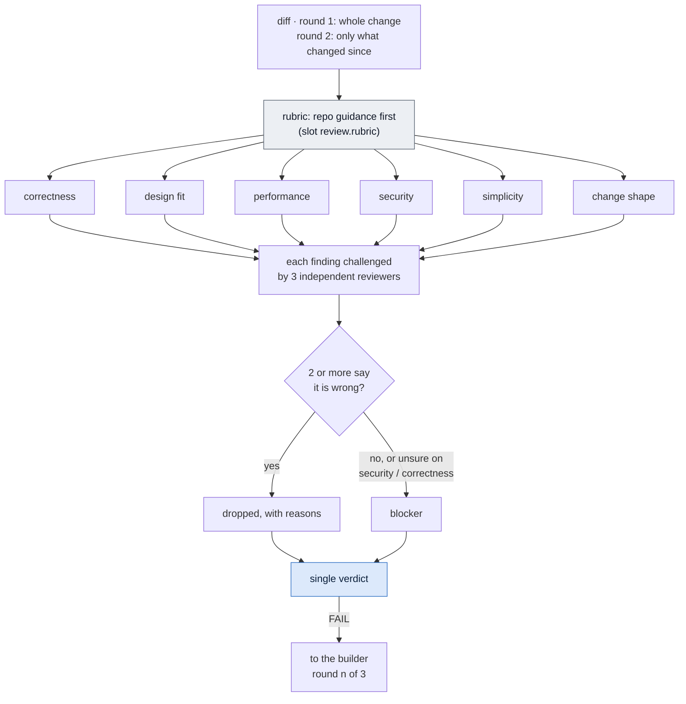

# review-code — find out whether the change is well written

> **TL;DR** — The quality gate for craft. Six reviewers each look at the change through one fixed lens — correctness, design fit, performance, security, simplicity, change shape — using your repository's own review guidance where it has one. Every finding is challenged before it blocks, and what survives goes back to the builder. It never edits code.

> [!NOTE]
> **Status: 📐 design.** Tracked in [P3-06](../../../roadmap/phase-3-build.md#p3-06--review-code).

---

## At a glance

| | |
|---|---|
| **Block** | Build — after [`verify-works`](./verify-works.md) is green, inside the "until green" loop |
| **Invoke** | `/throughline:review-code` · `$tl-review-code` · `/tl-review-code` |
| **Decision point** | None — a machine loop with a round limit |
| **Reads** | The diff of a slice's worktree, a branch or a PR · the slice's criteria for context · the repo's review guidance |
| **Writes** | One verdict per round on the slice, findings with file, line and reasoning · optionally PR comments via `codehost` |
| **Slots** | `review.rubric` — a repo review skill, style guide or rules file |
| **Capabilities** | `codehost` (read a PR, optionally comment) |
| **Agents** | `reviewer` — one per lens, plus the challengers of each finding |

## When to use it — and when not

**Use it when** the change already does what it should and you want to know whether it belongs in the codebase as it is: bugs the tests missed, a pattern that fights the repo's own, an N+1, an unchecked input, code that could be half the size, a diff that mixes two concerns.

**Don't use it to** decide whether the feature works — that question is settled first by [`verify-works`](./verify-works.md). Reviewing code that doesn't work yet wastes the reviewers.

## How it works



| Lens | The question it owns |
|---|---|
| **correctness** | Will this misbehave on an input or state the tests didn't try? |
| **design fit** | Does it follow how *this* repository already solves this kind of problem? |
| **performance** | Repeated queries, unbounded loops, work done on every request that could be done once? |
| **security** | Can anything from outside reach this code without being checked? |
| **simplicity** | Is there a smaller, clearer way to say the same thing — in code and in prose? |
| **change shape** | Is this one coherent change, sized to be reviewed, with nothing unrelated inside? |

1. **Lenses are fixed, not chosen per run.** Six reviewers asking the same question would agree with each other; six different questions catch different things.
2. **Your repo's guidance is the rubric.** A review skill, `CONTRIBUTING.md`, a style guide or lint config found by `tl discover` sets what "good" means here. The harness default applies only where the repo is silent.
3. **Challenged before it blocks.** A finding is dropped only when two or more of its three challengers actively argue it is wrong.
4. **Security and correctness lean cautious.** Input that crosses a boundary is treated as untrusted until the code shows otherwise; in doubt, the finding stands. A missed exploit costs far more than a false alarm.
5. **Later rounds look at what moved.** Round 2 reviews only the diff since round 1, so a fix isn't punished for code it never touched.
6. **Reads, never writes.** Same guarantee as verify: no edit tools where enforceable, and the slice's worktree is checked untouched after every round.
7. **Bounded, and yours to tune.** Three rounds by default; change it per project (`gates.review.rounds`) or per run (`--rounds review=5`). Still blocked at the limit? You get every finding with its reasoning, and the choice to extend or stop.

**Teams can add lenses** (accessibility, i18n, data privacy…) as manifests ([extending](../../extending/lenses-templates-profiles.md)). Removing one of the six is not a configuration option.

## Standalone use

| You give it | It reviews |
|---|---|
| nothing | the current branch against its base |
| `slice-0d4e` | that slice's worktree, with its criteria as context |
| `#142` or a PR URL | that PR; add `--comment` to post findings on it |
| a branch name | that branch |

## Run it

```text
> /throughline:review-code #142

Review — PR #142 "Add CSV export to the orders list"
Rubric    .claude/skills/backend-guidelines (repo) · CONTRIBUTING.md
Lenses    correctness · design fit · performance · security · simplicity · change shape
Round     1 of 3

▸ 6 reviewers started
✓ design fit · ✓ security · ✓ change shape
✗ performance: one query per order row in ExportService#rows
✗ simplicity: CsvBuilder duplicates the existing ReportWriter helpers
✗ correctness: a comma in a customer name breaks the column layout
▸ challenging 3 findings…
  performance kept (0 of 3 against) · correctness kept (0 of 3 against)
  simplicity dropped — 2 of 3 argued ReportWriter can't stream

Verdict   FAIL — 2 blockers · 1 dropped (reasons linked)
Next      builder, round 2 of 3 (only the new diff is reviewed)
```

| CLI | Invoke | Parallel lenses |
|---|---|---|
| Claude Code | `/throughline:review-code …` | native subagents |
| Codex CLI | `$tl-review-code …` | native subagents |
| OpenCode | `/tl-review-code …` | native subagents |
| Copilot CLI | `/tl-review-code …` | native subagents (`/fleet`) |
| Gemini CLI · Antigravity · Cursor | `/tl-review-code …` | native where available, otherwise headless or one by one ([orchestration](../../architecture/orchestration-and-gates.md)) |

## Before & after

- **Fed by:** a green [`verify-works`](./verify-works.md), or any PR or branch directly.
- **Feeds:** the builder when red; the **test it** decision before [`open-pr`](./open-pr.md) when green.

## Gotchas & FAQ

**"It flagged something our team does on purpose."** Write it into the repo's guidance (or a review skill). The design-fit lens reads it next time, and the finding goes away for everyone.

**"Too many nitpicks."** Findings that can't survive a challenge are dropped. If noise still gets through, that is a calibration case for the eval corpus, not a reason to remove a lens.

**"Can it post the review on the PR?"** Yes, with `--comment`, through your `codehost` provider. It never approves or requests changes on your behalf.

---

<!-- docnav -->
[◀ verify-works](verify-works.md)  ·  [📖 Docs index](../../README.md)  ·  [🧭 Concepts](../../concepts.md)  ·  [open-pr ▶](open-pr.md)
