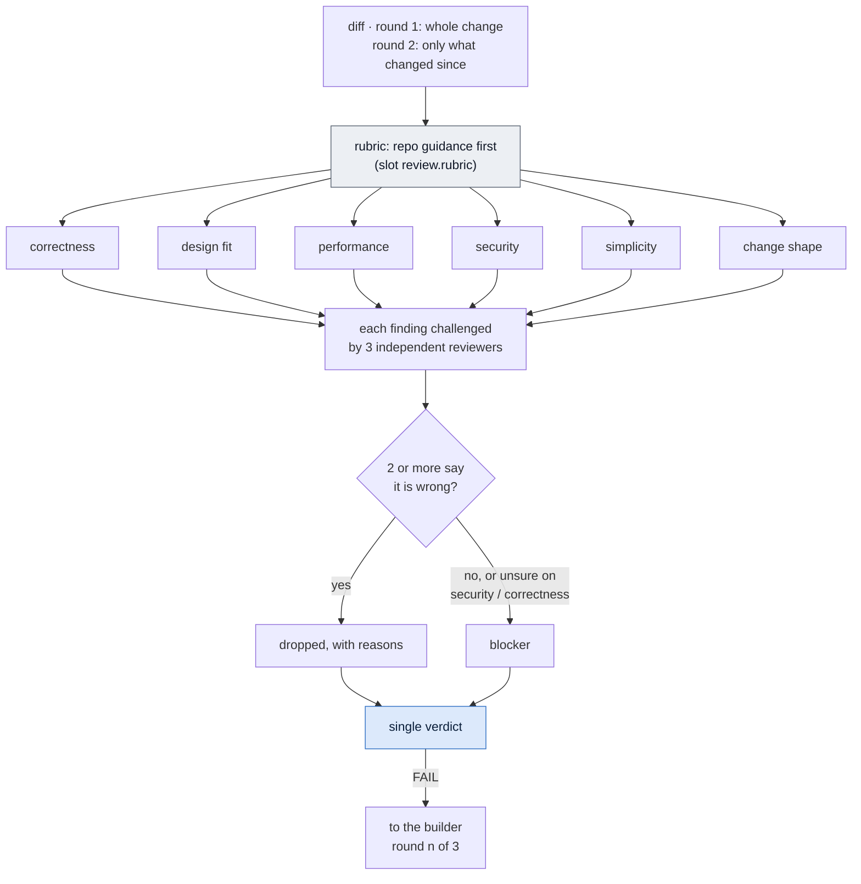
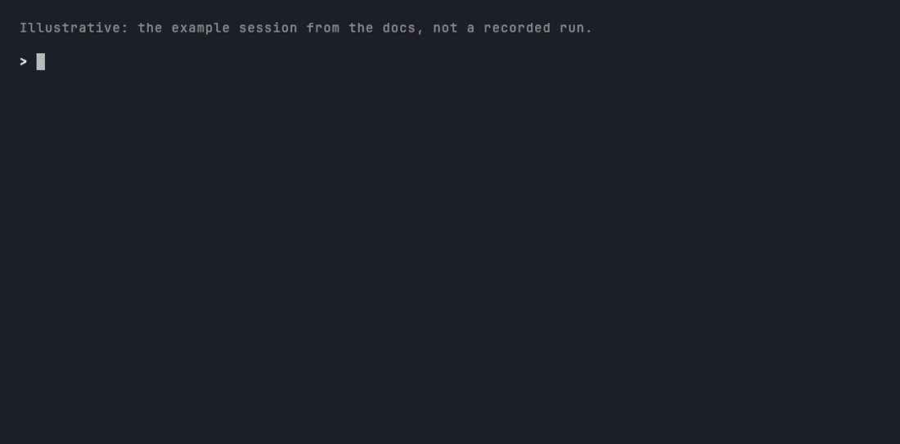

# review-code — find out whether the change is well written

> **TL;DR** — The quality gate for craft. Six reviewers each look at the change through one fixed lens — correctness, design fit, performance, security, simplicity, change shape — using your repository's own review guidance where it has one. Every finding is challenged before it blocks, and what survives goes back to the builder. It never edits code.

Comment publication through GitHub and GitLab hosts is tested against fixtures.

## At a glance

| | |
| --- | --- |
| **Block** | Build — after [`verify-works`](./verify-works.md) is green, inside the "until green" loop |
| **Invoke** | `/wholeloop:review-code` · `$wl-review-code` · `/wl-review-code` |
| **Decision point** | None — a machine loop with a round limit |
| **Reads** | The diff of a slice's worktree, a branch or a PR · the slice's criteria for context · the repo's review guidance |
| **Writes** | One verdict per round on the slice, findings with file, line and reasoning · optionally PR comments via `codehost` |
| **Slots** | `review.rubric` — a repo review skill, style guide or rules file |
| **Capabilities** | `codehost` (read a PR, optionally comment) |
| **Agents** | `reviewer` — one per lens, plus the challengers of each finding |

## When to use it — and when not

**Use it when** the change already does what it should and you want to know whether it belongs in the codebase as it is: bugs the tests missed, a pattern that fights the repo's own, an N+1, an unchecked input, code that could be half the size, a diff that mixes two concerns.

**Don't use it to** decide whether the feature works — that question is settled first by [`verify-works`](./verify-works.md). Reviewing code that doesn't work yet wastes the reviewers.

## How it works



| Lens | The question it owns |
| --- | --- |
| **correctness** | Will this misbehave on an input or state the tests didn't try? |
| **design fit** | Does it follow how *this* repository already solves this kind of problem? |
| **performance** | Repeated queries, unbounded loops, work done on every request that could be done once? |
| **security** | Can anything from outside reach this code without being checked? |
| **simplicity** | Is there a smaller, clearer way to say the same thing — in code and in prose? |
| **change shape** | Is this one coherent change, sized to be reviewed, with nothing unrelated inside? |

1. **Lenses are fixed, not chosen per run.** Six reviewers asking the same question would agree with each other; six different questions catch different things. Correctness and security always run. The four optional lenses step aside only when the change cannot concern them, and the plan says why:
   - **Documentation only:** design fit, performance and simplicity are skipped.
   - **Ten changed lines or fewer in one file:** simplicity and change shape are skipped.
   - An unknown size, such as a new untracked file, keeps every lens.
2. **Your repo's guidance is the rubric.** A review skill, `CONTRIBUTING.md`, a style guide or lint config found by `wl discover` sets what "good" means here. The harness default applies only where the repo is silent.
3. **Only blockers block.** Each finding of an optional lens carries a severity: **blocker** (the change must not ship with it), **should** (worth fixing, can wait) or **nit** (cosmetic). Should and nit findings are not challenged and do not fail the round; you read every one of them in the hand-back as "Not blocking". Correctness and security findings are always blockers.
4. **Challenged before it blocks.** A blocker is dropped only when two or more of its three challengers actively argue it is wrong.
5. **Security and correctness lean cautious.** Input that crosses a boundary is treated as untrusted until the code shows otherwise; in doubt, the finding stands. A missed exploit costs far more than a false alarm.
6. **Later rounds look at what moved.** Round 2 reviews only the diff since round 1, so a fix isn't punished for code it never touched.
7. **Reads, never writes.** Same guarantee as verify: no edit tools where enforceable, and the slice's worktree is checked untouched after every round.
8. **Bounded, and yours to tune.** Three rounds by default; change it per project (`gates.review.rounds`) or per run (`--rounds review=5`). Still blocked at the limit? You get every finding with its reasoning, and the choice to extend or stop.
9. **Rigor is your choice.** `standard` is the default and the coverage above. Ask for `--rigor quick` to run only correctness, security and your criteria for a tiny change, or `--rigor deep` for five challengers per blocker. The plan shows a proposal from the change size, but nothing changes unless you choose it, and your interaction profile never does. The chosen rigor and what it covered appear in the plan and the verdict.

**Teams can add lenses** (accessibility, i18n, data privacy…) as manifests ([extending](../../extending/lenses-templates-profiles.md)). Disabling a built-in requires a meaningful reason in project configuration, reported in every gate plan.

## Standalone use

| You give it | It reviews |
| --- | --- |
| nothing | the current named branch; asks for owner and comparison base |
| `slice-0d4e` | that slice's worktree, with its criteria as context |
| a PR URL | asks for a host-resolved local named `--branch`; no implicit remote fetch |
| a branch name | that branch |

The core commands behind the skill:

```text
wl review begin <branch> --base <base> --owner <person> --json
wl review begin --for <slice-id> --json
wl review input --for <id> --json
wl review complete --for <id> --json
```

A PR URL also needs `--branch <resolved-local-head>`. The client supplies the reviewers and refuters, and keeps their tools read-only.

**What each round sees.** The changed files are copied into private objects in your store, never into the repository's index. A round includes uncommitted edits, new and deleted files, file modes and symlink targets. Earlier findings that were kept stay in context so they can be rechecked, even if the new patch no longer touches them.

**What is refused.** Inputs are bounded, and files with sensitive names or recognized credential shapes are refused. This is not a complete secret detector, so check other sensitive paths before a review.

**What stays fixed.** Changing the rubric during a run fails instead of weakening the review. Keep the private objects together with the journal: rebuilding projections cannot recreate missing source files.

[Cost previews](../README.md#cost-before-workers-start) show current worker calls, requested tiers and declared input size before each batch starts. The illustrative example below is abridged and omits these previews; token usage, time and price are not measured by the plan.

## Run it



*Illustrative: the example session below, animated. Its wording depends on your client and model.*

The same session as text:

```text
> /wholeloop:review-code #142

Review — PR #142 "Add CSV export to the orders list"
Rubric    .claude/skills/backend-guidelines (repo) · CONTRIBUTING.md
Lenses    correctness · design fit · performance · security · simplicity · change shape
Round     1 of 3

▸ 6 reviewers started
✓ design fit · ✓ security · ✓ change shape
✗ performance: one query per order row in ExportService#rows
✗ simplicity: CsvBuilder duplicates the existing ReportWriter helpers
✗ correctness: a comma in a customer name breaks the column layout
▸ challenging 3 findings…
  performance kept (0 of 3 against) · correctness kept (0 of 3 against)
  simplicity dropped — 2 of 3 argued ReportWriter can't stream

Verdict   FAIL — 2 blockers · 1 dropped (reasons linked)
Next      builder, round 2 of 3 (only the new diff is reviewed)
```

| Client | Invoke | Parallel lenses run as |
| --- | --- | --- |
| Claude Code | `/wl-review-code …`, or `/wholeloop:review-code …` with the plugin | native subagents |
| Codex CLI | `$wl-review-code …` | native subagents |
| OpenCode | Ask for `wl-review-code` | native subagents |
| Copilot CLI | Ask for `wl-review-code` | native subagents (`/fleet`) |
| Gemini CLI · Cursor | Ask for `wl-review-code` | native where available, otherwise headless or one by one |
| Antigravity | Ask for `wl-agy-review-code` | native where available, otherwise headless or one by one |

## Before & after

- **Fed by:** a green [`verify-works`](./verify-works.md), or any PR or branch directly.
- **Feeds:** the builder when red; the **test it** decision before [`open-pr`](./open-pr.md) when green.

## Gotchas & FAQ

**"It flagged something our team does on purpose."** Write it into the repo's guidance (or a review skill). The design-fit lens reads it next time, and the finding goes away for everyone.

**"Too many nitpicks."** Findings that can't survive a challenge are dropped. If noise still gets through, that is a calibration case for the eval corpus, not a reason to remove a lens.

**"Can it post the review on the PR?"** Draft locally with `wl review comment-plan --for <id> --pr <url> --json`. A configured provider must support codehost.comment-pr. Only an explicitly requested typed host call publishes; the CLI draft does not. Reconcile ambiguous remote outcomes before retrying. No authenticated comments were posted by the local tests.

<!-- docnav -->
[◀ verify-works](verify-works.md)  ·  [📖 Docs index](../../README.md)  ·  [🧭 Concepts](../../concepts.md)  ·  [open-pr ▶](open-pr.md)
