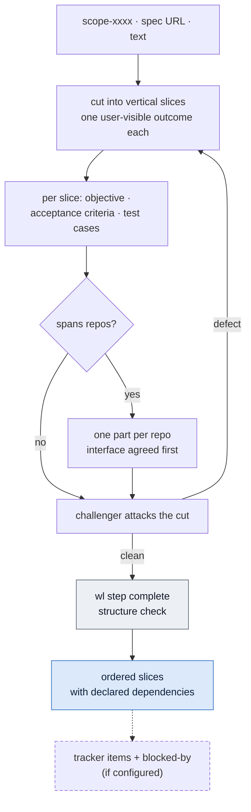

# slice-work — vertical slices with criteria written before code

> **TL;DR** — Splits a scope into **vertical slices** in a set order: each slice is something a user can actually do, working from screen to database — not "the API part" or "the UI part". Objective, acceptance criteria and test cases are written for every slice *before* any code. When a slice touches several repositories it gets one part per repository, and the shared contract is settled first. A challenger pokes holes in the split before any building starts.

> [!NOTE]
> **Status: 🚧 partial.** Versioned plans, structural lint, pinned inherited criteria, atomic stable slices/parts, local tracker references and dependency-aware next routing are implemented. Live semantic critique and remote mirroring remain manual; building/worktrees are later tasks. Tracked in [P3-01](../../../roadmap/phase-3-build.md#p3-01--slice-work).

---

## At a glance

| | |
| --- | --- |
| **Block** | Build |
| **Invoke** | `/wholeloop:slice-work` · `$wl-slice-work` · `/wl-slice-work` |
| **Decision point** | None |
| **Reads** | A scope (`scope-xxxx`) · or a standalone deliverable and owner |
| **Writes** | Slices (`slice-xxxx`) and parts, chained in order · optionally tracker items with blocked-by links |
| **Slots** | `slice.conventions` (your team's ticket or story format, if any) |
| **Capabilities** | `tracker.create-item` · `tracker.link-items` (optional) · `source.code` (to locate repos and contracts) |
| **Agents** | `challenger` (slicing mode) |

## When to use it — and when not

**Use it when** a scope is ready to build and you'd like something you can show working after every single slice, instead of one big reveal at the end.

**Skip it when** the change is one small, obvious unit: [`build-slice`](./build-slice.md) creates a single ad-hoc slice from free text.

## How it works



1. **Something a user can do.** "User can filter their orders" is a slice, even though it touches both API and UI. "Add a filter endpoint" isn't — nobody can try it.
2. **In order, unless independent.** Slices declare what they depend on; anything without a dependency can be built at the same time as the rest. After each slice, the product still works and there's one more thing to show.
3. **Agree the contract, then build both sides at once.** For a slice spanning repositories, the shared interface (an API shape, an event schema) is a tiny first part. Once it's settled, the parts on each side depend on that agreement, not on each other, and can be built simultaneously.
4. **The challenger checks the split itself**:

   | It asks | Example of a problem |
   | --- | --- |
   | Is this really one thing? | "filter **and** export" in the same slice |
   | Is every dependency written down? | slice 3 needs a column that no earlier slice adds |
   | Could someone try it once it's done? | "set up the data model" |
   | Would finishing every slice actually deliver the scope? | all criteria pass, but search is never reachable from the page |

5. **The structure is checked by code**: every slice has at least one testable criterion and one test case, every part belongs to exactly one repository, and dependencies don't loop.

## Standalone use

Use `wl step begin slice-work --input "Find past orders" --owner "Alex" --json`
to create the minimal initiative/scope hierarchy. Earlier Define steps are not
fabricated. An existing scope uses `--for <scope>`; an initiative ID must first
select a child scope. URL adoption remains separate P2-08 work.

`wl slices plan --for <scope> --json` returns inherited criteria, exact source
pins and the current checkout as a candidate repository. Confirm actual roots
before drafting; declaring a path does not prove it is a usable Git repository.
Read the selected slice.conventions guidance and `wl slices schema --json`.

The YAML metadata uses wholeloop/slice-plan@1, repository key/path entries and
slices with stable key, title, objective, one outcome, an end-to-end demonstration,
criteria, linked test cases and repository keys. Preserve sourceScope/sourceSpec
pins and inherited criteria exactly. Multiple repositories require a contract
repository, interface and examples. Slices default to a chain in plan order;
blockedBy replaces that default, including an explicit empty array for independent
work. Keys or existing slice IDs can name dependencies within the same scope.

Call `wl challenge plan slicing --file <file> --for <scope> --json`, then
`wl slices check <file> --for <scope> --json`. Complete through
`wl step complete slice-work --for <scope> --artifact <file> --json`. Invalid
criteria, missing demonstrations, multiple declared outcomes, cycles or stale
source pins leave no partial child updates. Revisions reuse IDs; omissions do
not delete earlier work, and closed children need explicit reopening.

The contract repository's part includes its implementation, keeping the total at
one part per participating repository. Single-repository slices need no child
part. `next <scope>` selects ready work, then the contract part, or asks between
independent choices. Recorded dependency completion is required before continuing
blocked work. Local tracker IDs are stored references; remote publication remains
pending until the host confirms real writes and records their links. See
[ADR-0029](../../decisions/0029-vertical-slice-contracts-and-repository-parts.md).

## Run it

```text
> /wholeloop:slice-work scope-a9e0

Slices — "Find an order"
Repos      api (~/code/shop-api) · web (~/code/shop-web)
Format     slice.conventions → default (no repo skill found)

  slice-0d4e  User can search orders by number      api + web
                part-1 api   contract: GET /orders?q=   (closes first)
                part-2 web   search box on orders page
  slice-77ab  User can filter orders by status/date api + web   (after slice-0d4e)
  slice-c21f  Empty and error states are explicit   web          (after slice-77ab)

▸ challenger: slice-77ab had "filter and sort" → split, sort moved to a later scope
✓ shape check passed · 3 slices · 9 criteria · 14 test cases

Produced
  Slices             3 · parts 5          wl status scope-a9e0
  Tracker items      5 + blocked-by links (Linear)
Next                 /wholeloop:build-slice scope-a9e0
```

| CLI | Invoke |
| --- | --- |
| Claude Code | `/wholeloop:slice-work …` |
| Codex CLI | `$wl-slice-work …` |
| OpenCode · Copilot CLI · tier B | `/wl-slice-work …` |

## Before & after

- **Fed by:** [`cut-scopes`](../define/cut-scopes.md) (the scope and its complexity call) and [`write-spec`](../define/write-spec.md) (stories and criteria).
- **Feeds:** [`build-slice`](./build-slice.md) — each slice's criteria and test cases become the builder's contract and the verifier's rubric.

## Gotchas & FAQ

**"Why not one task for the backend and one for the frontend?"** Because neither can be tried on its own, so feedback arrives only at the very end. Parts appear only when a slice really crosses repositories, and the agreed interface goes first.

**"These slices look tiny."** That's intended: small slices are quick to check, easy to show and cheap to throw away. Aim for something one builder finishes in one go.

**"Can independent slices in the same repository be built simultaneously?"** Yes. Each gets its own worktree and branch in [`build-slice`](./build-slice.md); only declared dependencies make one wait for another.

**"The challenger flagged a slice I think is fine."** Reply with your reasoning — it's kept with the slice. If it keeps getting the same thing wrong, that example belongs in its test corpus.

---

<!-- docnav -->
[◀ cut-scopes](../define/cut-scopes.md)  ·  [📖 Docs index](../../README.md)  ·  [🧭 Concepts](../../concepts.md)  ·  [build-slice ▶](build-slice.md)
