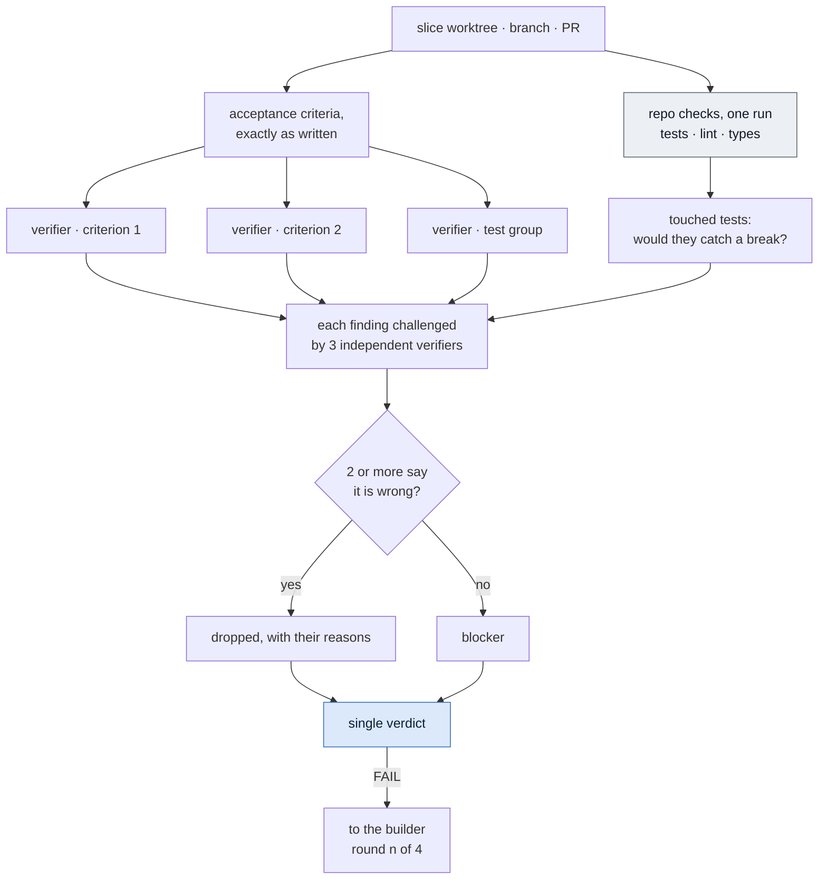

# verify-works — check that the change keeps its promises

> **TL;DR** — The quality gate for behaviour. It runs your repository's own checks a single time, takes the slice's acceptance criteria exactly as written, and gives each one to a read-only verifier that tests it against what the code really does. It also asks whether the tests you touched would notice if the feature broke. Every finding is challenged before it blocks. It reports; the builder repairs; the loop repeats until green.

The optional [declared API/CLI host](../../tutorials/delivery-behaviors.md) adds observed application behaviour.

## At a glance

| | |
| --- | --- |
| **Block** | Build — inside the "until green" loop, or on its own |
| **Invoke** | `/wholeloop:verify-works` · `$wl-verify-works` · `/wl-verify-works` |
| **Decision point** | None — *until green* is a machine loop with a round limit |
| **Reads** | A slice's worktree, a branch or a PR · its acceptance criteria (from the slice, an issue, the PR description, or you) |
| **Writes** | One verdict per round on the slice — `PASS` or `FAIL`, each finding with its evidence · nothing inside your repository |
| **Slots** | `verify.suite` — the test, lint and type-check commands your repo already uses |
| **Capabilities** | `codehost` (read a PR) · `tracker` (read criteria from an issue) |
| **Agents** | `verifier` — one per criterion or test group, plus the challengers of each finding |

## When to use it — and when not

**Use it when** "the tests pass" is not the same question as "users get what we said they would". Inside the flow, [`build-slice`](./build-slice.md) calls it after every build round.

**Don't use it for** naming, structure or whether an abstraction is right — that belongs to [`review-code`](./review-code.md). Behaviour first, craft second; they always run in that order.

## How it works



1. **One run of the checks, shared by everyone.** They run inside the slice's own worktree, so nothing you have open is disturbed, and verifiers read the result instead of launching their own. The commands come from `wl discover` (package scripts, `Makefile`, task runners, CI config) or your explicit `verify.suite` binding — never guessed.
2. **Criteria are the contract.** A verifier judges the change against what was agreed, not against its own taste in features.
3. **Tests that can't go red are findings.** If a test would still pass with the feature deleted, it is reported — it gives confidence it hasn't earned.
4. **Findings must survive a challenge.** Three verifiers try to knock each one down; it is dropped only if two or more actively argue against it. A verifier that crashes or times out simply doesn't count, so silence can never erase a real problem.
5. **Doubt keeps correctness findings alive.** If nobody can show the behaviour is right, the finding stays.
6. **Reads, never writes.** Verifiers have no edit tools wherever the CLI can enforce that, and the core checks the slice's worktree is untouched after each round — any change fails the round.
7. **Bounded, and yours to tune.** Four rounds by default; change it per project (`gates.verify.rounds`) or per run (`--rounds verify=6`). Still red at the limit? The run stops, hands you every finding with its evidence, and asks whether to extend or stop.

## Standalone use

| You give it | It checks |
| --- | --- |
| nothing | the current branch against its base |
| `slice-0d4e` | that slice's worktree against its criteria |
| `#142` or a PR URL | that PR, checked out in a temporary worktree, with criteria from its description or linked issue |
| a branch name | that branch, in a temporary worktree; criteria are requested if none are found |

No criteria anywhere? It **asks**. Without them the result is only a test run, and the verdict says exactly that.

## Run it

An example session. The layout and wording depend on your client and model:

```text
> /wholeloop:verify-works slice-0d4e

Verify — slice-0d4e "user can filter orders by date"
Checks    npm test · npm run lint · npx tsc --noEmit   (from package.json)
Criteria  4 (from slice-0d4e)
Round     1 of 4

▸ checks ran — 212 passed · 0 failed · lint clean · types clean
▸ verifiers started: AC-1 · AC-2 · AC-3 · AC-4 · touched tests
✓ AC-1  ✓ AC-2  ✗ AC-3  ✓ AC-4
✗ touched tests: filters.spec.ts "applies range" still passes with the filter removed
▸ challenging 2 findings…
  AC-3 kept — nobody argued against it (end date excluded; criterion says included)
  touched tests kept — 1 of 3 argued against it

Verdict   FAIL — 2 blockers, recorded on slice-0d4e
Next      builder, round 2 of 4
```

| Client | Invoke | Parallel verifiers run as |
| --- | --- | --- |
| Claude Code | `/wl-verify-works …`, or `/wholeloop:verify-works …` with the plugin | native subagents |
| Codex CLI | `$wl-verify-works …` | native subagents |
| OpenCode | Ask for `wl-verify-works` | native subagents |
| Copilot CLI | Ask for `wl-verify-works` | native subagents (`/fleet`) |
| Gemini CLI · Cursor | Ask for `wl-verify-works` | native where available, otherwise headless or one by one |
| Antigravity | Ask for `wl-agy-verify-works` | native where available, otherwise headless or one by one |

## Before & after

- **Fed by:** [`build-slice`](./build-slice.md) on every round, or any branch or PR directly.
- **Feeds:** [`review-code`](./review-code.md) when green; the builder when red.

## Gotchas & FAQ

**"Everything is green locally — why FAIL?"** Passing tests and met criteria are different claims. The verdict names the criterion and shows the evidence.

**"It picked the wrong test command."** Pin it once: `wl answer verify.suite="make check" --scope project`, or set it in `.wholeloop/config.yml`.

**"Can I skip a verifier to save time?"** You can make it slower; you cannot make it check less. No setting reduces what a gate covers.

**"Does it see the UI?"** Not from source alone. Until a rendering source is configured, the verdict states that visual behaviour was not checked.

## Available verification commands

```bash
wl verify begin feature/orders --base main --owner Owner --by Owner --criteria criteria.json --json
wl verify begin --for slice-0123abcd --json
wl verify suite --for slice-0123abcd --run gate-0123456789abcdef --round 1 --json
wl gate submit --for slice-0123abcd --file criterion-result.json --json
wl gate verdict --for slice-0123abcd --gate verify --json
wl verify complete --for slice-0123abcd --json
```

**Starting.** Criteria files use `wholeloop/criteria@1`. Missing criteria, owner or base become questions (exit 2) before anything is created, and an agreement already recorded cannot be overridden with flags. A PR URL also needs `--branch`, a local branch the host resolved; nothing is fetched or authenticated here.

**Which commands run.** The suite is your repository's declared check or verify command, or the selected test plus that package's declared typecheck and lint.

- When the guidance lives in an instruction file, the host reads it and passes explicit references, for example `--commands '["package.json#test","package.json#lint"]'`. Prose is never executed.
- Commands run with their own arguments and working directory, and stop at the first failure.
- Each command gets 120 000 ms by default (`--timeout` accepts 100 to 600 000). A timeout, or more than 1 MiB of output, stops its whole process group.

**Once per round.** The suite runs once per round, and every verifier reads the same result.

- The intent is recorded before the suite runs. Concurrent or repeated calls share one receipt.
- An unfinished run cannot be retried in the same round: inspect it, close the round and carry on within the budget.
- Raw output appears only in the current response. The store keeps exit codes, signals and digests of the output, and a cached answer says `current: false` if the code changed since.

**Changed tests.** When the change touches test files, verification adds two checks: a deterministic lint for tests that cannot fail, such as `expect(true).toBe(true)` or `assert.ok(true)`, and a separate review of the changed tests by a verifier. The lint does not prove a whole test can fail, and it is not mutation testing.

**Completion** needs a successful recorded suite and a current verify pass. A failed suite stays a blocker even if its findings were refuted.

The host contract is `harness/workflows/verification.ts`, which shares the suite output with read-only verifiers and uses the same gate scheduler as builds. Tests with stubbed workers prove the plumbing, not the model's judgement or a client's isolation.

<!-- docnav -->
[◀ build-slice](build-slice.md)  ·  [📖 Docs index](../../README.md)  ·  [🧭 Concepts](../../concepts.md)  ·  [review-code ▶](review-code.md)
