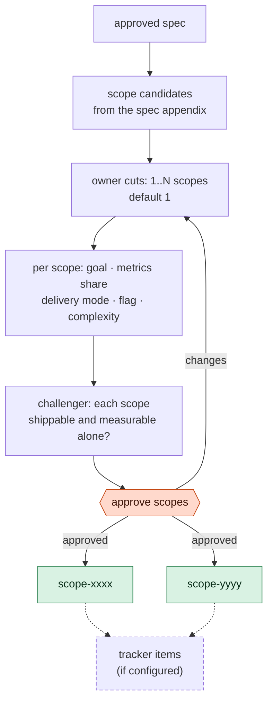

# cut-scopes — one scope per thing you will ship

> **TL;DR** — Splits an approved spec into **scopes**: pieces you can release and measure independently. Often there is just one. Each scope gets a goal, the metrics it is responsible for, a delivery mode, a flag name and a simple/complex call, and can show up in your tracker too. Ends at the second **approve** decision point.

> [!NOTE]
> **Status: 📐 design.** Tracked in [P2-04](../../../roadmap/phase-2-define.md#p2-04--cut-scopes).

---

## At a glance

| | |
|---|---|
| **Block** | Define |
| **Invoke** | `/throughline:cut-scopes` · `$tl-cut-scopes` · `/tl-cut-scopes` |
| **Decision point** | **approve** the scopes |
| **Reads** | An approved spec on an initiative (`init-xxxx`) · or a spec document / issue URL |
| **Writes** | One scope per deliverable (`scope-xxxx`) under the initiative · optionally an epic-like tracker item per scope |
| **Slots** | `flags.naming` (your flag naming convention) |
| **Capabilities** | `tracker.create-item` · `tracker.link-items` (both optional) |
| **Agents** | `challenger` (scope mode — is each cut independently shippable?) |

## When to use it — and when not

**Use it when** the spec is approved and you want to agree on the pieces that will be built, released and measured one by one. Most of the time there is just **one** — then this step simply confirms it and attaches a flag and a complexity call.

**Skip it when** it's a small fix: [`build-slice`](../build/build-slice.md) works straight from a sentence. It is also not a planning tool — *when* each piece gets built is decided by people, elsewhere.

## How it works



Every scope carries:

| Field | Meaning |
|---|---|
| **Goal** | The user-visible outcome this scope delivers, in one sentence |
| **Metrics** | Its share of the spec's measurement plan — every metric belongs to at least one scope |
| **Delivery mode** | `feature` (into an existing product, behind a flag) or `proof-of-concept` (greenfield, no PR flow) |
| **Flag** | Named using your `flags.naming` convention; [`ramp-exposure`](../rollout/ramp-exposure.md) uses this exact name later |
| **Complexity** | `simple` or `complex` — guides how finely [`slice-work`](../build/slice-work.md) splits it; the checks are identical either way |

1. **No scope waits for another unless you say so.** Each one can go live the moment its own code is merged. If one really must come after another, write it down with `--after scope-xxxx`.
2. **The harness suggests, the owner chooses.** Suggestions come from the spec's candidate list; the final split is made by the owner when approving.
3. **Planning the calendar is yours.** Sprints, cycles, quarters — the harness doesn't model any of them and doesn't try to.
4. **You can add a scope whenever you like.** It just becomes one more child under the initiative; nothing else moves.

## Standalone use

On its own it takes a spec document or issue URL, opens the initiative behind it and asks only what it can't find — typically who owns it. On an existing initiative you can target a single scope to add or adjust (`--scope scope-xxxx`).

## Run it

```text
> /throughline:cut-scopes init-41c2

Scopes — "Users struggle to find their past orders"
Candidates  search · filters · export

Proposed cut (2)
  scope-a9e0  Find an order       search + filters   feature   flag orders_search_v1   complex
              metrics: time_to_find_order, orders_page_exit
  scope-b113  Export orders       export             feature   flag orders_export_v1   simple
              metrics: — (no metric) → asked you
Tracker     Linear (remembered for this repo)

▸ challenger: scope-b113 has no metric — add one or record why

Decision: approve these scopes?   [approve] [change the cut]

Produced
  Scopes             scope-a9e0 · scope-b113     tl status init-41c2
  Tracker items      2 (Linear)                  (links)
Next                 /throughline:slice-work scope-a9e0
```

| CLI | Invoke |
|---|---|
| Claude Code | `/throughline:cut-scopes …` |
| Codex CLI | `$tl-cut-scopes …` |
| OpenCode · Copilot CLI · tier B | `/tl-cut-scopes …` |

## Before & after

- **Fed by:** [`write-spec`](./write-spec.md) — the approved spec, its scope candidates and its metrics.
- **Feeds:** [`slice-work`](../build/slice-work.md) (one scope at a time), [`ramp-exposure`](../rollout/ramp-exposure.md) (the flag), [`measure-impact`](../learn/measure-impact.md) (each scope's metrics).

## Gotchas & FAQ

**"Is one scope enough?"** Usually, yes. Split only when parts can genuinely go live separately.

**"How is a scope different from the initiative?"** The initiative holds the *why* — problem, spec, owner. A scope is a *what* you release. With a single scope the two overlap almost completely, and that is expected.

**"Does every scope need a flag?"** It needs one or a written reason for not having one — an internal tool, a throwaway prototype.

**"Does approving the scopes mean we'll build them now?"** No. Approval agrees on the split; when each piece gets built is a team conversation, not a harness setting.

---

<!-- docnav -->
[◀ write-spec](write-spec.md)  ·  [📖 Docs index](../../README.md)  ·  [🧭 Concepts](../../concepts.md)  ·  [slice-work ▶](../build/slice-work.md)
