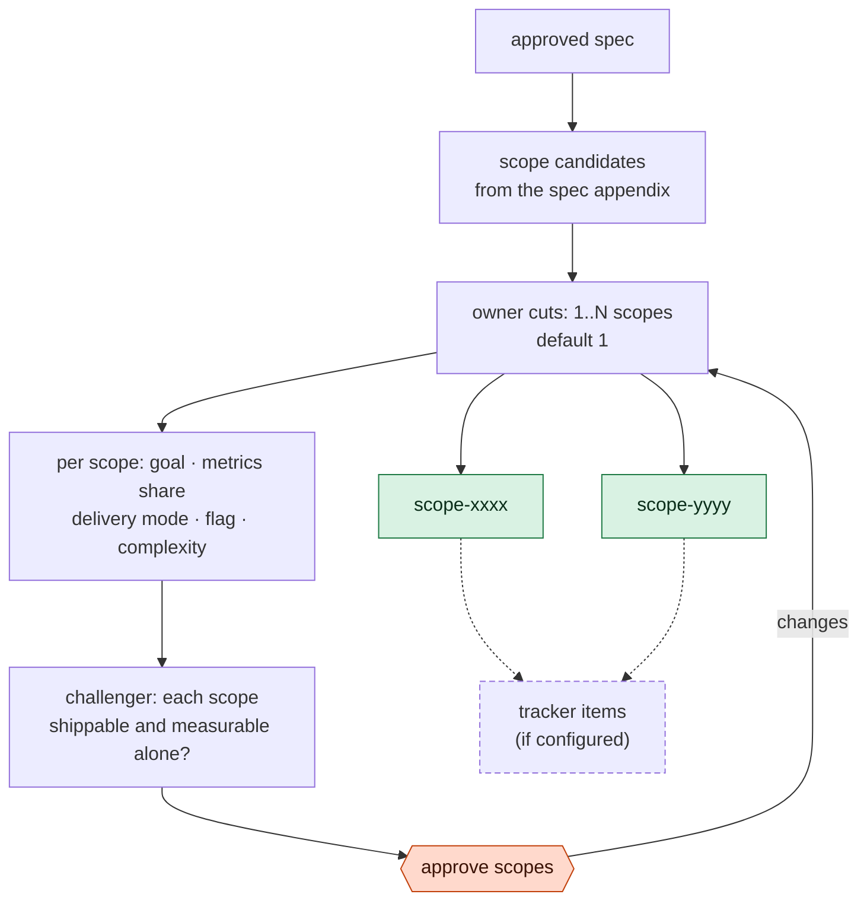

# cut-scopes — one scope per thing you will ship

> **TL;DR** — Splits an approved spec into **scopes**: pieces you can release and measure independently. Often there is just one. Each scope gets a goal, the metrics it is responsible for, a delivery mode, a flag name and a simple/complex call, and can show up in your tracker too. Ends at the second **approve** decision point.

Remote trackers are experimental.

Completed artifacts can join the initiative's explicit shared outbox, including a research brief adopted into that initiative. The conductor publishes through the selected host and records links only after verifying the complete exact chunk. The CLI persists requests and labelled read imports; authenticated tool execution remains a client responsibility. See [shared publication](../utilities.md#adopt-a-url-and-publish-define-artifacts).

The separate [delegated-decision controller](../../tutorials/delivery-decisions.md) records explicitly authorized exact-revision machine judgments with independent challenge. It never writes this step's legacy human approval fields. The commands on this page retain their supervised contract; complete native unattended orchestration remains under implementation.

---

## At a glance

| | |
| --- | --- |
| **Block** | Define |
| **Invoke** | `/wholeloop:cut-scopes` · `$wl-cut-scopes` · `/wl-cut-scopes` |
| **Decision point** | **approve** the scopes |
| **Reads** | An approved spec on an initiative (`init-xxxx`) · or a standalone deliverable with an explicit metric catalog |
| **Writes** | One scope per deliverable (`scope-xxxx`) under the initiative · optionally an epic-like tracker item per scope |
| **Slots** | `flags.naming` (your flag naming convention) |
| **Capabilities** | `tracker.create-item` · `tracker.link-items` (both optional) |
| **Agents** | `challenger` (scope mode — is each cut independently shippable?) |

## When to use it — and when not

**Use it when** the spec is approved and you want to agree on the pieces that will be built, released and measured one by one. Most of the time there is just **one** — then this step simply confirms it and attaches a flag and a complexity call.

**Skip it when** it's a small fix: [`build-slice`](../build/build-slice.md) works straight from a sentence. It is also not a planning tool — *when* each piece gets built is decided by people, elsewhere.

## How it works



Every scope carries:

| Field | Meaning |
| --- | --- |
| **Goal** | The user-visible outcome this scope delivers, in one sentence |
| **Metrics** | Its share of the spec's measurement plan — every metric belongs to at least one scope |
| **Delivery mode** | `feature` (into an existing product, behind a flag) or `proof-of-concept` (greenfield, no PR flow) |
| **Flag** | Named using your `flags.naming` convention; [`ramp-exposure`](../rollout/ramp-exposure.md) uses this exact name later |
| **Complexity** | `simple` or `complex` — guides how finely [`slice-work`](../build/slice-work.md) splits it; the checks are identical either way |

1. **No scope waits for another unless you say so.** Each one can go live the moment its own code is merged. If one really must come after another, put its stable plan key or existing scope ID in `after`. Cycles and cross-initiative references fail before any child updates.
2. **The harness suggests, the owner chooses.** The default suggestion owns all spec stories and metrics; the final split is made by the owner when approving.
3. **Planning the calendar is yours.** Sprints, cycles, quarters — the harness doesn't model any of them and doesn't try to.
4. **You can add a scope whenever you like.** It just becomes one more child under the initiative; nothing else moves.

## Standalone use

Begin with `wl step begin cut-scopes --input "Find past orders" --owner "Alex"
--json`. It creates an initiative for the child scopes without fabricating earlier steps. Supply `metricIds` or a reasoned `measurementException` in the plan. A shared document is adopted first with `wl adopt <URL>`. Revisions target the initiative and reuse each scope's stable `key`; omitted scopes remain until explicitly closed.

`wl scopes plan --for <initiative> --json` returns the pinned spec reference, metric/story catalog, one suggested scope and batched delivery questions. Fill `wholeloop/scope-plan@1` YAML front matter using `wl scopes schema --json`, followed by Scope overview, Metric ownership, Delivery plan, Complexity and Open questions. A scope without metrics needs `measurementReason`; every scope needs a flag or `withoutFlagReason`, plus argued complexity. Read the returned `flags.naming` binding before drafting names.

Complete with `wl step complete cut-scopes --for <initiative> --artifact <file>
--json`. Local tracker references point to the created scope records. The exact plan, resolved dependencies and tracker status stay in the journal. Remote publication is a pending handoff, never a claimed external write. Child scopes exist as reviewable drafts before approval, and inherit the initiative's pending decisions. After `wl answer decision.approve-scopes=approved --for <initiative>
--by <person> --json`, `next` chooses the sole open scope or asks which to use. [ADR-0024](../../decisions/0024-atomic-scope-plans-and-parent-approval.md) explains stable keys, atomic publication and the parent approval boundary.

## Run it

```text
> /wholeloop:cut-scopes init-41c2

Scopes — "Users struggle to find their past orders"
Candidates  search · filters · export

Proposed cut (2)
  scope-a9e0  Find an order       search + filters   feature   flag orders_search_v1   complex
              metrics: time_to_find_order, orders_page_exit
  scope-b113  Export orders       export             feature   flag orders_export_v1   simple
              metrics: — (no metric) → asked you
Tracker     Linear (remembered for this repo)

▸ challenger: scope-b113 has no metric — add one or record why

Decision: approve these scopes?   [approve] [change the cut]

Produced
  Scopes             scope-a9e0 · scope-b113     wl status init-41c2
  Tracker items      2 (Linear)                  (links)
Next                 /wholeloop:slice-work scope-a9e0
```

| CLI | Invoke |
| --- | --- |
| Claude Code | `/wholeloop:cut-scopes …` |
| Codex CLI | `$wl-cut-scopes …` |
| OpenCode · Copilot CLI · tier B | `/wl-cut-scopes …` |

## Before & after

- **Fed by:** [`write-spec`](./write-spec.md) — the approved spec, its scope candidates and its metrics.
- **Feeds:** [`slice-work`](../build/slice-work.md) (one scope at a time), [`ramp-exposure`](../rollout/ramp-exposure.md) (the flag), [`measure-impact`](../learn/measure-impact.md) (each scope's metrics).

## Gotchas & FAQ

**"Is one scope enough?"** Usually, yes. Split only when parts can genuinely go live separately.

**"How is a scope different from the initiative?"** The initiative holds the *why* — problem, spec, owner. A scope is a *what* you release. With a single scope the two overlap almost completely, and that is expected.

**"Does every scope need a flag?"** It needs one or a written reason for not having one — an internal tool, a throwaway prototype.

**"Does approving the scopes mean we'll build them now?"** No. Approval agrees on the split; when each piece gets built is a team conversation, not a harness setting.

---

<!-- docnav -->
[◀ write-spec](write-spec.md)  ·  [📖 Docs index](../../README.md)  ·  [🧭 Concepts](../../concepts.md)  ·  [slice-work ▶](../build/slice-work.md)
