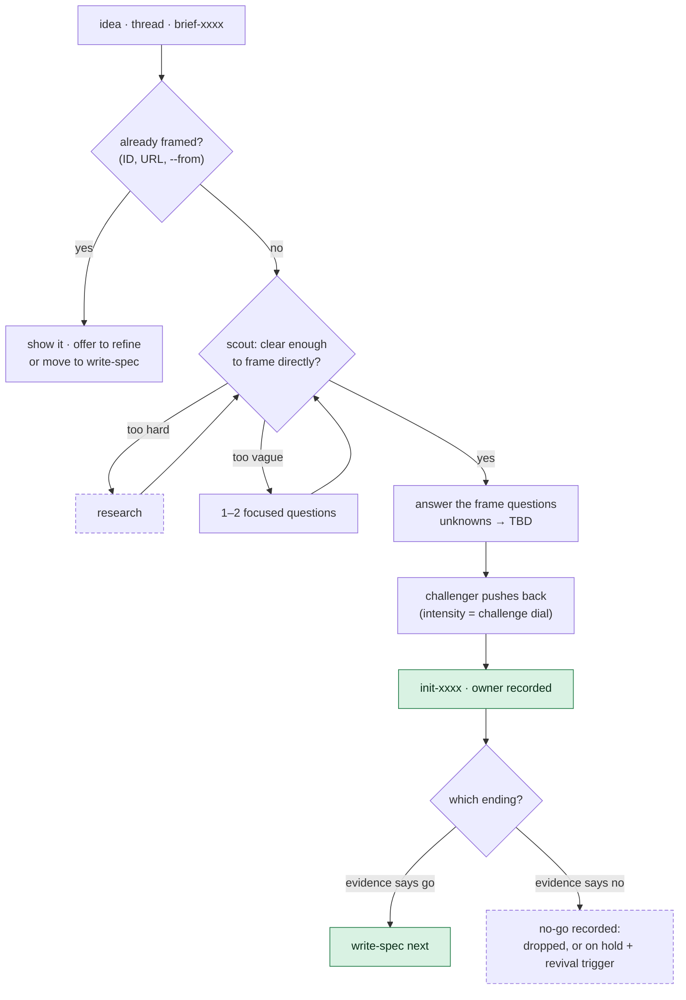
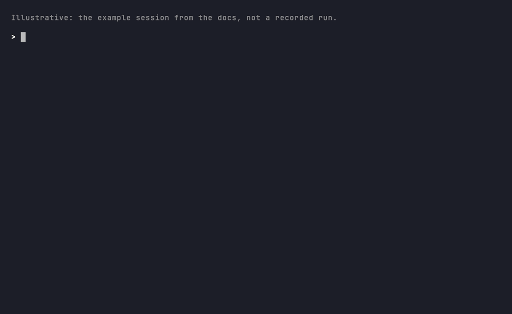
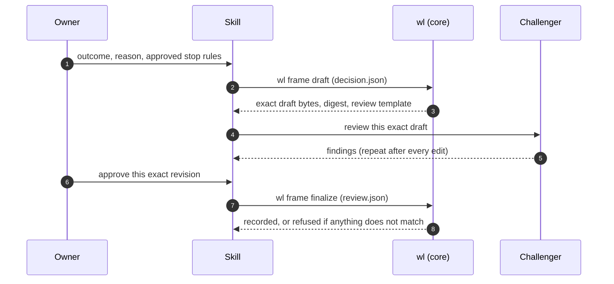

# frame-problem — a problem worth solving, with an owner, or an argued no-go

> **TL;DR** — Give it a rough idea: one sentence, a copied thread or a research brief. It works through a short, fixed list of questions: what hurts and for whom, what supports that, what would change if you got it right and what would make you walk away. It opens the **initiative**, records who owns it, and ends with a clear call: write the specification next, or record why not.

This standalone framing scenario passed live on all seven clients. Publishing the framing to a remote service is experimental.

## At a glance

| | |
| --- | --- |
| **Block** | Define — the front door of the flow |
| **Invoke** | `/wholeloop:frame-problem` · `$wl-frame-problem` · `/wl-frame-problem` |
| **Decision point** | Your outcome (go, on hold or dropped) and your approval of the exact final reviewed draft. Approving the specification later is a separate decision |
| **Reads** | An idea (text, file or URL) · optionally `--from brief-xxxx` · optionally an existing `init-xxxx` to refine |
| **Writes** | The initiative (`init-xxxx`) with its framing and owner · optionally a framing document (`docs`) and an idea item (`tracker`) |
| **Slots** | `frame.template`: your team's own discovery template, if any |
| **Capabilities** | `docs.create` · `tracker.create-item` (both optional) · any `source.*` through [`research`](./research.md) |
| **Agents** | `challenger` (pushes back on the framing) · `researcher` (through `research`, when needed) |

## When to use it — and when not

**Use it when** something new is on the table: a feature, an improvement, a hunch. Use it also to park an idea properly, so whoever opens it next week has everything in one place. Stopping right after this step is perfectly normal.

**Skip it when** you already have a clear problem statement: [`write-spec`](./write-spec.md) accepts one directly. And keep solutions out of it; this step is about the problem only.

## How it works



The framing answers exactly these questions, no more and no fewer:

| Question | What a good answer looks like |
| --- | --- |
| **Problem** | What hurts, as observed, in one or two sentences |
| **Who it is for** | A specific segment, not "users" |
| **Evidence + hypothesis** | Data, tickets, interviews or prior art, and why you think this would help |
| **Expected impact** | An observable change, ideally measurable; it seeds the measurement plan |
| **Who validated it** | The person or forum that agrees this is real |
| **Cost / priority** | A rough effort and value call; RICE if your team uses it |
| **What would make us stop** | The signal that would change course |
| **Rough scope hint** | One line on what is likely in and out; not a specification |

Five rules shape the result:

1. **"Don't know yet" is a valid answer; a made-up one is not.** Write `TBD: <what is missing>; who: <who could answer>`. A few of those usually means [`research`](./research.md) is the next stop.
2. **You set how hard it pushes.** With `challenge: supportive` it points out gaps; with `adversarial` it argues the other side on purpose. The list of questions stays the same either way ([profile](../../configuration/profile.md)).
3. **Every initiative has an owner**: a real person, stored on the initiative. Later decision points go to them unless you say otherwise.
4. **Destinations are explicit.** Local providers keep the framing and the initiative on your machine. Publishing to a shared service needs a destination you selected and a confirmed write; no receipt is invented for a service that could not be reached.
5. **Saying no is a finished outcome.** A dropped or on-hold decision closes the initiative and keeps the reason, and for on hold, the condition for reopening. Read that reasoning instead of opening a duplicate to get around it.

## Standalone use

On its own it needs nothing but the idea: it creates the initiative and stops there.

- With `--from brief-xxxx`, it starts from the brief's claims and carries its open questions over as `TBD`s.
- With an existing `init-xxxx` or a document URL, it picks that up and works on it instead of opening a second copy.

[Cost previews](../README.md#cost-before-workers-start) show current worker calls, requested tiers and declared input size before each batch starts. The illustrative example below is abridged and omits these previews; token usage, time and price are not measured by the plan.

## Run it



*Illustrative: the example session below, animated. Its wording depends on your client and model.*

The same session as text:

```text
> /wholeloop:frame-problem --from brief-7f3a

Frame — "Users struggle to find their past orders"
Mode      new initiative · evidence from brief-7f3a
Who owns this initiative?   > Ana López

Problem            Users with >20 orders abandon the orders page before finding one
Who it is for      Repeat buyers on web
Evidence           brief-7f3a: 2 claims (high), 1 (medium)
Expected impact    Time-to-find ↓ · orders-page exits ↓
Who validated it   TBD: ticket volume · support lead
Stop if            fewer than 5% of active users have >20 orders

▸ challenger: "is this a search problem or a pagination problem?" → added as open question

Produced
  Initiative        init-41c2   wl open init-41c2
Kept                on this machine · wl share mode --for init-41c2 to publish it
Open questions      2
Next                /wholeloop:write-spec init-41c2
```

| Client | Invoke |
| --- | --- |
| Claude Code, installed skills | `/wl-frame-problem …` |
| Claude Code, generated plugin | `/wholeloop:frame-problem …` |
| Codex CLI | `$wl-frame-problem …` |
| OpenCode · Copilot · Gemini · Cursor | Ask for `wl-frame-problem` |
| Antigravity | Ask for `wl-agy-frame-problem` |

For a guided first run, follow [your first framing](../../tutorials/first-framing.md).

## Before & after

- **Fed by:** a raw idea, a [`research`](./research.md) brief, or what a previous initiative learned through [`decide-next`](../learn/decide-next.md).
- **Feeds:** [`write-spec`](./write-spec.md): the framing, the expected impact (which becomes the measurement plan) and every `TBD`.

## Gotchas & FAQ

**"Why does framing ask for approval before the spec?"** You own the outcome and the exact stop and reopen conditions. The final draft must reflect your decision, be reviewed and get your approval before it is finalized. Approving the specification later is a separate decision and does not replace this one.

**"I have no numbers and nobody has confirmed it yet."** Use `TBD` and name who could fill it in. An honest gap beats a confident guess every time.

**"Will I end up with two initiatives for the same idea?"** Not when the match is clear. An explicit ID, a completed brief, an adopted URL or the same title in the same repository reuses the existing initiative; the title match ignores case and spacing. When several items match, you are asked for the ID. Detecting that two differently worded ideas mean the same thing is not done yet.

**"Can I already sketch the solution here?"** Save it for [`write-spec`](./write-spec.md); this step is only about the problem.

**"Can a machine take the framing decision for me?"** Not in this step. [Autonomous delivery](../../tutorials/delivery-decisions.md) can apply a decision you delegated in advance, under a pinned rubric and with an independent challenge, but it records its judgements separately and never fills in this step's human approval.

## Final decision and review

This section is the **core protocol** behind the skill, for scripts and skill authors. In a conversation, the skill does all of this for you; follow [your first framing](../../tutorials/first-framing.md) instead. Keep every metadata file and draft outside the repository. `wl frame schema --json` prints both input contracts.



**1. Capture the decision** as `wholeloop/frame-decision@1`. Include only the stop rules the owner approved:

```json
{
  "schema": "wholeloop/frame-decision@1",
  "by": "Alex",
  "outcome": "on-hold",
  "reason": "No observed problem yet",
  "reopen": "User evidence confirms difficulty finding tasks",
  "stopConditions": []
}
```

**2. Render the draft** with `wl frame draft --for <id> --artifact <draft.md> --file <decision.json> --json`.

- The core replaces the *Stop conditions* section with the approved data, and returns the exact bytes (`artifact.content`), their hash and a `reviewTemplate`.
- Save `artifact.content` exactly to the external draft file. This command records nothing.

**3. Review it.** Give the exact draft to the challenger (`challenge plan problem`). Resolve the findings, or keep the evidence gaps explicitly documented. Every content edit needs a new review; a structural pass is not enough.

**4. Complete the review template** with the actual reviewer, the matching final digest, the coverage (problem, evidence, impact, decision fidelity) and no unresolved findings. Get the owner's approval of that same revision. Names and approvals are reported by the client: the core cannot authenticate a person or prove that a claim is true.

**5. Finalize** with `wl frame finalize --for <id> --artifact <draft.md> --file <review.json> --json`. It records the review, the artifact and the decision together. It refuses:

- a stale digest;
- a different owner or run;
- a stop rule the owner did not approve;
- an incomplete review.

A no-go keeps its exact reopening condition and stops.

To save the draft and the review template without changing a byte, redirect `frame draft`'s JSON to an external plan file and extract its strings. Set `FRAME_PLAN_FILE`, `FRAME_DRAFT_FILE` and `FRAME_REVIEW_FILE` to paths outside the repository first:

```bash
node --input-type=module - "$FRAME_PLAN_FILE" "$FRAME_DRAFT_FILE" "$FRAME_REVIEW_FILE" <<'JS'
import { readFileSync, writeFileSync } from 'node:fs'
const [planFile, draftFile, reviewFile] = process.argv.slice(2)
const plan = JSON.parse(readFileSync(planFile, 'utf8'))
writeFileSync(draftFile, plan.artifact.content, { flag: 'wx' })
writeFileSync(reviewFile, JSON.stringify(plan.reviewTemplate, null, 2) + '\n', { flag: 'wx' })
JS
```

- The script refuses to overwrite existing files, so use new paths.
- The review file starts incomplete and is not an approval. Fill it in only from what the owner and the challenger actually said.
- Extracting line by line can add a final newline to the draft; the digest covers every byte, including that newline.

The older `step complete` path is kept for existing callers and historical data. It makes no claim of a final review, so do not use it for new framing, and do not replace an old artifact to make a past test look successful: repeat it with a new run.

## Available core commands

```text
wl step begin frame-problem --input "Find old orders" --owner Alex --json
wl step begin frame-problem --from brief-0123abcd --json
wl frame schema --json
wl frame draft --for init-0123abcd --artifact /path/to/frame.md --file /path/to/decision.json --json
wl frame finalize --for init-0123abcd --artifact /path/to/frame.md --file /path/to/review.json --json
```

Substitute your own IDs and external file paths.

- **Template.** The returned `template` lists the exact required headings. Each unknown must name the missing evidence and who can answer it, for example `TBD: order-search baseline; who: product analyst`. This is a structural check; it does not prove a claim is true.
- **Identity.** A title is reused within the same repository, ignoring case and spacing; across repositories, continue by ID. Several matches require an ID.
- **Reopening.** A closed outcome is reopened explicitly with `wl state update --status open`; running the idea again does not erase a no-go.
- **Briefs.** Adopting a completed brief records its path and includes it in the resume context.
- **Publication.** Local publication creates no duplicate documents or tracker items. Remote receipts say `pending` and leave a hand-off note; they never claim a write that was not confirmed.

<!-- docnav -->
[◀ research](research.md)  ·  [📖 Docs index](../../README.md)  ·  [🧭 Concepts](../../concepts.md)  ·  [write-spec ▶](write-spec.md)
