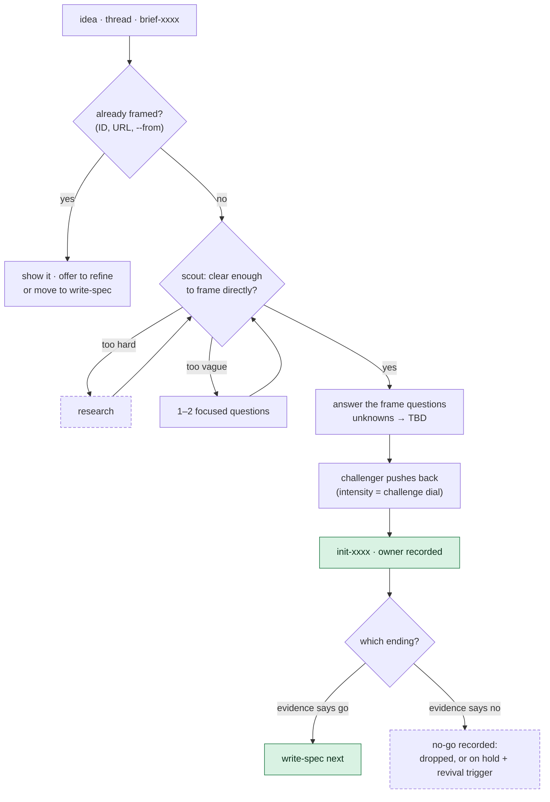

# frame-problem — a problem worth solving, with an owner, or an argued no-go

> **TL;DR** — Give it a rough idea — one sentence, a copied thread, a research brief — and it works through a short, fixed list of questions: what hurts and for whom, what supports that, what would change if we got it right, and what would make us walk away. It opens the **initiative**, names the person who owns it, and finishes with a clear call: write the spec next, or record why not.

> [!NOTE]
> **Status: 🚧 partial.** The core enforces all eight framing questions plus ownership, explicit TBD markers, completed-brief adoption, normalized-title reuse and argued dropped/on-hold outcomes. Local docs/tracker publication references the existing store records; remote destinations return pending handoffs. Canonical skill escalation to research follows the challenge style. Canonical URL adoption, per-initiative shared outboxes and explicit host publication/reconciliation are implemented locally. An [owner-observed Claude run](../../../roadmap/manual-verification.md#owner-observed-claude-framing-and-session-recovery-2026-10-22) completed an on-hold outcome and recovered status across sessions, and exposed narrative decision-fidelity and final-review gaps now addressed by exact owner-decision rendering and digest-bound finalization under [ADR-0086](../../decisions/0086-exact-final-framing-review-and-owner-decisions.md). New native acceptance remains pending. Authenticated remote publication and broader client conformance remain unverified. [P2-02](../../../roadmap/phase-2-define.md#p2-02--frame-problem-complete).

---

## Final decision and review

Canonical framing uses the new commands after step begin. Run `wl frame schema
--json` for both input contracts. Save metadata and drafts outside the repository.

1. Capture the owner's explicit outcome/reason, exact reopening condition for
   on-hold, and only approved stop rules in wholeloop/frame-decision@1:

   ```json
   {
     "schema": "wholeloop/frame-decision@1",
     "by": "Alex",
     "outcome": "on-hold",
     "reason": "No observed problem yet",
     "reopen": "User evidence confirms difficulty finding tasks",
     "stopConditions": []
   }
   ```

2. Call `wl frame draft --for <id> --artifact <draft.md> --file <decision.json>
   --json`. Save its exact artifact.content bytes to the external draft file.
   The core replaces Stop conditions with the approved data and returns its hash
   and a reviewTemplate. This command does not complete or change the journal.
3. Use challenge plan problem on those bytes and give the exact draft to the
   challenger. Resolve findings or keep evidence gaps explicitly documented.
   Repeat review after every content edit. A structural pass is insufficient.
4. Complete reviewTemplate with the actual reviewer, matching final digest,
   coverage problem/evidence/impact/decision-fidelity and no unresolved findings.
   Obtain the owner's approval of that same final revision. Names/approval are
   client-reported; the core cannot authenticate a person or prove semantic truth.
5. Call `wl frame finalize --for <id> --artifact <draft.md> --file <review.json>
   --json`. It atomically records the review note, artifact and exact decision.
   A stale digest, mismatched owner/run, extra stop rule or incomplete review
   refuses completion. No-go retains its exact reopening condition and stops.

To save the draft and review template without changing the digest, redirect frame
draft's JSON into an external plan file, then extract its strings exactly. For
example, after setting FRAME_PLAN_FILE, FRAME_DRAFT_FILE and FRAME_REVIEW_FILE to
external paths (not repository paths):

```bash
node --input-type=module - "$FRAME_PLAN_FILE" "$FRAME_DRAFT_FILE" "$FRAME_REVIEW_FILE" <<'JS'
import { readFileSync, writeFileSync } from 'node:fs'
const [planFile, draftFile, reviewFile] = process.argv.slice(2)
const plan = JSON.parse(readFileSync(planFile, 'utf8'))
writeFileSync(draftFile, plan.artifact.content, { flag: 'wx' })
writeFileSync(reviewFile, JSON.stringify(plan.reviewTemplate, null, 2) + '\n', { flag: 'wx' })
JS
```

Use new output paths: the example refuses overwriting existing files. The review
file starts incomplete and is not an approval. Complete it only from the actual
owner/challenger observations. Line-oriented extraction can append a newline to
artifact.content; the digest covers every byte, including that newline.

Legacy step complete is retained for existing callers and historical data; it
makes no final semantic-review claim. Do not replace the old observed artifact to
make its historical test appear successful. Repeat acceptance with a new run.

## Available core commands

```text
wl step begin frame-problem --input "Find old orders" --owner Alex --json
wl step begin frame-problem --from brief-0123abcd --json
wl step complete frame-problem --for init-0123abcd --artifact /path/to/frame.md --json
wl step complete frame-problem --for init-0123abcd --artifact /path/to/frame.md --no-go on-hold --reason "Need evidence" --reopen "Ten affected customers confirmed" --json
```

The returned `template` lists the exact required headings. Each unknown must name
both missing evidence and its answerer, for example `TBD: order-search baseline;
who: product analyst`. This is a structural check, not proof that a factual claim
is true; the skill and research evidence review establish that distinction.

Title reuse normalizes case and whitespace within the same canonical repository path; cross-repository continuation uses an explicit ID. It does not claim semantic duplicate
detection. Several matches require an explicit ID. A closed outcome must be
inspected and explicitly reopened with `state update --status open`; rerunning
an idea does not erase its no-go. Completed-brief adoption records the source
artifact path and includes it in bounded resume context.

Local publication creates no duplicate docs or tracker items. Remote receipts say
`pending` and add a durable handoff note; they do not claim an external write.
The broader scenarios below still depend on live clients and provider work.

## At a glance

| | |
| --- | --- |
| **Block** | Define — the front door of the flow |
| **Invoke** | `/wholeloop:frame-problem` · `$wl-frame-problem` · `/wl-frame-problem` |
| **Decision point** | None — the first one is *approve* at [`write-spec`](./write-spec.md) |
| **Reads** | An idea (text, file, URL) · optionally `--from brief-xxxx` · optionally an existing `init-xxxx` to refine |
| **Writes** | The initiative (`init-xxxx`) with its framing and owner · optionally a framing document (`docs`) and an idea item (`tracker`) |
| **Slots** | `frame.template` (a team's own discovery template, if any) |
| **Capabilities** | `docs.create` · `tracker.create-item` (both optional) · any `source.*` through [`research`](./research.md) |
| **Agents** | `challenger` (pushes back on the framing) · `researcher` (via `research`, when needed) |

## When to use it — and when not

**Use it when** something new is on the table — a feature, an improvement, a hunch — or when you just want to park an idea properly so whoever opens it next week has everything in one place. Stopping right after this step is perfectly normal.

**Skip it when** you already have a clear problem statement: [`write-spec`](./write-spec.md) accepts one directly. And keep solutions out of it — this step is about the problem only.

## How it works



The framing answers exactly these questions — no more, no fewer:

| Question | What a good answer looks like |
| --- | --- |
| **Problem** | What hurts, observed, in one or two sentences |
| **Who it is for** | A specific segment, not "users" |
| **Evidence + hypothesis** | Data, tickets, interviews, prior art — and why we think this would help |
| **Expected impact** | An observable change, ideally measurable; it seeds the measurement plan |
| **Who validated it** | The person or forum that agrees this is real |
| **Cost / priority** | A rough effort and value call; RICE if your team uses it |
| **What would make us stop** | The signal that would change course |
| **Rough scope hint** | One line on what is likely in and out — not a spec |

1. **"Don't know yet" is a valid answer; a made-up one isn't.** Write `TBD: <what is missing>; who: <who could answer>`. A few of those usually means [`research`](./research.md) is the next stop.
2. **You set how hard it pushes.** With `challenge: supportive` it points out gaps; with `adversarial` it argues the other side on purpose. Either way the list of questions stays the same ([profile](../../configuration/profile.md)).
3. **Every initiative has an owner** — a real person, stored on the initiative. Later decision points go to them unless you say otherwise.
4. **It publishes only where you told it to.** A configured `docs` provider gets a framing document; a `tracker` gets an idea item. With neither, it all stays in the store until a later `sync`.
5. **Saying no is a finished outcome.** `--no-go` closes the initiative with the reasoning attached — dropped for good, or on hold with the signal that would reopen it — so the next person to have the same idea starts from that reasoning instead of from zero.

## Standalone use

On its own it needs nothing but the idea: it creates the initiative and stops there. With `--from brief-xxxx` it starts from the brief's claims and carries its open questions over as `TBD`s. Point it at an existing `init-xxxx` or a document URL and it picks that up and works on it, rather than opening a second copy.

## Run it

```text
> /wholeloop:frame-problem --from brief-7f3a

Frame — "Users struggle to find their past orders"
Mode      new initiative · evidence from brief-7f3a
Profile   pair (standard · balanced challenge)
Publish   docs → not configured ↓

Where should the framing live?
  (•) Only in the store for now   ( ) Notion  ✓ detected   ( ) Confluence  ✗ not connected
Who owns this initiative?   > Ana López

Problem            Users with >20 orders abandon the orders page before finding one
Who it is for      Repeat buyers on web
Evidence           brief-7f3a: 2 claims (high), 1 (medium)
Expected impact    Time-to-find ↓ · orders-page exits ↓
Who validated it   TBD: ticket volume · support lead
Stop if            fewer than 5% of active users have >20 orders

▸ challenger: "is this a search problem or a pagination problem?" → added as open question

Produced
  Initiative        init-41c2   wl open init-41c2
Open questions      2
Next                /wholeloop:write-spec init-41c2
```

| CLI | Invoke |
| --- | --- |
| Claude Code | `/wholeloop:frame-problem …` |
| Codex CLI | `$wl-frame-problem …` |
| OpenCode · Copilot CLI · tier B | `/wl-frame-problem …` |

## Before & after

- **Fed by:** a raw idea, a [`research`](./research.md) brief, or the learnings of a previous initiative via [`decide-next`](../learn/decide-next.md).
- **Feeds:** [`write-spec`](./write-spec.md) — the framing, the expected impact (which becomes the measurement plan) and every `TBD`.

## Gotchas & FAQ

**"Nothing asked for my approval."** On purpose. Capturing an idea should cost a minute, not a meeting. Your first sign-off comes with the spec.

**"I have no numbers and nobody has confirmed it yet."** Use `TBD` and name who could fill it in. An honest gap beats a confident guess every time.

**"Will I end up with two initiatives for the same idea?"** A matching explicit ID, completed-brief relation or normalized title in the same recorded repository reuses the initiative. Ambiguous matches require an ID; canonical URL adoption also reuses stored links through next. Semantic duplicate detection remains planned. [ADR-0022](../../decisions/0022-framing-identity-and-explicit-outcomes.md) explains why.

**"Can I already sketch the solution here?"** Save it for [`write-spec`](./write-spec.md); this step is only about the problem.

---

<!-- docnav -->
[◀ research](research.md)  ·  [📖 Docs index](../../README.md)  ·  [🧭 Concepts](../../concepts.md)  ·  [write-spec ▶](write-spec.md)
