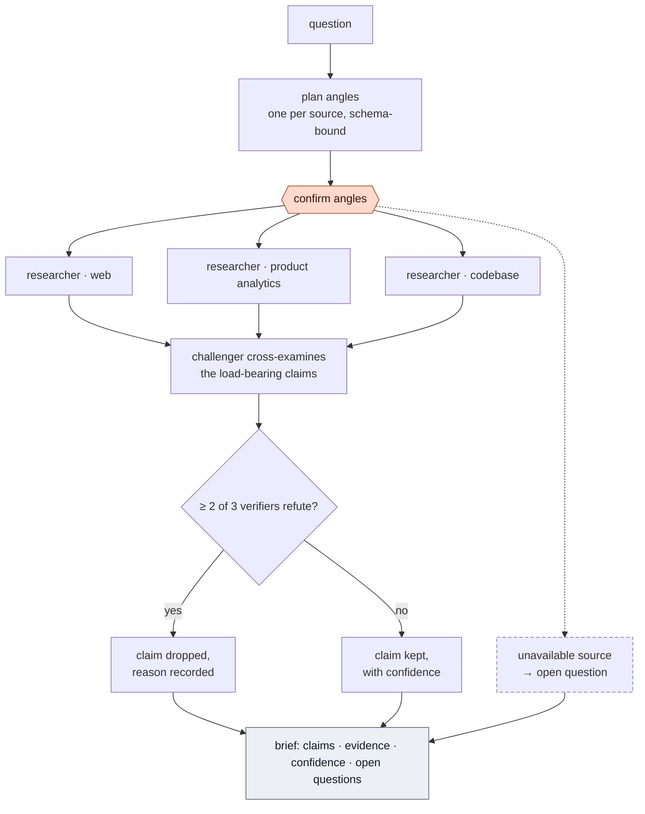

# research — an evidence-first brief on any hard question

> **TL;DR** — Splits a question into angles, investigates each one against a real source in parallel, lets a challenger try to refute the claims the conclusion rests on, and hands back a brief: claims with evidence and confidence, plus the open questions nothing could answer. Optional in the flow; useful on its own any day.

> [!NOTE]
> **Status: 📐 design.** Tracked in [P2-01](../../../roadmap/phase-2-define.md#p2-01--research).

---

## At a glance

| | |
|---|---|
| **Block** | Define — optional, only when it's hard |
| **Invoke** | `/wholeloop:research` · `$wl-research` · `/wl-research` |
| **Decision point** | None |
| **Reads** | A question (text, file or URL) · optionally an initiative or scope ID |
| **Writes** | A brief (`brief-xxxx`) in the store · optionally attached to an initiative · optionally published through the `docs` capability |
| **Slots** | `research.method` (a repo's own research skill, if any) |
| **Capabilities** | any `source.*` provider — web, code, product analytics, BI, support, errors, observability, knowledge… |
| **Agents** | `researcher` (one per angle) · `challenger` (cross-examination) |

## When to use it — and when not

**Use it when** the answer depends on several unknowns — usage data, technical feasibility, what comparable products do, what support is hearing — and a confident guess would be expensive.

**Skip it when** the problem and a plausible success signal are already clear. [`frame-problem`](./frame-problem.md) can start from a sentence and calls `research` itself when it judges the problem too hard to frame directly.

## How it works



1. **Sources are providers.** The angles on offer are exactly the `source.*` providers you have configured or that `wl` detects — add a provider and it shows up here, with no change to the step ([extending/providers](../../extending/providers.md)).
2. **Confirming angles is cheap and optional.** It is a lightweight check, not one of the six decision points: say "go", "drop 2" or "add competitors' mobile apps".
3. **Never fabricated.** A source that is not configured, not authenticated or returns nothing becomes an **open question** with what is missing and who might have it.
4. **Cross-examination is bounded.** Only the claims each angle's conclusion rests on are challenged; a claim falls only on **two active refutations**, so a silent verifier cannot delete a real finding.
5. **The brief has a fixed shape**, checked by `wl step complete` before it is recorded.

## Standalone use

Alone, `research` needs only a question. It creates a **loose brief** that you can later feed into [`frame-problem`](./frame-problem.md) (`--from brief-7f3a`) or simply keep. Inside an initiative, the brief attaches to it and its open questions become inputs to the next step.

## Run it

```text
> /wholeloop:research Do users struggle to find their past orders, and how do comparable products solve it?

Research — "Do users struggle to find their past orders?"
Mode      standalone · no initiative · brief stored outside the repo
Profile   pair (standard · balanced challenge)
Sources   not configured for this repo yet ↓

Which sources can I use?                                 (multi-select)
  [x] Web                    native
  [x] This codebase          native
  [ ] PostHog                ✓ MCP detected in your CLI config
  [ ] Mixpanel               ✗ not connected — I can show you how to add it
  [ ] Support tickets        ✗ no provider configured
Remember this for:  ( ) just this time  (•) this repo  ( ) always

Angles (3) — "go", "drop 2" or "add …"
 1  web       how comparable products expose order history, search and filters
 2  posthog   orders-page usage: searches, time to find, drop-off
 3  codebase  current orders list: filters, pagination, query limits
 —  support   not available → open question

▸ researcher:web started · researcher:posthog started · researcher:codebase started
✓ codebase 3 claims · ✓ posthog 2 claims · ✓ web 4 claims
▸ challenger cross-examining 4 load-bearing claims…
✗ dropped 1 claim — 2 of 3 verifiers refuted it (single-week sample)

Produced
  Research brief   brief-7f3a    wl open brief-7f3a
Open questions     2             support tickets unreachable · no baseline for "time to find"
Next (optional)    /wholeloop:frame-problem --from brief-7f3a
```

| CLI | Invoke | Parallel angles |
|---|---|---|
| Claude Code | `/wholeloop:research …` | native subagents |
| Codex CLI | `$wl-research …` | native subagents |
| OpenCode | `/wl-research …` | native subagents |
| Copilot CLI | `/wl-research …` | native subagents (`/fleet`) |
| Gemini CLI · Antigravity · Cursor | `/wl-research …` | native where supported, else headless or sequential ([orchestration](../../architecture/orchestration-and-gates.md)) |

## Before & after

- **Fed by:** anything — a question, a pasted thread, a file, an existing initiative or scope.
- **Feeds:** [`frame-problem`](./frame-problem.md) and [`write-spec`](./write-spec.md) (evidence, baselines, open questions); any later step that needs evidence.

## Gotchas & FAQ

**"It asked me which sources to use — every time?"** Only until you answer with *this repo* or *always*; then it is remembered at that scope.

**"A source I need is not in the list."** Write a provider manifest for it — usually a few lines pointing at an MCP server ([how](../../extending/providers.md)).

**"Why was a claim dropped that looked right to me?"** The receipt links each dropped claim with the verifiers' reasons. If they were wrong, that is a calibration case worth adding to the eval corpus.

---

<!-- docnav -->
[◀ The flow](../README.md)  ·  [📖 Docs index](../../README.md)  ·  [🧭 Concepts](../../concepts.md)  ·  [frame-problem ▶](frame-problem.md)
