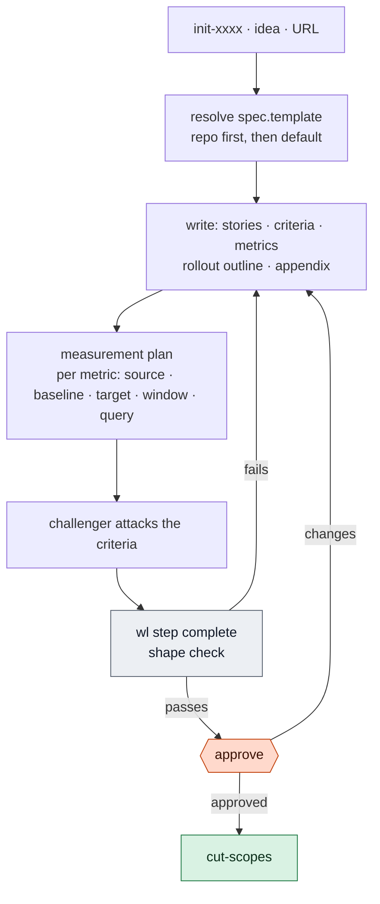
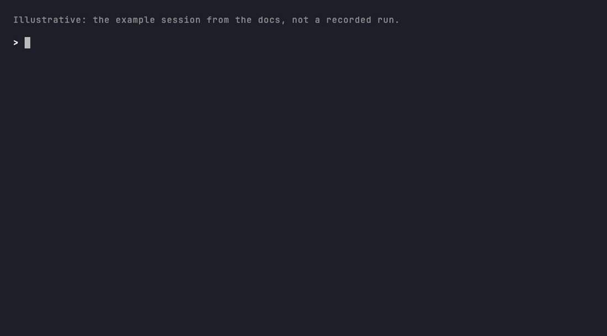

# write-spec — what we will build, how we will know it worked

> **TL;DR** — Turns a framed problem into a specification a builder can work from and a person can sign off: user stories with testable acceptance criteria, success metrics, a rough rollout outline and a **measurement plan you can actually run**. For every metric it records where the number comes from, where it is today, where it should go and over what window. A challenger stress-tests the criteria first. It ends at the **approve** decision point.

Publishing the specification to a remote service is experimental.

## At a glance

| | |
| --- | --- |
| **Block** | Define |
| **Invoke** | `/wholeloop:write-spec` · `$wl-write-spec` · `/wl-write-spec` |
| **Decision point** | **approve** — nothing downstream runs on an unapproved spec |
| **Reads** | An initiative (`init-xxxx`) · or a pasted idea, document or issue URL |
| **Writes** | The spec on the initiative · its measurement plan, queries included · scope candidates · optionally a document (`docs`) |
| **Slots** | `spec.template` (your team's spec format, if any) · `flags.naming` (for the proposed flag) |
| **Capabilities** | `docs.create` / `docs.update` · `source.*` to read baselines · `source.code` to see what else the change touches |
| **Agents** | `challenger` (criteria mode) · `researcher` (baselines, when missing) |

## When to use it — and when not

**Use it when** a framed problem has earned a commitment and the team needs one definition of done, including the numbers that will prove it, agreed before anyone writes code.

**Skip it when** the change is a small, well-understood fix: [`build-slice`](../build/build-slice.md) takes free text and agrees acceptance criteria with you directly.

## How it works



1. **Your format first.** If the repository or team has a spec skill or template, the `spec.template` slot binds to it and the harness adds only what it needs on top (criteria, measurement plan). Otherwise the built-in template applies ([repo skills](../../configuration/repo-skills.md)).
2. **Choose where each metric lives.** The step offers registered tools with access labels for your current client, asks which one holds each metric and reuses an explicit remembered choice. You can ask to remember a choice for this repository. Each metric names that provider (`posthog`, `metabase`, `sentry`…), today's value, the value we're aiming for, the time window and the stored query. [`measure-impact`](../learn/measure-impact.md) replays exactly that later. If the chosen tool needs tracking before it can answer, "add the tracking" becomes work for the first slice; an unknown baseline stays explicit.
3. **The challenger reads the criteria like a tester would.** Two criteria that contradict each other; a criterion you couldn't write a failing test for; a statement about today's behaviour that the code says is false; a criteria set that would pass even if the feature did something extra and unwanted.
4. **A machine checks the shape, not a reviewer's mood.** `wl step complete` rejects a spec with a story lacking criteria, a metric lacking a provider or window, or wording no test can verify ("fast", "intuitive", "better").
5. **Technical notes live in a separate appendix** so the main spec stays readable for everyone: what else touches the same data, a suggested flag name, and the candidate scopes [`cut-scopes`](./cut-scopes.md) will start from.

## Standalone use

On its own it takes a pasted idea, a document or an issue URL. With no initiative around, it opens one and asks just the three things it can't work without — the problem, the owner and the expected impact — rather than the full framing. Give it an existing spec and it edits that one instead of writing a new one.

## Run it



*Illustrative: the example session below, animated. Its wording depends on your client and model.*

The same session as text:

```text
> /wholeloop:write-spec init-41c2

Spec — "Users struggle to find their past orders"
Template  spec.template → product-spec (repo skill)
Publish   docs → Notion (remembered for this repo)

Stories   3 · criteria 9
Metrics   time_to_find_order   posthog   baseline 48s → target 20s   window 30d
          orders_page_exit     posthog   baseline 31% → target 20%  window 30d
Appendix  also touches: orders API, export job · flag: orders_search_v1

▸ challenger: criterion 2.3 ("results load fast") is untestable → rewritten as p95 < 400 ms
▸ challenger: 1.1 and 3.2 cannot both hold for archived orders → asked you
✓ shape check passed

Decision: approve this spec?   [approve] [request changes]

Produced
  Spec               init-41c2/spec     wl open init-41c2
  Document           Notion page        (link)
Next                 /wholeloop:cut-scopes init-41c2
```

| Client | Invoke |
| --- | --- |
| Claude Code, installed skills | `/wl-write-spec …` |
| Claude Code, generated plugin | `/wholeloop:write-spec …` |
| Codex CLI | `$wl-write-spec …` |
| OpenCode · Copilot · Gemini · Cursor | Ask for `wl-write-spec` |
| Antigravity | Ask for `wl-agy-write-spec` |

Optional numeric criterion assertions allow deterministic contradictory-pair checks: name the exact subject, context, unit, operator and value. The shared lint rejects conflicting bounds before completion. Free-text consistency still needs a challenger; `wl challenge plan spec --file <file> --json` supplies fixed coverage and tone without calling a model.

## Before & after

- **Fed by:** [`frame-problem`](./frame-problem.md) (problem, impact, `TBD`s) and [`research`](./research.md) (evidence, baselines).
- **Feeds:** [`cut-scopes`](./cut-scopes.md) (scope candidates, metrics to apportion), [`slice-work`](../build/slice-work.md) (stories and criteria), [`prepare-launch`](../rollout/prepare-launch.md) and [`measure-impact`](../learn/measure-impact.md) (the measurement plan).

## Gotchas & FAQ

**"Can I leave the metrics out?"** Not silently. Without them nobody can tell later whether it worked. If something truly cannot be measured, say why in the spec: that counts as an answer.

**"We already have our own spec format."** Then the `spec.template` slot picks it up, and the harness only layers its shape checks on top.

**"The challenger is too loud for me."** Turning `challenge` down makes it gentler in how it says things; it still runs the same criteria checks ([profile](../../configuration/profile.md)). A check that keeps being wrong should become a test case for it.

**"Do I have to publish the spec somewhere?"** No. The store is enough; a `docs` provider is optional. When you do publish, the specification joins the initiative's other Define artifacts ([shared publication](../utilities.md#adopt-a-url-and-publish-define-artifacts)), and links are recorded only after the write is confirmed.

**"Can a machine approve the spec for me?"** Not in this step. [Autonomous delivery](../../tutorials/delivery-decisions.md) can apply a decision you delegated in advance, under a pinned rubric and with an independent challenge, but it records its judgements separately and never fills in this step's human approval.

## Available core commands

The commands the skill uses, for scripts and skill authors:

```text
wl step begin write-spec --for init-0123abcd --json
wl step begin write-spec --input "Find old orders" --owner Alex --impact "Reduce retrieval time" --json
wl spec schema --json
wl spec check /path/to/spec.md --json
wl spec check /path/to/spec.md --client codex --json
wl answer metric:source.product-analytics=posthog --remember project --json
wl step complete write-spec --for init-0123abcd --artifact /path/to/spec.md --json
wl answer decision.approve-spec=approved --for init-0123abcd --by Alex --json
```

**The specification file** is Markdown with YAML front matter (`schema: wholeloop/spec@1`). The schema is `src/spec/schemas/spec-v1.json`, and `test/fixtures/spec/spec.md` is a complete fictional example. Its fictional `analytics` provider needs a registered extension; use a registered tool ID such as `posthog` for a new specification.

- **Stories.** Each has an ID, an actor, a behaviour, a benefit and uniquely identified criteria with tests that can fail.
- **Wording lint.** Criteria may not use vague words: fast, quickly, intuitive, better, user-friendly, seamless, robust, scalable, easy and ASAP. It is a structural aid, not proof that the criteria are right.
- **Metrics.** Each pins a source provider, a query operation and its stored query, a unit, a baseline, a target and a window in days with a time zone.
  - A known baseline needs its value and evidence.
  - An unknown baseline needs the missing evidence, who can answer it and a `trackingStory` that will start measuring it.
  - With no metrics at all, `measurementException` needs a reason and an accountable person.
- **Rollout.** Each stage records its audience, a growing exposure, exit conditions and rollback; a flagged rollout also proposes the flag name. Validating the plan runs no query and changes no flag.

**The template.** `templateSource` in the begin payload says which template applies: your repository's guidance first, otherwise the manifest `templates.spec` selects (default `spec`). Required sections from a custom template add to the core ones.

**Measurement tools.** Ready entry returns `metricProviders.capabilities`. Each `source.*` query capability has its providers, access labels and an explicitly remembered `selected` provider, or `null`. A removed or incompatible preference needs a new choice.

- The labels distinguish native access, available MCP in this client, configuration in another client, an executable alone and unavailable access ([source selection](./research.md)). They do not prove authentication.
- `spec check` rejects invented providers and capability or operation mismatches, including at completion. An undetected registered provider produces a nonblocking warning.
- Use `--client` when checking outside an attributed client; it cannot override an executing adapter's identity.
- Register a custom tool through a validated [provider extension](../../extending/providers.md), rather than inventing a provider name in the specification.
- Validation runs no query and changes no preference. Previously recorded artifacts remain readable if a provider is later removed.

**Approval follows the revision.**

- Used on its own, the step asks for the problem, the owner and the expected impact before creating work. Inside an initiative, it reuses the framing's impact.
- After completion, approval is pending **for that revision**. Approving an unfinished draft is refused.
- A rejection allows another `write-spec` run, and an earlier approval never carries over to a later completion.

Local publication points to the stored specification; remote destinations stay pending hand-offs until a write is confirmed.

<!-- docnav -->
[◀ frame-problem](frame-problem.md)  ·  [📖 Docs index](../../README.md)  ·  [🧭 Concepts](../../concepts.md)  ·  [cut-scopes ▶](cut-scopes.md)
