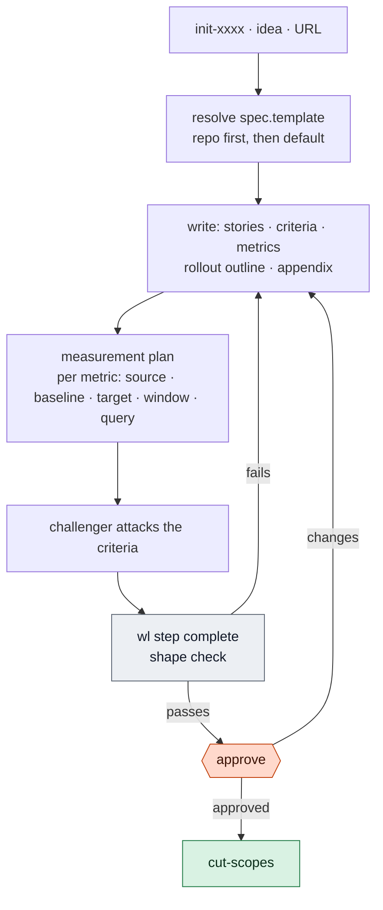

# write-spec — what we will build, how we will know it worked

> **TL;DR** — Turns a framed problem into a spec a builder can work from and a person can sign off: user stories with testable acceptance criteria, success metrics, a rough rollout outline and a **measurement plan you can actually run** — for every metric, where the number comes from, where it is today, where it should go and over what window. A challenger stress-tests the criteria first. Ends at the **approve** decision point.

> [!NOTE]
> **Status: 🚧 partial.** The core supports standalone/initiative entry, repository-first template routing, versioned spec metadata, deterministic shape/wording checks, local publication and revision-bound approval. Canonical drafting and challenger resources are available; live model critique, source queries and remote publication still need client/provider conformance. Tracked in [P2-03](../../../roadmap/phase-2-define.md#p2-03--write-spec).

Completed artifacts can join the initiative's explicit shared outbox, including a research brief adopted into that initiative. The conductor publishes through the selected host and records links only after verifying the complete exact chunk. The CLI persists requests and labelled read imports; authenticated tool execution remains a client responsibility. See [shared publication](../utilities.md#adopt-a-url-and-publish-define-artifacts).

---

## Available core commands

```text
wl step begin write-spec --for init-0123abcd --json
wl step begin write-spec --input "Find old orders" --owner Alex --impact "Reduce retrieval time" --json
wl spec schema --json
wl spec check /path/to/spec.md --json
wl step complete write-spec --for init-0123abcd --artifact /path/to/spec.md --json
wl answer decision.approve-spec=approved --for init-0123abcd --by Alex --json
```

The artifact uses YAML front matter with `schema: wholeloop/spec@1`. The public schema is `src/spec/schemas/spec-v1.json`; a complete, fictional fixture is `test/fixtures/spec/spec.md`. Each story has an ID, actor, desired behavior, benefit and uniquely identified criteria with falsifiable tests. The English wording lint currently rejects fast, quickly, intuitive, better, user-friendly, seamless, robust, scalable, easy and ASAP. It is a structural aid, not proof that the criteria are correct or complete.

Each metric pins a source provider, query operation and stored query, unit, baseline, target comparator/value and days/timezone. A known baseline needs its value and evidence. An unknown baseline needs missing evidence, an answerer and an existing `trackingStory`. Without metrics, `measurementException` requires a reason and accountable person. Rollout stages record audience, increasing exposure, exit conditions and rollback; flagged rollout also needs its proposed flag name. No query or flag change is executed by validating this plan.

The begin payload exposes `templateSource`: selected repository guidance takes priority; otherwise `templates.spec` selects a manifest (default `spec`). Custom required sections add to the core sections. The shared host workflow reads repo guidance before drafting, while completion validates both metadata and shape.

Standalone entry asks for problem, owner and expected impact before creating work. An initiative can reuse its framing impact or an explicit remembered answer. After completion, approval is pending for that revision. Rejection permits another write-spec run; approval during an unfinished draft is refused. An earlier approval never applies to a later completion. See [ADR-0023](../../decisions/0023-structured-spec-plans-and-revision-approval.md).

Local publication references the stored spec and initiative; external destinations remain pending handoffs. The broader examples below describe the target host UX.

## At a glance

| | |
| --- | --- |
| **Block** | Define |
| **Invoke** | `/wholeloop:write-spec` · `$wl-write-spec` · `/wl-write-spec` |
| **Decision point** | **approve** — nothing downstream runs on an unapproved spec |
| **Reads** | An initiative (`init-xxxx`) · or a pasted idea, document or issue URL |
| **Writes** | The spec on the initiative · its measurement plan, queries included · scope candidates · optionally a document (`docs`) |
| **Slots** | `spec.template` (your team's spec format, if any) · `flags.naming` (for the proposed flag) |
| **Capabilities** | `docs.create` / `docs.update` · `source.*` to read baselines · `source.code` to see what else the change touches |
| **Agents** | `challenger` (criteria mode) · `researcher` (baselines, when missing) |

## When to use it — and when not

**Use it when** a framed problem has earned a commitment and the team needs one definition of done — including the numbers that will prove it — agreed before anyone writes code.

**Skip it when** the change is a small, well-understood fix: [`build-slice`](../build/build-slice.md) takes free text and agrees acceptance criteria with you directly.

## How it works



1. **Your format first.** If the repository or team has a spec skill or template, the `spec.template` slot binds to it and the harness adds only what it needs on top (criteria, measurement plan). Otherwise the built-in template applies ([repo skills](../../configuration/repo-skills.md)).
2. **Metrics come with their query.** Each one names the **provider** that answers it (`posthog`, `metabase`, `sentry`…), today's value, the value we're aiming for, the time window and the stored query. [`measure-impact`](../learn/measure-impact.md) replays exactly that later — nobody has to reinvent the measurement after launch. If no provider can answer a metric yet, "add the tracking" becomes work for the first slice.
3. **The challenger reads the criteria like a tester would.** Two criteria that contradict each other; a criterion you couldn't write a failing test for; a statement about today's behaviour that the code says is false; a criteria set that would pass even if the feature did something extra and unwanted.
4. **A machine checks the shape, not a reviewer's mood.** `wl step complete` rejects a spec with a story lacking criteria, a metric lacking a provider or window, or wording no test can verify ("fast", "intuitive", "better").
5. **Technical notes live in a separate appendix** so the main spec stays readable for everyone: what else touches the same data, a suggested flag name, and the candidate scopes [`cut-scopes`](./cut-scopes.md) will start from.

## Standalone use

On its own it takes a pasted idea, a document or an issue URL. With no initiative around, it opens one and asks just the three things it can't work without — the problem, the owner and the expected impact — rather than the full framing. Give it an existing spec and it edits that one instead of writing a new one.

## Run it

```text
> /wholeloop:write-spec init-41c2

Spec — "Users struggle to find their past orders"
Template  spec.template → product-spec (repo skill)
Publish   docs → Notion (remembered for this repo)

Stories   3 · criteria 9
Metrics   time_to_find_order   posthog   baseline 48s → target 20s   window 30d
          orders_page_exit     posthog   baseline 31% → target 20%  window 30d
Appendix  also touches: orders API, export job · flag: orders_search_v1

▸ challenger: criterion 2.3 ("results load fast") is untestable → rewritten as p95 < 400 ms
▸ challenger: 1.1 and 3.2 cannot both hold for archived orders → asked you
✓ shape check passed

Decision: approve this spec?   [approve] [request changes]

Produced
  Spec               init-41c2/spec     wl open init-41c2 --spec
  Document           Notion page        (link)
Next                 /wholeloop:cut-scopes init-41c2
```

| CLI | Invoke |
| --- | --- |
| Claude Code | `/wholeloop:write-spec …` |
| Codex CLI | `$wl-write-spec …` |
| OpenCode · Copilot CLI · tier B | `/wl-write-spec …` |

Optional numeric criterion assertions allow deterministic contradictory-pair checks: name the exact subject, context, unit, operator and value. The shared lint rejects conflicting bounds before completion. Free-text consistency still needs a challenger; `wl challenge plan spec --file <file> --json` supplies fixed coverage and tone without calling a model.

## Before & after

- **Fed by:** [`frame-problem`](./frame-problem.md) (problem, impact, `TBD`s) and [`research`](./research.md) (evidence, baselines).
- **Feeds:** [`cut-scopes`](./cut-scopes.md) (scope candidates, metrics to apportion), [`slice-work`](../build/slice-work.md) (stories and criteria), [`prepare-launch`](../rollout/prepare-launch.md) and [`measure-impact`](../learn/measure-impact.md) (the measurement plan).

## Gotchas & FAQ

**"Can I leave the metrics out?"** Not silently. Without them nobody can tell later whether it worked. If something truly can't be measured, say why in the spec — that counts as an answer.

**"We already have our own spec format."** Then the `spec.template` slot picks it up, and the harness only layers its shape checks on top.

**"The challenger is too loud for me."** Turning `challenge` down makes it gentler in how it says things; it still runs the same criteria checks ([profile](../../configuration/profile.md)). A check that keeps being wrong should become a test case for it.

**"Do I have to publish the spec somewhere?"** No. The store is enough; a `docs` provider is optional.

---

<!-- docnav -->
[◀ frame-problem](frame-problem.md)  ·  [📖 Docs index](../../README.md)  ·  [🧭 Concepts](../../concepts.md)  ·  [cut-scopes ▶](cut-scopes.md)
