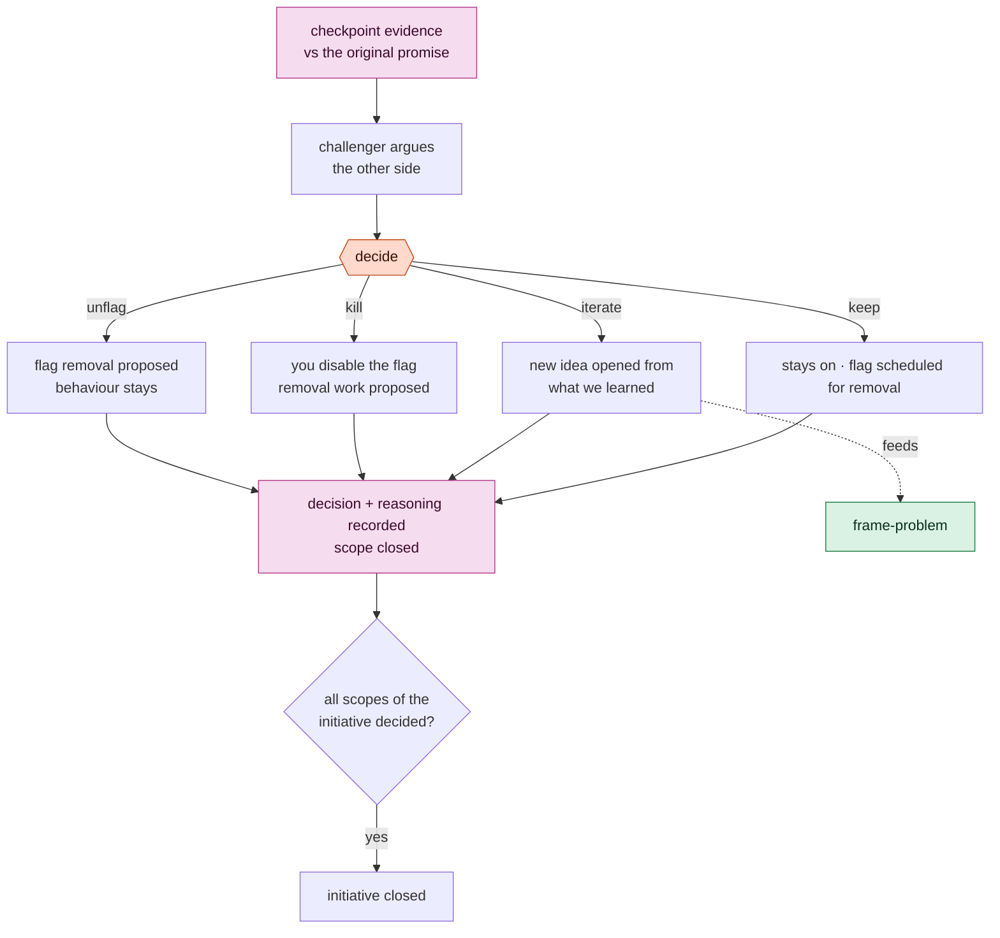
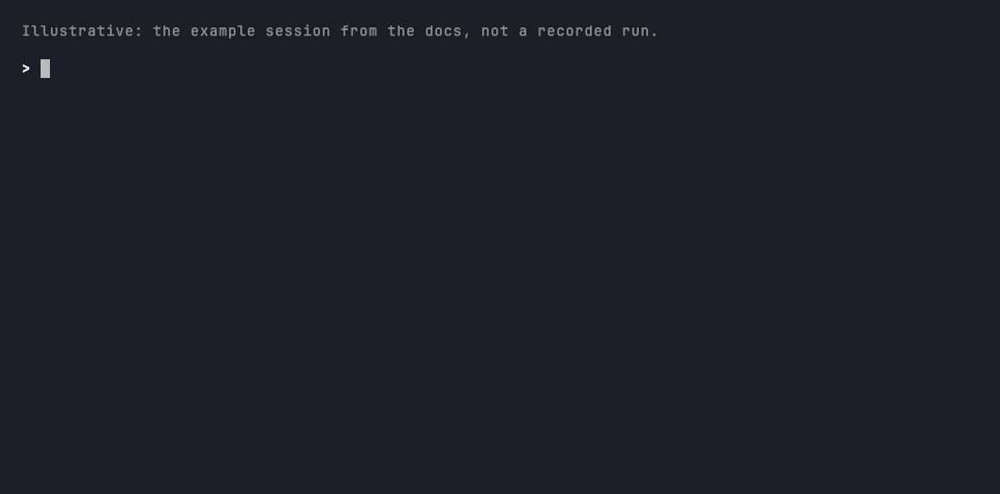

# decide-next — keep it, change it, kill it, or clean it up

> **TL;DR** — The step that closes the line. With the checkpoint evidence in front of you, you choose one of four outcomes — keep, iterate, kill or unflag — and say why. The decision is recorded, the scope closes, any clean-up is proposed as work, and whatever was learned is carried into the next idea instead of being lost in someone's notes.

Follow-up in external services is experimental.

## At a glance

| | |
| --- | --- |
| **Block** | Learn — final step |
| **Invoke** | `/wholeloop:decide-next` · `$wl-decide-next` · `/wl-decide-next` |
| **Decision point** | **decide** |
| **Reads** | The scope's checkpoint reports · its spec and original promise · open questions still pending |
| **Writes** | The decision and its reasoning on the scope · the scope closed · follow-up work (flag removal, iteration idea) · optionally published via `docs` / `tracker` |
| **Slots** | `learn.decision` (a team's own decision record format, if any) |
| **Capabilities** | `docs` · `tracker` (follow-up items) |
| **Agents** | `challenger` — argues the opposite of the option you lean towards, at the intensity your profile sets |

## When to use it — and when not

**Use it when** the last planned checkpoint is in, or the evidence is already clear enough to call it early.

**Don't use it to** look at numbers — that's [`measure-impact`](./measure-impact.md). If no checkpoint exists yet, this step offers to run one first.

## How it works



| Outcome | Means | Follow-up the step proposes |
| --- | --- | --- |
| **keep** | It worked well enough to stay as is | A task to remove the flag and dead branches |
| **iterate** | Right direction, not there yet | A new or reopened idea in [`frame-problem`](../define/frame-problem.md), seeded with the evidence |
| **kill** | It didn't earn its place | Flag off (by you), a task to remove the code, the reasoning archived |
| **unflag** | Choose permanence; propose flag removal | A task to delete the flag; behaviour unchanged |

1. **Evidence and promise, side by side.** The decision screen shows what the spec said would happen next to what did, including every metric that stayed unknown.
2. **A deliberate counter-argument.** The challenger makes the best case against your leaning. With `challenge: supportive` it's a short note; with `adversarial` it pushes hard. Either way, the decision is yours.
3. **Reasoning is required.** One or two sentences, in your words. A decision without a reason can't be revisited honestly six months later.
4. **Killing is a valid ending.** A recorded "no, and here's why" is a result, not a failure — and it stops the same idea from being re-proposed without new evidence.
5. **Closing is the point.** The scope is done when it's decided, not when it's merged. When every scope of an initiative is decided, the initiative closes too.
6. **Learning travels.** `iterate` creates an idea that already carries the evidence; the other outcomes retain their exact evidence, reason and proposals on the closed scope, discoverable through its initiative and store.

## Standalone use

Point it at a scope, or describe what shipped and what you observed. Without checkpoint evidence it asks what you know and records the decision as based on that, clearly labelled, so nobody later mistakes it for a measured outcome.

## Run it



*Illustrative: the example session below, animated. Its wording depends on your client and model.*

The same session as text:

```text
> /wholeloop:decide-next scope-a9e0

Decide — scope-a9e0 "Find an order"
Promised   time to find ≤ 25 s · orders-page exits ≤ 20%
Observed   18 s (met) · 27% (partly) · support tickets unknown
Your lean  keep

▸ challenger: "exits are still 7 points above target; iterate on the
  empty-result page before removing the flag?"

Decision: [keep] [iterate] [kill] [unflag]   > iterate
Reason    > Search works; exits stay high when nothing matches.
Unknowns  > acknowledge: support_tickets

Recorded
  scope-a9e0       closed · iterate · by Ana López
  New idea         init-58d0 "Improve empty search results"   evidence linked
Next               /wholeloop:frame-problem init-58d0
```

| Client | Invoke |
| --- | --- |
| Claude Code, installed skills | `/wl-decide-next …` |
| Claude Code, generated plugin | `/wholeloop:decide-next …` |
| Codex CLI | `$wl-decide-next …` |
| OpenCode · Copilot · Gemini · Cursor | Ask for `wl-decide-next` |
| Antigravity | Ask for `wl-agy-decide-next` |

## Before & after

- **Fed by:** [`measure-impact`](./measure-impact.md) checkpoints.
- **Feeds:** [`frame-problem`](../define/frame-problem.md) on `iterate`; the tracker with clean-up work; future [`research`](../define/research.md) through the recorded learnings.

## Gotchas & FAQ

**"Can I decide before D+30?"** Yes. The report shows which checkpoints were skipped, and the decision records that it was made early.

**"Who should make the call?"** The owner named at [`frame-problem`](../define/frame-problem.md). The step shows who that is and records who actually decided.

**"Will it remove the flag for me?"** It records a local cleanup proposal; publishing a tracker item or agreeing a Build slice is explicit future work. Removing the flag in code goes through [`build-slice`](../build/build-slice.md) like any other change.

## Core commands

The commands behind the skill, for scripts and skill authors:

```bash
wl learn begin --for scope-a9e0 --leaning keep --json
wl learn report --for scope-a9e0 --json
# A challenger reads the actual plan, report and repository guidance.
wl learn challenge --for scope-a9e0 --file counterargument.json --json
wl learn decide iterate --for scope-a9e0 --basis <challenge-event> --by Alex --reason "The evidence supports refining the date selection" --ack '["checkpoint:d30"]' --iteration idea.json --json
wl learn report --for scope-a9e0 --json
```

`wl learn schema` prints every input contract.

**The counterargument** (`wholeloop/learning-challenge@1`) names its basis (the exact plan event), what it argues against, an alternative that differs from your leaning, the argument, its limits and who made it. Your profile changes its tone and how many extra questions it asks; the four areas it covers stay fixed. A changed report, guidance or profile needs a new `begin` and a new counterargument.

**The decision** needs:

- a written reason;
- `--ack` listing every unknown and pending checkpoint the report returned, including later checkpoints when you decide early;
- a current challenge. A missing reason, an absent challenge or a stale basis cannot close work.

Measured evidence can never be replaced by a self-report. Used on its own, `--reported` supplies a summary, the promise, references, who reported it and optionally the flag; it is labelled self-reported and creates no numbers.

**Iterate** takes a title, problem, audience and impact. The core creates an open initiative with a full framing draft, a link to the evidence and questions, each with an owner, about validation, cost and stop conditions. `frame-problem` starts and stays unfinished until someone completes it. `existing` can reuse a closed idea from the same repository that never reached a specification; reopening a developed initiative, or the current parent, is refused so its old scope approvals stay valid.

**Keep, unflag and kill** produce proposals, never changes:

- keep and unflag propose removing the flag; unflag needs a confirmed flag identity;
- kill proposes that a person disables it and cleans up the code.

Nothing is applied and no tracker task is published: the decision has no provider or write access. Follow-up work goes through Build as usual.

**Closing.** Completion closes the scope, then the initiative, but only when every scope has a completed learning decision; a sibling closed by hand does not count. Both closures are recorded together. If a run is interrupted after the decision was stored, `wl learn complete --for <id> --json` finishes it without duplicating the decision or the iteration. A reopened scope must be decided again, and a closed parent must be reopened before you add another scope.

<!-- docnav -->
[◀ measure-impact](measure-impact.md)  ·  [📖 Docs index](../../README.md)  ·  [🧭 Concepts](../../concepts.md)  ·  [Utilities ▶](../utilities.md)
