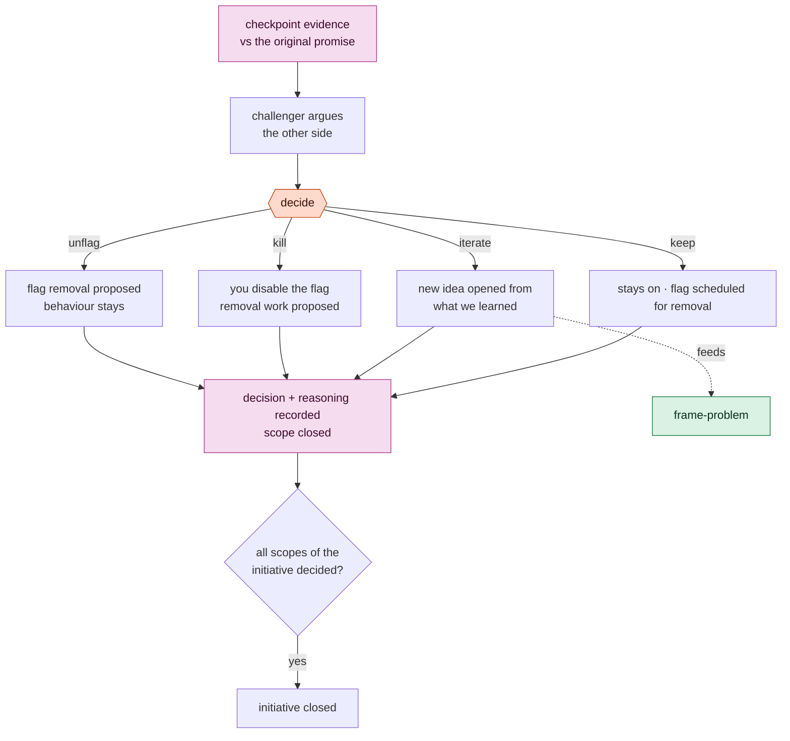

# decide-next — keep it, change it, kill it, or clean it up

> **TL;DR** — The step that closes the line. With the checkpoint evidence in front of you, you choose one of four outcomes — keep, iterate, kill or unflag — and say why. The decision is recorded, the scope closes, any clean-up is proposed as work, and whatever was learned is carried into the next idea instead of being lost in someone's notes.

> [!NOTE]
> **Status: ✅ implemented.** Evidence-pinned counterarguments, explicit outcomes, linked framing drafts, cleanup proposals and guarded closure are tested. Follow-up in external services is experimental.

---

## At a glance

| | |
| --- | --- |
| **Block** | Learn — final step |
| **Invoke** | `/wholeloop:decide-next` · `$wl-decide-next` · `/wl-decide-next` |
| **Decision point** | **decide** |
| **Reads** | The scope's checkpoint reports · its spec and original promise · open questions still pending |
| **Writes** | The decision and its reasoning on the scope · the scope closed · follow-up work (flag removal, iteration idea) · optionally published via `docs` / `tracker` |
| **Slots** | `learn.decision` (a team's own decision record format, if any) |
| **Capabilities** | `docs` · `tracker` (follow-up items) |
| **Agents** | `challenger` — argues the opposite of the option you lean towards, at the intensity your profile sets |

## When to use it — and when not

**Use it when** the last planned checkpoint is in, or the evidence is already clear enough to call it early.

**Don't use it to** look at numbers — that's [`measure-impact`](./measure-impact.md). If no checkpoint exists yet, this step offers to run one first.

## How it works



| Outcome | Means | Follow-up the step proposes |
| --- | --- | --- |
| **keep** | It worked well enough to stay as is | A task to remove the flag and dead branches |
| **iterate** | Right direction, not there yet | A new or reopened idea in [`frame-problem`](../define/frame-problem.md), seeded with the evidence |
| **kill** | It didn't earn its place | Flag off (by you), a task to remove the code, the reasoning archived |
| **unflag** | Choose permanence; propose flag removal | A task to delete the flag; behaviour unchanged |

1. **Evidence and promise, side by side.** The decision screen shows what the spec said would happen next to what did, including every metric that stayed unknown.
2. **A deliberate counter-argument.** The challenger makes the best case against your leaning. With `challenge: supportive` it's a short note; with `adversarial` it pushes hard. Either way, the decision is yours.
3. **Reasoning is required.** One or two sentences, in your words. A decision without a reason can't be revisited honestly six months later.
4. **Killing is a valid ending.** A recorded "no, and here's why" is a result, not a failure — and it stops the same idea from being re-proposed without new evidence.
5. **Closing is the point.** The scope is done when it's decided, not when it's merged. When every scope of an initiative is decided, the initiative closes too.
6. **Learning travels.** `iterate` creates an idea that already carries the evidence; the other outcomes retain their exact evidence, reason and proposals on the closed scope, discoverable through its initiative and store.

## Standalone use

Point it at a scope, or describe what shipped and what you observed. Without checkpoint evidence it asks what you know and records the decision as based on that — clearly labelled, so nobody later mistakes it for a measured outcome.

## Run it

```bash
wl learn begin --for scope-a9e0 --leaning keep --json
wl learn report --for scope-a9e0 --json
# A challenger reads the actual plan, report and repository guidance.
wl learn challenge --for scope-a9e0 --file counterargument.json --json
wl learn decide iterate --for scope-a9e0 --basis <challenge-event> --by Alex --reason "The evidence supports refining the date selection" --ack '["checkpoint:d30"]' --iteration idea.json --json
wl learn report --for scope-a9e0 --json
```

`wl learn schema` exposes the counterargument, self-report and iteration fields. Counterarguments use wholeloop/learning-challenge@1 with basis (the exact plan event), against, alternative, argument, limits and by. The alternative must differ from the leaning. Profile tone and additional question budget change; the four coverage areas stay fixed. Actual learn.decision instructions are loaded and pinned. A changed report/guidance/profile needs a new begin and counterargument.

The person must supply a written reason and --ack containing every returned unknown/pending-checkpoint key, including an early decision before later checkpoints. A missing reason, absent challenge or stale basis cannot close work. Measured evidence cannot be replaced by an invocation's self-report. Standalone --reported supplies summary/promise/refs/by and optional flag, clearly labelled self-reported; it never creates numerical observations.

Iteration input supplies title/problem/audience/impact. The core creates an open initiative with a full framing draft, evidence link and owner-labelled questions for validation, cost/priority and stop conditions. frame-problem starts and remains incomplete. Optional existing selects a closed pre-spec idea in the same repository; reopening a developed initiative or the current parent is rejected to preserve old scope approvals. No prior validation, spec or future Build is invented.

Keep/unflag propose flag-removal work; kill proposes human disablement/code cleanup. Unflag needs a confirmed flag identity. These are unapplied proposals, not actual flag/code changes or automatically published tracker tasks. The decision workflow has no provider or mutation host. Explicit future work goes through normal Build.

Canonical completion closes the scope, then its initiative only if every scope has a completed learning decision. A manually closed sibling does not count. Reopened scopes lose eligibility; reopen a closed parent before creating another scope. The scope/parent closure shares one atomic journal batch. If a decision is stored before interruption, `wl learn complete --for <id> --json` recovers completion without duplicating the decision or iteration. Projections and resume refs retain all evidence and proposals. [ADR-0041](../../decisions/0041-challenged-learning-decisions-and-scope-closure.md) records the human, iteration and closure boundaries.

| CLI | Invoke |
| --- | --- |
| Claude Code | `/wholeloop:decide-next …` |
| Codex CLI | `$wl-decide-next …` |
| OpenCode | `/wl-decide-next …` |
| Copilot CLI | `/wl-decide-next …` |
| Gemini CLI · Antigravity · Cursor | `/wl-decide-next …` |

## Before & after

- **Fed by:** [`measure-impact`](./measure-impact.md) checkpoints.
- **Feeds:** [`frame-problem`](../define/frame-problem.md) on `iterate`; the tracker with clean-up work; future [`research`](../define/research.md) through the recorded learnings.

## Gotchas & FAQ

**"Can I decide before D+30?"** Yes. The report shows which checkpoints were skipped, and the decision records that it was made early.

**"Who should make the call?"** The owner named at [`frame-problem`](../define/frame-problem.md). The step shows who that is and records who actually decided.

**"Will it remove the flag for me?"** It records a local cleanup proposal; publishing a tracker item or agreeing a Build slice is explicit future work. Removing the flag in code goes through [`build-slice`](../build/build-slice.md) like any other change.

---

<!-- docnav -->
[◀ measure-impact](measure-impact.md)  ·  [📖 Docs index](../../README.md)  ·  [🧭 Concepts](../../concepts.md)  ·  [Utilities ▶](../utilities.md)
