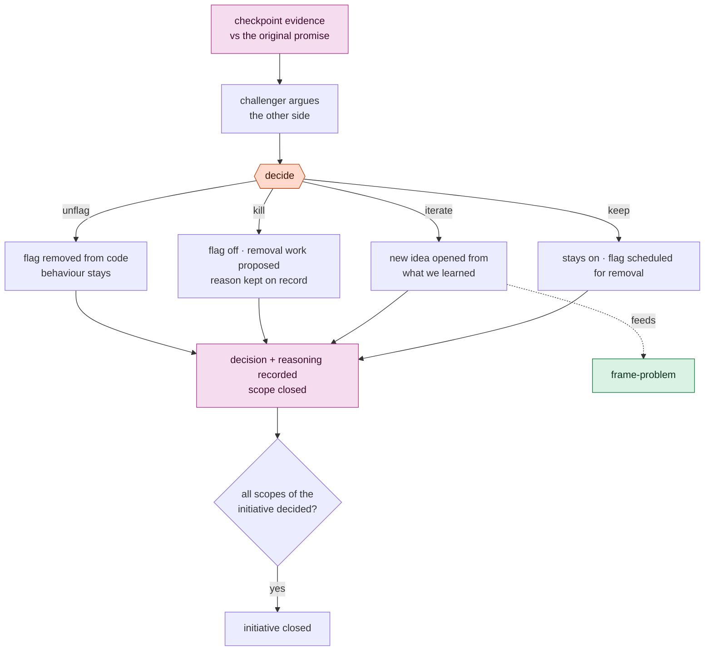

# decide-next — keep it, change it, kill it, or clean it up

> **TL;DR** — The step that closes the line. With the checkpoint evidence in front of you, you choose one of four outcomes — keep, iterate, kill or unflag — and say why. The decision is recorded, the scope closes, any clean-up is proposed as work, and whatever was learned is carried into the next idea instead of being lost in someone's notes.

> [!NOTE]
> **Status: 📐 design.** Tracked in [P4-04](../../../roadmap/phase-4-rollout-learn.md#p4-04--decide-next).

---

## At a glance

| | |
|---|---|
| **Block** | Learn — final step |
| **Invoke** | `/throughline:decide-next` · `$tl-decide-next` · `/tl-decide-next` |
| **Decision point** | **decide** |
| **Reads** | The scope's checkpoint reports · its spec and original promise · open questions still pending |
| **Writes** | The decision and its reasoning on the scope · the scope closed · follow-up work (flag removal, iteration idea) · optionally published via `docs` / `tracker` |
| **Slots** | `learn.decision` (a team's own decision record format, if any) |
| **Capabilities** | `docs` · `tracker` (follow-up items) |
| **Agents** | `challenger` — argues the opposite of the option you lean towards, at the intensity your profile sets |

## When to use it — and when not

**Use it when** the last planned checkpoint is in, or the evidence is already clear enough to call it early.

**Don't use it to** look at numbers — that's [`measure-impact`](./measure-impact.md). If no checkpoint exists yet, this step offers to run one first.

## How it works



| Outcome | Means | Follow-up the step proposes |
|---|---|---|
| **keep** | It worked well enough to stay as is | A task to remove the flag and dead branches |
| **iterate** | Right direction, not there yet | A new or reopened idea in [`frame-problem`](../define/frame-problem.md), seeded with the evidence |
| **kill** | It didn't earn its place | Flag off (by you), a task to remove the code, the reasoning archived |
| **unflag** | Done and permanent | A task to delete the flag; behaviour unchanged |

1. **Evidence and promise, side by side.** The decision screen shows what the spec said would happen next to what did, including every metric that stayed unknown.
2. **A deliberate counter-argument.** The challenger makes the best case against your leaning. With `challenge: supportive` it's a short note; with `adversarial` it pushes hard. Either way, the decision is yours.
3. **Reasoning is required.** One or two sentences, in your words. A decision without a reason can't be revisited honestly six months later.
4. **Killing is a valid ending.** A recorded "no, and here's why" is a result, not a failure — and it stops the same idea from being re-proposed without new evidence.
5. **Closing is the point.** The scope is done when it's decided, not when it's merged. When every scope of an initiative is decided, the initiative closes too.
6. **Learning travels.** `iterate` creates an idea that already carries the evidence; the other outcomes still add their lessons to the initiative, where future `research` can find them.

## Standalone use

Point it at a scope, or describe what shipped and what you observed. Without checkpoint evidence it asks what you know and records the decision as based on that — clearly labelled, so nobody later mistakes it for a measured outcome.

## Run it

```text
> /throughline:decide-next scope-a9e0

Decide — scope-a9e0 "orders date filter"
Promise   ≥ 15% of visits use it · time to find ≤ 25 s · fewer "can't find order" tickets
Result    18.4% ✓ · 29 s ~ · tickets ? (no source)

Challenger  "Keep is tempting, but the main promise was speed and it missed by 4 s.
             Iterating on presets ('last month') could close the gap cheaply."

Outcome?   [ Keep ]  [ Iterate ]  [ Kill ]  [ Unflag ]
> Iterate — usage is there; presets should get us under 25 s

Recorded  iterate · "usage is there; presets should get us under 25 s"
Produced
  Decision            scope-a9e0 (closed)                 tl open scope-a9e0 --decision
  New idea            init-9b70 "date presets for orders" tl open init-9b70
  Follow-up           ENG-517 remove flag after presets ship
Next              frame-problem init-9b70 — or stop here
```

| CLI | Invoke |
|---|---|
| Claude Code | `/throughline:decide-next …` |
| Codex CLI | `$tl-decide-next …` |
| OpenCode | `/tl-decide-next …` |
| Copilot CLI | `/tl-decide-next …` |
| Gemini CLI · Antigravity · Cursor | `/tl-decide-next …` |

## Before & after

- **Fed by:** [`measure-impact`](./measure-impact.md) checkpoints.
- **Feeds:** [`frame-problem`](../define/frame-problem.md) on `iterate`; the tracker with clean-up work; future [`research`](../define/research.md) through the recorded learnings.

## Gotchas & FAQ

**"Can I decide before D+30?"** Yes. The report shows which checkpoints were skipped, and the decision records that it was made early.

**"Who should make the call?"** The owner named at [`frame-problem`](../define/frame-problem.md). The step shows who that is and records who actually decided.

**"Will it remove the flag for me?"** It proposes the work as a tracker item or an ad-hoc slice. Removing the flag in code goes through [`build-slice`](../build/build-slice.md) like any other change.

---

<!-- docnav -->
[◀ measure-impact](measure-impact.md)  ·  [📖 Docs index](../../README.md)  ·  [🧭 Concepts](../../concepts.md)  ·  [Utilities ▶](../utilities.md)
