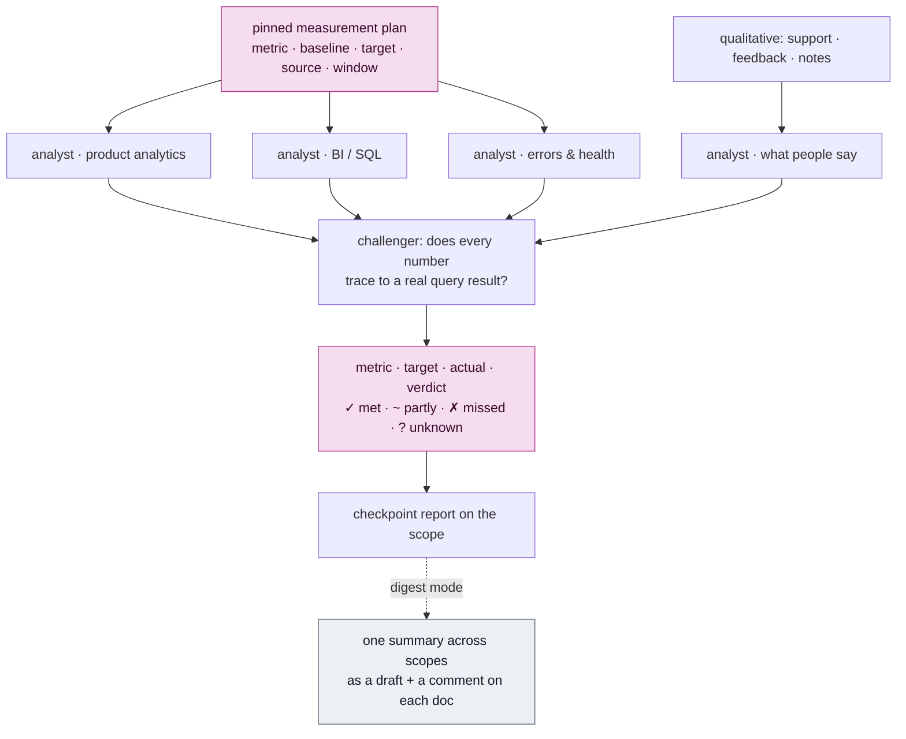

# measure-impact — put the real numbers next to the promise

> **TL;DR** — At each checkpoint — launch, day 7, day 30 by default — it runs the measurement plan the spec pinned, against the sources that plan names, and lays every result beside its target with a verdict. It adds what people are saying, and it never fills a gap with a guess: a number it couldn't read is reported as missing. The outcome is the evidence `decide-next` needs.

> [!NOTE]
> **Status: 📐 design.** Tracked in [P4-03](../../../roadmap/phase-4-rollout-learn.md#p4-03--measure-impact-and-the-analyst).

---

## At a glance

| | |
| --- | --- |
| **Block** | Learn — first step |
| **Invoke** | `/wholeloop:measure-impact` · `$wl-measure-impact` · `/wl-measure-impact` |
| **Decision point** | None — it measures; [`decide-next`](./decide-next.md) decides |
| **Reads** | The scope's pinned measurement plan (metric · baseline · target · source · window) · qualitative sources |
| **Writes** | A checkpoint report on the scope · optionally published via `docs` and commented on the tracker item |
| **Slots** | `learn.report` (the team's own impact-review format, if any) |
| **Capabilities** | any `source.*` named by the plan · `docs` · `tracker` · `comms.draft` (digest) |
| **Agents** | `analyst` (one per source) · `challenger` (checks the numbers trace back to real data) |

## When to use it — and when not

**Use it when** a checkpoint is due on something that shipped — or whenever you want an honest read of whether a change did what it was meant to do.

**Don't use it to** decide. It reports evidence with verdicts per metric; the call on what to do next is yours, in [`decide-next`](./decide-next.md).

## How it works



1. **The plan is pinned, not reinvented.** The query, source and window written at spec time are reused as-is, so day 30 measures the same thing day 0 promised. Changing a definition is allowed, but recorded, with both values shown.
2. **Checkpoints are configurable.** Launch, D+7 and D+30 by default; a team can set its own (`learn.checkpoints`), and a scope can add one ("pilot exit").
3. **Every number has a receipt.** Each value links to the query or dashboard it came from. The challenger checks that nothing in the report lacks one.
4. **Gaps stay gaps.** An unreachable source, a missing event, an empty window → **unknown**, with what is missing and who could fix it. Never an estimate dressed as a measurement.
5. **Numbers and voices.** Support tickets, feedback and notes go in a separate section, so anecdotes inform the decision without being mistaken for metrics.
6. **Digest mode.** `--digest` summarises every scope currently in Learn, as a comms **draft** for a person to post and a comment on each scope's document or tracker item.

## Standalone use

Give it a metric and a time range ("export success rate since 1 September, in Metabase") or a scope ID. Without a pinned plan it asks for the target and the source before reading anything — a verdict needs something to compare against.

## Run it

```text
> /wholeloop:measure-impact scope-a9e0 --checkpoint D+30

Measure — scope-a9e0 "orders date filter" · D+30
Plan      pinned at write-spec · 3 metrics · 1 guardrail

Metric                          Baseline   Target    Actual    Verdict
  Visits using the filter        —          ≥ 15%     18.4%     ✓ met
  Time to find an order (p50)    41 s       ≤ 25 s    29 s      ~ partly
  Support tickets "find order"   22/mo      ≤ 10/mo   ?         ? unknown — support source not connected
Guardrail
  p95 /orders latency            380 ms     ≤ +10%    +6%       ✓ held

What people say  3 notes from the sales team: date presets requested ("last month")
Receipts         each value links to its PostHog insight / Datadog query

Produced
  Checkpoint report   scope-a9e0 · D+30        wl open scope-a9e0 --report D+30
  Published           Notion · Orders date filter / Impact
Next              decide-next scope-a9e0
```

| CLI | Invoke | Parallel analysts |
| --- | --- | --- |
| Claude Code | `/wholeloop:measure-impact …` | native subagents |
| Codex CLI | `$wl-measure-impact …` | native subagents |
| OpenCode | `/wl-measure-impact …` | native subagents |
| Copilot CLI | `/wl-measure-impact …` | native subagents (`/fleet`) |
| Gemini CLI · Antigravity · Cursor | `/wl-measure-impact …` | native where available, otherwise headless or one by one |

## Before & after

- **Fed by:** the measurement plan from [`write-spec`](../define/write-spec.md), the dashboards from [`prepare-launch`](../rollout/prepare-launch.md), and the final stage of [`ramp-exposure`](../rollout/ramp-exposure.md).
- **Feeds:** [`decide-next`](./decide-next.md).

## Gotchas & FAQ

**"It says unknown for a metric I know is fine."** Then the source behind it isn't reachable from here. Connect the provider (`wl mcp add …`) and re-run; the checkpoint updates in place.

**"Can I compare against a different baseline?"** Yes, with `--baseline`, and both values stay in the report so the change is visible.

**"Nobody remembers to run D+30."** [`status`](../utilities.md#status) lists every checkpoint that is due, and `next` brings you here when one is.

---

<!-- docnav -->
[◀ ramp-exposure](../rollout/ramp-exposure.md)  ·  [📖 Docs index](../../README.md)  ·  [🧭 Concepts](../../concepts.md)  ·  [decide-next ▶](decide-next.md)
